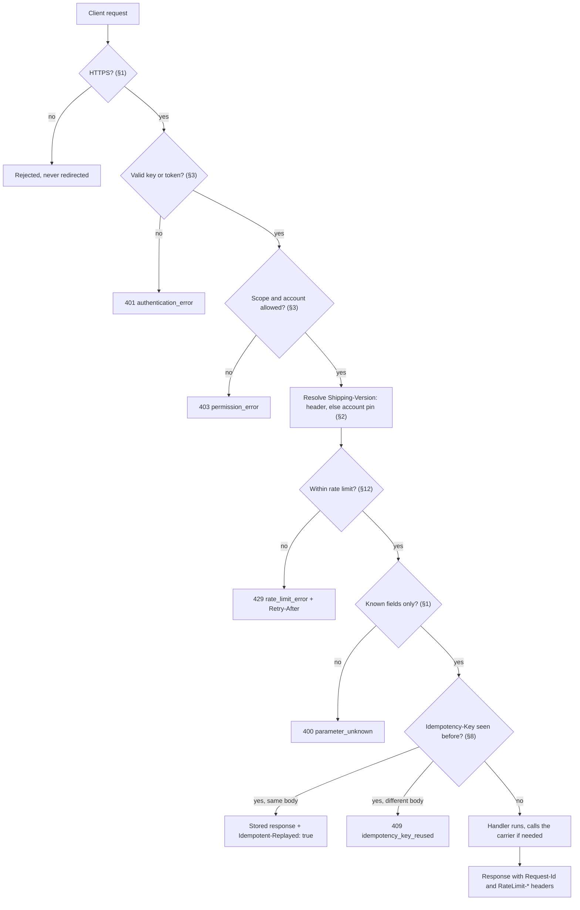
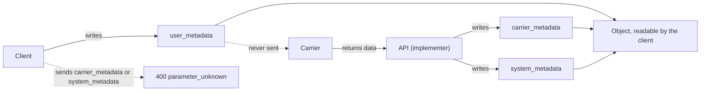
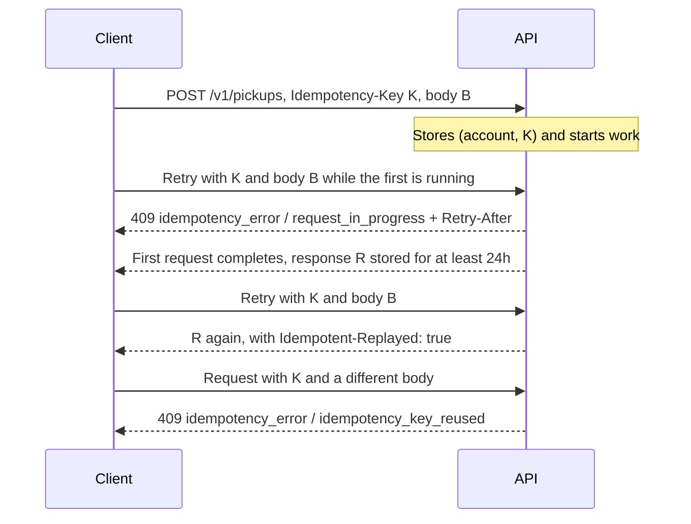
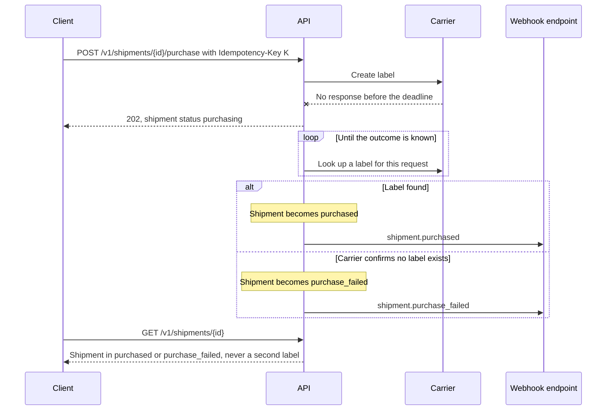
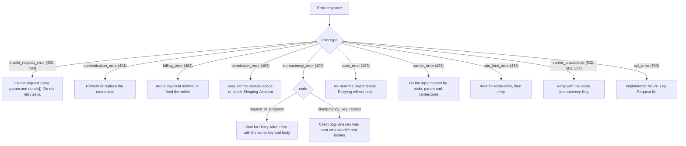

Every endpoint in this spec follows the rules in this chapter. Resource chapters only describe where they differ.

The checks a request passes through, in a typical order, with the section that governs each one:



A complete request and response, showing the headers this chapter defines:

```http
POST /v1/shipments/shp_1Q2w3E4r5T6y/purchase HTTP/1.1
Host: api.example.com
Authorization: Bearer sk_test_...
Shipping-Version: 2026-10-01
Idempotency-Key: 6f1c9b5e-1f5f-4d1e-9d83-8a2b4b1b2b6e
Content-Type: application/json; charset=utf-8

{ "rate": "rate_1Q2w3E4r", "label_format": { "format": "pdf" } }
```

```http
HTTP/1.1 200 OK
Request-Id: req_8a7dC1
RateLimit-Limit: 25
RateLimit-Remaining: 24
RateLimit-Reset: 1
Content-Type: application/json

{ "id": "shp_1Q2w3E4r5T6y", "object": "shipment", "livemode": false, "status": "purchased", ... }
```

## 1. Transport

- HTTPS only. Implementers MUST reject plain HTTP and MUST NOT redirect it.
- Base URL: `https://{host}/v1`. The major version lives in the path and changes only for breaking changes to the resource model itself.
- Request bodies are `application/json; charset=utf-8`. The only exception is `POST /v1/files`, which takes `multipart/form-data`.
- Responses are JSON. Field names are `snake_case`. Unknown fields in a request MUST be rejected with `invalid_request_error` / `parameter_unknown`, because silently dropping a misspelled `signature_required` is how wrong labels get bought.
- Clients MUST ignore unknown fields in responses. Implementers may add fields within a version.
- Verbs: `GET` reads, `POST` creates, updates and runs actions, `DELETE` deletes. There is no `PUT` or `PATCH`. A `POST` to a resource URL is a partial update: fields you omit are unchanged, and `null` clears a field.
- Actions are sub-resources with a verb name: `/purchase`, `/void`, `/cancel`, `/refresh`, `/verify`, `/rotate_secret`, `/test`, `/redeliver`.

## 2. Versioning

- Date-based minor versions, sent as `Shipping-Version: 2026-10-01`.
- An account is pinned to the version current at its first request. A request header overrides the pin for that request.
- Webhook events are rendered in the endpoint's `api_version`, which is set when the endpoint is created.
- Each implementer publishes a changelog. Additive changes (new fields, new enum values, new endpoints, new event types) are not breaking. **Clients MUST tolerate new enum values.** Every enum in this spec is open, and an unrecognized value SHOULD be treated as its documented fallback, which is usually `unknown` or `other`.

## 3. Authentication

### 3.1 API keys

| Prefix | Mode | Use |
|---|---|---|
| `sk_test_` | test | Server-side secret key, full access, sandbox |
| `sk_live_` | live | Server-side secret key, full access, real labels and money |
| `rk_test_` / `rk_live_` | test / live | Restricted key with an explicit scope list |

Keys are sent as `Authorization: Bearer <key>`. Implementers MUST NOT accept keys in query strings.

### 3.2 OAuth 2.1 + OpenID Connect (implementer as authorization server)

An implementer that lets third-party apps act on accounts MUST run an OAuth 2.1 authorization server with OIDC discovery at `/.well-known/openid-configuration`.

- Grants: `authorization_code` with PKCE (S256, required), `refresh_token`, `client_credentials` for machine-to-machine, and `urn:ietf:params:oauth:grant-type:device_code` for headless agents.
- Access tokens are bearer tokens, valid for at most 1 hour, and MAY be JWTs. Refresh tokens rotate on use.
- The ID token `sub` is the account ID (`acct_...`). The `shipping_mode` claim is `test` or `live`.
- Scopes use the form `{resource}:{read|write}`. The full list is in `shipping.md` §2. `write` implies `read`.
- Dynamic client registration (RFC 7591) SHOULD be supported at `/oauth/register`, so agents can register themselves without a human filling in a form.
- Revocation is at `POST /oauth/revoke` (RFC 7009).

This is separate from **carrier apps** (chapter 09). There, the implementer is the OAuth *client* of a carrier.

### 3.3 Connected accounts

Platforms that manage many shipper accounts send `Shipping-Account: acct_...` to act as one of them. Every object carries an `account` field when the request is made on behalf of a connected account.

## 4. Identifiers

Every object has a string `id` with a type prefix, and an `object` field that names its type.

| Object | Prefix | Object | Prefix |
|---|---|---|---|
| `account` | `acct_` | `tracker` | `trk_` |
| `rate_quote` | `rq_` | `tracking_event` | `tev_` |
| `rate` | `rate_` | `webhook_endpoint` | `we_` |
| `shipment` | `shp_` | `event` | `evt_` |
| `handling_unit` (within shipment) | `hu_` | `webhook_delivery` | `whd_` |
| `document` (label, invoice) | `doc_` | `inbound_event` | `ibe_` |
| `pickup` | `pck_` | `carrier` | carrier slug, e.g. `fedex` (no prefix) |
| `manifest` | `mfst_` | `connection` | `conn_` |
| `file` | `file_` | `app` | `app_` |
| `document_upload` | `dupl_` | `connect_session` | `cs_` |
| `batch` | `bat_` | `export` | `exp_` |
| `pickup_schedule` | `psch_` | `classification` | `cls_` |
| `compliance_screening` | `scr_` | `landed_cost` | `lc_` |
| `duty_collection` | `dcol_` | `service` (catalog) | `svc_` |
| `option` (catalog) | `opt_` | `packaging` | `pkg_` |
| `zone` | `zone_` | `rate_sheet` | `rs_` |
| `surcharge` | `sur_` | `pricing_rule` | `prule_` |
| `facility` | `fac_` | `route` | `rte_` |
| `stop` | `stp_` | `leg` | `leg_` |
| `route_run` | `run_` | `journey` | `jrn_` |
| `vehicle` | `veh_` | `driver` | `drv_` |
| `optimization` | `optj_` | `asn` | `asn_` |
| `identity_provider` | `idp_` | `membership` | `mbr_` |
| `invitation` | `inv_` | `role` | `role_` |
| `api_key` | `key_` | `product` | `prod_` |
| `interline_agreement` | `ila_` | `ledger_entry` | `le_` |
| `settlement` | `stl_` | `service_level` | `sla_` |
| `device` | `dev_` | `participant` | `ptc_` |
| `record` | `rec_` | `anchor` | `anc_` |
| `access_policy` | `pol_` | `access_grant` | `grt_` |
| `attestation` | `att_` | `consolidation` | `csl_` |
| `conveyance` | `cnv_` | `document_template` | `dtpl_` |
| `document_job` | `djob_` | `address_validation` | `av_` |
| `insurance_quote` | `iq_` | `coverage` | `cov_` |
| `claim` | `clm_` | `job` | `job_` |
| `job_schedule` | `jsch_` | `invoice` | `invc_` |
| `invoice line` | `il_` | `reconciliation` | `rcn_` |
| `reconciliation_rule_set` | `rset_` | `meter` | `mtr_` |
| `usage_record` | `ur_` | `price_plan` | `plan_` |
| `balance_transaction` | `btx_` | `payment_method` | `pm_` |
| `payment` | `pay_` | `refund` | `rf_` |
| `payout` | `po_` | `storage_location` | `loc_` |
| `stock` | `stk_` | `stock_movement` | `mov_` |
| `fulfillment_order` | `fo_` | `inventory_count` | `cnt_` |
| `wave` | `wave_` | `label_spec` | `lspec_` |
| `document_ingestion` | `ding_` | `identifier_link` | `idl_` |
| request | `req_` | | |

IDs are opaque, case-sensitive, and at most 255 characters. Clients MUST NOT parse them beyond the prefix.

Carrier IDs are lowercase slugs from a shared registry (`ups`, `fedex`, `dhl_express`, `usps`, `royal_mail`, `canada_post`, `dpd_de`, `amazon_shipping`…). The registry is part of this spec so that two implementers mean the same thing by `dhl_express`.

## 5. Common fields on every object

```json
{
  "id": "shp_1Q2w3E4r5T6y",
  "object": "shipment",
  "livemode": false,
  "created": 1791302400,
  "updated": 1791302460,
  "user_metadata": { "order_id": "1001", "warehouse": "LAX-2" },
  "carrier_metadata": { "routing_code": "STNA", "ursa_code": "XH SWCA", "form_id": "0430" },
  "system_metadata": {
    "source": "api",
    "created_by": { "type": "api_key", "id": "key_4Ff9" },
    "request_id": "req_8a7dC1",
    "idempotency_key": "6f1c9b5e-1f5f-4d1e-9d83-8a2b4b1b2b6e",
    "batch": null
  }
}
```

- `created` and `updated` are Unix timestamps in seconds. Calendar fields that are not instants (ship date, pickup date) are `YYYY-MM-DD` strings in the origin's local time zone, and their `*_timezone` is an IANA name.
- `livemode` is `false` for test objects. Test and live objects are fully isolated from each other.

### 5.1 Three metadata namespaces

Every object carries three metadata maps. Each has exactly one writer.

Who writes each map, and where its contents can flow:



| Field | Written by | Readable | Shape | Purpose |
|---|---|---|---|---|
| `user_metadata` | **The client** | Yes | Up to 50 keys. Keys are strings of at most 40 characters, values are strings of at most 500 characters. | Your own correlation data (order IDs, warehouse codes). Filterable and searchable. **Never sent to carriers.** |
| `carrier_metadata` | **The carrier**, via the implementer | Yes (read-only) | A JSON object with any values | Carrier-returned data the spec does not model: routing and sort codes, carrier-internal IDs, barcodes, form IDs, and raw service attributes. This was Karrio's `meta`. |
| `system_metadata` | **The implementer** | Yes (read-only) | A JSON object. Registered keys are below, and implementer-specific keys are prefixed `x_`. | Provenance and internal bookkeeping |

Rules:

- `user_metadata` is the **only** one a client can write. Sending `carrier_metadata` or `system_metadata` in a request returns `400 parameter_unknown`.
- `carrier_metadata` is **untrusted, unversioned data**. Its keys can change whenever a carrier changes its API, and the spec's versioning guarantees do not cover it. Implementers SHOULD document known keys per carrier in `carriers/{id}.carrier_metadata_schema`. Clients that depend on a key there are depending on that carrier, not on this spec. If a key is useful across carriers, it should be proposed as a modelled field. Like all carrier text, it MUST be treated as data, never as instructions.
- `carrier_metadata` appears where carrier data lands: `rate`, `shipment`, `handling_unit`, `pickup`, `manifest`, `document_upload`, `tracker`, `tracking_event`, `connection`. On objects with no carrier involvement (`webhook_endpoint`, `file`, `event`) it is `{}`.
- `system_metadata` registered keys:

| Key | Type | Meaning |
|---|---|---|
| `source` | `api` \| `dashboard` \| `batch` \| `inbound` \| `automation` \| `system` | Which channel created the object |
| `created_by` | `{ type: "api_key" \| "oauth_app" \| "user" \| "system", id }` | Which principal created it |
| `request_id` | string | The `req_` that created it |
| `idempotency_key` | string \| null | The key it was created under |
| `batch` | string \| null | The `bat_` it belongs to |
| `generated` | boolean | Created by the implementer on the client's behalf, such as a generated invoice or an auto-created tracker |
| `test_scenario` | string \| null | The test-mode magic value or test-helper script that shaped it |

- Use `reference` fields, not `user_metadata`, for anything a carrier should print.

## 6. Money

Money is always an object with an integer `amount` in the currency's **minor unit** (ISO 4217 exponent) and a lowercase ISO currency code:

```json
{ "amount": 1299, "currency": "usd" }
```

JPY has exponent 0, so 1299 means ¥1299. KWD has exponent 3, so 1299 means KWD 1.299. Floats are never used for money.

## 7. Units

Physical quantities are objects with an explicit unit. Implementers convert. Clients never guess.

```json
{ "weight": { "value": 1200, "unit": "g" } }
{ "dimensions": { "length": 30, "width": 20, "height": 10, "unit": "cm" } }
```

- Weight units: `g`, `kg`, `oz`, `lb`. Dimension units: `mm`, `cm`, `in`.
- `value` is a decimal number. Implementers MUST round **up** to the carrier's precision when they convert, because a carrier bills on the rounded-up value, and rounding down creates adjustment charges later.

## 8. Requests that change the world: idempotency

- Every `POST` accepts an `Idempotency-Key` header (1–255 characters, UUIDv4 recommended).
- The key is **required** on `POST /v1/shipments` when it carries a `purchase` instruction, on `POST /v1/shipments/{id}/purchase`, `POST /v1/pickups`, and `POST /v1/manifests`. A request without it gets `400 idempotency_key_required`.
- The implementer stores the first response (status and body) for at least 24 hours, keyed by `(account, key)`. A replay returns the stored response with the `Idempotent-Replayed: true` header.
- A replay with a different body returns `409 idempotency_error` / `idempotency_key_reused`.
- **Replays after reconciliation.** If the stored first response was a `202` for an operation that has since completed (a purchase that was `purchasing`), a replay returns `200` with the **current** object, not the stale `202`. The stored response is authoritative for *what was requested*, and the object is authoritative for *what happened*.
- A replay while the first request is still running returns `409 idempotency_error` / `request_in_progress`, and clients retry after `Retry-After`.

How the implementer answers the same `Idempotency-Key` over time:


- **Carrier-side idempotency.** If the implementer times out talking to a carrier during a purchase, it MUST NOT report failure until it has reconciled. It either confirms that no label exists, or it finds the label and returns it. Until then the shipment is `status: "purchasing"`, and the implementer emits `shipment.purchased` or `shipment.purchase_failed` when it knows the outcome. This rule is the difference between a timeout and a double-billed label.

A purchase where the carrier times out, and the implementer reconciles before reporting an outcome:



## 9. Errors

```json
{
  "error": {
    "type": "carrier_error",
    "code": "address_invalid",
    "message": "Recipient postal code does not match city.",
    "param": "ship_to.address.postal_code",
    "doc_url": "https://shippinginternals.dev/errors/address_invalid",
    "request_id": "req_8a7dC1",
    "carrier": {
      "id": "fedex",
      "connection": "conn_9f8e",
      "code": "ADDRESS.POSTALCODE.MISMATCH",
      "message": "Postal code is invalid for the city."
    },
    "details": []
  }
}
```

| `type` | HTTP | Meaning |
|---|---|---|
| `invalid_request_error` | 400, 404 | Malformed request, unknown parameter, or missing resource |
| `authentication_error` | 401 | Missing, invalid or expired credentials |
| `billing_error` | 402 | The account cannot pay (no payment method, or a wallet balance below the label cost) |
| `permission_error` | 403 | Valid credentials, insufficient scope, or wrong account |
| `idempotency_error` | 409 | Key reuse conflict or request in progress |
| `state_error` | 409 | The action is invalid in the object's current status, such as voiding a manifested shipment |
| `carrier_error` | 422 | The carrier rejected the request. `carrier` is populated |
| `rate_limit_error` | 429 | Too many requests. `Retry-After` is set |
| `carrier_unavailable` | 502, 503, 504 | The carrier timed out or is down. Safe to retry with the same idempotency key |
| `api_error` | 500 | The implementer failed |

`code` is drawn from the shared registry below. New codes are additive, and clients MUST handle unknown codes by falling back on `type`.

| Code | Type | HTTP | Raised when |
|---|---|---|---|
| `parameter_missing`, `parameter_invalid`, `parameter_unknown` | `invalid_request_error` | 400 | Request validation |
| `resource_missing` | `invalid_request_error` | 404 | The ID does not exist in this mode and account |
| `idempotency_key_required` | `invalid_request_error` | 400 | A purchase, pickup, manifest, ASN or batch create without a key |
| `idempotency_key_reused`, `request_in_progress` | `idempotency_error` | 409 | Chapter 00 §8 |
| `version_conflict` | `state_error` | 409 | A stale `If-Match` (products) |
| `label_already_purchased`, `already_manifested`, `already_in_transit`, `manifest_in_progress`, `tracker_owned_by_shipment`, `connection_in_use`, `manifest_required`, `pickup_in_progress`, `capacity_exceeded`, `qualification_missing` | `state_error` | 409 | The action is invalid in the object's current state |
| `label_not_certified` | `carrier_error` | 422 | The carrier requires label certification for this account (chapter 25 §6) |
| `insufficient_stock` | `state_error` | 409 | A movement or allocation exceeds available stock (chapter 29) |
| `insufficient_balance` | `billing_error` | 402 | A purchase would take the prepaid balance below zero (chapter 28 §5) |
| `rate_expired` | `state_error` | 409 | Purchasing a rate after `expires_at`. Re-rate. |
| `manifest_empty`, `manifest_scope_mixed`, `product_not_active` | `invalid_request_error` | 400 | Chapters 05 and 20 |
| `address_invalid`, `address_unserviceable`, `service_unavailable`, `handling_unit_type_unsupported`, `weight_exceeds_limit`, `dimensions_exceed_limit` | `carrier_error` | 422 | The carrier or service cannot carry the shipment |
| `option_unsupported`, `option_conflict`, `carrier_config_invalid` | `carrier_error` | 422 | Carrier settings are rejected |
| `items_required`, `customs_required`, `customs_item_invalid`, `hs_code_missing`, `hs_code_invalid`, `item_weight_exceeds_parcel` | `carrier_error` | 422 | Customs or item data is insufficient |
| `dangerous_goods_not_permitted`, `compliance_blocked` | `carrier_error` | 422 | The goods cannot travel on this lane |
| `rate_mismatch`, `void_window_expired`, `pickup_window_unavailable`, `pickup_cutoff_passed`, `pickup_already_scheduled` | `carrier_error` | 422 | The carrier refused at action time |
| `connection_invalid_credentials`, `connection_reauthorization_required`, `carrier_account_suspended` | `carrier_error` | 422 | The carrier account cannot be used |
| `tracking_number_not_found` | `carrier_error` | 422 | Only on `refresh` of a tracker with `refresh.mode: "manual"` |
| `carrier_timeout`, `carrier_down` | `carrier_unavailable` | 502, 503, 504 | Also used in `rate_quote.errors[]` and manifest `errors[]` |

`details[]` holds field-level errors when several fields fail at once. Each entry is `{ code, message, param }`.

Every response carries `Request-Id: req_...`. Clients SHOULD log it.

How a client should react to each error `type`:



## 10. Pagination

List endpoints use cursor pagination:

```
GET /v1/shipments?limit=25&starting_after=shp_123
```

```json
{ "object": "list", "url": "/v1/shipments", "has_more": true, "data": [ ... ] }
```

- `limit` is 1–100, default 10.
- `starting_after` / `ending_before` take an object ID. Results are newest first.
- Filters use bracket syntax: `created[gte]=1791302400`, `status=purchased`, `carrier=fedex`, `user_metadata[order_id]=1001`.

Search endpoints (`/search`) take a `query` string and use a `next_page` token instead of `starting_after` (chapter 10 §3).

## 11. Expansion

Fields that reference other objects return an ID by default. Pass `expand[]=tracker` to inline the full object, and use dotted paths for nested expansion (`expand[]=rate.connection`). Implementers MUST support expansion to a depth of 4 and MUST document which fields can be expanded.

## 12. Rate limits

The default is 100 requests per second per account in live mode and 25 in test mode. Rating and purchase calls MAY have lower per-carrier limits, because carriers throttle the implementer. Every response carries `RateLimit-Limit`, `RateLimit-Remaining` and `RateLimit-Reset` (IETF draft `ratelimit-headers`).

## 13. Test mode

- Test keys produce test objects. Test labels carry a `SAMPLE / VOID` watermark and are never accepted by a carrier.
- Implementers SHOULD route test calls to the carrier's sandbox when one exists, and fall back to a deterministic simulator when it does not.
- **Magic values** (test mode only) let clients exercise failure paths:

| Field | Value | Result |
|---|---|---|
| `ship_to.address.postal_code` | `00000` | `carrier_error` / `address_invalid` |
| `ship_to.address.line1` | `UNDELIVERABLE` | Tracker progresses to `exception` / `delivery_failed` |
| `handling_units[0].weight.value` | `99999` | `carrier_error` / `weight_exceeds_limit` |
| `tracking_number` | `TEST_DELIVERED` | Tracker returns `delivered` |
| `tracking_number` | `TEST_RETURNED` | Tracker returns `returned` |
| `reference` | `TEST_TIMEOUT` | Purchase enters `purchasing` and resolves 10 seconds later |

- `POST /v1/test_helpers/trackers/{id}/advance` steps a test tracker through a scripted lifecycle (chapter 08 §7).

## 14. Localization

Send `Accept-Language` to localize human-readable `message` and `description` fields. Codes and enums are never localized.

## 15. Security requirements for implementers

- Secrets (carrier credentials, webhook secrets, app client secrets) are **write-only**. They appear in a response once, at creation or rotation, and never again.
- Carrier credentials MUST be encrypted at rest with per-account keys.
- Personally identifiable address data in labels and tracking SHOULD be retained no longer than the implementer's published retention period, and MUST be erasable via `POST /v1/shipments/{id}` with `redact: true` once the shipment is terminal. Redaction replaces names, phones, emails and street lines with `"[redacted]"`.
- Carrier-provided free text (event descriptions, error messages) MUST be returned as data and never interpolated into markup or prompts without escaping. This matters for agents. See `shipping.md` §3, rule 8.

## 16. API surfaces: REST Interface and GraphQL Interface

The specification exposes one object model through two interfaces, divided by **who is calling**:

| Interface | Audience | Covers |
|---|---|---|
| **REST Interface** (`/v1/…`) | Integrators: merchants, e-commerce platforms and OMSs, marketplaces, partners injecting freight, devices, data network participants, and agents | Every module's public workflows and actions: rating, purchase and void, pickups, manifests, tracking, webhooks and events, inbound, customs documents, trade, products, fulfillment orders and stock levels, injection, timelines and records, document generation and ingestion, integrations, jobs, invoices and payments |
| **GraphQL Interface** (`POST /graphql`) | Internal tools: implementer dashboards, operations consoles, carrier and network member administration, data teams | CRUD over **every** domain object, including shipments, trackers, pickups, manifests, products and invoices, plus the back-office operations that exist only here: catalog, pricing, facilities, routes and runs, fleet, devices, consolidations and conveyances, templates and label specs, network agreements and settlements, identity and access administration, job schedules, billing configuration and reconciliation, warehouse execution |

Rules:

- Both interfaces share IDs, object shapes, enums, metadata namespaces, errors (GraphQL Interface `extensions` carry the REST error object), idempotency (`Idempotency-Key`), scopes, versioning and events.
- CRUD operations on public domain objects exist on both interfaces and MUST behave identically.
- Workflow actions for integrators (purchase, void, carrier push, OAuth, discovery) are REST-only. Back-office operations are GraphQL-Interface-only. Implementers MAY mirror a back-office operation on REST as an extension, but clients MUST NOT rely on it.
- The [GraphQL Interface](/spec/graphql) page lists every field, and each field has its own reference page with examples.
