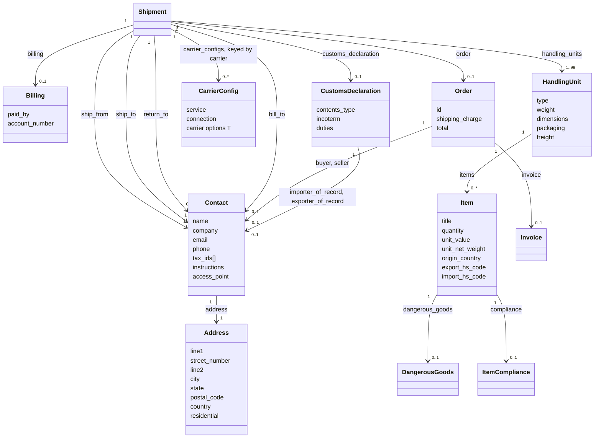
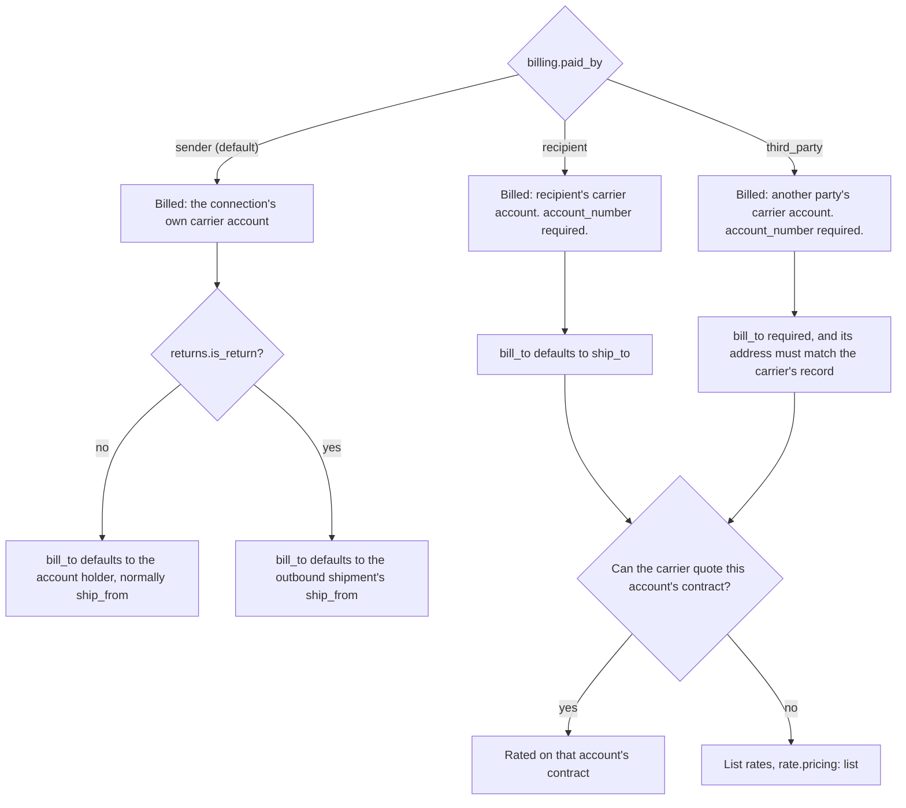
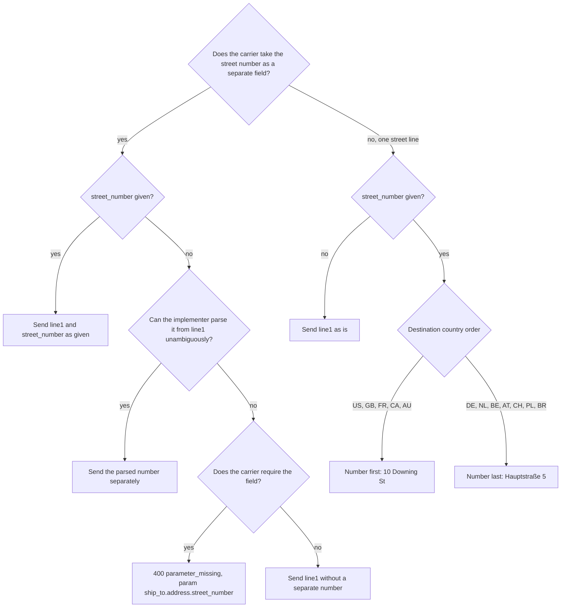
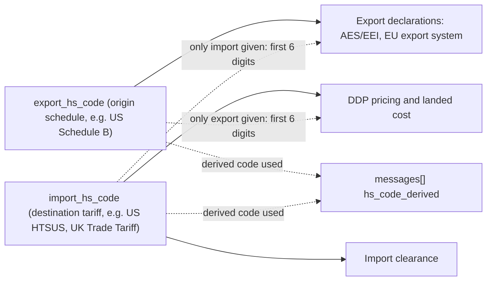
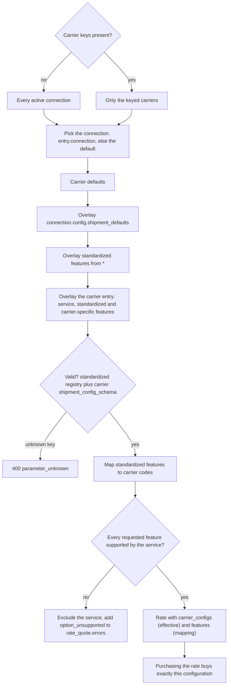

These value objects are embedded in resources. They have no ID of their own unless noted.

How they fit together on a shipment:

```
shipment
├── ship_from / ship_to / return_to / bill_to   Contact  → address: Address
├── billing                                { paid_by, account_number }
├── handling_units[]                         HandlingUnit (parcel, pallet, …)
│   └── items[]                            Item     → dangerous_goods, compliance
├── order                                  Order    → invoice
├── customs_declaration                    CustomsDeclaration → importer_of_record / exporter_of_record: Contact
└── carrier_configs                        { "*": standardized features, [carrier_id]: { service, standardized + carrier-specific features } }
```

Each object holds one kind of truth. **Who** is involved lives in contacts, and **who pays** is `bill_to` plus `billing`. **What** is in the box lives in items, inside the parcel that physically holds them. **What was sold** lives in the order. **What is declared to customs** lives in the customs declaration. **Which product, with which features,** lives in `carrier_configs`: the service plus standardized and carrier-specific features, per carrier. Earlier drafts, and most carrier APIs, fold several of these into a single "customs" object. That object then breaks the first time a parcel is domestic but still has dangerous goods, or an order splits across two handling_units.

The same structure as a class diagram, with the cardinality of each slot:



## 1. Contact

A party to a shipment, with its address nested. This follows Stripe's `shipping` and `billing_details`, and the `shipFrom` / `shipTo` / `billTo` convention common in carrier APIs.

A shipment has four party slots, all of type Contact:

| Slot | Party | Required |
|---|---|---|
| `ship_from` | Where the carrier collects, and the shipper on the label | yes |
| `ship_to` | Where the carrier delivers | yes |
| `return_to` | Where undeliverable or returned parcels go | no. Defaults to `ship_from`. |
| `bill_to` | The party the **carrier** invoices for transportation charges | no. See §1.1. |

```json
{
  "name": "Grace Hopper",
  "company": "Navy Research Lab",
  "email": "grace@example.com",
  "phone": "+442079460000",
  "tax_ids": [{ "type": "eori", "value": "GB123456789000", "country": "GB" }],
  "address": {
    "line1": "Downing St",
    "street_number": "10",
    "line2": "Flat 2",
    "city": "London",
    "state": null,
    "postal_code": "SW1A 2AA",
    "country": "GB",
    "residential": true,
    "validation": null
  },
  "instructions": "Leave with concierge",
  "access_point": null
}
```

| Field | Type | Notes |
|---|---|---|
| `name` | string | Person name. Either `name` or `company` is required. |
| `company` | string | Business name. It helps the driver at collection and delivery. |
| `email` | string | Carriers use it for notifications when the carrier config enables them, and for emailed return labels |
| `phone` | string | E.164. Many carriers require it for international shipments and for the recipient. |
| `tax_ids[]` | TaxId[] | `{ type, value, country? }`. Types: `eori`, `vat`, `ioss`, `voec`, `gst`, `ein`, `ssn_last4`, `cpf`, `cnpj`, `rfc`, `abn`, `state_tax_id`, `other`. A party's tax identity belongs to the party, so the seller's IOSS goes on `ship_from` or `exporter_of_record`, not in a customs field (contrast APIs that put `EORI`, `IOSS` and `VAT` fields on the customs object). |
| `address` | Address | Required on `ship_from`, `ship_to`, `return_to` and `bill_to` |
| `instructions` | string | Delivery or collection instructions, max 255 |
| `access_point` | object | `{ carrier, id, type: "locker" \| "parcel_shop" \| "post_office" }` for pickup-point delivery on `ship_to`. In that case, `address` describes the point. |

### 1.1 Bill-to and billing

`bill_to` says **who** the carrier invoices. `billing` says **how**, meaning which carrier account is charged.

```json
"bill_to": {
  "company": "Acme Brands Ltd",
  "phone": "+447700900123",
  "tax_ids": [{ "type": "vat", "value": "GB123456789" }],
  "address": { "line1": "5 Wharf Rd", "city": "London", "postal_code": "N1 7GR", "country": "GB" }
},
"billing": { "paid_by": "third_party", "account_number": "123456789" }
```

| `billing.paid_by` | Billed account | `bill_to` default | `account_number` |
|---|---|---|---|
| `sender` (default) | The connection's own carrier account | The connection's account holder, which is normally `ship_from` | Not needed. The connection's account is used. |
| `recipient` | The recipient's carrier account (collect) | `ship_to` | Required |
| `third_party` | Another party's carrier account (a brand paying for its 3PL's shipments, a marketplace) | None. `bill_to` is required. | Required |

Rules:

- Carriers validate third-party and collect billing against the account's registered country and postal code. The implementer sends `bill_to.address.country` and `postal_code` with the account number, so `bill_to.address` MUST match the address the carrier has on file for that account.
- **Billing affects price.** Recipient and third-party accounts are rated on their own contracts, or not at all. So `bill_to` and `billing` belong to the rate request, and a rate is only valid for the billing it was quoted with. Carriers that cannot quote another party's account return list rates, with `rate.pricing: "list"`.
- **Returns.** On a return (`returns.is_return: true`), `ship_from` is the customer, but `sender` billing still means the connection's account, which is the merchant. `bill_to` then defaults to the outbound shipment's `ship_from`, not the customer.
- `bill_to` is not the same as `order.buyer`. The buyer is who the merchant invoiced for the goods. `bill_to` is who the carrier invoices for the transport. On a commercial invoice, the "sold to" party is `order.buyer`, falling back to `ship_to`.
- Duties and taxes have their own billing in `customs_declaration.duties` (§5), because a shipment can be freight-prepaid by the sender and duties-collect from the recipient.

How `billing.paid_by` decides the billed account and the default `bill_to`:



### Address

| Field | Type | Notes |
|---|---|---|
| `line1` | string | Required. The street. If `street_number` is set, `line1` is the street name only (`Downing St`). Otherwise it is street and number together (`10 Downing St`). Do not include the city, state or postal code. |
| `street_number` | string | The house or building number, including suffixes (`10`, `221B`, `12-14`). Optional, but recommended for DE, NL, BE, AT, CH, PL, BR and other countries whose carriers take the number as a separate field. |
| `line2` | string | Apartment, suite, floor, building, or care-of |
| `city` | string | Required, except where the country has no cities in its postal system |
| `state` | string | ISO 3166-2 subdivision code without the country prefix (`CA`, `ON`, `NSW`). Required for US, CA, AU, MX, BR, IN and CN. |
| `postal_code` | string | Required where the country uses postal codes |
| `country` | string | ISO 3166-1 alpha-2. Required. |
| `residential` | boolean | `null` means unknown. The implementer MAY resolve it via validation. It affects price. |
| `validation` | object | Read-only. `{ status: "verified" \| "corrected" \| "unverified" \| "invalid", suggested: Address?, messages[] }`, filled when `validate_addresses: true` is sent |

**Street number rules.**

- **When a carrier wants it separate** (DHL Parcel DE, PostNL, DPD, Correios): the implementer uses `street_number` if it is given. Otherwise it MAY parse it out of `line1`. If parsing is ambiguous and the carrier requires the field, the request fails with `400 parameter_missing`, `param: "ship_to.address.street_number"`, rather than guessing.
- **When a carrier wants one street line** (most US, UK and FR carriers): the implementer joins the two in the destination country's order. That is number first in US, GB, FR, CA and AU (`10 Downing St`), and number last in DE, NL, BE, AT, CH, PL and BR (`Hauptstraße 5`).
- Clients never put the number in both fields.

The same rules as a decision flow:



**Why nest the address.** A contact without an address is useful (an EU responsible person, a broker's phone line), and an address without a contact is useful (a pickup location, a manifest origin). Nesting lets each exist alone, and lets `address` be reused by itself on pickups and manifests.

## 2. Handling unit

Anything that gets its own label: a parcel, an envelope, a pallet, a crate. The spec uses one object for all of them. The freight term "handling unit" covers both worlds, and a shipment can mix them, such as two pallets plus a loose carton.

```json
{
  "id": "hu_7Yh2",
  "type": "parcel",
  "weight": { "value": 1200, "unit": "g" },
  "dimensions": { "length": 30, "width": 20, "height": 10, "unit": "cm" },
  "packaging": "your_packaging",
  "reference": "BOX-1",
  "description": "Apparel",
  "items": [ { "...": "Item" } ],
  "freight": null,
  "tracking_number": null
}
```

A pallet:

```json
{
  "id": "hu_P4ll",
  "type": "pallet",
  "weight": { "value": 412, "unit": "kg" },
  "dimensions": { "length": 120, "width": 80, "height": 145, "unit": "cm" },
  "packaging": "eur_pallet",
  "items": [ { "...": "Item" } ],
  "freight": {
    "pallet_standard": "eur1",
    "stackable": false,
    "piece_count": 36,
    "freight_class": "70",
    "nmfc_code": "156600-03",
    "hazmat_placard": false
  },
  "tracking_number": "SSCC 376123450000000017"
}
```

| Field | Notes |
|---|---|
| `type` | `parcel` (the default), `envelope`, `tube`, `pallet`, `crate`, `skid`, `drum`, `carton`, `uld` (an air cargo unit load device), `container` (an ocean or intermodal container), `other` |
| `weight` | Required. The **gross** weight of the packed unit, including any pallet. |
| `dimensions` | Required unless `packaging` is a carrier flat-rate package. For pallets, the height includes the pallet base. |
| `packaging` | A generic code (`your_packaging`, `envelope`, `pak`, `tube`, `eur_pallet`, `us_pallet_48x40`) or a carrier packaging code from the catalog (chapter 14 §4) |
| `items[]` | What is physically **in this unit**. It is required for any shipment that needs a customs declaration, and for any unit containing dangerous goods. The implementer aggregates items for carriers that want one commodity list per shipment. |
| `conditions` | Optional environmental limits (temperature, shock, tilt) checked against device telemetry (chapter 22 §3) |
| `freight` | Pallet and freight attributes. For `uld`, it also holds `uld_type` (`AKE`, `PMC`…) and `uld_id`. For `container`, it holds `iso_type` and `container_number`. `pallet_standard` is `eur1`, `eur2`, `us_48x40`, `au_1165`, or `other`. `piece_count` is the number of loose pieces (cartons) on the unit, as counted on a bill of lading. `freight_class` and `nmfc_code` are for US LTL. |
| `id`, `tracking_number` | Set on purchase. A multi-unit shipment returns one tracking number per unit. For pallets, this may be an SSCC. |

Implementers MUST reject a unit whose items' summed weight (`unit_gross_weight`, falling back to `unit_net_weight`, × `quantity`) exceeds the unit's `weight` (`parameter_invalid`, `param: "handling_units[0].weight"`). They MUST NOT reject the opposite case, because packaging has weight.

Services declare which unit types they accept (chapter 14 §1, `limits.handling_unit_types`). A rate request mixing types that no service accepts returns no rates for that carrier, with `errors[].code = "handling_unit_type_unsupported"`.

## 3. Item

One line of goods inside a parcel. The fields follow the richer commodity models of cross-border carriers, with HS codes split by direction and dangerous goods moved here, so that they sit on the thing that is dangerous.

```json
{
  "title": "Cotton t-shirt",
  "description": "Men's knitted t-shirt, 100% cotton",
  "sku": "TS-RED-M",
  "quantity": 2,
  "unit_value": { "amount": 1500, "currency": "usd" },
  "unit_net_weight": { "value": 180, "unit": "g" },
  "unit_gross_weight": { "value": 200, "unit": "g" },
  "origin_country": "PT",
  "export_hs_code": "6109.10.0012",
  "import_hs_code": "6109100010",
  "category": "apparel",
  "product_url": "https://shop.example.com/p/ts-red",
  "image_url": "https://cdn.example.com/ts-red.jpg",
  "product_id": "prod_88",
  "variant_id": "var_88_m",
  "order_line_id": "line_1",
  "brand": "Ada Basics",
  "material": "100% cotton",
  "manufacturer": { "name": "Fábrica Têxtil Lda", "country": "PT", "mid": "PTFABTEX123BRA" },
  "compliance": null,
  "dangerous_goods": null,
  "user_metadata": {}
}
```

| Field | Type | Notes |
|---|---|---|
| `title` | string | Required. Short name, as sold. |
| `description` | string | Customs-grade description of what it *is* ("men's knitted cotton t-shirt"). Carriers and customs reject vague text like "gift" or "clothes". Defaults to `title`, and implementers SHOULD warn (`description_too_vague`) when they detect generic text. |
| `sku` | string | |
| `quantity` | integer | Required, ≥ 1 |
| `unit_value` | Money | Required for customs. The value of **one** unit, as declared. |
| `unit_net_weight` | Weight | Required for customs. The weight of **one** unit of the goods themselves, without any packaging. This is the figure customs duty and statistics are based on. |
| `unit_gross_weight` | Weight | Optional. The weight of **one** unit including its own retail packaging (box, blister, bottle), but not the shipping carton. It MUST be ≥ `unit_net_weight`. |
| `origin_country` | string | Country of manufacture (ISO alpha-2). Required for customs. |
| `export_hs_code` | string | Classification under the **origin** country's export schedule (US Schedule B, EU CN for exports). 6–10 digits, with dots allowed and ignored. |
| `import_hs_code` | string | Classification under the **destination** country's import tariff (US HTSUS, UK Trade Tariff, EU TARIC). 6–10+ digits. |
| `category` | string | Free-form product category, which classification and restriction screening use |
| `product_url`, `image_url` | string | Used by carriers and brokers for classification review (DHL eCommerce, for example) |
| `product_id`, `variant_id` | string | Your catalog identifiers |
| `order_line_id` | string | Links the item to a line of `shipment.order` |
| `product` | string | A `prod_` ID (chapter 20). Unset item fields are filled from the product, HS codes are chosen per origin and destination country, and values are snapshotted at purchase. |
| `brand`, `material` | string | Requested by several corridors for apparel and footwear (US, CA, BR) |
| `manufacturer` | object | `{ name, country, mid }`. `mid` is the US CBP Manufacturer ID. |
| `compliance` | ItemCompliance | Controlled-goods details. See below. |
| `dangerous_goods` | DangerousGoods | See below |
| `user_metadata` | object | Not sent to carriers |

**Net and gross weight.** Commercial invoices from DHL Express and FedEx, EU export declarations, and several import regimes (CN, BR, IN) ask for both per line. Rules:

- Declarations use `unit_net_weight × quantity` as the line's net weight.
- Where a carrier or declaration needs line gross weight and `unit_gross_weight` is absent, implementers use the net weight and report it in `messages[]` (`gross_weight_derived`).
- Neither field replaces the parcel `weight`, which is the gross weight of the packed shipping carton, and the figure carriers bill on.

**Why two HS codes.** Only the first 6 digits are harmonized across countries. The digits after that are national, so the same shirt is `6109.10.0012` on a US export filing and `6109100010` on the UK import tariff. Carriers ask for different ones: export declarations (AES/EEI, the EU export system) want the export code, and DDP pricing and import clearance want the import code. One `hs_code` field forces every integrator to guess which one the carrier meant. Rules:

- Supply at least one of the two codes for customs. If only one is given, implementers MAY use its first 6 digits where the other is needed, and MUST report that in `messages[]` (`hs_code_derived`).
- The implementer MUST NOT invent a code. Classification is a separate concern, and an implementer offering it exposes it as its own capability (`classification`) that returns suggestions, never silently filling these fields.

Which code goes where, and what happens when only one is supplied:



### ItemCompliance

```json
{
  "controlled": true,
  "control_type": "dual_use",
  "eccn": "5A992.c",
  "license": { "type": "export", "number": "D123456", "expires_on": "2027-01-01" },
  "regulatory_agency": "FDA",
  "regulatory_program": "food",
  "regulatory_category_code": "16",
  "certification": { "type": "ce", "reference": "CE-2026-0042" }
}
```

All fields are optional. `control_type` is one of `dual_use`, `military`, `sanctions`, `agricultural`, `pharmaceutical`, `cites`, `other`.

### DangerousGoods

Lives on the item, because a lithium battery is a property of the power bank, not of the shipment.

```json
{
  "class": "9",
  "un_number": "UN3481",
  "proper_shipping_name": "Lithium ion batteries packed with equipment",
  "packing_group": null,
  "packing_instruction": "966",
  "section": "II",
  "quantity": { "value": 0.1, "unit": "kg" },
  "lithium": { "type": "ion", "configuration": "packed_with_equipment", "watt_hours": 18.5, "cells": 2 },
  "accessibility": "inaccessible",
  "transport_mode": "air",
  "excepted_quantity": false,
  "limited_quantity": false,
  "emergency_contact": { "name": "ChemTrec", "phone": "+18004249300" },
  "declaration_document": null
}
```

| Field | Notes |
|---|---|
| `class` | IATA/ADR hazard class (`1`–`9`, with divisions like `2.1`) |
| `un_number` | `UN` + 4 digits |
| `packing_group` | `I`, `II`, `III`, or `null` |
| `lithium` | `{ type: "ion" \| "metal", configuration: "alone" \| "packed_with_equipment" \| "contained_in_equipment", watt_hours?, lithium_grams?, cells? }` |
| `quantity` | Net quantity of the dangerous substance per unit of the item |
| `declaration_document` | A `file_` ID for a shipper's declaration, where the carrier requires one to be uploaded |

If any item has `dangerous_goods`, the implementer MUST only rate services whose carrier declares the `dangerous_goods` capability and accepts that class. The implementer MUST NOT silently drop the field, because the failure mode is a fire on an aircraft.

## 4. Order

Optional. The commercial transaction behind the shipment, which is what was sold and for how much. It is an embedded value, not a resource, and order management stays in the OMS. Customs needs it for invoice data, DDP and VAT calculation (freight is part of the customs value in the EU and UK), and documents.

```json
{
  "id": "1001",
  "reference": "#1001",
  "channel": "shopify",
  "ordered_at": "2026-10-05T18:22:00Z",
  "currency": "usd",
  "subtotal": { "amount": 3000, "currency": "usd" },
  "shipping_charge": { "amount": 995, "currency": "usd" },
  "insurance_charge": null,
  "discount": { "amount": 0, "currency": "usd" },
  "tax": { "amount": 0, "currency": "usd" },
  "total": { "amount": 3995, "currency": "usd" },
  "invoice": {
    "number": "INV-1001",
    "date": "2026-10-06",
    "type": "commercial",
    "terms_of_payment": "prepaid",
    "file": null
  },
  "buyer": null,
  "seller": null
}
```

| Field | Notes |
|---|---|
| `id` | Your order identifier. It is searchable (`order.id`), and implementers SHOULD index it. |
| `reference` | Human-facing order number |
| `channel` | Sales channel (`shopify`, `amazon`, `pos`, `b2b`…), free-form |
| `subtotal`, `shipping_charge`, `insurance_charge`, `discount`, `tax`, `total` | Money. `shipping_charge` is what the **buyer paid** for shipping, not the label cost. DDP and VAT engines need it. |
| `invoice` | `{ number, date, type: "commercial" \| "proforma", terms_of_payment: "prepaid" \| "collect" \| "free_of_charge", file? }`. `file` is a `file_` ID for an invoice you supply. If it is absent and the declaration has `paperless_trade: true`, the implementer generates the invoice from the order, the items and the declaration. |
| `buyer`, `seller` | Contact. Use these when they differ from `ship_to` / `ship_from` (a gift order, or a marketplace seller shipping from a 3PL). |

An order may span several shipments (a split shipment). Send the same `order.id` on each one, and the implementer MUST NOT assume `order.total` equals the sum of one shipment's items.

## 5. Customs declaration

Required when origin and destination are in different customs territories. The implementer decides that, including intra-EU, GB↔NI, US↔PR, and the Canary Islands. The **what** is declared from `handling_units[].items[]`, so this object holds only the declaration itself.

```json
{
  "contents_type": "merchandise",
  "contents_explanation": null,
  "incoterm": "DAP",
  "duties": { "paid_by": "recipient", "account_number": null, "bill_to": null },
  "importer_of_record": null,
  "exporter_of_record": {
    "company": "Ada Shop Inc.",
    "phone": "+14085550100",
    "tax_ids": [{ "type": "ein", "value": "12-3456789" }, { "type": "ioss", "value": "IM2500000001" }],
    "address": { "line1": "1 Infinite Loop", "city": "Cupertino", "state": "CA", "postal_code": "95014", "country": "US" }
  },
  "import_broker": null,
  "export_broker": null,
  "eu_responsible_person": null,
  "export_declaration": { "type": "itn", "value": "X20261006123456" },
  "non_delivery": "return",
  "paperless_trade": true,
  "certify": true,
  "signer": "Ada Lovelace",
  "documents": []
}
```

| Field | Notes |
|---|---|
| `contents_type` | `merchandise`, `gift`, `sample`, `documents`, `returned_goods`, `repair`, `personal_effects`, `other` (needs `contents_explanation`) |
| `incoterm` | `DAP`, `DDP`, `DDU` (legacy, mapped to DAP where a carrier has retired it), `EXW`, `FCA`, `CPT`, `CIP`, `DPU` |
| `duties` | `{ paid_by: "sender" \| "recipient" \| "third_party", account_number?, bill_to?: Contact }`. Same defaults as shipment billing (§1.1). `bill_to` is required for `third_party`. With DDP, `paid_by` is normally `sender`. |
| `importer_of_record` | Contact. The party legally responsible for the import. It defaults to `ship_to`. Set it when a broker, marketplace or the seller (under DDP) is the IOR. |
| `exporter_of_record` | Contact. The party legally responsible for the export. It defaults to `ship_from`. Set it when a 3PL ships on behalf of a brand. Its `tax_ids` carry the EORI, IOSS, VOEC and similar. |
| `import_broker` | Contact, plus `licence` (`{ country, number }`) and `participant` (a DID, chapter 23). The customs broker that files the import entry and pays duties on the importer's behalf. Its `tax_ids` carry its broker or EORI number. |
| `export_broker` | Contact, with the same extra fields. The forwarder or filing agent that submits the export declaration (AES/EEI, the EU export system) for the exporter. |
| `eu_responsible_person` | Contact. The EU General Product Safety Regulation economic operator, for B2C goods sold into the EU. |
| `landed_cost` | `lc_` ID of a guaranteed landed-cost quote (chapter 13 §4). It binds DDP duties and taxes to that quote. A DDP rate sets it automatically. |
| `export_declaration` | `{ type: "itn" \| "eel_pfc" \| "mrn" \| "ead", value }` |
| `non_delivery` | `return` or `abandon` |
| `paperless_trade` | Submit customs documents electronically (ETD, PLT) where the carrier supports it. Without an `order.invoice.file`, the implementer generates the invoice. |
| `certify`, `signer` | The declaration's certification and the name of the person signing |
| `documents[]` | References to documents that were already uploaded (chapter 06): `{ type, document_upload }` or `{ type, carrier_reference }` |

Corridor-specific fields with no canonical home (Brazil's CPF purpose, India's IEC) go in the carrier config, where the carrier's schema validates them. The declaration has no free-form `options` bag.

**Why at rating time.** Cross-border carriers price landed cost (duty plus tax plus fees) into the quote. Because the order, the items and the declaration are all accepted at rating time, a DDP rate can be exact rather than estimated.

## 6. Carrier configs: products and features

`carrier_configs` is the shipment's **product and feature configuration**. It is the rethought successor of three things integrators already know:

| Prior art | What it held | Where it lives now |
|---|---|---|
| Karrio `shipment.options` | Standardized options (signature, insurance, COD…) plus carrier-prefixed options (`fedex_…`, `ups_…`) | Standardized features and carrier-specific features in `carrier_configs` |
| Carrier `additionalServices` flags (common in cross-border APIs) | Signature, delivery warranty, PUDO delivery, low carbon, duty and tax mode | Standardized features |
| Amazon Shipping `valueAddedServices` | Per-rate value-added services | Standardized features, and `rate.carrier_configs` for what a rate actually includes |
| The service code (`serviceCode`, `service`, `selected_rate_id`) | Which carrier product to buy | `service` inside the same object |

It is what a shipping method configuration holds in an ERP or WMS (the carrier, the product, and the additional services enabled for it), carried on the shipment.

```ts
type CarrierConfigs = {
  "*"?: StandardFeatures                        // defaults for every carrier being rated
  [carrier_id: string]: CarrierConfig<CarrierFeatures[carrier_id]>
}

type CarrierConfig<T> = {
  service?: string          // the carrier product, e.g. "fedex_international_priority"
  connection?: string       // conn_…, when the account has several for this carrier
} & StandardFeatures        // spec-defined, typed, mapped by the implementer to each carrier
  & T                       // carrier-specific features, typed by carriers/{id}.shipment_config_schema
```

```json
"carrier_configs": {
  "*": { "signature": "adult", "insurance": { "amount": 25000, "currency": "usd" } },
  "fedex": {
    "service": "fedex_international_priority",
    "saturday_delivery": true,
    "priority_alert": true
  },
  "dhl_express": {
    "connection": "conn_dhl_eu",
    "service": "dhl_express_worldwide",
    "signature": "standard",
    "go_green_plus": true
  },
  "ups": {}
}
```

Here every carrier is asked for an adult signature and $250 cover. DHL Express overrides the signature level, FedEx adds Saturday delivery (standardized) and Priority Alert (FedEx-specific), and UPS is rated with only the `*` features.

### Semantics

- **Keys select carriers.** Each carrier key adds that carrier to the rating set, and `{}` means "this carrier with its defaults". `*` selects no carrier: it holds standardized features applied to every rated carrier. If no carrier key is present, every active connection is rated, with `*` applied.
- **`service` selects the product.** In a rate request it narrows that carrier to one service, and omitting it returns every eligible service. A purchase without a `rate` needs exactly one carrier key with a `service`.
- **`connection` selects the account** when the account has several for the carrier.
- **Standardized features** (§6.1) have one name, one type and one meaning across all carriers. The implementer translates each one into the carrier's own product codes, flags and service options, exactly as Karrio's connectors map `options` today. They may appear in `*` or in a carrier entry.
- **Carrier-specific features** cover everything the carrier offers that the spec does not standardize. Their names and types come from the carrier's `shipment_config_schema` (generated from its catalog, chapter 14 §3). They are allowed only inside that carrier's entry, never in `*`. Standardized names are reserved, and a carrier-specific feature MUST NOT reuse one with a different meaning.
- **Precedence**, from lowest to highest: the carrier's defaults, then the connection's `config.shipment_defaults`, then `*`, then the carrier entry.
- **Unknown keys are rejected** (`400 parameter_unknown`, `param: "carrier_configs.fedex.signture"`).

### Honoring standardized features

A standardized feature is a requirement, not a hint. The implementer MUST NOT silently drop one.

- **Rating.** A service that cannot provide a requested standardized feature is excluded from `rates[]`. The exclusion is listed in `rate_quote.errors[]` with `code: "option_unsupported"` and `param` naming the feature. A shipper asking for adult signature never sees a rate that cannot deliver it.
- **Purchase.** It fails with `422 carrier_error` / `option_unsupported`.
- **Transparency.** Every rate states how each standardized feature was fulfilled at that carrier, so the mapping is visible rather than implied:

```json
"rate": {
  "carrier_configs": { "fedex": { "connection": "conn_9f8e", "service": "fedex_international_priority", "signature": "adult", "insurance": { "amount": 25000, "currency": "usd" }, "saturday_delivery": true, "priority_alert": true } },
  "features": {
    "signature": { "value": "adult", "carrier_code": "ADULT", "charge": { "amount": 650, "currency": "usd" } },
    "insurance": { "value": { "amount": 25000, "currency": "usd" }, "carrier_code": "DECLARED_VALUE", "charge": { "amount": 300, "currency": "usd" } },
    "saturday_delivery": { "value": true, "carrier_code": "SATURDAY_DELIVERY", "charge": { "amount": 1600, "currency": "usd" } }
  }
}
```

`rate.carrier_configs` is the effective configuration (one key) that a purchase of the rate buys. `rate.features` explains, per standardized feature, the carrier's native code and its price.

### Flow



### One shape everywhere

Rates, purchased shipments, pickups, pickup schedules and manifests all use `carrier_configs`. Where only one carrier is involved, the map has one key and no `*`. The schemas are `shipment_config_schema`, `pickup_config_schema` and `manifest_config_schema`. There is no singular `carrier_config` field anywhere in the spec.

### 6.1 Standardized features

The normative registry. The set is append-only, and a feature graduates into it when two or more carriers offer the same semantics. Each carrier declares which features it supports in `carriers/{id}.standardized_features`, per service in its catalog.

| Feature | Type | Meaning |
|---|---|---|
| `signature` | `"none"` \| `"standard"` \| `"indirect"` \| `"adult"` | Signature on delivery |
| `age_verification` | integer | Minimum age checked at handover (16, 18, 21) |
| `insurance` | Money | Carrier declared value or carrier insurance. Third-party cover is a coverage instead (chapter 26 §5). |
| `cash_on_delivery` | Money + `method` (`cash` \| `check` \| `any`) | Collect payment on delivery |
| `saturday_delivery`, `sunday_delivery` | boolean | Weekend delivery |
| `evening_delivery` | boolean | Delivery after the standard day window |
| `delivery_window` | `{ start, end }` (local times) | Time-definite or appointment delivery |
| `hold_for_pickup` | boolean | Hold at a carrier facility for collection |
| `access_point_delivery` | boolean | Deliver to the access point in `ship_to.access_point` (PUDO, locker) |
| `direct_delivery_only` | boolean | No neighbor or safe-place delivery |
| `authority_to_leave` | boolean | The carrier may leave the parcel without a signature (shipper release) |
| `delivery_confirmation` | `"none"` \| `"scan"` \| `"photo"` \| `"pin"` | Proof of delivery |
| `notifications` | `{ email?: boolean, sms?: boolean }` | Carrier notifications to the consignee, using `ship_to.email` and `ship_to.phone` |
| `dry_ice` | Weight | Dry ice weight |
| `dangerous_goods_service` | boolean | Book the carrier's DG-accepting service variant. DG details stay on items. |
| `carbon_neutral` | boolean | Carbon-offset or low-carbon service |
| `delivery_warranty` | boolean | Carrier-backed on-time guarantee |
| `duty_tax_mode` | `"guaranteed"` \| `"collect_from_consignee"` | How duties are settled under DDP |
| `paperless_trade` | boolean | Electronic customs documents. It mirrors `customs_declaration.paperless_trade`, and either may be set. |
| `return_label` | boolean | Generate a return label with the outbound |
| `references` | `[{ type: "po" \| "invoice" \| "department" \| "customer" \| "other", value }]` | Additional printed references |
| `label_message` | string | Short text printed on the label where the carrier allows it |

**Why one object.** Splitting the product (`service`) from its features (`options`) forced clients to know which features each product allows, and to re-send both on every call. Putting them together under the carrier they belong to makes the request read like a shipping method configuration. Standardized features keep cross-carrier intent simple. Carrier-specific features keep every carrier's full surface. `rate.features` makes the translation between them auditable.

## 7. Service

Read-only on rates and shipments:

```json
{
  "carrier": "fedex",
  "connection": "conn_9f8e",
  "code": "fedex_international_priority",
  "name": "FedEx International Priority®",
  "level": "express",
  "carrier_code": "INTERNATIONAL_PRIORITY"
}
```

- `code` is the implementer's normalized service code (`{carrier}_{service}`). It is stable across versions, and it is what `carrier_configs.*.service` takes.
- `carrier_code` is the raw carrier product code.
- `level` is one of `same_day`, `overnight`, `express`, `standard`, `economy`, `freight`, `other`.

## 8. Charge

```json
{ "kind": "fuel_surcharge", "name": "Fuel Surcharge", "amount": { "amount": 312, "currency": "usd" }, "carrier_code": "FSC" }
```

`kind` values: `base`, `fuel_surcharge`, `residential_surcharge`, `remote_area_surcharge`, `peak_surcharge`, `oversize_surcharge`, `dangerous_goods_surcharge`, `option` (with an `option` key naming the carrier-config key), `insurance`, `duty`, `tax`, `customs_fee`, `pickup_fee`, `discount` (negative), `adjustment`, `other`.

## 9. Delivery estimate

```json
{ "days": 2, "date": "2026-10-08", "window": { "start": "2026-10-08T09:00:00+01:00", "end": "2026-10-08T12:00:00+01:00" }, "guaranteed": true, "business_days": true }
```

## 10. Document (label, invoice, manifest PDF)

```json
{
  "id": "doc_3Rf8",
  "object": "document",
  "type": "label",
  "format": "pdf",
  "size": "4x6",
  "url": "https://files.example.com/doc_3Rf8?sig=...",
  "url_expires_at": 1791388800,
  "data": null,
  "handling_unit": "hu_7Yh2"
}
```

- `type`: `label`, `return_label`, `commercial_invoice`, `proforma_invoice`, `certificate_of_origin`, `customs_declaration` (CN22/CN23), `packing_slip`, `pick_list`, `manifest`, `scan_form`, `close_report`, `cod_report`, `dangerous_goods_report`, `order_summary`, `pickup_confirmation`, `dangerous_goods_declaration`, `consolidation_label`, `bill_of_lading`, `cmr`, `air_waybill`, `delivery_receipt`, `insurance_certificate`, `invoice`, `custom`, `other`. Documents rendered from a template also carry `template` and `template_version` (chapter 25).
- `format`: `pdf`, `png`, `zpl`, `epl`, `gif`, `jpg`. ZPL is returned as text at 203 dpi unless `label.dpi` is 300.
- `size`: `4x6`, `4x8`, `a4`, `a5`, `a6`, `letter`, or `WxH` in inches.
- `url` is a signed, short-lived URL. `GET /v1/shipments/{id}` re-signs it. Pass `label.inline: true` at purchase to get base64 in `data` instead.

## 11. References

`reference` is a string up to 35 characters that the carrier prints on the label. Carriers that support several get the `references` standardized feature of `carrier_configs` (§6.1, §6). Implementers truncate per carrier and report it in `messages[]`.

## 12. Messages

Successful responses MAY carry non-fatal `messages[]`:

```json
{ "level": "warning", "code": "hs_code_derived", "message": "import_hs_code not provided; used first 6 digits of export_hs_code for DDP pricing.", "param": "handling_units[0].items[0].import_hs_code", "carrier": "fedex" }
```

Levels: `info`, `warning`. Errors are never messages.

## 13. Recurrence

Defined in [Platform Constructs → Shared objects](/platform/shared-objects#recurrence). It is used here by pickup schedules, routes, driver shifts and end-of-day close.

## 14. Area

Defined in [Platform Constructs → Shared objects](/platform/shared-objects#area). It is used here by zones.
