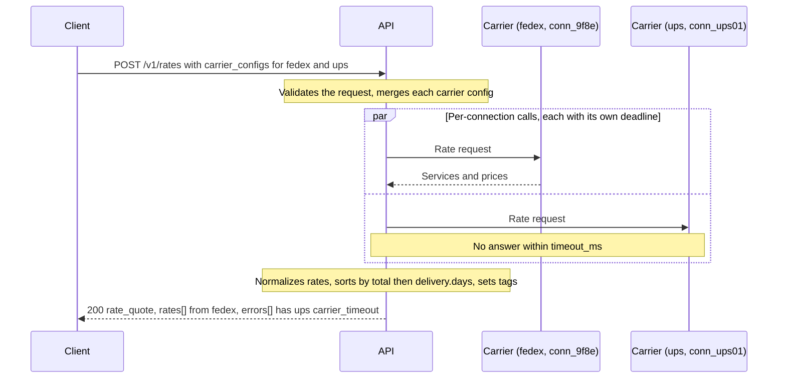
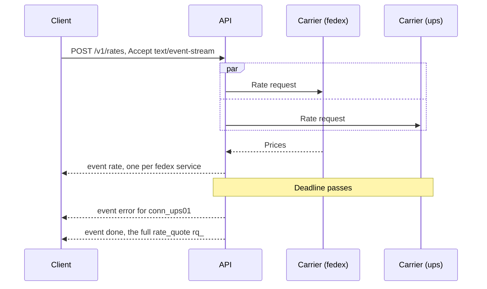
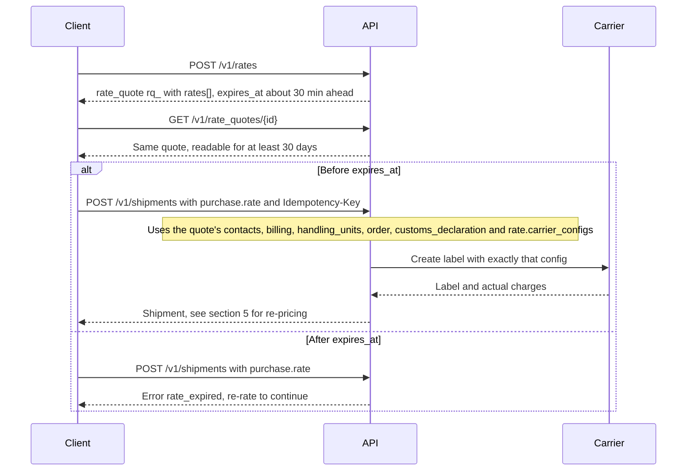
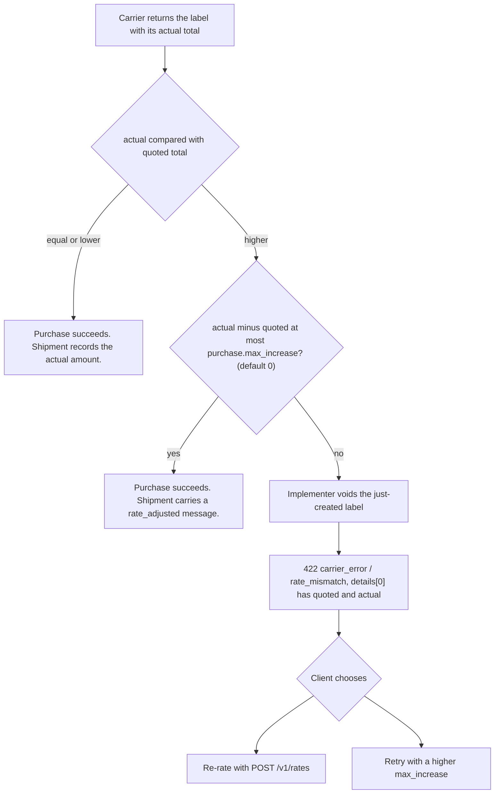

A rate request fans out to every eligible carrier connection and returns a **rate quote**: an immutable, retrievable, expiring snapshot of what each service costs for this exact shipment.

## 1. The `rate_quote` object

```json
{
  "id": "rq_5Tg7Yh",
  "object": "rate_quote",
  "livemode": false,
  "created": 1791302400,
  "expires_at": 1791304200,
  "shipment": null,
  "request": {
    "ship_from": { "...": "Contact" },
    "ship_to": { "...": "Contact" },
    "bill_to": null,
    "billing": { "paid_by": "sender" },
    "handling_units": [ { "...": "Parcel, with items[]" } ],
    "order": { "...": "Order" },
    "customs_declaration": { "...": "CustomsDeclaration" },
    "carrier_configs": { "*": { "signature": "indirect" }, "fedex": {}, "ups": {} },
    "ship_date": "2026-10-06",
    "returns": { "is_return": false }
  },
  "rates": [
    {
      "id": "rate_1Q2w3E4r",
      "object": "rate",
      "service": { "carrier": "fedex", "connection": "conn_9f8e", "code": "fedex_international_priority", "name": "FedEx International Priority®", "level": "express", "carrier_code": "INTERNATIONAL_PRIORITY" },
      "total": { "amount": 6420, "currency": "usd" },
      "total_in_account_currency": { "amount": 6420, "currency": "usd" },
      "charges": [
        { "kind": "base", "name": "Transportation", "amount": { "amount": 5600, "currency": "usd" } },
        { "kind": "fuel_surcharge", "name": "Fuel", "amount": { "amount": 620, "currency": "usd" } },
        { "kind": "option", "option": "signature", "name": "Indirect signature", "amount": { "amount": 200, "currency": "usd" } }
      ],
      "landed_cost": null,
      "delivery": { "days": 2, "date": "2026-10-08", "guaranteed": true, "business_days": true },
      "carrier_configs": { "fedex": { "connection": "conn_9f8e", "service": "fedex_international_priority", "signature": "indirect", "saturday_delivery": false } },
      "features": { "signature": { "value": "indirect", "carrier_code": "INDIRECT", "charge": { "amount": 200, "currency": "usd" } } },
      "billable_weight": { "value": 1.5, "unit": "kg" },
      "zone": "E",
      "pricing": "negotiated",
      "tags": ["fastest"],
      "documents": { "label_formats": ["pdf", "png", "zpl"], "label_sizes": ["4x6", "a4"] },
      "requires": [],
      "expires_at": 1791304200,
      "messages": [],
      "carrier_metadata": { "rate_type": "PAYOR_ACCOUNT_PACKAGE", "commit_day": "THURSDAY", "saturday_delivery_available": true }
    }
  ],
  "errors": [
    {
      "connection": "conn_ups01",
      "carrier": "ups",
      "type": "carrier_unavailable",
      "code": "carrier_timeout",
      "message": "UPS did not respond within 8s."
    }
  ],
  "messages": []
}
```

### Rate fields that need explaining

| Field | Meaning |
|---|---|
| `total` | What a purchase of this rate will charge, in the carrier's currency. It is binding until `expires_at` unless `rate_mismatch` occurs (§5). |
| `total_in_account_currency` | `total` converted at the implementer's FX rate. Informational only. |
| `landed_cost` | Present when `customs_declaration.incoterm` is `DDP` or the carrier quotes duties. It is a full `landed_cost` object (chapter 13 §4) with its own `lc_` ID. Buying a DDP rate binds its quote. Many cross-border carriers return this natively. |
| `pricing` | `list`, `negotiated` (account-specific contract), `implementer` (resold at implementer rates, or marked up by pricing rules), `retail`, or `rate_sheet` (computed from the implementer's own tariff, in Carrier, 3PL and Fleet modes) |
| `pricing_details` | Present when `pricing` is `rate_sheet` or pricing rules applied: rate sheet, version, zones, billable weight, band, surcharges and rules used (chapter 15 §1). It makes the price reproducible. |
| `tags` | Computed per quote: `cheapest`, `fastest`, `best_value`. They are advisory, so do not sort by them. |
| `requires` | What a purchase will additionally need, such as `["handling_units[].items[].import_hs_code", "ship_to.phone"]`. Lets a UI or agent collect missing fields **before** a failed purchase. |
| `features` | How each requested standardized feature is fulfilled at this carrier: `{ [feature]: { value, carrier_code, charge } }` (chapter 01 §6) |
| `carrier_configs` | One key: the **effective** config this rate priced: your carrier config, merged over the connection's defaults, merged over the carrier's own defaults, with the resolved `connection` and `service`. Purchasing the rate buys exactly this config. |

## 2. Get live rates

```
POST /v1/rates
```

### Request

| Param | Type | Required | Notes |
|---|---|---|---|
| `ship_from` | Contact | yes | |
| `ship_to` | Contact | yes | |
| `return_to` | Contact | no | Defaults to `ship_from` |
| `bill_to` | Contact | conditional | The party the carrier invoices. Required when `billing.paid_by` is `third_party`. See chapter 01 §1.1. |
| `billing` | object | no | `{ paid_by: "sender" \| "recipient" \| "third_party", account_number? }`. Defaults to `sender`. It affects price, so it belongs in the quote. |
| `handling_units` | Parcel[] | yes | 1–99. More than one parcel means a multi-piece shipment. Include `items[]` for cross-border or dangerous-goods rating. |
| `order` | Order | no | Improves DDP and VAT accuracy (`shipping_charge`, `total`) |
| `customs_declaration` | CustomsDeclaration | conditional | Required for cross-border rating when the carrier prices duties or rejects without it. Implementers MAY rate without it and add `customs_declaration` to `requires`. |
| `carrier_configs` | `{ "*"?: StandardFeatures, [carrier]: CarrierConfig }` | no | The product and feature configuration (chapter 01 §6). Carrier keys choose which carriers to rate, with optional `service` and `connection` and their features. `*` applies standardized features to every carrier. Without carrier keys, every active connection is rated. |
| `ship_date` | date | no | Defaults to today in the origin's time zone |
| `returns` | object | no | `{ is_return: true }` rates a return (the carrier collects from `ship_from`, which is the customer) |
| `levels` | string[] | no | Limit to these service levels across all selected carriers |
| `currency` | string | no | Preferred currency for `total_in_account_currency` |
| `timeout_ms` | integer | no | Per-carrier deadline, 1000–30000, default 8000. Slow carriers become `errors[]` entries rather than holding the whole call. |
| `shipment` | string | no | Rate an existing draft `shp_`. Equivalent to `POST /v1/shipments/{id}/rates`. |
| `validate_addresses` | boolean | no | Validate and normalize `ship_from.address` / `ship_to.address`. Results appear in `address.validation`. |
| `user_metadata` | object | no | |

A cross-border request that rates FedEx with an indirect signature and UPS with its defaults:

```json
{
  "ship_from": {
    "company": "Ada Shop Inc.",
    "phone": "+14085550100",
    "address": { "line1": "1 Infinite Loop", "city": "Cupertino", "state": "CA", "postal_code": "95014", "country": "US" }
  },
  "ship_to": {
    "name": "Grace Hopper",
    "phone": "+442079460000",
    "address": { "line1": "Downing St", "street_number": "10", "city": "London", "postal_code": "SW1A 2AA", "country": "GB", "residential": true }
  },
  "handling_units": [
    {
      "weight": { "value": 1200, "unit": "g" },
      "dimensions": { "length": 30, "width": 20, "height": 10, "unit": "cm" },
      "items": [
        { "title": "Cotton t-shirt", "quantity": 2, "unit_value": { "amount": 1500, "currency": "usd" }, "unit_net_weight": { "value": 180, "unit": "g" }, "origin_country": "PT", "export_hs_code": "6109.10.0012" }
      ]
    }
  ],
  "customs_declaration": { "contents_type": "merchandise", "incoterm": "DAP" },
  "carrier_configs": { "fedex": { "signature": "indirect" }, "ups": {} },
  "timeout_ms": 8000
}
```

### Response

`200` with a `rate_quote`. Rates are sorted by `total_in_account_currency` ascending (so mixed-currency quotes sort correctly), then by `delivery.days`.

**Partial failure is not failure.** If at least one connection was attempted, the response is `200` and the failed connections appear in `errors[]`. If every connection fails, the response is still `200` with an empty `rates[]` and a populated `errors[]`. A non-2xx status is reserved for problems with the request itself (`400`), credentials (`401`, `403`), or the implementer (`5xx`). This is the single most important difference from carrier-native APIs, where one carrier's outage would otherwise take down checkout.

The fan-out, with one carrier missing the `timeout_ms` deadline:



### Streaming (optional capability `rates.stream`)

`POST /v1/rates` with `Accept: text/event-stream` returns Server-Sent Events as carriers respond:

```
event: rate
data: { "object": "rate", ... }

event: error
data: { "connection": "conn_ups01", ... }

event: done
data: { "id": "rq_5Tg7Yh", "object": "rate_quote", ... }
```

This suits checkout pages that render the first rates in about 300 ms rather than waiting for the slowest carrier.

The same fan-out over Server-Sent Events:



## 3. Retrieve a rate quote

```
GET /v1/rate_quotes/{id}
```

Returns the quote, including after expiry, for audit. Rates are retained for at least 30 days. Expired rates can be read but not purchased.

## 4. Expiry and caching

- `expires_at` is set by the implementer, no shorter than 15 minutes and SHOULD be 30 minutes. A carrier that publishes a shorter validity (Amazon Shipping's `requestToken`) caps it.
- Implementers MAY cache carrier responses. A cached rate MUST carry the cache age in `messages[]` (`code: "rate_cached"`) and MUST NOT outlive the carrier's own validity.
- Rates are bound to their request. Purchasing `rate_...` buys exactly the contacts (including `bill_to`), billing, handling_units, order, customs declaration and `rate.carrier_configs` in the quote. To change anything, re-rate.

A quote's life from rating to purchase:



## 5. Rate mismatch at purchase

Carriers sometimes re-price at label time (dimensional reweighs, surcharges recalculated at ship time). On purchase:

- If the label's actual total is **equal or lower**, the purchase succeeds and the shipment records the actual amount.
- If it is **higher by no more than `purchase.max_increase`** (default `0`), the purchase succeeds, and the shipment carries a `rate_adjusted` message.
- Otherwise the implementer MUST void the just-created label and return `422 carrier_error` / `rate_mismatch` with `error.details[0] = { quoted, actual }`. The client re-rates or raises `max_increase`.

The decision the implementer makes once the carrier returns the label's actual total:



## 6. What rating MUST NOT do

- It MUST NOT create a shipment, reserve a tracking number, or charge money.
- It MUST NOT emit webhook events. Quotes are high-volume and noisy.
- It MUST NOT require `customs_declaration` for domestic shipments, or `dimensions` for flat-rate packaging.
- It MUST NOT return a rate for a service that cannot carry an item's `dangerous_goods`.
