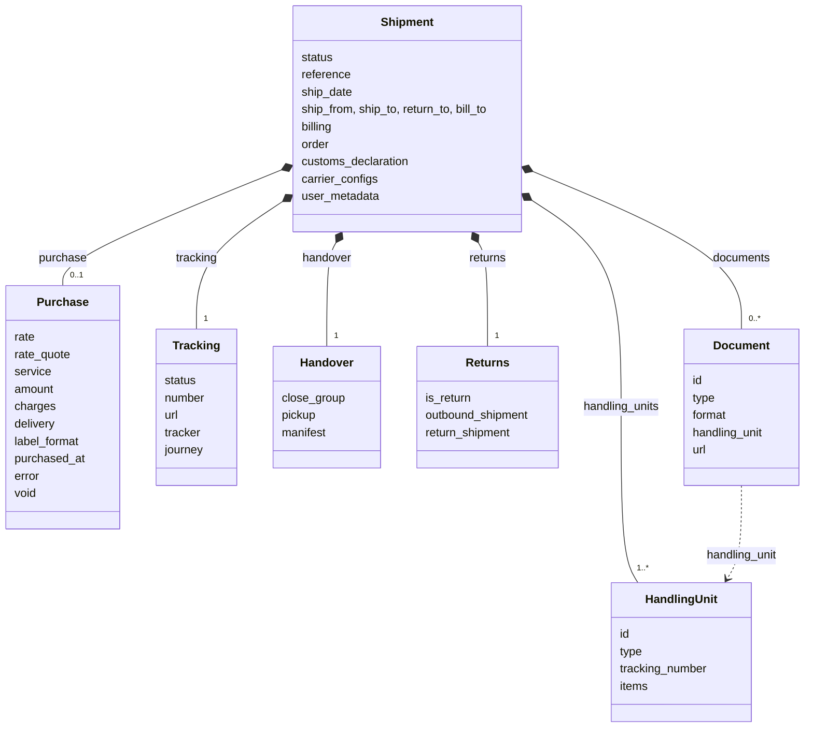
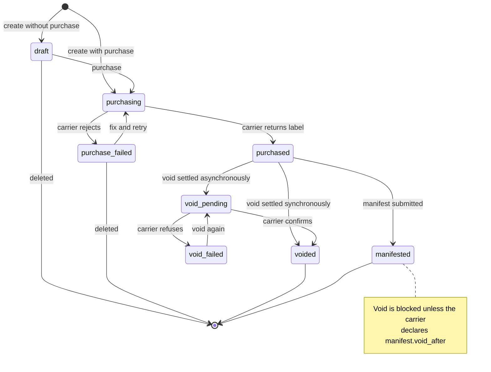
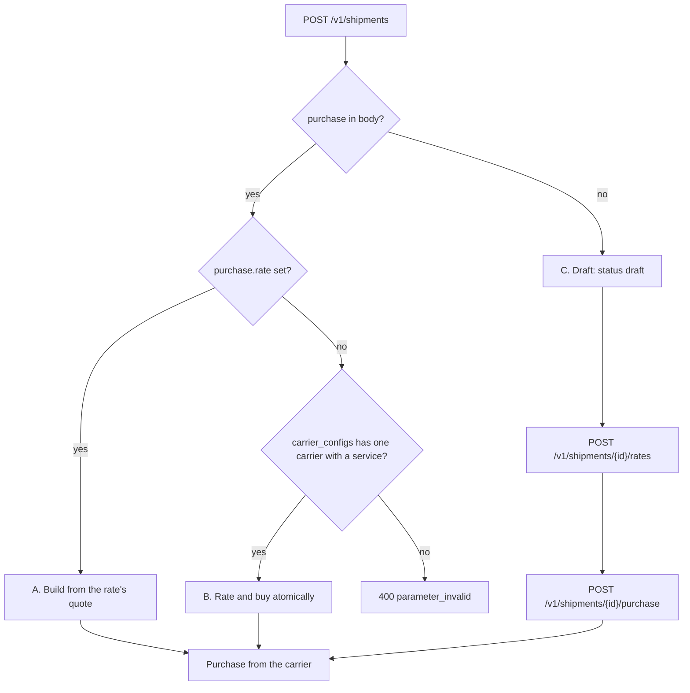
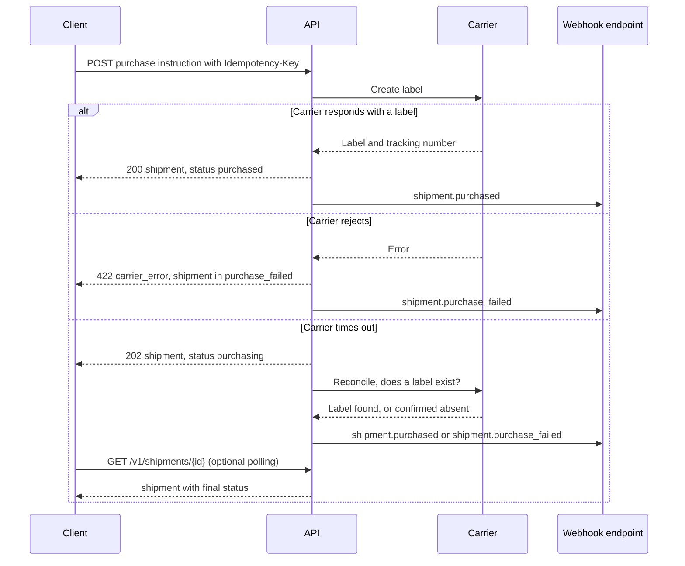
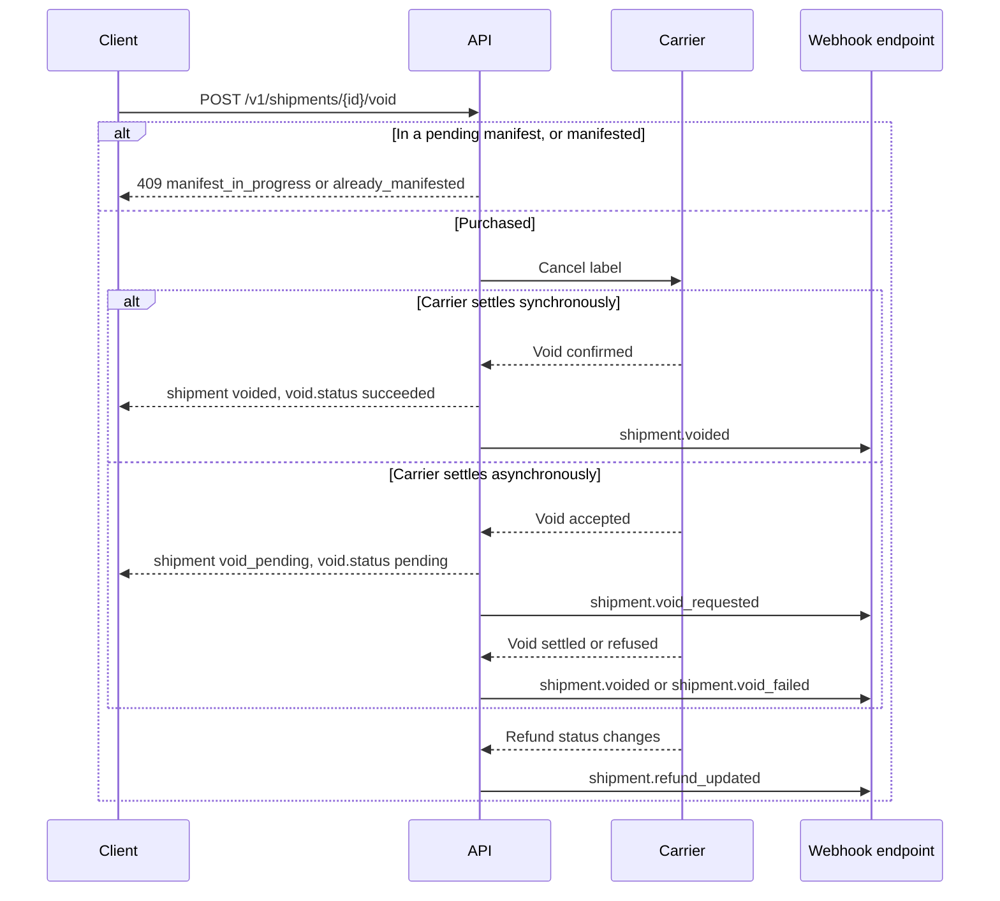

A **shipment** is the record of moving handling units from one party to another with one carrier service. Buying a shipment produces its label. It keeps two lifecycles apart:

- `status`: the **commercial lifecycle**, owned by the implementer (draft → purchased → voided).
- `tracking.status`: the **physical lifecycle**, projected from the shipment's tracker (pre_transit → in_transit → delivered). See chapter 07.

They are separate because they change for different reasons. A shipment can be `purchased` and `exception` at the same time. It can also be `voided` while its tracker still shows `pre_transit` because the carrier never scanned it.

## 1. The `shipment` object

The root holds only what describes the shipment itself. Everything else is grouped by concern into four nested objects: `purchase`, `tracking`, `handover` and `returns`.

```json
{
  "id": "shp_1Q2w3E4r5T6y",
  "object": "shipment",
  "livemode": false,
  "created": 1791302400,
  "updated": 1791302460,
  "status": "purchased",
  "reference": "ORDER-1001",
  "ship_date": "2026-10-06",

  "ship_from": { "...": "Contact" },
  "ship_to": { "...": "Contact" },
  "return_to": { "...": "Contact" },
  "bill_to": null,
  "billing": { "paid_by": "sender", "account_number": null },

  "handling_units": [ { "id": "hu_7Yh2", "type": "parcel", "tracking_number": "794612345678", "items": [ { "...": "Item" } ], "...": "HandlingUnit" } ],
  "order": { "id": "1001", "invoice": { "number": "INV-1001", "date": "2026-10-06" }, "...": "Order" },
  "customs_declaration": { "...": "CustomsDeclaration" },
  "carrier_configs": { "fedex": { "connection": "conn_9f8e", "service": "fedex_international_priority", "signature": "indirect", "saturday_delivery": false } },

  "purchase": {
    "rate": "rate_1Q2w3E4r",
    "rate_quote": "rq_5Tg7Yh",
    "service": { "carrier": "fedex", "connection": "conn_9f8e", "code": "fedex_international_priority", "name": "FedEx International Priority®", "level": "express", "carrier_code": "INTERNATIONAL_PRIORITY" },
    "amount": { "amount": 6420, "currency": "usd" },
    "charges": [ { "...": "Charge" } ],
    "delivery": { "days": 2, "date": "2026-10-08", "guaranteed": true },
    "label_format": { "format": "pdf", "size": "4x6" },
    "purchased_at": 1791302460,
    "error": null,
    "void": null,
    "coverage": null
  },
  "tracking": {
    "status": "pre_transit",
    "number": "794612345678",
    "url": "https://www.fedex.com/fedextrack/?trknbr=794612345678",
    "tracker": "trk_8Hj3",
    "journey": null
  },
  "handover": { "close_group": "dock-a", "pickup": null, "manifest": null },
  "injection": null,
  "returns": { "is_return": false, "outbound_shipment": null, "return_shipment": null },

  "documents": [
    { "id": "doc_3Rf8", "object": "document", "type": "label", "format": "pdf", "size": "4x6", "handling_unit": "hu_7Yh2", "url": "https://...", "url_expires_at": 1791388800 },
    { "id": "doc_9Kk1", "object": "document", "type": "commercial_invoice", "format": "pdf", "url": "https://..." }
  ],
  "messages": [],
  "user_metadata": { "order_id": "1001" },
  "carrier_metadata": { "routing_code": "STNA", "ursa_code": "XH SWCA", "master_tracking_id": "794612345678" },
  "system_metadata": { "source": "api", "created_by": { "type": "api_key", "id": "key_4Ff9" }, "request_id": "req_8a7dC1", "idempotency_key": "6f1c9b5e-...", "batch": null }
}
```

| Group | Fields | Notes |
|---|---|---|
| **root** | `status`, `reference`, `ship_date`, the four contacts, `billing`, `handling_units`, `order`, `customs_declaration`, `carrier_configs`, `documents`, `messages`, metadata | The shipment as described. These are the input fields, so the request shape matches the object. |
| **`purchase`** | `rate`, `rate_quote`, `service`, `amount`, `charges`, `delivery`, `label_format`, `purchased_at`, `error`, `void` | What was bought, and its commercial outcome. It is `null` until the first purchase attempt. `error` holds the last failed attempt in `purchase_failed`. |
| **`tracking`** | `status`, `number`, `url`, `tracker`, `journey` | The physical lifecycle. `number` is the master tracking number. Per-unit numbers are on `handling_units[].tracking_number`. `journey` is set in Carrier, 3PL and Fleet modes (chapter 16 §4). |
| **`handover`** | `close_group`, `pickup`, `manifest` | How the shipment leaves the shipper: its end-of-day close group (chapter 05 §4), its pickup, and its manifest |
| **`injection`** | `partner`, `channel`, `upstream_*`, `label_mode`, `injection_point`, `asn`, `status`, `received`, `tracking_feedback` | Set only when an upstream party injected the shipment (chapter 18). `null` otherwise. |
| **`returns`** | `is_return`, `outbound_shipment`, `return_shipment` | The outbound and return relationship. The field is named `returns` because `return` is a reserved word in most languages. |

This diagram shows the lean root, the four nested groups, and the arrays the root holds.



Rules:

- **`documents[]` holds every document**: labels (one per handling unit), return labels, commercial invoices, CN22/CN23 forms, and DG declarations. There is no separate `label` field. Clients pick by `type` (and `handling_unit` for multi-unit labels).
- **`carrier_configs` is the only carrier-settings field, everywhere.** Before purchase, it holds the carriers to rate, with each carrier's requested settings. After purchase, it holds exactly one key, the purchased carrier, with its **effective** config: your settings, merged with connection and carrier defaults, plus the resolved `connection` and `service`. The same map shape appears on rates, pickups, pickup schedules and manifests, always with one key when only one carrier is involved.
- Additional printed references (PO, department, invoice) are carrier-specific and go in the `references` standardized feature of `carrier_configs` (chapter 01 §6.1). `reference` is the single primary reference.

### `status`

| Status | Meaning | Next |
|---|---|---|
| `draft` | Created, not purchased. Editable. Can be rated. | `purchasing`, deleted |
| `purchasing` | A purchase is in flight, or is being reconciled after a carrier timeout (chapter 00 §8). | `purchased`, `purchase_failed` |
| `purchase_failed` | The carrier rejected the purchase. `purchase.error` is set. Editable again, so fix and retry. | `purchasing`, deleted |
| `purchased` | The label exists. The carrier may bill once it is scanned. | `void_pending`, `voided`, `manifested` |
| `manifested` | Included in a submitted manifest. Cannot be voided via the API unless the carrier declares `manifest.void_after`. | (terminal for commerce) |
| `void_pending` | A void was requested and the carrier settles it asynchronously. | `voided`, `void_failed` |
| `voided` | The label was cancelled. The refund state is in `purchase.void.refund`. | (terminal) |
| `void_failed` | The carrier refused the void (already scanned, or outside its window). The label is still valid. | `void_pending` |

This state diagram shows the transitions in the table above.



## 2. Create a shipment

```
POST /v1/shipments
```

The request body uses the root fields of the object, plus an optional `purchase` **instruction**. If `purchase` is present, the label is bought in the same call, and `Idempotency-Key` is required.

**A. From a rate (most common).**

```json
{ "purchase": { "rate": "rate_1Q2w3E4r", "label_format": { "format": "zpl", "size": "4x6" } }, "reference": "ORDER-1001" }
```

The shipment is built from the rate's quote: contacts, billing, handling units, order and declaration from the quote request, and `carrier_configs` from the rate. Alongside a rate, only `reference`, `handover.close_group` and `user_metadata` are accepted. Billing and carrier settings are part of the price, so changing them means re-rating.

**B. One call, no prior quote.**

```json
{
  "ship_from": { }, "ship_to": { }, "handling_units": [ ], "order": { }, "customs_declaration": { },
  "carrier_configs": { "fedex": { "service": "fedex_international_priority", "signature": "adult" } },
  "purchase": { "label_format": { "format": "pdf" } }
}
```

This mirrors Amazon Shipping's `oneClickShipment`. The implementer rates and buys atomically. `carrier_configs` MUST contain exactly one carrier, and its config MUST include a `service`. Otherwise the request fails with `400 parameter_invalid`.

**C. Draft first.** Omit `purchase`. `carrier_configs` may hold several carriers, and they become the rating set for the draft. Edit it with `POST /v1/shipments/{id}`, rate it with `POST /v1/shipments/{id}/rates`, and buy it later.

This flowchart shows how the implementer picks one of the three create paths from the request body.



### Request fields

| Field | Notes |
|---|---|
| `ship_from`, `ship_to`, `return_to`, `bill_to`, `billing`, `handling_units`, `order`, `customs_declaration`, `carrier_configs`, `ship_date` | As in chapter 02. Not allowed alongside `purchase.rate`. |
| `reference` | The primary reference printed on the label (max 35 characters) |
| `handover` | `{ close_group }` on input. `pickup` and `manifest` are set by those APIs. |
| `returns` | `{ is_return, include_return_label }` on input. With `is_return`, `ship_from` is the customer and `ship_to` is the returns facility. `include_return_label` also generates a return shipment, which populates `returns.return_shipment`. |
| `purchase` | The purchase instruction: `{ rate?, label_format?, max_increase? }`. `label_format` is `{ format, size, dpi, inline }` and defaults from account settings. `max_increase` is the tolerated re-price (chapter 02 §5). |
| `user_metadata` | |

### Response

- `200` with a shipment in `purchased` status when the carrier responds synchronously.
- `202` with a shipment in `purchasing` status when the implementer is reconciling a timeout. Clients wait for `shipment.purchased` or `shipment.purchase_failed`, or poll `GET /v1/shipments/{id}`.
- `422 carrier_error` when the carrier rejects. The shipment is still created, in `purchase_failed` status with `purchase.error` set, and the error carries `error.shipment = "shp_..."` so the client can fix and retry.

This sequence shows the three purchase outcomes, including reconciliation after a carrier timeout (chapter 00 §8). It applies to both create-with-purchase and purchasing a draft.



## 3. Purchase a draft

```
POST /v1/shipments/{id}/purchase
Idempotency-Key: ...
```

```json
{ "rate": "rate_1Q2w3E4r", "label_format": { "format": "pdf" } }
```

The body is the same purchase instruction. `rate` must belong to a quote made for this shipment. Without `rate`, the draft's `carrier_configs` must hold exactly one carrier with a `service`. Purchasing a shipment that is already `purchased` returns `409 state_error` / `label_already_purchased`, not a second label.

## 4. Re-rate a draft

```
POST /v1/shipments/{id}/rates
```

The body accepts `carrier_configs` (which replaces the draft's), `levels` and `timeout_ms`. The result is a `rate_quote` with `shipment: "shp_..."`.

## 5. Void a label

```
POST /v1/shipments/{id}/void
```

```json
{ "reason": "customer_cancelled", "handling_units": null }
```

| Param | Notes |
|---|---|
| `reason` | `customer_cancelled`, `duplicate`, `wrong_address`, `wrong_service`, `damaged_label`, `other` |
| `handling_units` | Void specific units of a multi-unit shipment (`["hu_..."]`). Only carriers with the `void.partial` capability support this. |

The response is the shipment, with `purchase.void` set:

```json
"void": {
  "requested_at": 1791306000,
  "reason": "customer_cancelled",
  "status": "succeeded",
  "refund": { "status": "pending", "amount": { "amount": 6420, "currency": "usd" }, "expected_by": "2026-10-20" },
  "carrier_reference": "VOID-88123"
}
```

- `void.status`: `pending`, `succeeded`, `failed`.
- `void.refund.status`: `not_applicable` (the carrier bills only on scan), `pending`, `refunded`, `partially_refunded`, `rejected`.
- Errors: `409 state_error` / `manifest_in_progress`, `409 state_error` / `already_manifested`, `409 state_error` / `already_in_transit`, `422 carrier_error` / `void_window_expired`.
- Voiding is idempotent. Voiding a `voided` shipment returns it unchanged with `200`.

This sequence shows a void, with the carrier settling it either at once or later, and the refund tracked separately.



**Why void is not DELETE.** The label existed, may have been printed, and may yet be scanned. The record must survive for reconciliation against the carrier invoice. This is the Stripe refund pattern applied to postage.

## 6. Returns

```
POST /v1/shipments/{id}/return
```

```json
{ "carrier_configs": { "ups": { "service": "ups_ground" } }, "purchase": { "label_format": { "format": "pdf" } }, "delivery_method": "label" }
```

This creates a new shipment with `returns.is_return: true` and `returns.outbound_shipment` set, and sets `returns.return_shipment` on the original. `ship_from`/`ship_to` are swapped (`ship_to` becomes the original `return_to`). Handling units, items and `order` are copied, and `customs_declaration` is copied with `contents_type: "returned_goods"`. Pass `handling_units` to return only some items. Billing defaults to the merchant's connection account, and `bill_to` defaults to the outbound `ship_from` (chapter 01 §1.1).

`delivery_method` is one of:
- `label`: a printable label, in `documents[type=label]`.
- `qr_code`: a carrier drop-off QR code, in `documents[type=label, format=png]`.
- `email`: the carrier emails the label to the customer's email, which is `ship_from.email` on the return.
- `pickup`: the carrier collects from the customer. This requires the pickups module.

## 7. Retrieve, update, list, delete

```
GET    /v1/shipments/{id}
POST   /v1/shipments/{id}
GET    /v1/shipments
GET    /v1/shipments/search?query=...
DELETE /v1/shipments/{id}
```

- **Update:** In `draft` and `purchase_failed`, every input field is editable. In other statuses, only `user_metadata`, `reference` (stored only, not re-sent to the carrier) and `redact` are editable.
- **Delete:** Only `draft` and `purchase_failed` shipments can be deleted. Others return `409 state_error`.
- **List filters:** `status`, `tracking.status`, `tracking.number`, `carrier`, `connection`, `purchase.service.code`, `reference`, `order.id`, `returns.is_return`, `handover.manifest` (`none` for unmanifested), `handover.pickup`, `handover.close_group`, `ship_date[gte|lte]`, `created[gte|lte]`, `user_metadata[key]`. `carrier` and `connection` match the key of `carrier_configs` and its `connection`.
- **Expandable:** `purchase.rate`, `purchase.rate_quote`, `purchase.service.connection`, `tracking.tracker`, `tracking.journey`, `handover.pickup`, `handover.manifest`, `returns.outbound_shipment`, `returns.return_shipment`.

## 8. Re-render a label

```
POST /v1/shipments/{id}/label
```

```json
{ "format": "zpl", "size": "4x6", "handling_unit": null }
```

This re-renders labels in another format when the carrier supports it (capability `labels.reformat`), or converts them locally (PDF ↔ PNG). It never re-purchases. The new `document`s are appended to `documents[]`.

## 9. Events

`shipment.created`, `shipment.updated`, `shipment.purchased`, `shipment.purchase_failed`, `shipment.void_requested`, `shipment.voided`, `shipment.void_failed`, `shipment.refund_updated`, `shipment.manifested`, `shipment.tracking_updated`, `shipment.charges_adjusted`. The last fires when a carrier invoice adjustment arrives through inbound reconciliation.
