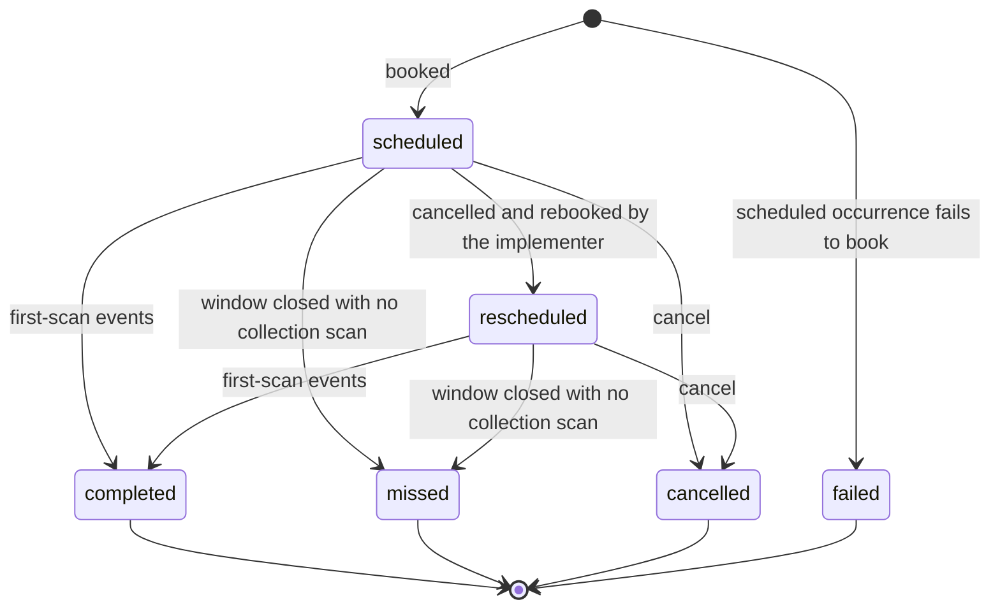
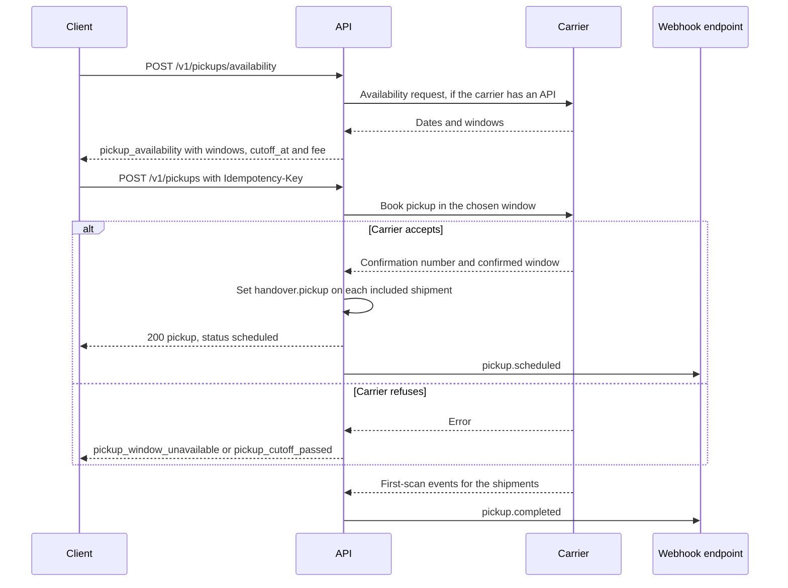
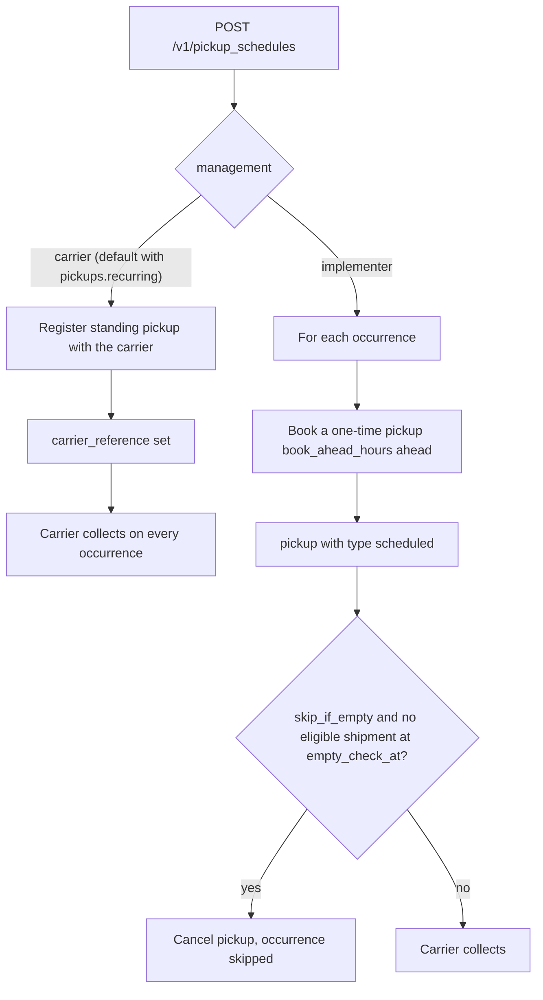
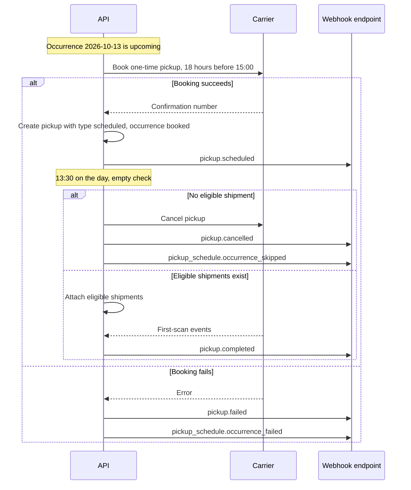
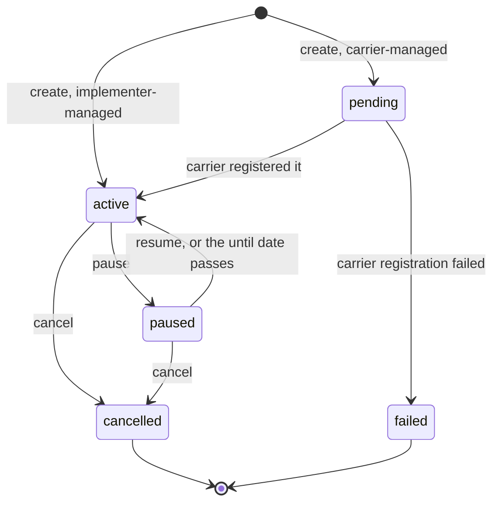

A **pickup** asks a carrier to collect parcels from an address within a time window. It is booked against one connection and may cover any number of that connection's purchased shipments.

## 1. The `pickup` object

```json
{
  "id": "pck_4Rt6",
  "object": "pickup",
  "livemode": false,
  "created": 1791302400,
  "updated": 1791302400,
  "status": "scheduled",
  "connection": "conn_9f8e",
  "carrier": "fedex",
  "confirmation_number": "CPU-8812",
  "contact": { "...": "Contact, with address" },
  "date": "2026-10-07",
  "timezone": "America/Los_Angeles",
  "window": { "ready_at": "10:00", "close_at": "17:00" },
  "location": "front_desk",
  "instructions": "Ring bell at loading dock B",
  "shipments": ["shp_1Q2w3E4r5T6y"],
  "manifest": "mfst_2Ws4",
  "handling_unit_count": 3,
  "total_weight": { "value": 4.2, "unit": "kg" },
  "type": "one_time",
  "schedule": null,
  "amount": { "amount": 0, "currency": "usd" },
  "documents": [],
  "cancellation": null,
  "messages": [],
  "user_metadata": {}
}
```

| Field | Notes |
|---|---|
| `status` | `scheduled`, `rescheduled`, `completed` (carrier confirmed collection, inferred from first-scan events), `missed` (the window closed with no collection scan), `cancelled`, `failed` |
| `window` | Local times. The carrier may narrow the requested window. The response always shows the confirmed window. |
| `location` | `front_door`, `back_door`, `side_door`, `front_desk`, `reception`, `mailroom`, `loading_dock`, `garage`, `other` |
| `type` | `one_time` (booked directly) or `scheduled` (an occurrence of a pickup schedule, §7) |
| `schedule` | The `psch_` this pickup was generated from, or `null` |
| `shipments` | Optional. Some carriers (USPS, Canada Post) require tracking numbers, while others (DHL Express) only need counts. Rely on `carriers/{id}.pickup.requires`. |
| `manifest` | The manifest this handover belongs to, when booked with one (chapter 05 §9) |
| `amount` | The pickup fee, if any |

This state diagram shows how a pickup's `status` moves, based on the values above and sections 3 to 5.



## 2. Check availability

```
POST /v1/pickups/availability
```

```json
{ "connection": "conn_9f8e", "contact": { "address": { } }, "date": "2026-10-07", "handling_unit_count": 3, "total_weight": { "value": 4.2, "unit": "kg" } }
```

```json
{
  "object": "pickup_availability",
  "connection": "conn_9f8e",
  "dates": [
    { "date": "2026-10-07", "windows": [{ "ready_at": "09:00", "close_at": "18:00" }], "cutoff_at": 1791331200, "fee": { "amount": 0, "currency": "usd" } },
    { "date": "2026-10-08", "windows": [{ "ready_at": "09:00", "close_at": "18:00" }], "cutoff_at": 1791417600, "fee": { "amount": 0, "currency": "usd" } }
  ]
}
```

Carriers without an availability API return a synthesized window from the carrier's published service hours, with `messages[0].code = "availability_estimated"`.

## 3. Book a pickup

```
POST /v1/pickups
Idempotency-Key: ...
```

| Param | Required | Notes |
|---|---|---|
| `connection` | yes* | *Or inferred from `shipments` when they all share one connection |
| `contact` | yes* | Contact with `address`. The driver uses `name` and `phone`. *Or inferred from the shipments' `ship_from`. |
| `date` | yes | |
| `window` | yes | `{ ready_at, close_at }`. Carriers enforce a minimum window (often 2 hours) and a same-day cutoff. |
| `shipments` | conditional | Required when the carrier needs tracking numbers |
| `handling_unit_count`, `total_weight` | conditional | Required if `shipments` is omitted |
| `location`, `instructions` | no | |
| `carrier_configs` | no | `{ "<carrier>": { ... } }` with one key: pickup options (vehicle type, liftgate, freight), validated against `carriers/{id}.pickup_config_schema` |
| `user_metadata` | no | |

The response is `200` with a pickup in `scheduled` status. The errors are `pickup_window_unavailable`, `pickup_cutoff_passed`, `address_unserviceable`, and `pickup_already_scheduled` (when the carrier allows only one per address per day, `error.details[0].pickup` names the existing one).

Every included shipment's `handover.pickup` is set to this pickup.

This sequence shows a one-time pickup from availability check to collection.



## 4. Update or reschedule

```
POST /v1/pickups/{id}
```

The editable fields are `date`, `window`, `shipments` (add or remove), `handling_unit_count`, `total_weight`, `location`, `instructions` and `user_metadata`. If the carrier has no modify API, the implementer cancels and rebooks atomically, the `confirmation_number` changes, and the status becomes `rescheduled`. Either way the pickup keeps its `id`.

## 5. Cancel (void) a pickup

```
POST /v1/pickups/{id}/cancel
```

```json
{ "reason": "no_longer_needed" }
```

The result is `status: "cancelled"`, and `cancellation: { requested_at, reason, carrier_reference }`. Cancelling after the window has opened returns `409 state_error` / `pickup_in_progress` for carriers that forbid it. Cancelling is idempotent.

## 6. List and retrieve

```
GET /v1/pickups/{id}
GET /v1/pickups?status=scheduled&date[gte]=2026-10-01&connection=conn_9f8e
```

Expandable: `shipments`, `connection`.

## 7. Pickup schedules (recurring pickups)

Most shippers want "collect from the dock every weekday at 3pm", not a booking every day. Carriers support this in two incompatible ways, and the spec hides the difference:

- **Carrier-managed:** the carrier holds a standing daily or weekly pickup on the account (UPS and FedEx regular pickups, many postal operators). It is created once, and the carrier comes every time.
- **Implementer-managed:** the carrier only books one-time pickups. The implementer books each occurrence ahead of time, and can skip days with nothing to collect.

This flowchart shows how a schedule is handled under each kind of management.



### 7.1 The `pickup_schedule` object

```json
{
  "id": "psch_6Tt2",
  "object": "pickup_schedule",
  "livemode": false,
  "created": 1791302400,
  "updated": 1791302400,
  "status": "active",
  "connection": "conn_ups01",
  "carrier": "ups",
  "management": "implementer",
  "contact": { "company": "Ada Shop", "phone": "+14085550100", "address": { "line1": "Infinite Loop", "street_number": "1", "city": "Cupertino", "state": "CA", "postal_code": "95014", "country": "US" } },
  "recurrence": { "frequency": "weekly", "days": ["mon", "tue", "wed", "thu", "fri"], "times": ["15:00"], "timezone": "America/Los_Angeles", "starts_on": "2026-10-12", "holiday_calendar": "us_federal", "exceptions": [] },
  "window": { "ready_at": "15:00", "close_at": "18:00" },
  "location": "loading_dock",
  "instructions": "Dock B",
  "estimate": { "handling_unit_count": 40, "total_weight": { "value": 60, "unit": "kg" } },
  "booking": { "book_ahead_hours": 18, "skip_if_empty": true, "empty_check_at": "13:30", "attach_shipments": "eligible" },
  "carrier_configs": {},
  "next_occurrences": [
    { "date": "2026-10-12", "status": "booked", "pickup": "pck_4Rt6" },
    { "date": "2026-10-13", "status": "upcoming", "pickup": null }
  ],
  "carrier_reference": null,
  "user_metadata": {}, "carrier_metadata": {}, "system_metadata": {}
}
```

| Field | Notes |
|---|---|
| `status` | `pending` (being registered with the carrier), `active`, `paused`, `cancelled`, `failed` |
| `management` | `carrier` or `implementer`. Clients may request one. The default is `carrier` when the carrier supports standing pickups (capability `pickups.recurring`), and otherwise `implementer`. |
| `recurrence` | A `Recurrence` (chapter 01 §13). Carrier-managed schedules are limited to what the carrier supports (usually weekly by day), and the rest returns `option_unsupported`. |
| `booking` | Implementer-managed only. `book_ahead_hours` sets when each occurrence is booked. With `skip_if_empty`, the occurrence is skipped (or cancelled, if already booked) when no eligible shipment exists at `empty_check_at`. `attach_shipments` is `eligible` (attach every purchased, unmanifested shipment from this `contact.address`) or `none`. |
| `next_occurrences[]` | The next 14 occurrences: `upcoming`, `booked`, `skipped`, `completed`, `missed`, or `failed`, each with its generated `pickup` |
| `carrier_reference` | The carrier's standing-pickup ID, for carrier-managed schedules |

Each booked occurrence is an ordinary `pickup` with `type: "scheduled"` and `schedule: "psch_..."`. Every pickup endpoint and event applies to it. Cancelling that one pickup skips that occurrence only.

This sequence follows one occurrence of the implementer-managed schedule above (`book_ahead_hours: 18`, `skip_if_empty: true`, `empty_check_at: "13:30"`).



This state diagram shows a schedule's `status`, driven by the endpoints in §7.2.



### 7.2 Endpoints

```
POST   /v1/pickup_schedules                         create (Idempotency-Key required)
GET    /v1/pickup_schedules                         GET /v1/pickup_schedules/{id}
POST   /v1/pickup_schedules/{id}                    update recurrence, window, contact, booking, carrier_configs, user_metadata
POST   /v1/pickup_schedules/{id}/pause              { until?: "2026-11-01" }
POST   /v1/pickup_schedules/{id}/resume
POST   /v1/pickup_schedules/{id}/cancel
POST   /v1/pickup_schedules/{id}/skip               { dates: ["2026-10-14"] }    (adds recurrence exceptions)
POST   /v1/pickup_schedules/{id}/add                { dates: ["2026-10-18"] }    (adds one-off occurrences)
GET    /v1/pickup_schedules/{id}/occurrences?from=…&to=…
```

- Updating a carrier-managed schedule re-registers it with the carrier. If the carrier has no modify API, the implementer cancels and recreates it, the `carrier_reference` changes, and the `id` stays the same.
- Changes take effect from the next occurrence that has not been booked. Occurrences already booked keep their pickup unless the update sets `apply_to_booked: true`.
- Filters: `status`, `connection`, `carrier`, `management`.

### 7.3 Events

`pickup_schedule.created`, `pickup_schedule.updated`, `pickup_schedule.paused`, `pickup_schedule.resumed`, `pickup_schedule.cancelled`, `pickup_schedule.failed`, `pickup_schedule.occurrence_skipped`, `pickup_schedule.occurrence_failed` (a booking attempt failed, and the underlying `pickup.failed` event is also emitted).

## 8. Events

`pickup.scheduled`, `pickup.updated`, `pickup.rescheduled`, `pickup.cancelled`, `pickup.failed`, `pickup.completed`, `pickup.missed`.
