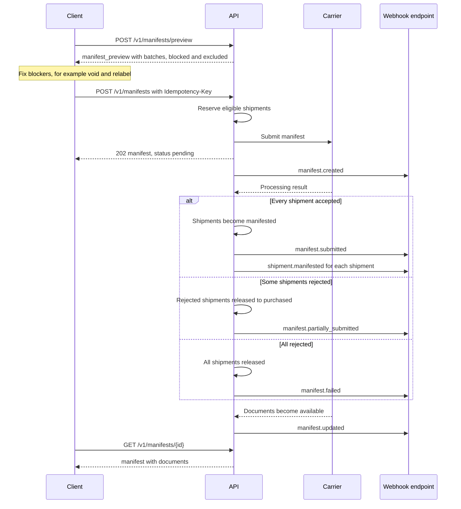
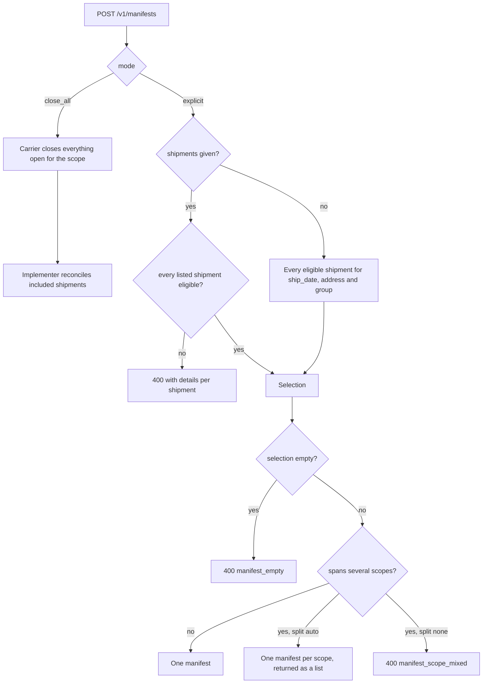
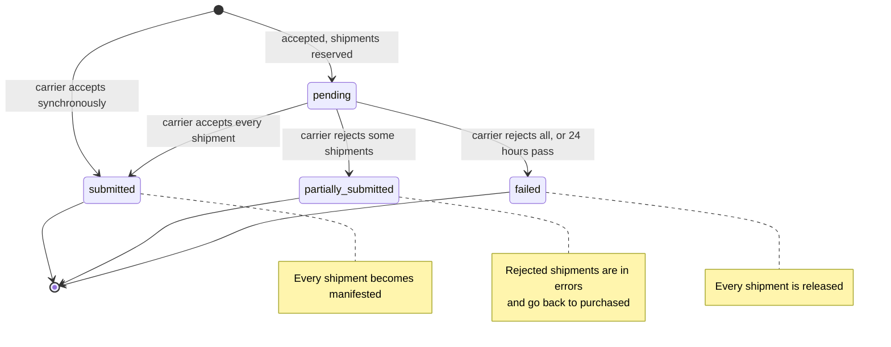
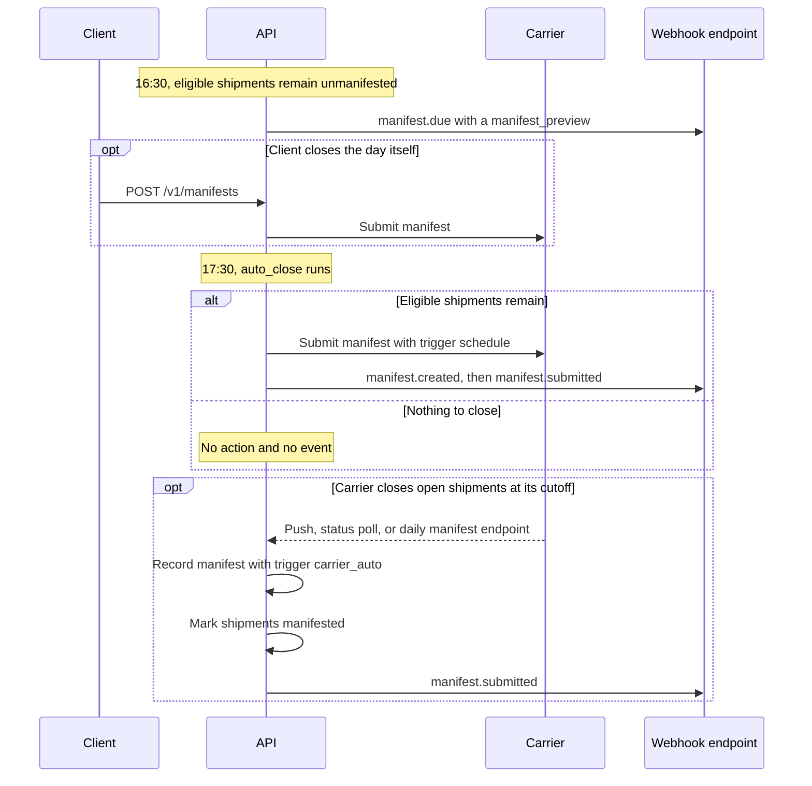
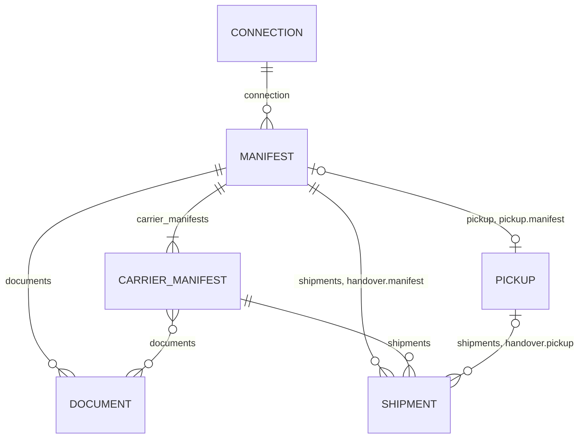

A **manifest** (also called a close-out, end-of-day, SCAN form, bordereau, or order summary) tells a carrier which labels to expect at a handover. For some carriers it is mandatory, and their parcels are not accepted, or not billed correctly, without one: USPS SCAN forms, Canada Post transmit, Australia Post orders, DHL Parcel DE, and most postal operators. Others close the day implicitly, or have no concept of it at all.

Integrations break on end of day in predictable ways, and this chapter is built around them:

| What we saw | Carrier examples | How the spec handles it |
|---|---|---|
| One request returns **several** carrier manifests | Canada Post (one per group or shipping point), SEKO (several outbound manifest numbers) | `carrier_manifests[]` within one `manifest` (§1) |
| A manifest is scoped by **origin, date, or group**, not by account | USPS (entry ZIP + mailing date), Canada Post (group IDs) | `scope` on the carrier, plus implementer-side close groups (§4) |
| The carrier **closes everything open**, with no shipment list | FedEx Ground End of Day close, DHL Parcel DE | `mode: "close_all"` (§3) |
| Submission is **asynchronous**, and documents arrive later | Asendia, Royal Mail | `pending` → `submitted`, with events and `documents` that fill in later (§5) |
| **Some** shipments are rejected | Asendia (`errorParcelIds`) | `partially_submitted` with per-shipment `errors[]` (§5) |
| Older labels have **stale ship dates** | USPS (`overwriteMailingDate`) | `ship_date_policy` (§3) |
| Manifested shipments become **locked** | Australia Post orders, USPS SCAN | Shipment status `manifested`, and void is blocked (§6) |
| The carrier **auto-closes** at its cutoff | DHL Parcel DE | `carrier_auto` manifests detected and recorded (§7.3) |
| People forget to close the day | Every merchant | Previews, scheduled auto-close, and a `manifest.due` reminder (§2, §7) |

Check `GET /v1/carriers/{id}` → `manifest` for a carrier's behavior (§8).

## 1. The `manifest` object

```json
{
  "id": "mfst_2Ws4",
  "object": "manifest",
  "livemode": false,
  "created": 1791320000,
  "updated": 1791320090,
  "status": "submitted",
  "mode": "explicit",
  "trigger": "api",
  "connection": "conn_cpc01",
  "carrier": "canada_post",
  "ship_date": "2026-10-06",
  "timezone": "America/Toronto",
  "address": { "line1": "Rue Saint-Paul", "street_number": "200", "city": "Montréal", "state": "QC", "postal_code": "H2Y 1Z9", "country": "CA" },
  "group": null,
  "shipments": ["shp_1Q2w...", "shp_9Ij8..."],
  "shipment_count": 42,
  "handling_unit_count": 47,
  "total_weight": { "value": 61.4, "unit": "kg" },
  "carrier_manifests": [
    {
      "carrier_reference": "M-0000123456",
      "shipments": ["shp_1Q2w...", "..."],
      "documents": ["doc_7Mn2"],
      "carrier_metadata": { "group_id": "20261006-A", "po_number": "1234567890" }
    },
    {
      "carrier_reference": "M-0000123457",
      "shipments": ["shp_9Ij8...", "..."],
      "documents": ["doc_7Mn3"],
      "carrier_metadata": { "group_id": "20261006-B" }
    }
  ],
  "documents": [
    { "id": "doc_7Mn9", "type": "manifest", "format": "pdf", "bundle": ["doc_7Mn2", "doc_7Mn3"], "url": "https://..." },
    { "id": "doc_7Mn2", "type": "manifest", "format": "pdf", "url": "https://..." },
    { "id": "doc_7Mn3", "type": "manifest", "format": "pdf", "url": "https://..." },
    { "id": "doc_8Pq1", "type": "close_report", "format": "pdf", "url": "https://..." }
  ],
  "pickup": "pck_4Rt6",
  "errors": [],
  "reference": "DOCK-A-20261006",
  "submitted_at": 1791320090,
  "messages": [],
  "user_metadata": {},
  "carrier_metadata": {},
  "system_metadata": { "source": "api", "request_id": "req_Mf1" }
}
```

| Field | Notes |
|---|---|
| `status` | `pending`, `submitted`, `partially_submitted`, `failed` (§5) |
| `mode` | `explicit` (listed shipments) or `close_all` (everything open at the carrier for the scope) (§3) |
| `trigger` | `api` (a client call), `schedule` (the connection's auto-close, §7.1), or `carrier_auto` (the carrier closed it on its own, and the implementer recorded it, §7.3) |
| `address` | The origin or handover facility, for carriers whose `scope` includes the origin (USPS entry ZIP). It is an Address, not a Contact. |
| `group` | The close group this manifest closed (§4) |
| `carrier_manifests[]` | One entry per manifest the carrier issued. Most carriers produce exactly one. Each has its own `carrier_reference`, shipment subset, `documents` (IDs into the manifest's `documents[]`), and `carrier_metadata`. |
| `documents[]` | **Every** document: each carrier manifest, a combined print-ready PDF (`bundle` lists the documents it merges), and close-out reports (`close_report`, `cod_report`, `dangerous_goods_report`, `order_summary`, `scan_form`). It is empty while `pending`. |
| `pickup` | The pickup booked with, or for, this handover (§9) |
| `errors[]` | `{ shipment, code, message, carrier_metadata }` for shipments the carrier rejected |

## 2. Preview the day

```
POST /v1/manifests/preview
```

```json
{ "connection": "conn_usps01", "ship_date": "2026-10-06" }
```

```json
{
  "object": "manifest_preview",
  "connection": "conn_usps01",
  "carrier": "usps",
  "ship_date": "2026-10-06",
  "cutoff_at": 1791334800,
  "batches": [
    {
      "address": { "line1": "Main St", "street_number": "100", "city": "Austin", "state": "TX", "postal_code": "78701", "country": "US" },
      "group": null,
      "shipments": ["shp_...", "..."],
      "shipment_count": 118,
      "handling_unit_count": 118
    }
  ],
  "blocked": [
    { "shipment": "shp_Zz9", "code": "ship_date_in_past", "message": "Ship date 2026-10-03 is earlier than the manifest date. Use ship_date_policy=roll_forward, or void and relabel." }
  ],
  "excluded": [
    { "shipment": "shp_Yy8", "code": "void_pending", "message": "Void in progress." }
  ]
}
```

A preview is free, side-effect-free, and makes no carrier call. It returns what `POST /v1/manifests` would submit with the same parameters: one entry in `batches[]` per manifest that would be created, plus what would be blocked or excluded and why. End-of-day screens are built on this: show the count, fix the blockers, then close.

This sequence shows a full end-of-day close with a carrier that processes manifests asynchronously.



## 3. Create (close out) a manifest

```
POST /v1/manifests
Idempotency-Key: ...
```

| Param | Required | Notes |
|---|---|---|
| `connection` | yes | Carriers manifest per account |
| `mode` | no | `explicit` (the default when `shipments` is given) or `close_all` (the default when it is not and the carrier supports it). `close_all` sends no shipment list. The carrier closes everything open for the scope, and the implementer reconciles which of its shipments were included. This requires capability `manifests.close_all`. |
| `shipments` | no | Explicit `shp_` IDs. If omitted with `mode: explicit`, every eligible shipment is included (see below). |
| `ship_date` | no | Defaults to today in the connection's time zone |
| `address` | conditional | Required when the carrier's scope includes `origin` and `split` is `none` while eligible shipments have more than one origin. Defaults to the shipments' common `ship_from.address`. |
| `group` | no | Close only this close group (§4) |
| `ship_date_policy` | no | `strict` (the default: shipments with an earlier ship date block the manifest) or `roll_forward` (the carrier re-dates them to the manifest date, where allowed, as with USPS). Carriers without support return `option_unsupported`. |
| `split` | no | `auto` (the default) or `none`. With `auto`, if the eligible shipments span several scopes (USPS origins, Canada Post groups), the implementer creates **one manifest per scope** and returns a `list` of them. With `none`, a request that spans scopes fails with `400 manifest_scope_mixed`. |
| `pickup` | no | `{ book: true, window, contact }` to book the handover pickup in the same call, or `"pck_..."` to link an existing one (§9) |
| `carrier_configs` | no | Single-key carrier options, validated against `carriers/{id}.manifest_config_schema`. For example: Canada Post `method_of_payment` and `detailed_manifests`, USPS `destination_entry_facility_type`, DHL Parcel DE `billing_number`. |
| `reference` | no | Printed on the manifest where supported |
| `user_metadata` | no | |

**Eligible shipments** are those that are `purchased`, belong to `connection`, have not been voided or void-requested, are not in another `pending` or `submitted` manifest, and match `ship_date`, `address` and `group`.

Rules:

- With an explicit list, every shipment must be eligible. Otherwise the call returns `400` with `details[]` per shipment, and nothing is submitted.
- An empty selection returns `400 invalid_request_error` / `manifest_empty`.
- The response is `200` with a `manifest`, `202` if it is `pending`, or a `list` of manifests when `split: auto` produced several.
- A manifest is **irreversible** through the API. Implementers whose carrier supports reopening MAY expose `POST /v1/manifests/{id}/cancel` under capability `manifests.cancel`.

This flowchart shows how the implementer turns a create request into zero, one, or several manifests.



## 4. Scope and close groups

Carriers disagree about *what* a manifest closes. The carrier catalog states it as `manifest.scope`, which lists one or more of:

| Scope | Meaning | Examples |
|---|---|---|
| `connection` | Everything for the account | Asendia, SEKO |
| `ship_date` | One manifest per ship date | Most |
| `origin` | One manifest per origin facility or postal code | USPS (entry facility ZIP) |
| `group` | Shipments are assigned to a carrier group at label time, and groups are transmitted | Canada Post (`group_id`) |

**Close groups.** Merchants often need to close part of the day: one dock, one wave, one client of a 3PL. A shipment can carry `handover.close_group`, a string set at create or purchase that defaults to `null`. `POST /v1/manifests` with `group` closes only that group. For carriers with `group` scope, the implementer maps `handover.close_group` onto the carrier's own grouping at label time, creating carrier groups as needed. That is why the field must be set **before purchase** for those carriers. Changing it afterwards returns `409 state_error`.

## 5. Asynchronous submission and partial results

| `status` | Meaning |
|---|---|
| `pending` | Accepted and being submitted, or the carrier is processing asynchronously. Included shipments are reserved, so they cannot be voided or added to another manifest. |
| `submitted` | The carrier accepted every shipment, `documents` are available (or will be), and every shipment is `manifested`. |
| `partially_submitted` | The carrier accepted some shipments and rejected others. The accepted ones become `manifested`. The rejected ones are in `errors[]`, are released back to `purchased`, and can go into a later manifest. |
| `failed` | Rejected entirely. `errors[]` is set, and every shipment is released. |

This state diagram shows a manifest's `status`, and what each outcome does to its shipments.



- Implementers MUST poll or subscribe to carriers that process asynchronously, and move the manifest out of `pending` within the carrier's published processing time. Manifests still `pending` after 24 hours move to `failed` with `code: "carrier_timeout"`, and their shipments are released.
- When documents arrive after the status changes (Asendia document locations, for example), `documents` fill in later, and `manifest.updated` fires.

## 6. Effect on shipments

- An included shipment's `handover.manifest` field is set, and its status becomes `manifested` on `submitted`.
- `POST /v1/shipments/{id}/void` on a shipment in a `pending` manifest returns `409 state_error` / `manifest_in_progress`. On a `manifested` shipment it returns `409 state_error` / `already_manifested`, unless the carrier declares `manifest.void_after: true`.
- Shipments purchased after a `close_all` for the same scope and date belong to the **next** manifest. Implementers MUST NOT silently date them into a closed day. Where the carrier requires it, they are re-dated to the next business day, and a `ship_date_rolled` message is added.

## 7. Automatic end of day

### 7.1 Scheduled auto-close (run by the implementer)

Configured per connection in `connection.config.end_of_day` (chapter 09 §2):

```json
"end_of_day": {
  "auto_close": true,
  "time": "17:30",
  "days": ["mon", "tue", "wed", "thu", "fri"],
  "mode": "explicit",
  "split": "auto",
  "ship_date_policy": "strict",
  "book_pickup": false,
  "remind_before_minutes": 60
}
```

At `time` (in the connection's time zone), the implementer runs the equivalent of `POST /v1/manifests` for the day with `trigger: "schedule"`, and emits the usual events. If there is nothing to close, it does nothing and emits no event.

### 7.2 Reminders

If `remind_before_minutes` is set, or the carrier's `manifest.required` is true, the implementer emits `manifest.due` that many minutes before `time` or the carrier cutoff, whichever is earlier, while eligible shipments remain unmanifested. The event's `data.object` is a `manifest_preview`.

### 7.3 Carrier auto-close (run by the carrier)

Some carriers close open shipments themselves at a cutoff. When the implementer detects this, through a carrier push, a status poll, or the carrier's daily manifest endpoint, it MUST record a `manifest` with `trigger: "carrier_auto"`, mark the shipments `manifested`, and emit `manifest.submitted`. Otherwise the client still thinks those shipments are open and voidable.

This sequence shows one day on a connection with the `end_of_day` config from §7.1 (`time: "17:30"`, `remind_before_minutes: 60`). Each step runs only if its condition holds.



## 8. Carrier manifest descriptor

`GET /v1/carriers/{id}` includes:

```json
"manifest": {
  "required": true,
  "scope": ["ship_date", "origin"],
  "modes": ["explicit"],
  "async": false,
  "multiple_per_request": false,
  "ship_date_policies": ["strict", "roll_forward"],
  "cutoff_local_time": "20:00",
  "carrier_auto_close": false,
  "void_after": false,
  "reprint": true,
  "max_shipments": 10000,
  "documents": ["scan_form"]
}
```

Capabilities (chapter 11): `manifests`, `manifests.close_all`, `manifests.async`, `manifests.reprint`, `manifests.cancel`, `manifests.carrier_auto_close`.

## 9. Manifests and pickups

The handover is one physical event, but many carriers expose it as two APIs. Some, like Canada Post, take a pickup flag on the transmit call itself.

- `pickup: { book: true, window, contact }` on create books the pickup after a successful submit and links both ways (`manifest.pickup`, `pickup.manifest`, and each shipment's `handover`). Where the carrier books the pickup within the manifest call, the implementer creates the `pickup` object from the response.
- If the connection's config has `manifest_required: true`, `POST /v1/pickups` with shipments that are not manifested returns `409 state_error` / `manifest_required`.

This diagram shows how a manifest, its carrier manifests, its documents, its shipments and its pickup relate.



## 10. Retrieve, list, update, reprint

```
GET  /v1/manifests/{id}
GET  /v1/manifests?connection=conn_usps01&ship_date=2026-10-06&status=submitted&trigger=schedule
POST /v1/manifests/{id}                (user_metadata, reference)
POST /v1/manifests/{id}/reprint        → manifest with fresh document URLs
```

`reprint` re-fetches documents from the carrier (capability `manifests.reprint`, for example FedEx Ground's close-report reprint by date), or re-renders a stored copy. It never resubmits.

Expandable: `shipments`, `connection`, `pickup`.

## 11. Events

`manifest.created`, `manifest.updated`, `manifest.submitted`, `manifest.partially_submitted`, `manifest.failed`, `manifest.due`. Each manifested shipment also emits `shipment.manifested`.
