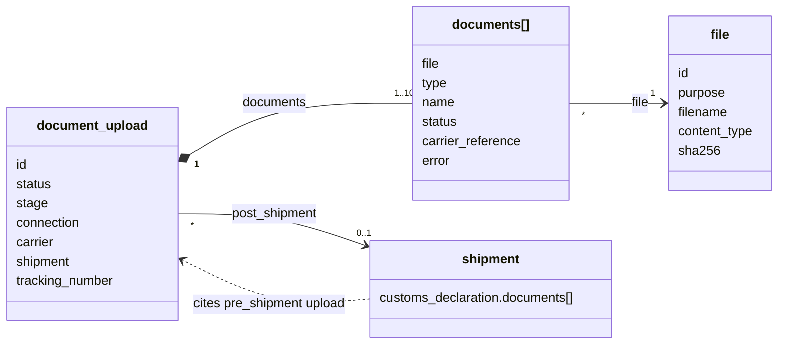
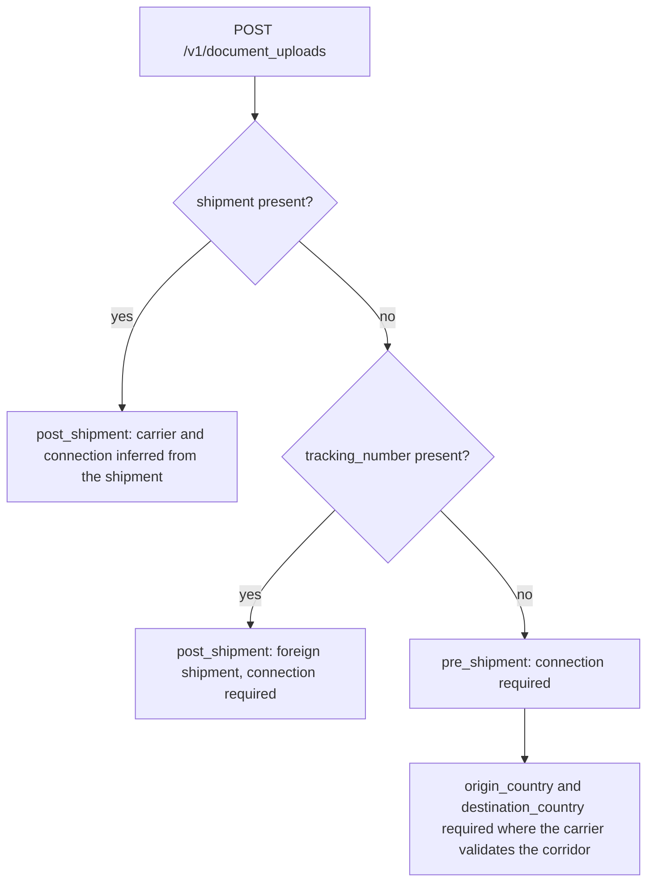
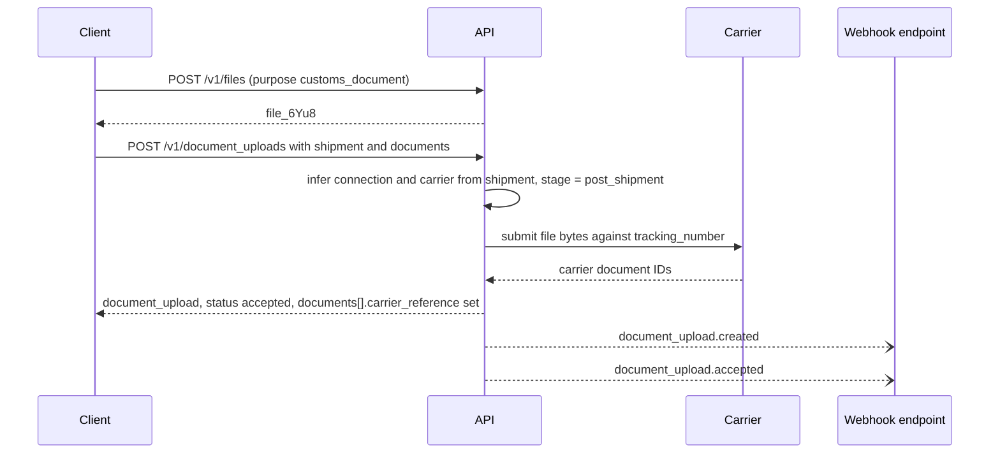
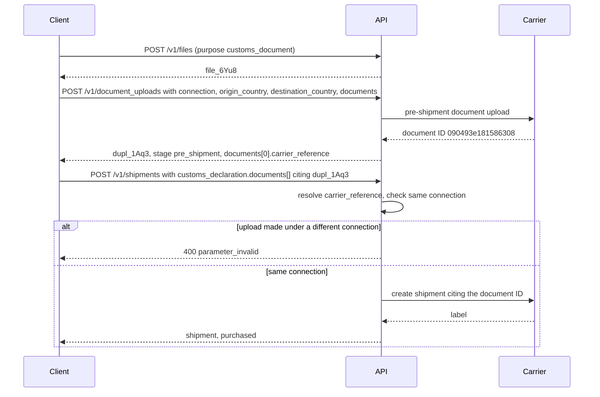
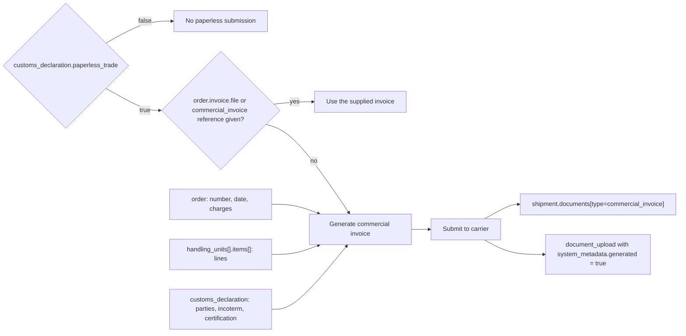

Two objects:

- **`file`**: bytes you uploaded or the implementer generated. It is carrier-agnostic, like Stripe Files.
- **`document_upload`**: a submission of one or more files to a carrier as trade documents (commercial invoice, certificate of origin, licence), also known as paperless trade, ETD, or PLT.

Splitting them means a client uploads an invoice once and can submit it to several carriers, retry a failed submission without re-uploading, and audit exactly which bytes each carrier received.

The diagram below shows how the two objects relate: one `file` can be cited by many submissions, and each submission belongs to one connection and, after the label, one shipment.



## 1. The `file` object

```json
{
  "id": "file_6Yu8",
  "object": "file",
  "livemode": false,
  "created": 1791302400,
  "purpose": "customs_document",
  "filename": "INV-1001.pdf",
  "content_type": "application/pdf",
  "size": 48213,
  "sha256": "3a7bd3e2360a3d...",
  "url": "https://files.example.com/file_6Yu8?sig=...",
  "url_expires_at": 1791306000,
  "expires_at": null,
  "user_metadata": {}
}
```

`purpose` is one of `customs_document`, `dangerous_goods_declaration`, `label` (generated), `manifest` (generated), `signature_image`, `proof_of_delivery`, `logo` (printed on labels or invoices where carriers allow it), or `other`.

### Upload

```
POST /v1/files
Content-Type: multipart/form-data
```

The form fields are `file` (binary, required), `purpose` (required), and `user_metadata[key]`. The maximum size is 10 MB. Allowed types per purpose: `customs_document` takes PDF, PNG, JPG and TIFF, and `logo` takes PNG and SVG.

There is also a JSON alternative for agents and serverless clients that cannot do multipart easily:

```json
POST /v1/files
Content-Type: application/json

{ "purpose": "customs_document", "filename": "INV-1001.pdf", "content_type": "application/pdf", "data": "<base64>" }
```

Other file endpoints: `GET /v1/files/{id}`, `GET /v1/files/{id}/contents` (streams bytes), `GET /v1/files?purpose=...`, and `DELETE /v1/files/{id}`. Deletion is refused (`409`) while a `pending` `document_upload` references the file. `accepted`, `partially_accepted` and `rejected` are terminal.

## 2. The `document_upload` object

```json
{
  "id": "dupl_1Aq3",
  "object": "document_upload",
  "livemode": false,
  "created": 1791302400,
  "updated": 1791302410,
  "status": "accepted",
  "connection": "conn_9f8e",
  "carrier": "fedex",
  "shipment": "shp_1Q2w3E4r5T6y",
  "tracking_number": "794612345678",
  "stage": "post_shipment",
  "origin_country": "US",
  "destination_country": "GB",
  "documents": [
    {
      "file": "file_6Yu8",
      "type": "commercial_invoice",
      "name": "INV-1001.pdf",
      "status": "accepted",
      "carrier_reference": "090493e181586308",
      "error": null
    }
  ],
  "reference": "ORDER-1001",
  "messages": [],
  "user_metadata": {}
}
```

| Field | Notes |
|---|---|
| `stage` | `pre_shipment`: uploaded before the label, and the returned `carrier_reference` values are attached at purchase via `customs_declaration.documents[]` (FedEx ETD pre-shipment, UPS Paperless pre-upload). `post_shipment`: attached to an existing shipment or tracking number (DHL Express PLT post-label, for example). |
| `status` | `pending`, `accepted`, `partially_accepted`, `rejected`. Most carriers answer synchronously. |
| `documents[].type` | `commercial_invoice`, `proforma_invoice`, `certificate_of_origin`, `export_license`, `import_permit`, `packing_list`, `dangerous_goods_declaration`, `power_of_attorney`, `usmca_certificate`, `eur1`, `other` |
| `documents[].carrier_reference` | The carrier's document ID. It is what a later purchase cites. |

## 3. Submit documents

```
POST /v1/document_uploads
```

| Param | Required | Notes |
|---|---|---|
| `shipment` | conditional | For `post_shipment`. Carrier and connection are inferred from it. |
| `connection` | conditional | For `pre_shipment`, or `post_shipment` against a tracking number the implementer did not create |
| `tracking_number` | conditional | With `connection`, for a foreign shipment |
| `origin_country`, `destination_country` | conditional | Required for `pre_shipment` on carriers that validate the corridor (FedEx) |
| `documents` | yes | `[{ file, type, name? }]`, 1–10. A `file` may also be inline `{ data, content_type, filename }`, which creates the `file` implicitly. |
| `reference`, `user_metadata` | no | |

`stage` is derived: if `shipment` or `tracking_number` is present, it is `post_shipment`, and otherwise `pre_shipment`.

This is how the implementer derives `stage` and resolves the connection from the request parameters.



A post-shipment submission against a shipment the implementer created looks like this.



Errors: `option_unsupported` (the carrier or corridor does not accept paperless documents, so print and attach instead), `document_type_unsupported`, `file_too_large_for_carrier` (carrier limits are often lower than 10 MB), `shipment_not_eligible` (already delivered, or outside the upload window).

### Pre-shipment flow

```
POST /v1/files                     → file_6Yu8
POST /v1/document_uploads          { connection, origin_country, destination_country, documents:[{file:"file_6Yu8", type:"commercial_invoice"}] }
                                   → dupl_1Aq3, documents[0].carrier_reference = "090493e181586308"
POST /v1/shipments                 { ..., customs_declaration: { paperless_trade: true, documents: [{ type:"commercial_invoice", document_upload:"dupl_1Aq3" }] }, purchase: {} }
```

When `customs_declaration.documents[]` references a `document_upload`, the implementer resolves its carrier references. A reference made under a different connection returns `400 parameter_invalid`.

The same flow as a sequence: the document reaches the carrier first, and the purchase cites it by reference.



### Generated documents

If `customs_declaration.paperless_trade` is true and neither `order.invoice.file` nor a `commercial_invoice` document reference is provided, implementers SHOULD generate a commercial invoice from `order` (number, date, charges), `handling_units[].items[]` (lines) and `customs_declaration` (parties, incoterm, certification), submit it, and expose it as `shipment.documents[type=commercial_invoice]` and a `document_upload` with `system_metadata.generated = true`.

The diagram shows when an invoice is generated and which shipment data feeds it.



## 4. Retrieve, list, update

```
GET  /v1/document_uploads/{id}
GET  /v1/document_uploads?shipment=shp_...&status=rejected
POST /v1/document_uploads/{id}       (user_metadata only)
```

Expandable: `shipment`, `documents.file`.

## 5. Events

`file.created`, `document_upload.created`, `document_upload.accepted`, `document_upload.partially_accepted`, `document_upload.rejected`.
