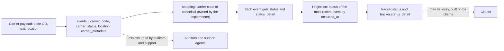
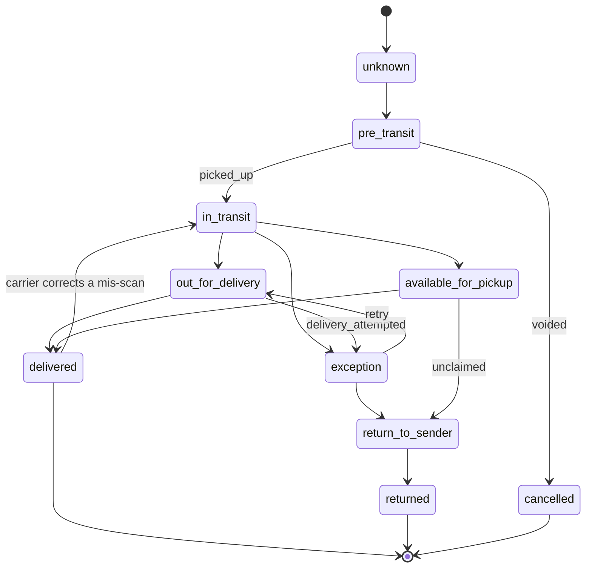
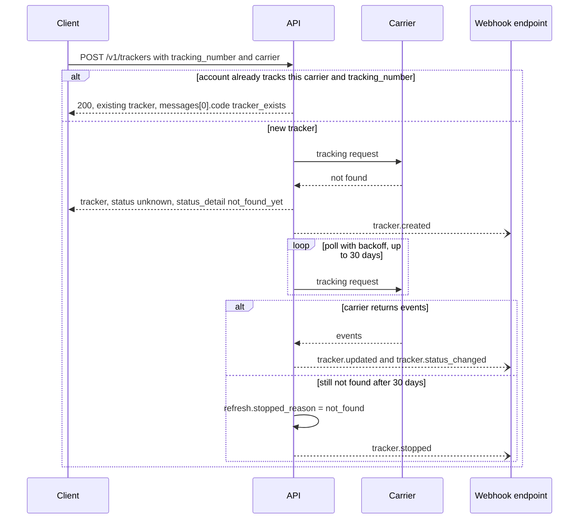
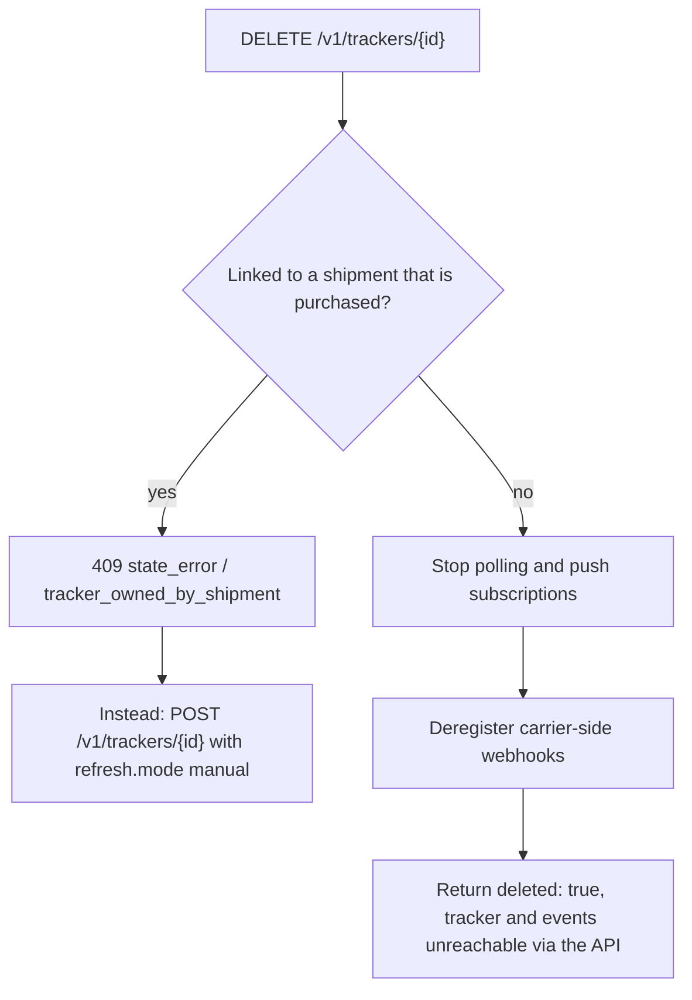
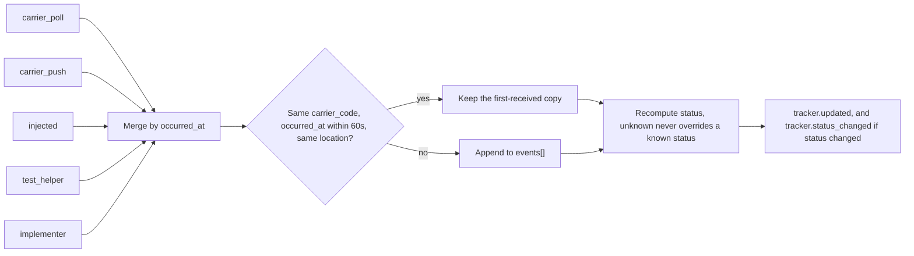

A **tracker** follows one tracking number with one carrier. It keeps two clocks:

1. **`events[]`**: an append-only log of what the carrier said, kept **lossless**. It holds the raw code, raw text and raw location.
2. **`status`**: a projection over that log into a small canonical set, which **may be lossy**, plus `status_detail` for the reason.

Clients build on `status`. Auditors and support agents read `events[]`. All disagreement between carriers is quarantined in the mapping from carrier codes to canonical status, and the implementer owns that mapping.

The diagram shows the two clocks: carrier data lands unchanged in `events[]`, and only the implementer's mapping turns it into `status` and `status_detail`.



## 1. The `tracker` object

```json
{
  "id": "trk_8Hj3",
  "object": "tracker",
  "livemode": false,
  "created": 1791302460,
  "updated": 1791489000,
  "tracking_number": "794612345678",
  "carrier": "fedex",
  "connection": "conn_9f8e",
  "shipment": "shp_1Q2w3E4r5T6y",
  "status": "out_for_delivery",
  "status_detail": "out_for_delivery",
  "status_updated_at": 1791489000,
  "delivered_at": null,
  "estimated_delivery": { "date": "2026-10-08", "window": { "start": "2026-10-08T09:00:00+01:00", "end": "2026-10-08T12:00:00+01:00" }, "source": "carrier" },
  "origin": { "city": "Memphis", "state": "TN", "country": "US" },
  "destination": { "city": "London", "country": "GB" },
  "signed_by": null,
  "proof_of_delivery": null,
  "attempts": 0,
  "events": [
    {
      "id": "tev_aa01",
      "object": "tracking_event",
      "occurred_at": "2026-10-08T07:42:00+01:00",
      "received_at": 1791489000,
      "status": "out_for_delivery",
      "status_detail": "out_for_delivery",
      "description": "On FedEx vehicle for delivery",
      "carrier_code": "OD",
      "carrier_status": "On FedEx vehicle for delivery",
      "location": { "city": "London", "postal_code": "SE1", "country": "GB", "facility": null, "latitude": 51.5, "longitude": -0.09 },
      "source": "carrier_push",
      "carrier_metadata": { "scan_type": "OD", "station_id": "LCYA", "derived_status_code": "OD" }
    }
  ],
  "tracking_url": "https://www.fedex.com/fedextrack/?trknbr=794612345678",
  "public_url": "https://track.example.com/trk_8Hj3",
  "refresh": { "mode": "auto", "next_at": 1791492600, "last_at": 1791489000, "stopped_reason": null },
  "messages": [],
  "user_metadata": {}
}
```

## 2. Canonical status

| `status` | Means | Terminal? |
|---|---|---|
| `pre_transit` | Label created, and the carrier has not taken possession | no |
| `in_transit` | The carrier has the parcel and it is moving | no |
| `out_for_delivery` | On the final delivery vehicle. May repeat after a failed attempt. | no |
| `available_for_pickup` | Held at an access point, locker or facility for the recipient | no |
| `delivered` | Proof of delivery recorded | **yes** |
| `exception` | Something is wrong and needs attention (see `status_detail`) | no |
| `return_to_sender` | Moving back to the shipper | no |
| `returned` | Delivered back to the shipper | **yes** |
| `cancelled` | The carrier cancelled the shipment, or the label was voided and confirmed by the carrier | **yes** |
| `unknown` | No information yet, or the carrier code is unmapped | no |

Rules:

- **Status is allowed to move backwards.** `out_for_delivery` → `exception` → `out_for_delivery` is normal, and so is `delivered` → `in_transit`, which happens when the carrier corrects a mis-scan. Clients MUST NOT assume the status only moves forward.
- `status` equals the status of the most recent event by `occurred_at`, except that `unknown` events never override a known status.
- `delivered`, `returned` and `cancelled` stop automatic refresh after 72 hours without new events. "Terminal" means exactly that. A carrier correction can still move a terminal status, as described above.
- Every event carries both canonical and carrier fields. **`carrier_code` is never dropped.**

The state diagram shows the common paths between canonical statuses, including the backwards moves. It is not exhaustive, because `status` follows whatever the most recent event says.



### `status_detail`

A finer reason within the status. Clients MAY ignore it, but they MUST tolerate unknown values.

| status | status_detail values |
|---|---|
| `pre_transit` | `label_created`, `awaiting_pickup`, `pickup_scheduled`, `dropped_off_pending_scan` |
| `in_transit` | `picked_up`, `accepted`, `arrived_at_facility`, `departed_facility`, `in_transit`, `customs_cleared`, `arrived_at_destination_country`, `delayed`, `rerouted` |
| `out_for_delivery` | `out_for_delivery` |
| `available_for_pickup` | `at_access_point`, `at_carrier_facility`, `final_notice` |
| `delivered` | `delivered`, `delivered_to_neighbor`, `delivered_to_safe_place`, `delivered_to_mailbox`, `delivered_to_access_point`, `signed` |
| `exception` | `temperature_excursion`, `shock_detected`, `tilt_detected`, `delivery_attempted`, `address_issue`, `recipient_unavailable`, `refused`, `customs_hold`, `customs_duties_unpaid`, `customs_documentation_required`, `damaged`, `lost`, `weather_delay`, `carrier_delay`, `held_by_carrier`, `security_hold`, `prohibited_item`, `business_closed`, `access_restricted` |
| `return_to_sender` | `refused`, `undeliverable`, `unclaimed`, `customs_rejected`, `requested_by_shipper` |
| `returned` | `returned` |
| `cancelled` | `voided`, `cancelled_by_carrier` |
| `unknown` | `unknown`, `not_found_yet` |

**Why `delivery_attempted` is an exception.** One carrier treats a failed attempt as a normal step and another treats it as an exception. The spec takes the recipient's view: something needs attention. The retry is then a further `out_for_delivery` event.

## 3. Create a tracker

```
POST /v1/trackers
```

| Param | Required | Notes |
|---|---|---|
| `tracking_number` | yes | |
| `carrier` | conditional | Required unless `connection` is given. Use `"auto"` to let the implementer detect the carrier from the number format (capability `tracking.detect`). Detection results are in `messages[]` with `code: "carrier_detected"`. |
| `connection` | no | Use the account's credentials (some carriers only track their own account's numbers). Defaults to a system tracking connection. |
| `shipment` | no | Link to an existing `shp_`. Trackers for purchased shipments are created automatically, so this is for foreign shipments. |
| `ship_date`, `destination_postal_code`, `destination_country` | no | Disambiguators some carriers require (Royal Mail, DHL eCommerce) |
| `refresh` | no | `{ mode: "auto" \| "manual" }`. `auto` uses push where the carrier supports it, and otherwise poll with backoff. |
| `user_metadata` | no | |

**Idempotent by nature.** Creating a tracker for a `(carrier, tracking_number)` that the account already tracks returns the existing tracker with `200` and `messages[0].code = "tracker_exists"`. This holds even without an `Idempotency-Key`.

`tracking_number_not_found` is **not** an error at create time. New labels are often unknown to the carrier for hours. The tracker is created with `status: unknown`, `status_detail: not_found_yet`, and keeps polling for up to 30 days before it stops with `refresh.stopped_reason = "not_found"`.

The sequence shows a tracker created for a number the carrier does not know yet.



## 4. Discard a tracker

```
DELETE /v1/trackers/{id}
```

```json
{ "id": "trk_8Hj3", "object": "tracker", "deleted": true }
```

This stops all polling and push subscriptions with the carrier, and deregisters carrier-side webhooks where they exist. The tracker and its events are then unreachable via the API. Implementers MAY retain them internally for 30 days for billing disputes.

A tracker that is linked to a shipment cannot be discarded while the shipment is `purchased` (`409 state_error` / `tracker_owned_by_shipment`). Use `POST /v1/trackers/{id}` with `refresh: { mode: "manual" }` to stop polling instead. When the shipment is voided, its tracker stops automatically.

The flowchart shows how a discard request is decided.



## 5. Refresh

```
POST /v1/trackers/{id}/refresh
```

This forces a synchronous carrier poll and returns the tracker. It is rate-limited to once per 5 minutes per tracker (`429` otherwise). It is useful for "where is my order" pages. It is not useful as a polling loop. Use webhooks for that.

## 6. Events, list, search, update

```
GET  /v1/trackers/{id}
GET  /v1/trackers/{id}/events?limit=100&starting_after=tev_...
GET  /v1/trackers?status=exception&carrier=dhl_express&created[gte]=...
GET  /v1/trackers/search?query=status:"exception" AND status_detail:"customs_hold"
POST /v1/trackers/{id}          (user_metadata, refresh.mode)
```

`tracker.events` inlines the 50 most recent events. The full log is at `/events`.

## 7. Sources

`tracking_event.source` records where an event came from:

| source | Origin |
|---|---|
| `carrier_poll` | The implementer polled the carrier's tracking API |
| `carrier_push` | The carrier pushed to the implementer's inbound URL (chapter 08 §6) |
| `injected` | A client pushed a canonical event via `POST /v1/inbound_events` |
| `test_helper` | A test-mode simulation |
| `implementer` | Synthesized, such as `label_created` at purchase or `cancelled` at void |
| `device` | An IoT device: scanner, locker, sensor or telematics unit (chapter 22) |

Events from different sources are merged by `occurred_at`. Duplicates (same `carrier_code`, same `occurred_at` within 60 seconds, same location) are collapsed, and the first-received copy wins.

The flowchart shows events from all five sources merging into one tracker log.



## 8. Proof of delivery

When `delivered`, `proof_of_delivery` MAY be `{ signed_by, signature_file, photo_files: ["file_..."], location: { latitude, longitude }, delivered_to: "front_door" }`. The image files are `file` objects with `purpose: "proof_of_delivery"`.

## 9. Events (webhooks)

`tracker.created`, `tracker.updated` (any new event), `tracker.status_changed` (canonical status changed, which is the one most clients want), `tracker.delivered`, `tracker.exception`, `tracker.returned`, `tracker.stopped`, `tracker.deleted`.
