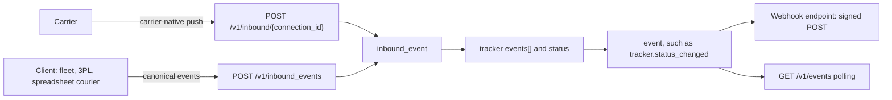
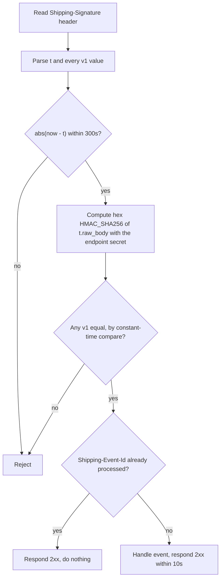
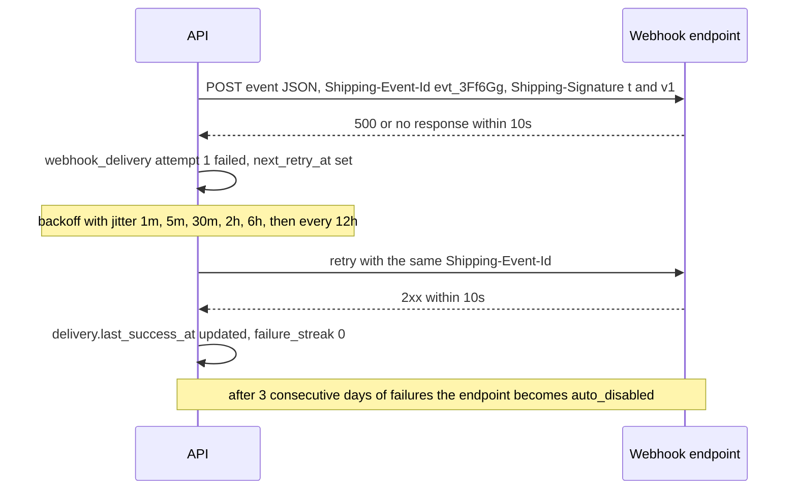
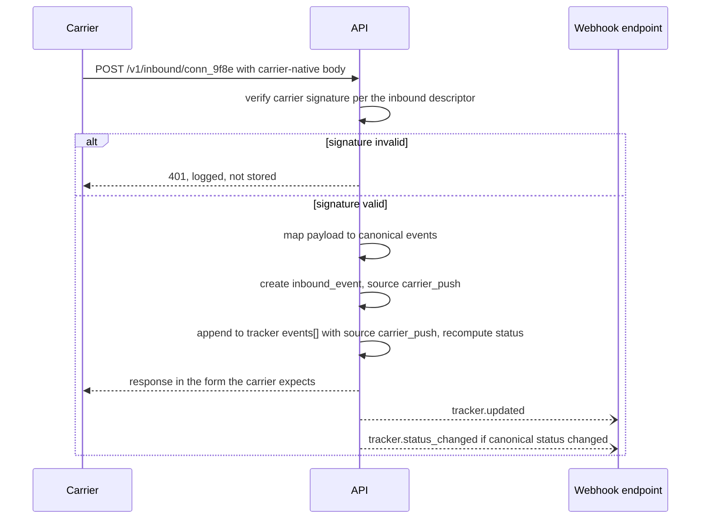
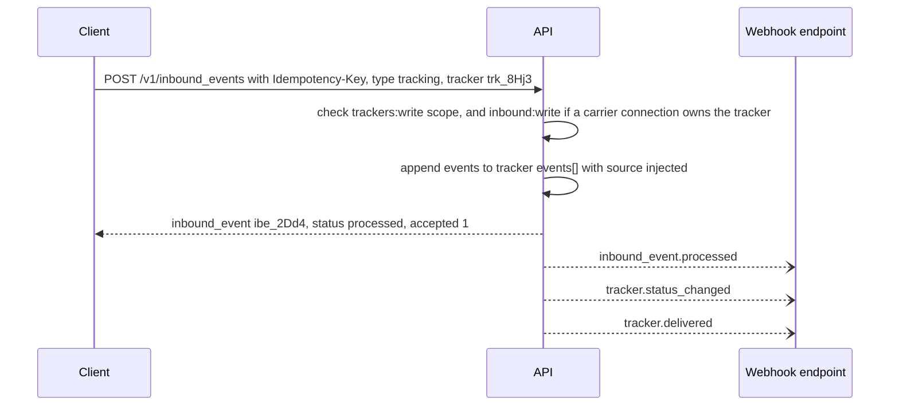

Webhooks carry events in two directions.

- **Outbound**: the implementer notifies you. This covers webhook endpoints, the event object, signatures, retries and redelivery.
- **Inbound**: events flow into the implementer, either as carrier-native pushes received per connection, or as canonical events a client injects (its own last-mile fleet, a carrier with no API, a 3PL feed).

The diagram shows both directions: inbound sources feed trackers, and every resulting change leaves as an outbound event.



## 1. The `event` object

```json
{
  "id": "evt_3Ff6Gg",
  "object": "event",
  "livemode": false,
  "created": 1791489001,
  "type": "tracker.status_changed",
  "api_version": "2026-10-01",
  "account": "acct_1Ab2",
  "data": {
    "object": { "id": "trk_8Hj3", "object": "tracker", "status": "out_for_delivery", "...": "full object at event time" },
    "previous_attributes": { "status": "in_transit", "status_detail": "arrived_at_facility" }
  },
  "related": { "shipment": "shp_1Q2w3E4r5T6y" },
  "request": { "id": null, "idempotency_key": null },
  "pending_webhooks": 1
}
```

- `data.object` is the **full** resource rendered at the endpoint's `api_version`. It is never a diff.
- `data.previous_attributes` is present on `*.updated` and `*.status_changed` events and lists only the changed fields.
- `request.id` links the event to the API call that caused it. It is `null` for carrier-originated events.
- Events are retained and listable for 30 days.

## 2. Event catalog

| Resource | Event types |
|---|---|
| shipment | `shipment.created`, `shipment.updated`, `shipment.purchased`, `shipment.purchase_failed`, `shipment.void_requested`, `shipment.voided`, `shipment.void_failed`, `shipment.refund_updated`, `shipment.manifested`, `shipment.tracking_updated`, `shipment.charges_adjusted` |
| tracker | `tracker.created`, `tracker.updated`, `tracker.status_changed`, `tracker.delivered`, `tracker.exception`, `tracker.returned`, `tracker.stopped`, `tracker.deleted` |
| pickup | `pickup.scheduled`, `pickup.updated`, `pickup.rescheduled`, `pickup.cancelled`, `pickup.failed`, `pickup.completed`, `pickup.missed` |
| manifest | `manifest.created`, `manifest.updated`, `manifest.submitted`, `manifest.partially_submitted`, `manifest.failed`, `manifest.due` (end-of-day reminder, `data.object` is a `manifest_preview`) |
| document_upload | `document_upload.created`, `document_upload.accepted`, `document_upload.partially_accepted`, `document_upload.rejected` |
| file | `file.created` |
| connection | `connection.created`, `connection.updated`, `connection.deleted`, `connection.verified`, `connection.verification_failed`, `connection.reauthorization_required`, `connection.disconnected` |
| connect_session | `connect_session.completed`, `connect_session.failed`, `connect_session.expired` |
| app | `app.created`, `app.updated`, `app.deleted`, `app.secret_rotated` |
| inbound_event | `inbound_event.processed`, `inbound_event.failed` |
| webhook_endpoint | `webhook_endpoint.disabled` (auto-disabled after sustained failures, and sent to the account's other endpoints and by email) |
| pickup_schedule | `pickup_schedule.created`, `.updated`, `.paused`, `.resumed`, `.cancelled`, `.failed`, `.occurrence_skipped`, `.occurrence_failed` |
| trade | `classification.completed`, `classification.failed`, `compliance_screening.completed`, `landed_cost.created`, `duty_collection.created`, `.assessed`, `.paid`, `.disputed` |
| catalog | `service.*`, `option.*`, `packaging.*`, `zone.*` (`created`, `updated`, `published`, `retired`) |
| pricing | `rate_sheet.published`, `rate_sheet.retired`, `surcharge.updated`, `surcharge.schedule_updated`, `pricing_rule.created`, `.updated`, `.deleted` |
| routes | `facility.*`, `route.*`, `route_run.created`, `.dispatched`, `.started`, `.stop_arrived`, `.stop_completed`, `.stop_failed`, `.completed`, `.cancelled`, `.delayed`, `journey.planned`, `.at_risk`, `.delayed`, `.rerouted`, `.completed` |
| fleet | `vehicle.*`, `driver.*`, `optimization.completed`, `optimization.failed`, `route_run.eta_updated`, `route_run.position_stale` |
| injection | `asn.created`, `.updated`, `.dispatched`, `.arrived`, `.closed`, `.cancelled`, `shipment.injection_accepted`, `.injection_on_hold`, `.injection_rejected`, `.injection_received`, `.injection_missing`, `.injection_cancelled` |
| accounts | `account.created`, `.updated`, `.requirements_updated`, `.suspended`, `.closed`, `identity_provider.*`, `membership.*`, `invitation.accepted`, `api_key.created`, `.rolled`, `.deleted` |
| products | `product.created`, `.updated`, `.archived`, `.unarchived`, `.deleted`, `.classification_needed` |
| network | `account.listed`, `.paused`, `.delisted`, `interline_agreement.proposed`, `.signed`, `.activated`, `.suspended`, `.terminated`, `ledger_entry.posted`, `settlement.closed`, `settlement.disputed`, `service_level.breached` |
| iot | `device.created`, `.updated`, `.deactivated`, `.offline`, `device_event.unmatched`, `handling_unit.condition_breached` |
| data network | `participant.registered`, `participant.credential_added`, `record.created`, `anchor.confirmed`, `access_grant.created`, `access_grant.revoked`, `attestation.created`, `records.erased`, `timeline.milestone_reached`, `timeline.milestone_disputed`, `timeline.gap_detected` |
| consolidation | `consolidation.created`, `.closed`, `.sealed`, `.seal_broken`, `.loaded`, `.deconsolidated`, `conveyance.created`, `.closed`, `.departed`, `.arrived`, `.delayed`, `.cancelled` |
| templates | `document_template.created`, `.published`, `.retired`, `document.generated`, `document.generation_failed`, `document_job.completed`, `label_spec.published`, `.certification_passed`, `.certification_failed`, `document_ingestion.needs_review`, `.applied`, `.failed` |
| integrations | `integration.created`, `.updated`, `address_validation.completed`, `insurance_quote.created`, `coverage.created`, `.activated`, `.cancelled`, `.expired`, `claim.submitted`, `.updated`, `.approved`, `.denied`, `.paid` |
| jobs | `job.queued`, `.started`, `.progressed` (opt-in), `.succeeded`, `.partially_succeeded`, `.failed`, `.cancelled`, `job_schedule.created`, `.paused`, `.resumed`, `.run_skipped` |
| billing | `invoice.created`, `.finalized`, `.sent`, `.paid`, `.partially_paid`, `.overdue`, `.disputed`, `.voided`, `.imported`, `reconciliation.completed`, `.line_resolved`, `usage_record.created`, `billing.cycle_completed`, `balance.low`, `.topped_up`, `payment_method.attached`, `payment.succeeded`, `.failed`, `.requires_action`, `refund.created`, `payout.paid`, `payout.failed` |
| inventory | `storage_location.created`, `stock_movement.created`, `inventory.level_changed`, `.level_low`, `fulfillment_order.created`, `.allocated`, `.backordered`, `.picking`, `.packed`, `.shipped`, `.cancelled`, `wave.released`, `inventory_count.completed` |
| batch | `batch.completed`, `batch.completed_with_errors` (delivered to the batch's `webhook_endpoint` and the account's endpoints) |
| test | `test.ping` |

`enabled_events` accepts `*` (everything) and resource wildcards (`tracker.*`).

## 3. The `webhook_endpoint` object

```json
{
  "id": "we_5Hh7",
  "object": "webhook_endpoint",
  "livemode": false,
  "created": 1791302400,
  "updated": 1791302400,
  "url": "https://merchant.example.com/hooks/shipping",
  "description": "Prod order sync",
  "enabled_events": ["shipment.purchased", "tracker.status_changed"],
  "status": "enabled",
  "api_version": "2026-10-01",
  "filters": { "carriers": null, "connections": null, "user_metadata": { "channel": "shopify" } },
  "secret": "whsec_...",
  "secret_preview": "whsec_…a91f",
  "disabled_reason": null,
  "delivery": { "last_success_at": 1791489002, "last_failure_at": null, "failure_streak": 0 },
  "user_metadata": {}
}
```

- `secret` is returned **only** on create and on rotate.
- `status` is `enabled`, `disabled` (by the user), or `auto_disabled` (after 3 consecutive days of failures).
- `filters` narrow delivery beyond event type. Every listed filter must match. This keeps multi-tenant platforms from receiving every merchant's events.

### Endpoints

```
POST   /v1/webhook_endpoints                       { url, enabled_events, description?, api_version?, filters?, user_metadata? }
GET    /v1/webhook_endpoints/{id}
GET    /v1/webhook_endpoints
POST   /v1/webhook_endpoints/{id}                  { url?, enabled_events?, description?, status?: "enabled"|"disabled", filters?, user_metadata? }
DELETE /v1/webhook_endpoints/{id}
POST   /v1/webhook_endpoints/{id}/rotate_secret    { expire_previous_in: 86400 }
POST   /v1/webhook_endpoints/{id}/test             { type?: "test.ping" | any event type }  → a webhook_delivery
```

- `url` MUST be `https`. Implementers MUST refuse private, loopback and link-local addresses, which protects against SSRF.
- `rotate_secret` keeps the old secret valid for `expire_previous_in` seconds (0–7 days). During overlap, deliveries are signed with both.
- `test` sends a synthetic event built from a realistic fixture of the requested type. The event has `livemode: false` and is not stored in `/v1/events`.

## 4. Delivery and signatures

Each delivery is an HTTPS `POST` with the event JSON as the body, and these headers:

```
Content-Type: application/json
User-Agent: OpenLogistics-Webhooks/1.0 (+https://shippinginternals.dev)
Shipping-Event-Id: evt_3Ff6Gg
Shipping-Event-Type: tracker.status_changed
Shipping-Delivery-Id: whd_9Kk2
Shipping-Signature: t=1791489002,v1=5257a869e7ecebeda32affa62cdca3fa51cad7e77a0e56ff536d0ce8e108d8bd,v1=...
```

**Signature scheme** (identical to Stripe's, so existing verification libraries work):

1. `signed_payload = "{t}.{raw_body}"`
2. `v1 = hex(HMAC_SHA256(secret, signed_payload))`
3. The receiver checks that any `v1` matches using a constant-time comparison, and that `|now − t| ≤ 300s`.

The flowchart shows the checks a receiver runs on each delivery.



Implementers SHOULD additionally offer **asymmetric signatures** (`v1a=` with Ed25519, public key at `/.well-known/shipping-configuration` → `webhook_signing_keys`), so receivers can verify without holding a shared secret. This matters for agents that subscribe dynamically.

### Retries and ordering

- A `2xx` response within 10 seconds is success. Anything else is a failure, and the body is ignored.
- Retries use exponential backoff with jitter over 3 days: 1m, 5m, 30m, 2h, 6h, then every 12h.
- **No ordering guarantee.** Use `data.object.updated` or tracker `status_updated_at` to discard stale events.
- **At-least-once delivery.** Deduplicate on `Shipping-Event-Id`, which is the same on every attempt. Each attempt is its own `webhook_delivery` with a new `whd_` ID (`Shipping-Delivery-Id`) and an incrementing `attempt`.

The sequence shows one event delivered after a failed first attempt.



### The `webhook_delivery` object

```json
{ "id": "whd_9Kk2", "object": "webhook_delivery", "event": "evt_3Ff6Gg", "webhook_endpoint": "we_5Hh7", "attempt": 2, "status": "failed", "response_status": 500, "response_body_excerpt": "upstream timeout", "duration_ms": 10000, "created": 1791489300, "next_retry_at": 1791491100 }
```

## 5. Events API

```
GET  /v1/events?type=tracker.*&created[gte]=...&related[shipment]=shp_...
GET  /v1/events/{id}
GET  /v1/events/{id}/deliveries
POST /v1/events/{id}/redeliver          { webhook_endpoint?: "we_..." }   → webhook_delivery[]
```

Polling `/v1/events` with `starting_after` is a supported alternative to webhooks for clients that cannot receive inbound HTTP, such as agents behind NAT.

## 6. Inbound: carrier push receivers

Many carriers push tracking (and sometimes invoice adjustments) to a URL. Each connection that supports push gets a dedicated receiver:

```
POST /v1/inbound/{connection_id}
```

- The URL is exposed as `connection.inbound.url`. The implementer registers it with the carrier automatically where the carrier has a subscription API, and otherwise the shipper pastes it into the carrier portal.
- The body is **carrier-native**. The implementer verifies the carrier's own signature scheme, which is configured in the carrier's `inbound` descriptor (chapter 09), maps the payload to canonical events, and responds the way the carrier expects.
- Each receipt creates an `inbound_event` with `source: "carrier_push"`. (`inbound_event.source` is `carrier_push` for this receiver and `api` for §7. It describes how the event entered the API. The resulting tracking events carry `tracking_event.source` values `carrier_push` and `injected` respectively.) Payloads that fail signature verification are rejected with `401`, logged, and not stored.

The sequence shows one carrier push from receipt to the client's webhook endpoint.



## 7. Inbound: event injection (canonical)

For sources that have no carrier integration (a merchant's own delivery fleet, a regional courier using spreadsheets, a 3PL's scan feed, a carrier implementing this spec that pushes canonical events), clients inject events directly:

```
POST /v1/inbound_events
Idempotency-Key: ...
```

```json
{
  "type": "tracking",
  "tracker": "trk_8Hj3",
  "events": [
    {
      "occurred_at": "2026-10-08T11:02:00+01:00",
      "status": "delivered",
      "status_detail": "delivered_to_safe_place",
      "description": "Left in porch",
      "carrier_code": "DLV-PORCH",
      "location": { "city": "London", "country": "GB", "latitude": 51.50, "longitude": -0.09 },
      "proof_of_delivery": { "photo_files": ["file_P0d1"] }
    }
  ]
}
```

| Param | Notes |
|---|---|
| `type` | `tracking` (supported by every implementer), or `shipment_charge` (a carrier invoice adjustment, capability `inbound.charges`) |
| `tracker` | Target tracker. Alternatively pass `carrier` and `tracking_number`, and `create_tracker: true` to create it on the fly. |
| `events[]` | 1–100 canonical tracking events. `status` is required, and `carrier_code` is recommended. |
| `shipment` + `charges[]` | For `shipment_charge`: `{ kind, amount, carrier_code, reason }` |

The response is an `inbound_event`:

```json
{ "id": "ibe_2Dd4", "object": "inbound_event", "type": "tracking", "source": "api", "status": "processed", "tracker": "trk_8Hj3", "accepted": 1, "rejected": 0, "errors": [], "created": 1791493320 }
```

Injected events are tagged `source: "injected"` on the tracker and fire the usual `tracker.*` events. Injection requires the `trackers:write` scope, and injection into a tracker owned by a carrier connection additionally requires `inbound:write`, so that a leaked read key cannot fake deliveries.

The sequence shows the injection example above, a merchant fleet recording a delivery.



```
GET /v1/inbound_events?connection=conn_...&status=failed
GET /v1/inbound_events/{id}
```

## 8. Test helpers

```
POST /v1/test_helpers/trackers/{id}/advance
```

```json
{ "to": "delivered", "script": "standard" }
```

This is only available in test mode. It moves a test tracker through a scripted path and emits real webhook events. Scripts: `standard` (pre_transit → in_transit ×3 → out_for_delivery → delivered), `failed_attempt` (… → exception/delivery_attempted → out_for_delivery → delivered), `customs_hold`, `return_to_sender`, `lost`.

Also available: `POST /v1/test_helpers/shipments/{id}/charge_adjustment`, which simulates a carrier reweigh.
