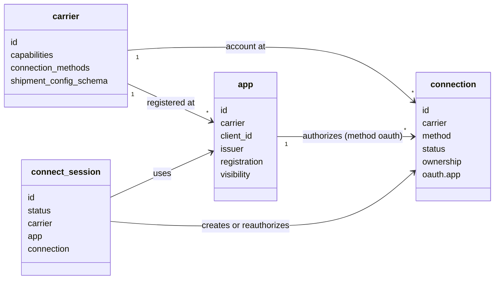
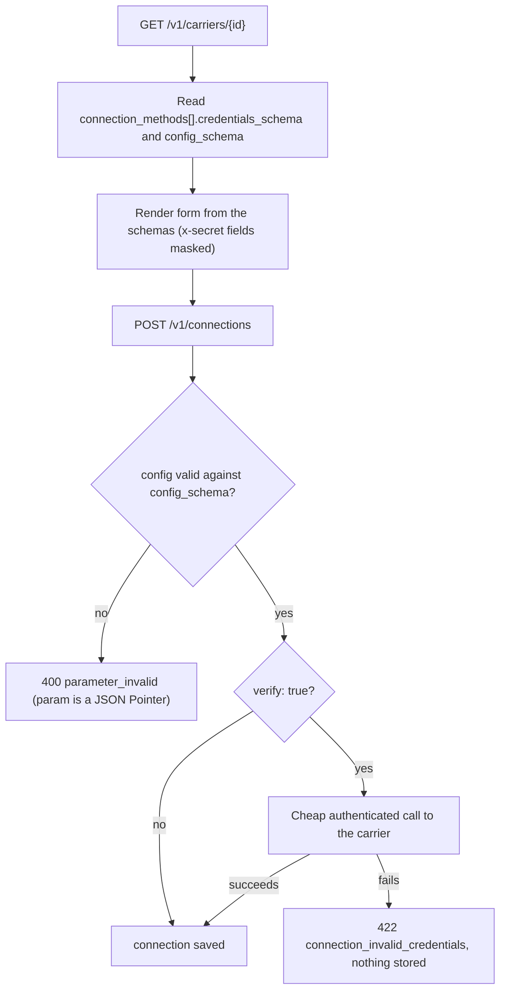
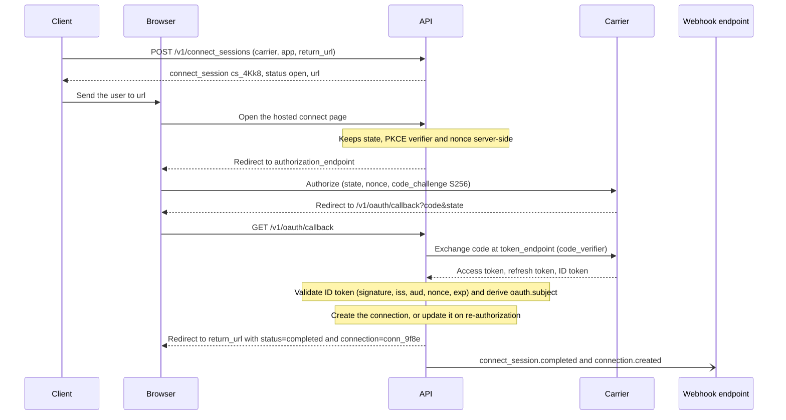
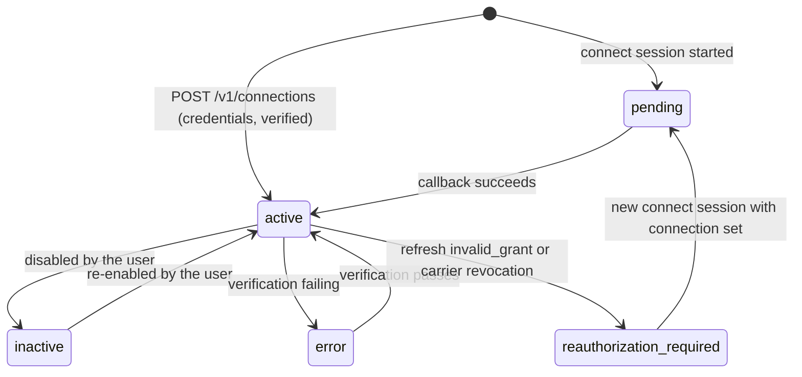
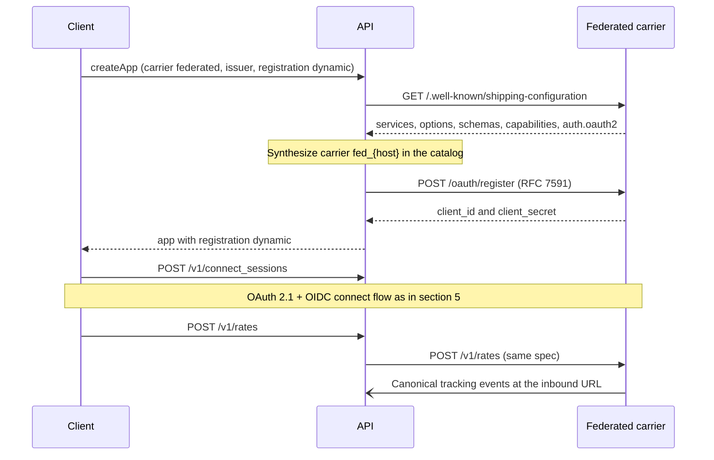

> **API surface.** Carrier catalog reads, connections and connect sessions are **REST**. Registering OAuth apps and onboarding federated providers is **GraphQL Interface**.

Three objects decide which carrier accounts the API ships with, and how it authenticates to them:

| Object | What it is | Who owns it |
|---|---|---|
| **`carrier`** | A catalog entry: capabilities, services, packagings, and the **schemas** for configuring a connection and for each request's carrier config | The implementer (read-only) |
| **`app`** | An OAuth client registration *with a carrier* (client ID and secret, redirect URIs, OIDC issuer) | The account (or the platform, shared with its connected accounts) |
| **`connection`** | A usable carrier account, authenticated by static credentials or by an OAuth grant through an app | The account |

The same objects serve every integration, not only carriers: chapter 26 generalizes `carrier` into `integration`, and adds interfaces for address validation and insurance.

A **`connect_session`** is the short-lived object that runs the OAuth/OIDC dance and produces a connection.

This diagram shows how the four objects relate.



The separation exists because of what happens at the second carrier (Shipping Internals, issue 06). Static API keys, OAuth client credentials, per-merchant OAuth grants, reseller accounts, and "bring your own contract" are all common, and a model that encodes only one of them breaks on the next. Here, *how to configure* is data (the carrier's schemas), *who the client is* is an app, and *which account* is a connection.

## 1. The `carrier` object

```
GET /v1/carriers
GET /v1/carriers/{id}
```

```json
{
  "id": "ups",
  "object": "carrier",
  "name": "UPS",
  "logo_url": "https://assets.example.com/carriers/ups.svg",
  "status": "available",
  "countries": { "origin": ["US", "CA", "GB", "DE", "..."], "destination": "*" },
  "capabilities": ["rates", "labels", "void", "void.partial", "returns", "pickups", "tracking", "tracking.push", "documents.pre_shipment", "documents.post_shipment", "address_validation"],
  "services": [
    { "code": "ups_ground", "name": "UPS® Ground", "level": "standard", "carrier_code": "03", "domestic": true, "international": false, "countries": ["US"] },
    { "code": "ups_worldwide_express", "name": "UPS Worldwide Express®", "level": "express", "carrier_code": "07", "domestic": false, "international": true }
  ],
  "packagings": [ { "code": "ups_letter", "name": "UPS Letter", "max_weight": { "value": 0.5, "unit": "kg" } } ],
  "label": { "formats": ["pdf", "png", "zpl", "epl", "gif"], "sizes": ["4x6", "4x8"] },
  "standardized_features": ["signature", "age_verification", "insurance", "saturday_delivery", "cash_on_delivery", "carbon_neutral", "direct_delivery_only", "notifications", "authority_to_leave"],
  "shipment_config_schema": {
    "$schema": "https://json-schema.org/draft/2020-12/schema",
    "type": "object",
    "additionalProperties": false,
    "properties": {
      "service": { "type": "string", "enum": ["ups_ground", "ups_worldwide_express", "..."] },
      "connection": { "type": "string" },
      "signature": { "type": "string", "enum": ["none", "standard", "adult"], "x-standardized": true },
      "insurance": { "$ref": "https://shippinginternals.dev/schemas/money.json", "x-standardized": true },
      "saturday_delivery": { "type": "boolean", "x-standardized": true },
      "ups_premier": { "type": "string", "enum": ["silver", "gold", "platinum"] },
      "shipper_release": { "type": "boolean" },
      "carbon_neutral": { "type": "boolean", "x-standardized": true }
    }
  },
  "manifest_config_schema": { "type": "object", "properties": { "shipper_number_override": { "type": "string" } } },
  "manifest": { "required": false, "scope": ["connection", "ship_date"], "modes": ["close_all"], "async": false, "multiple_per_request": false, "ship_date_policies": ["strict"], "cutoff_local_time": null, "carrier_auto_close": false, "void_after": true, "reprint": false, "documents": [] },
  "pickup_config_schema": { "type": "object", "properties": { "pickup_type": { "type": "string", "enum": ["on_call", "smart_pickup"] } } },
  "pickup": { "requires": ["handling_unit_count", "total_weight"], "same_day_cutoff": "14:00" },
  "tracking": { "number_patterns": ["^1Z[0-9A-Z]{16}$"], "public_url_template": "https://www.ups.com/track?tracknum={tracking_number}" },
  "connection_methods": [
    {
      "type": "oauth",
      "label": "Sign in with UPS",
      "issuer": "https://onlinetools.ups.com",
      "authorization_endpoint": "https://www.ups.com/lasso/signin",
      "token_endpoint": "https://onlinetools.ups.com/security/v1/oauth/token",
      "openid": false,
      "scopes": [],
      "app": { "required": true, "system_app": true, "dynamic_registration": false },
      "config_schema": { "...": "JSON Schema, see §2" }
    },
    {
      "type": "credentials",
      "label": "Client ID and secret",
      "credentials_schema": {
        "type": "object",
        "required": ["client_id", "client_secret", "account_number"],
        "properties": {
          "client_id": { "type": "string", "title": "Client ID" },
          "client_secret": { "type": "string", "title": "Client secret", "writeOnly": true, "x-secret": true },
          "account_number": { "type": "string", "title": "Shipper number", "pattern": "^[A-Z0-9]{6}$" }
        }
      },
      "config_schema": { "...": "JSON Schema, see §2" }
    }
  ],
  "inbound": { "supported": true, "registration": "automatic", "signature": "hmac_sha256_header", "header": "X-UPS-Signature" },
  "test_environment": "sandbox"
}
```

The carrier catalog is the **single source of truth for dynamic UIs and agents**. A client renders a "Connect UPS" form directly from `credentials_schema` and `config_schema`, with no per-carrier code. `x-secret: true` fields are masked, and `writeOnly` fields never come back.

This flowchart shows how a client goes from the catalog to a verified connection using the credentials method, with no per-carrier code.



The same catalog types every request. `shipment_config_schema` is the `T` in `carrier_configs.{carrier}` (chapter 01 §6), and `pickup_config_schema` and `manifest_config_schema` type the single-key `carrier_configs` on pickups and manifests. Properties marked `x-standardized: true` are standardized features (chapter 01 §6.1), and the implementer maps them to the carrier's native codes. The rest are carrier-specific. An agent that wants "adult signature on every carrier" sends `"*": { "signature": "adult" }`. Services that cannot provide it are excluded from the rates, with the reason given.

`capabilities` is drawn from the registry in chapter 11 §2. Filters: `GET /v1/carriers?capability=pickups&country=DE`.

## 2. Dynamic configuration (`config_schema`)

Credentials identify you to the carrier. Config changes how the implementer behaves for that account. They are kept apart because credentials are secret and rotate, while config is not secret and is edited often.

Every carrier's `config_schema` MUST include the **common config** properties below, and MAY add carrier-specific ones:

| Key | Type | Purpose |
|---|---|---|
| `account_country` | string | The country of the carrier account. It drives services and currency. |
| `currency` | string | Billing currency override |
| `services_enabled` | string[] | Restrict rating to these service codes |
| `services_disabled` | string[] | Exclude these service codes |
| `label_defaults` | `{ format, size, dpi }` | Per-connection label defaults |
| `shipment_defaults` | object | Settings merged under every request's `carrier_configs.{carrier}` for this connection (for example, `{ "signature": "standard" }`). Validated against `shipment_config_schema`. |
| `reference_template` | string | `"{reference} {user_metadata.order_id}"`, the printed reference rendered per shipment. This is the one explicit, opt-in way for `user_metadata` values to reach a carrier. |
| `rating_timeout_ms` | integer | Per-connection rating deadline |
| `manifest_required` | boolean | Block pickup booking until a manifest exists |
| `end_of_day` | object | `{ auto_close, time, days[], mode, split, ship_date_policy, book_pickup, remind_before_minutes }`. Scheduled close-out and reminders (chapter 05 §7). |
| `pickup_defaults` | `{ location, window, instructions }` | |
| `paperless_trade` | boolean | Default for `customs_declaration.paperless_trade` |
| `tracking_refresh` | `"auto"` \| `"push_only"` \| `"off"` | |

Carrier-specific examples: `dhl_express.site_id`, `canada_post.contract_id`, `fedex.smart_post_hub_id`, `dpd.depot`, `usps.crid`, `usps.mid`, `amazon_shipping.business_id` (the value sent as Amazon's `x-amzn-shipping-business-id`).

Implementers validate `config` against the schema on every write and return `400 parameter_invalid` with a JSON Pointer in `param` (`config/label_defaults/format`).

**Schema UI hints.** `config_schema` and `credentials_schema` MAY use `x-ui-group`, `x-ui-order`, `x-ui-widget` (`password`, `select`, `textarea`, `country`), `x-ui-help` (Markdown), and `x-ui-docs-url`. Renderers that do not support them fall back to plain JSON Schema.

## 3. The `connection` object

```json
{
  "id": "conn_9f8e",
  "object": "connection",
  "livemode": false,
  "created": 1791302400,
  "updated": 1791302400,
  "carrier": "ups",
  "method": "oauth",
  "display_name": "UPS – Main warehouse",
  "account_number": "A1B2C3",
  "status": "active",
  "default": true,
  "capabilities": ["rates", "labels", "void", "pickups", "tracking"],
  "config": { "account_country": "US", "label_defaults": { "format": "zpl", "size": "4x6" }, "services_disabled": ["ups_next_day_air_early"] },
  "credentials": null,
  "credentials_preview": null,
  "oauth": {
    "app": "app_7Gg9",
    "issuer": "https://onlinetools.ups.com",
    "subject": "A1B2C3",
    "scopes": [],
    "access_token_expires_at": 1791306000,
    "refresh_token_expires_at": 1796486400,
    "last_refreshed_at": 1791302400,
    "status": "valid"
  },
  "ownership": "account",
  "inbound": { "url": "https://api.example.com/v1/inbound/conn_9f8e", "status": "registered" },
  "verification": { "status": "verified", "checked_at": 1791302405, "error": null },
  "user_metadata": {}
}
```

| Field | Notes |
|---|---|
| `method` | `credentials` or `oauth` |
| `status` | `active`, `inactive` (disabled by the user), `error` (verification failing), `reauthorization_required` (refresh token expired or revoked, so start a new connect session), `pending` (a connect session is in progress) |
| `default` | Used when a request names a carrier but not a connection. There is at most one default per carrier per mode. |
| `credentials` | **Write-only.** Always `null` in responses. |
| `credentials_preview` | `{ field: "…last4" }` for non-secret identification, such as `{ "client_id": "…9a1c" }` |
| `ownership` | `account` (the shipper's own carrier contract), `platform` (a platform-provided account shared with connected accounts, the reseller model), or `system` (the implementer's own account, for "use our rates") |
| `oauth.subject` | The carrier account identifier. It comes from the OIDC ID token's `sub` when the carrier is an OIDC provider, and otherwise from the carrier's account endpoint. It prevents the same carrier account being connected twice by mistake. |

### Endpoints

```
POST   /v1/connections                     Create (method: credentials)
GET    /v1/connections/{id}
GET    /v1/connections?carrier=ups&status=active&ownership=account
POST   /v1/connections/{id}                Update display_name, config, credentials (rotation), status, default, user_metadata
DELETE /v1/connections/{id}
POST   /v1/connections/{id}/verify         Live credential check
```

**Create** (credentials):

```json
{
  "carrier": "dhl_express",
  "display_name": "DHL Express – EU",
  "credentials": { "site_id": "...", "password": "...", "account_number": "960000000" },
  "config": { "account_country": "DE", "paperless_trade": true },
  "default": true,
  "verify": true
}
```

If `verify: true` (the default), the implementer makes a cheap authenticated call to the carrier, such as a token fetch or a rate for a fixed lane, before saving. It returns `422 carrier_error` / `connection_invalid_credentials` on failure, and nothing is stored.

**Delete** is refused with `409 state_error` / `connection_in_use` while the connection has `scheduled` pickups or `pending` manifests. Purchased shipments keep their `service.connection` ID for history. Deleting an OAuth connection revokes its tokens at the carrier where the carrier supports RFC 7009.

**Verify** returns the connection with a refreshed `verification` field. It never spends money.

## 4. The `app` object (carrier OAuth client)

An app is your OAuth client registration at a carrier. You need one to connect via `method: oauth` unless the carrier's descriptor says `system_app: true` and you are content to use the implementer's own app.

```json
{
  "id": "app_7Gg9",
  "object": "app",
  "livemode": false,
  "created": 1791302400,
  "carrier": "ups",
  "name": "Acme Shipping – UPS",
  "client_id": "Ab12Cd34...",
  "client_secret": null,
  "client_secret_preview": "…f00d",
  "client_secret_expires_at": null,
  "redirect_uris": ["https://api.example.com/v1/oauth/callback"],
  "scopes": [],
  "issuer": "https://onlinetools.ups.com",
  "openid": false,
  "token_endpoint_auth_method": "client_secret_basic",
  "pkce": "S256",
  "registration": "manual",
  "visibility": "private",
  "status": "active",
  "connection_count": 14,
  "user_metadata": {}
}
```

| Field | Notes |
|---|---|
| `issuer` | For OIDC carriers, the implementer fetches `{issuer}/.well-known/openid-configuration` and validates ID tokens (signature, `iss`, `aud` = `client_id`, `nonce`, `exp`). |
| `openid` | `true` if the carrier is an OIDC provider. The connection's `oauth.subject` then comes from the ID token. |
| `registration` | `manual` (you pasted the client ID and secret from the carrier's developer portal) or `dynamic` (the implementer registered via RFC 7591 at the carrier's `registration_endpoint`, using `initial_access_token` if one is required) |
| `visibility` | `private` (this account only) or `platform` (connected accounts can connect their carrier accounts through this app, the Shopify/Stripe-Connect pattern) |
| `redirect_uris` | Default to the implementer's callback. You register these at the carrier. |

### Endpoints

```
mutation createApp                     { carrier, name, client_id?, client_secret?, scopes?, visibility?, registration?: "manual"|"dynamic", initial_access_token? }
query app
query apps?carrier=ups
mutation updateApp                name, scopes, visibility, client_secret (rotation), status, user_metadata
mutation deleteApp                409 if connection_count > 0, unless ?cascade=true, which disconnects them
mutation rotateSecretApp  dynamic apps only: rotates at the carrier, returns the new secret once
```

## 5. Connect sessions (the OAuth/OIDC flow)

```
POST /v1/connect_sessions
GET  /v1/connect_sessions/{id}
```

```json
{
  "carrier": "ups",
  "app": "app_7Gg9",
  "return_url": "https://merchant.example.com/settings/carriers?done=1",
  "display_name": "UPS – Main warehouse",
  "config": { "label_defaults": { "format": "zpl" } },
  "scopes": [],
  "connection": null,
  "login_hint": "ops@merchant.example.com"
}
```

```json
{
  "id": "cs_4Kk8",
  "object": "connect_session",
  "status": "open",
  "carrier": "ups",
  "app": "app_7Gg9",
  "url": "https://api.example.com/connect/cs_4Kk8",
  "expires_at": 1791304200,
  "return_url": "https://merchant.example.com/settings/carriers?done=1",
  "connection": null,
  "error": null
}
```

The flow:

1. The client creates a session and sends the user to `url`. The implementer hosts this page, which matters because it keeps `state`, the PKCE verifier and `nonce` server-side.
2. The implementer redirects to the carrier's `authorization_endpoint` with `response_type=code`, `client_id`, `redirect_uri`, `scope` (plus `openid` if `app.openid`), `state`, `nonce`, `code_challenge` and `code_challenge_method=S256`.
3. The carrier redirects back to `/v1/oauth/callback?code&state`. The implementer exchanges the code, validates the ID token when OIDC is in use, derives `oauth.subject`, and creates the connection, or updates it if `connection` was given, which is the re-authorization path.
4. The user is redirected to `return_url?connect_session=cs_4Kk8&status=completed&connection=conn_9f8e`.
5. Events: `connect_session.completed` plus `connection.created`, `connect_session.expired` (unused past `expires_at`, `status: "expired"`), or `connect_session.failed` with `error.code` set to `access_denied`, `invalid_grant`, `subject_already_connected`, or `id_token_invalid`.

This sequence shows the redirect flow end to end, for an OIDC carrier.



Some carriers return extra credentials in the callback. Some carriers' authorize flows return a per-account client ID and secret instead, and the implementer then uses `client_credentials` with them. Each carrier's `connection_methods[].type = "oauth"` descriptor declares `grant_after_callback: "authorization_code" | "client_credentials_from_callback"`, and the implementer handles both. The client never sees the difference.

**Headless agents** cannot follow a redirect. They call `POST /v1/connect_sessions` with `mode: "device"`, show the user `url` and `user_code`, and poll `GET /v1/connect_sessions/{id}` until `status` is `completed`.

### Token lifecycle

- The implementer refreshes carrier access tokens proactively, before they expire.
- If a refresh fails with `invalid_grant`, the connection moves to `reauthorization_required`, emits `connection.reauthorization_required`, and rating skips it with a `connection_reauthorization_required` entry in `rate_quote.errors[]`.
- When a carrier signals revocation (a back-channel logout or a revocation webhook), the connection moves to `reauthorization_required` and emits `connection.disconnected`.

This state diagram shows how `connection.status` (§3) moves, including the token lifecycle above.



## 6. Federated carriers (carriers that implement this spec)

A carrier that implements this spec publishes `/.well-known/shipping-configuration` and `/shipping.md`, and runs OAuth 2.1 + OIDC as described in chapter 00 §3.2. An aggregator can then onboard it **with no carrier-specific code**:

```
mutation createApp   { "carrier": "federated", "issuer": "https://api.newcarrier.com", "registration": "dynamic" }
```

1. The implementer fetches the carrier's `shipping-configuration`, then synthesizes a `carrier` catalog entry with ID `fed_{host}` and copies across its services, options, schemas and capabilities.
2. It registers dynamically at the carrier's `/oauth/register`.
3. Connect sessions and connections then work as in §5. Calls to the carrier use this same spec, and canonical tracking events arrive at the inbound URL already mapped.

This sequence shows an aggregator onboarding a federated carrier, from discovery to the first tracking event.



This is the long-term point of the standard. Every carrier that implements the spec turns integration work into configuration.
