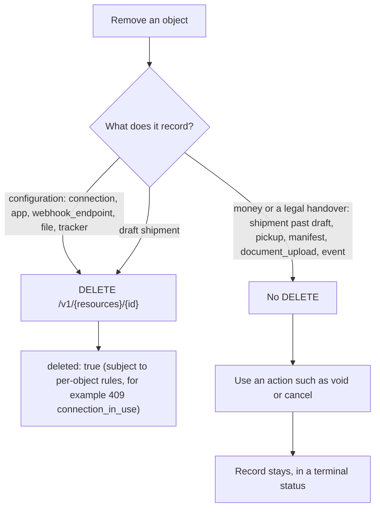
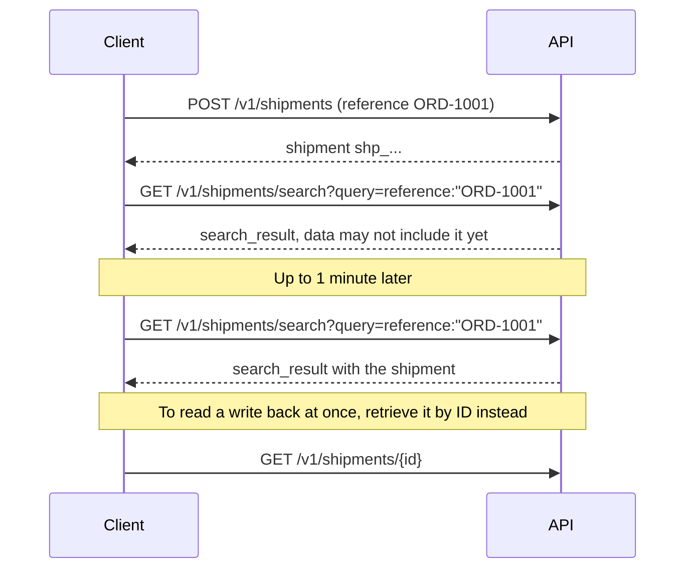

Every persistent object supports a uniform set of management operations. This chapter defines them once and lists what each resource allows.

## 1. Operations matrix

| Object | Create | Retrieve | Update | List | Search | Delete | Actions |
|---|---|---|---|---|---|---|---|
| `shipment` | ✓ | ✓ | ✓ (draft: all; else user_metadata, redact) | ✓ | ✓ | draft only | purchase, void, rates, return, label |
| `rate_quote` | via `/rates` | ✓ | — | — | — | — | — |
| `pickup` | ✓ | ✓ | ✓ (reschedule) | ✓ | ✓ | — | cancel |
| `manifest` | ✓ | ✓ | user_metadata, reference | ✓ | — | — | preview, reprint, (cancel: optional capability) |
| `file` | ✓ | ✓ | — | ✓ | — | ✓ (when unreferenced) | contents |
| `document_upload` | ✓ | ✓ | user_metadata | ✓ | — | — | — |
| `tracker` | ✓ | ✓ | user_metadata, refresh | ✓ | ✓ | ✓ (discard) | refresh, events |
| `webhook_endpoint` | ✓ | ✓ | ✓ | ✓ | — | ✓ | rotate_secret, test |
| `event` | — | ✓ | — | ✓ | — | — | redeliver, deliveries |
| `inbound_event` | ✓ | ✓ | — | ✓ | — | — | — |
| `connection` | ✓ | ✓ | ✓ | ✓ | — | ✓ | verify |
| `app` | ✓ | ✓ | ✓ | ✓ | — | ✓ | rotate_secret |
| `connect_session` | ✓ | ✓ | — | — | — | — | — |
| `carrier` | — | ✓ | — | ✓ | — | — | — |
| `pickup_schedule` | ✓ | ✓ | ✓ | ✓ | — | — | pause, resume, cancel, skip, add, occurrences |
| `classification`, `compliance_screening`, `landed_cost` | ✓ | ✓ | — | ✓ | — | — | classification: apply, feedback |
| `duty_collection` | — | ✓ | — | ✓ | — | — | pay, export |
| `service`, `option`, `packaging`, `zone` | ✓ | ✓ | ✓ (pending change) | ✓ | — | draft only | publish, versions; zones: match |
| `rate_sheet` | ✓ | ✓ | ✓ (pending change) | ✓ | — | draft only | publish, versions, simulate, import, export |
| `surcharge`, `pricing_rule` | ✓ | ✓ | ✓ | ✓ | — | ✓ | surcharge: schedule |
| `facility` | ✓ | ✓ | ✓ | ✓ | — | when unreferenced | — |
| `route` | ✓ | ✓ | ✓ | ✓ | — | draft or inactive | activate, deactivate, stops (CRUD, reorder), legs (update) |
| `route_run` | ✓ | ✓ | ✓ | ✓ | — | — | dispatch, start, complete, cancel, assign, unassign, stop and leg actions, positions, optimize |
| `journey` | via plan | ✓ | — | — | — | — | replan |
| `vehicle`, `driver` | ✓ | ✓ | ✓ | ✓ | — | ✓ | vehicle: position |
| `optimization` | ✓ | ✓ | — | ✓ | — | — | commit |
| `asn` | ✓ | ✓ | ✓ (before arrival) | ✓ | — | — | dispatch, arrive, receive, close, cancel |
| `account` | ✓ (platforms) | ✓ | ✓ | ✓ | — | — (close) | suspend, reactivate, close |
| `identity_provider` | ✓ | ✓ | ✓ | ✓ | — | ✓ | verify_domain, test |
| `membership`, `invitation`, `role` | ✓ | ✓ | ✓ | ✓ | — | ✓ | invitation: revoke |
| `api_key` | ✓ | ✓ | ✓ | ✓ | — | ✓ | roll |
| `product` | ✓ | ✓ | ✓ (If-Match) | ✓ | ✓ | when unreferenced (else archive) | upsert, archive, unarchive, import |
| `batch` | ✓ | ✓ | — | — | — | — | — |
| `interline_agreement` | ✓ | ✓ | ✓ (while proposed) | ✓ | — | — | sign, suspend, terminate |
| `ledger_entry` | — | ✓ | — | ✓ | — | — | — |
| `settlement` | — | ✓ | — | ✓ | — | — | close, dispute |
| `device` | ✓ | ✓ | ✓ | ✓ | — | ✓ | certificate, token, attach, detach, deactivate |
| `participant` | ✓ | ✓ | — | ✓ | — | — | credentials, rotate_keys |
| `record`, `anchor`, `attestation` | ✓ (records, attestations) | ✓ | — (append-only) | ✓ (query, feed) | — | — (erase keys only) | verify, erase |
| `consolidation` | ✓ | ✓ | ✓ | ✓ | — | — | add, remove, close, seal, break_seal, load, unload, deconsolidate, label, contents |
| `conveyance` | ✓ | ✓ | ✓ | ✓ | — | — | close, depart, arrive, cancel, manifest |
| `document_template` | ✓ | ✓ | ✓ (pending version) | ✓ | — | draft only | publish, versions, preview, validate |
| `document` | via generate | ✓ | — | ✓ | — | standalone only | — |
| `document_job` | ✓ | ✓ | — | ✓ | — | — | — |
| `label_spec` | ✓ | ✓ | ✓ (pending version) | ✓ | — | — | publish, certify, tracking_ranges |
| `document_ingestion` | ✓ (ingest) | ✓ | — | ✓ | — | — | apply, reject |
| `integration` | federated onboarding | ✓ | — | ✓ | — | — | — |
| `address_validation` | ✓ | ✓ | — | ✓ | — | — | — |
| `insurance_quote` | ✓ | ✓ | — | — | — | — | — |
| `coverage` | ✓ | ✓ | — | ✓ | — | — | cancel |
| `claim` | ✓ | ✓ | ✓ (evidence) | ✓ | — | — | withdraw |
| `job` | ✓ | ✓ | — | ✓ | — | — | cancel, retry, logs, stream |
| `job_schedule` | ✓ | ✓ | ✓ | ✓ | — | ✓ (user schedules) | pause, resume, run_now |
| `invoice` | ✓ (receivable drafts, import) | ✓ | ✓ (draft) | ✓ | — | — (void) | finalize, send, pay, dispute, void, mark_uncollectible, export |
| `reconciliation` | ✓ | ✓ | — | ✓ | — | — | resolve lines |
| `meter`, `price_plan` | ✓ | ✓ | ✓ | ✓ | — | — (archive) | — |
| `usage_record` | ✓ | ✓ | — | ✓ | — | — | import, summaries, export |
| `balance`, `balance_transaction` | — | ✓ | — | ✓ | — | — | top_up |
| `payment_method` | via setup | ✓ | — | ✓ | — | ✓ | — |
| `payment`, `refund`, `payout` | via invoice pay, top_up | ✓ | — | ✓ | — | — | payment: refund |
| `storage_location` | ✓ | ✓ | ✓ | ✓ | — | when empty | import |
| `stock` | — (projection) | ✓ | — | ✓ | — | — | levels, thresholds |
| `stock_movement` | ✓ (manual types) | ✓ | — (append-only) | ✓ | — | — | — |
| `fulfillment_order` | ✓ | ✓ | ✓ (until picking) | ✓ | — | — | allocate, release_to_pick, pack, ship, cancel |
| `wave` | ✓ | ✓ | — | ✓ | — | — | — |
| `inventory_count` | ✓ | ✓ | ✓ (lines) | ✓ | — | — | complete |
| `timeline` | — (derived) | ✓ | — | — | — | — | events, resolve |
| `identifier_link` | ✓ | via timeline | — (append-only) | — | — | — | — |
| `access_policy`, `access_grant` | ✓ | ✓ | ✓ | ✓ | — | — | grant: revoke |

The **"no destroy" principle**: objects that record money or a legal handover (shipments past draft, pickups, manifests, document uploads, events) are never deleted through the API. They move to a terminal status instead. Objects that are configuration (connections, apps, webhook endpoints, files, trackers) can be deleted.

This flowchart shows how the principle decides what happens when you want an object gone.



## 2. List

`GET /v1/{resources}` follows chapter 00 §10. Each resource's list filters:

| Resource | Filters |
|---|---|
| shipments | `status`, `tracking.status`, `tracking.number`, `carrier`, `connection`, `purchase.service.code`, `reference`, `order.id`, `returns.is_return`, `handover.manifest` (ID or `none`), `handover.pickup` (ID or `none`), `handover.close_group`, `ship_date[...]`, `created[...]`, `user_metadata[...]` |
| pickups | `status`, `carrier`, `connection`, `date[...]`, `created[...]` |
| manifests | `status`, `mode`, `trigger`, `group`, `carrier`, `connection`, `ship_date[...]`, `created[...]` |
| files | `purpose`, `created[...]` |
| document_uploads | `status`, `stage`, `shipment`, `connection`, `created[...]` |
| trackers | `status`, `status_detail`, `carrier`, `connection`, `tracking_number`, `shipment`, `delivered_at[...]`, `created[...]` |
| webhook_endpoints | `status` |
| events | `type` (wildcards allowed), `related[shipment\|tracker\|pickup\|manifest\|connection]`, `created[...]` |
| inbound_events | `type`, `status`, `connection`, `tracker`, `created[...]` |
| connections | `carrier`, `method`, `status`, `ownership`, `default` |
| apps | `carrier`, `visibility`, `status` |
| carriers | `capability`, `country`, `status` |

Range operators are `gt`, `gte`, `lt` and `lte`. `user_metadata[key]=value` is an exact match. `system_metadata[source]` and `system_metadata[batch]` are also filterable on every list. `carrier_metadata` is never filterable or searchable, because its keys are not stable.

## 3. Search

```
GET /v1/shipments/search?query=status:"purchased" AND carrier:"fedex" AND ship_to.address.country:"GB" AND created>1791302400&limit=50
GET /v1/trackers/search?query=status:"exception" AND -status_detail:"weather_delay"
GET /v1/pickups/search?query=date>="2026-10-01" AND status:"missed"
```

The grammar is the Stripe Search Query Language:

- `field:"value"` for exact match, `field~"val"` for substring match (minimum 3 characters), and `field>value` (also `<`, `>=`, `<=`) for numbers and dates.
- `AND` and `OR` combine clauses, but they cannot be mixed in one query. `-` negates a clause.
- Searchable fields: shipments allow `id`, `status`, `tracking.status`, `carrier`, `purchase.service.code`, `tracking.number`, `reference`, `order.id`, `order.invoice.number`, `ship_to.name`, `ship_to.email`, `ship_to.address.postal_code`, `ship_to.address.country`, `ship_from.address.postal_code`, `handling_units.items.sku`, `handling_units.items.import_hs_code`, `created`, `ship_date`, and `user_metadata["key"]`. Trackers allow `status`, `status_detail`, `carrier`, `tracking_number`, `created`, `delivered_at`, and `user_metadata["key"]`. Pickups allow `status`, `carrier`, `date`, `confirmation_number`, and `created`.
- The response is `{ "object": "search_result", "data": [...], "has_more": true, "next_page": "..." }`. Search results are eventually consistent, so allow up to 1 minute after a write.

This sequence shows what that lag means for a client that searches right after creating a shipment.



## 4. Retrieve and expand

`GET /v1/{resources}/{id}?expand[]=...`. A test-mode ID requested with a live key returns `404 resource_missing`, with `message` hinting at the mode mismatch.

## 5. Update

`POST /v1/{resources}/{id}`. Partial update. `null` clears a field. Setting `user_metadata` to `{}` or `null` clears all keys, and setting `user_metadata[key]` to `""` deletes that key.

Updating an immutable field returns `400 parameter_invalid` with `message` naming the status that froze it.

## 6. Delete

`DELETE /v1/{resources}/{id}` returns `{ "id", "object", "deleted": true }`. A repeated delete returns `404`.

## 7. Bulk operations (capability `batches`)

```
POST /v1/batches     { "operation": "shipments.create" | "trackers.create" | "shipments.void" | "pickups.cancel", "items": [ ...up to 1000 request bodies... ], "webhook_endpoint": "we_..." }
GET  /v1/batches/{id}
```

The result is a `batch` object (`bat_`) with `status` (`processing`, `completed`, `completed_with_errors`), `counts`, and `results_file` (JSONL, one line per item: `{ index, status, object | error }`). Each item gets its own idempotency key, derived as `{batch_id}:{index}`. Batches exist because merchants buy labels in the thousands at end of day, and shipping 1,000 POSTs through a rate limiter is a bad experience.

This sequence shows a batch from submission to its results file.

```mermaid
sequenceDiagram
    participant Client
    participant API
    Client->>API: POST /v1/batches (operation shipments.create, items)
    API-->>Client: batch bat_..., status processing
    loop Each item
        Note over API: Run item with idempotency key bat_...:index
    end
    Client->>API: GET /v1/batches/{id}
    API-->>Client: status completed or completed_with_errors, counts, results_file
    Client->>API: GET /v1/files/{id}/contents
    API-->>Client: JSONL, one line per item with index, status, object or error
```



## 8. Export

```
POST /v1/exports     { "resource": "shipments", "filters": { ... }, "format": "csv" | "jsonl", "fields": [ ... ] }
```

This produces a `file` with `purpose: "export"` and emits `file.created`. It is optional (capability `exports`).

## 9. Data retention

| Object | Minimum retention |
|---|---|
| shipments, pickups, manifests, document_uploads | 7 years (customs and tax) or the implementer's published period, whichever is longer. PII is redactable. |
| rate_quotes | 30 days |
| events, webhook_deliveries, inbound_events | 30 days |
| trackers | As long as the linked shipment exists, otherwise 180 days after the last event |
| files | Until deleted, except generated label files, which last as long as the shipment |
