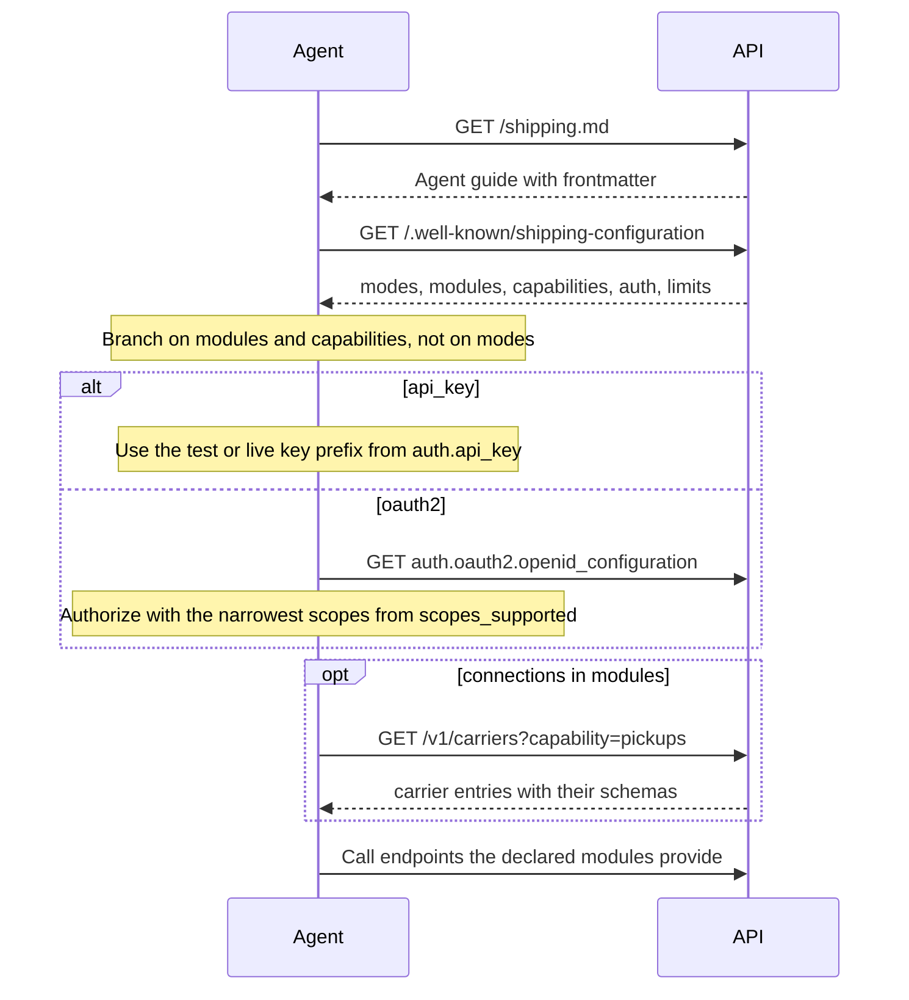
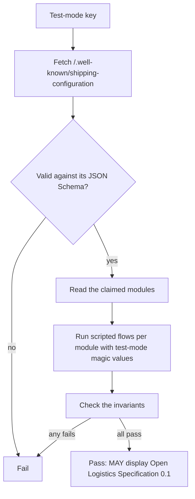

## 1. Modules and modes

Conformance is declared per **module** (chapter 12 §1). Each module is all-or-nothing: claiming it means implementing every MUST in it. A **mode** (`universal`, `carrier`, `3pl`, `fleet`) is a named profile that requires a set of modules (chapter 12 §2).

| Module | Includes | Chapters |
|---|---|---|
| **core** | Conventions, rates, shipments (create, purchase, void, retrieve, list), trackers (create, discard, retrieve, list), events API (list, retrieve), service availability | 00–03, 07, 10, 14 §2 |
| **webhooks** | Webhook endpoints, signed delivery, retries, redelivery, inbound injection | 08 |
| **pickups** | Availability, book, update, cancel, and pickup schedules (§7, with `management: implementer` at minimum) | 04 |
| **manifests** | Preview, create (explicit, with `split`), retrieve, list, async status, scheduled auto-close, `manifest.due` | 05 |
| **documents** | Files, document uploads (pre-shipment and/or post-shipment) | 06 |
| **connections** | Carrier catalog (read), connections, apps, connect sessions | 09 |
| **platform** | OAuth 2.1 + OIDC authorization server, connected accounts (`Shipping-Account`), accounts, memberships, roles, API keys, identity providers, token exchange | 00 §3.2–3.3, 19 |
| **trade** | Classification and landed cost. Screening, tariffs and collections are capabilities. | 13 |
| **catalog** | Authoring and publishing services, options, packagings and zones; the generated `shipment_config_schema` | 14 |
| **pricing** | Rate sheets (with the normative calculation), surcharges, pricing rules, simulate | 15 |
| **routes** | Facilities, routes, stops and legs, route runs with tracking write-through, journeys | 16 |
| **fleet** | Vehicles, drivers, dispatch, optimization, positions and ETAs | 17 |
| **injection** | Injected shipments (label modes, upsert by upstream reference), ASNs, receiving and discrepancies, tracking feedback | 18 |
| **products** | Product CRUD, variants, upsert with field ownership, item resolution and purchase snapshot | 20 |
| **network** | Carrier member accounts, member-owned catalog, pricing and routes, composed rates, interline agreements and handoffs, ledger and settlements | 21 |
| **iot** | Devices, device authentication, `POST /v1/device_events` with all event types, condition monitoring | 22 |
| **consolidation** | Consolidations with nesting and the aggregation rule, conveyances, custody chain, consolidation labels | 24 |
| **templates** | Document templates (Liquid and ZPL), validate, preview, generate, triggers, document jobs | 25 |
| **integrations** | Integration catalog, generalized apps and connections, per-interface defaults; each interface (`address_validation`, `insurance`) is claimed separately as a capability | 26 |
| **jobs** | Job envelope over every async operation, cancel, retry, logs, stream, job schedules including visible system schedules | 27 |
| **inventory** | Storage locations, stock projection from an append-only movement ledger, levels, fulfillment orders through ship, counts, level-change events | 29 |
| **billing** | Invoices with import and export (`json` and `ubl` at minimum), reconciliation, meters, usage records, price plans, billing cycle, payments interface with the PAN-free rule | 28 |
| **data_network** | Participants (DID), signed records with hash chains, anchoring and verify, policies, grants, key release, identity linking, timelines with the published milestone definitions, query and feed, erasure | 23 |

Each module's operations are claimed on the surface where the spec defines them (chapter 00 §16). Conformance for a module includes its GraphQL fields, as listed in the [GraphQL Interface](/spec/graphql), when that module defines any.

## 2. Capability registry

Capabilities are finer than modules. They appear on carriers, connections and in the configuration document.

```
rates  rates.stream  rates.landed_cost
labels  labels.reformat  labels.multi_piece  labels.inline
void  void.partial  void.async
returns  returns.qr_code  returns.pickup
pickups  pickups.availability  pickups.update  pickups.recurring
pickups.schedules  manifests  manifests.close_all  manifests.async  manifests.reprint  manifests.cancel  manifests.carrier_auto_close
documents.pre_shipment  documents.post_shipment  documents.generated_invoice
tracking  tracking.push  tracking.detect  tracking.proof_of_delivery
address_validation
dangerous_goods
inbound.charges
batches  exports
trade.classification  trade.screening  trade.landed_cost  trade.tariffs  trade.collections
catalog.versioning  pricing.distance  pricing.cost  routes.journeys  routes.subcontracting
fleet.optimization  fleet.positions  fleet.telematics
```

## 3. `/.well-known/shipping-configuration`

A JSON document served without authentication. It is the machine-readable twin of `shipping.md`.

This sequence shows how an agent or client uses the two discovery documents before its first real call.



```json
{
  "spec": "open-logistics-spec",
  "spec_version": "0.1",
  "api_versions": ["2026-10-01"],
  "api_base": "https://api.example.com/v1",
  "implementer": { "name": "Example Shipping", "docs": "https://docs.example.com" },
  "modes": ["universal"],
  "modules": ["core", "webhooks", "pickups", "manifests", "documents", "connections", "platform"],
  "carrier": null,
  "capabilities": ["rates", "rates.stream", "labels", "void", "returns", "pickups", "pickups.availability", "manifests", "documents.pre_shipment", "documents.post_shipment", "tracking", "tracking.push", "tracking.detect", "batches"],
  "carriers_endpoint": "https://api.example.com/v1/carriers",
  "openapi": "https://api.example.com/openapi.yaml",
  "agent_guide": "https://api.example.com/shipping.md",
  "auth": {
    "api_key": { "header": "Authorization", "scheme": "Bearer", "prefixes": { "test": "sk_test_", "live": "sk_live_" } },
    "oauth2": {
      "issuer": "https://api.example.com",
      "openid_configuration": "https://api.example.com/.well-known/openid-configuration",
      "registration_endpoint": "https://api.example.com/oauth/register",
      "scopes_supported": ["rates:read", "shipments:read", "shipments:write", "pickups:write", "manifests:write", "documents:write", "trackers:read", "trackers:write", "webhooks:write", "connections:read", "connections:write", "inbound:write", "openid", "profile", "email"]
    }
  },
  "webhooks": {
    "signature_schemes": ["v1", "v1a"],
    "webhook_signing_keys": [{ "kid": "2026-10", "alg": "Ed25519", "x": "11qYAYKxCrfVS_7TyWQHOg7hcvPapiMlrwIaaPcHURo" }]
  },
  "limits": { "requests_per_second": 100, "rates_timeout_ms_max": 30000, "file_size_max_bytes": 10485760, "batch_items_max": 1000 },
  "test_mode": { "magic_values": true, "test_helpers": true }
}
```

## 4. Conformance test suite

The spec ships a conformance suite (forthcoming) that runs against a test-mode key:

1. Discovery: fetch the configuration and validate it against its JSON Schema.
2. For each claimed module, run scripted flows using the test-mode magic values from chapter 00 §13.
3. Check the invariants: idempotent replays return identical bodies, partial rate failures return `200`, voided shipments keep their records, unknown request parameters are rejected, unknown response enums are tolerated, webhook signatures verify, and tracker status can move backwards.

This flowchart shows the order the suite runs in.



An implementer passing the suite MAY display `Open Logistics Specification 0.1 – {modules}`.

## 5. Agent integration (MCP)

Implementers SHOULD expose an MCP server that maps one tool to each endpoint, generated from `openapi.yaml`, with these constraints:

- Tools that spend money (`shipments_purchase`, `shipments_create` with a `purchase` instruction, paid `pickups_create`) are annotated `destructiveHint: true` and require host-side confirmation.
- Tool descriptions are drawn from `shipping.md` §3, so every agent receives the same guardrails.
- The MCP server authenticates with the OAuth flow from chapter 00 §3.2. It never takes a raw `sk_live_` key from a prompt.
