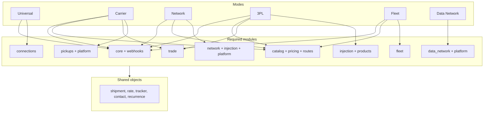
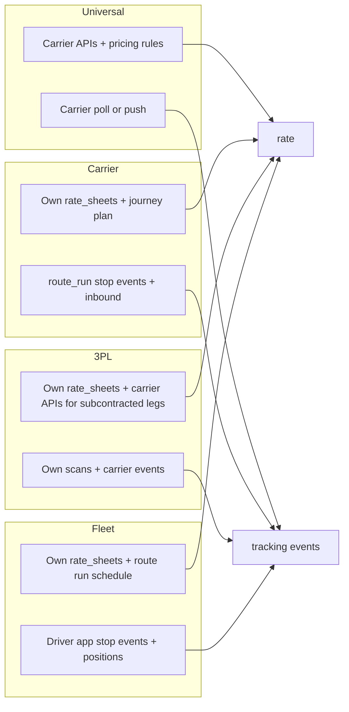
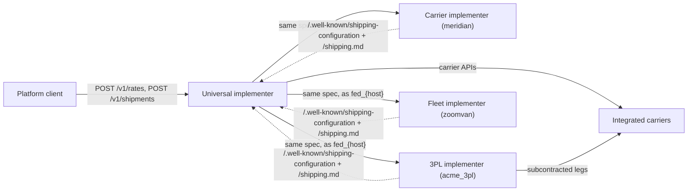

Six kinds of organization implement a logistics API, and they need different things from it:

| Mode | Who | What they sell | Example |
|---|---|---|---|
| **Universal** | Multi-carrier platforms and aggregators | Access to *other people's* networks through one API | Karrio, EasyPost, Shippo |
| **Carrier** | Parcel carriers, postal operators, cross-border networks | Their *own* network: services, a tariff, customs brokerage | DHL, UPS, a national post |
| **Network** | Carrier and LSP networks, marketplaces and alliances, whose members (couriers, forwarders, airlines, last-mile fleets) each serve first, middle or last mile segments | A venue where many carriers publish services, tariffs and routes, and shippers buy across them | A regional courier alliance, a postal union, an air cargo consortium, a freight marketplace |
| **3PL** | Third-party logistics and fulfillment providers | Shipping on behalf of many merchants, mixing their own routes with subcontracted carriers | A fulfillment network, a cross-border consolidator |
| **Fleet** | Operators running their own vehicles: vans, trucks, aircraft, drones, vessels | Movement capacity: first mile, line-haul, last mile, same day | A courier, an airline's cargo arm, a drone delivery operator |
| **Data Network** | Data network nodes for the logistics network | A shared, verifiable, access-controlled record of every party's canonical objects, and end-to-end timelines assembled from every party's scans | A node of a decentralized logistics data network |

The spec does **not** define six APIs. It defines one set of **modules**, built from one set of **objects**. A mode is a conformance profile that names which modules are required. A shipment, a rate, a tracker, a contact and a recurrence mean the same thing in every mode, so a client written against a Universal implementer can talk to a Carrier implementer without new code for the shared parts.

## 1. Modules

| Module | Chapter | Provides |
|---|---|---|
| `core` | 00–03, 07, 10, 14 §2 | Conventions, core objects, rates, shipments and labels, tracking, the events API, object management |
| `pickups` | 04 | One-time pickups and recurring pickup schedules |
| `manifests` | 05 | End of day |
| `documents` | 06 | Files and customs document uploads |
| `webhooks` | 08 | Webhook endpoints, signed delivery, inbound injection |
| `connections` | 09 | Carrier catalog (read), connections, apps, connect sessions. These are the means of reaching *other* carriers. |
| `platform` | 00 §3.2, 19 | OAuth 2.1 + OIDC authorization server, accounts (merchants, partners), memberships, roles, API keys, SSO identity providers, token exchange |
| `trade` | 13 | Classification, compliance screening, landed cost, tariff lookup, duty and tax collections |
| `catalog` | 14 | Authoring of services, options, packagings and zones |
| `pricing` | 15 | Rate sheets, surcharges, pricing rules |
| `routes` | 16 | Facilities, routes, stops, legs, route runs, journeys |
| `fleet` | 17 | Vehicles, drivers, dispatch, optimization, positions |
| `injection` | 18 | Shipments injected by upstream carriers, marketplaces and e-commerce platforms, ASNs, receiving, tracking feedback |
| `products` | 20 | Product and commodity master: CRUD, variants, per-country HS codes, upsert sync |
| `network` | 21 | Carrier accounts as network members, composed cross-member rates, interline agreements, settlement |
| `iot` | 22 | Device registry, scan, sensor, position and geofence ingestion, condition monitoring |
| `consolidation` | 24 | Bags, sacks, gaylords, cages, pallets, ULDs, containers and trailers, conveyances (flights, voyages, trips), aggregation and custody |
| `templates` | 25 | Document templates (Liquid, ZPL), carrier label specs and certification, generation (on-demand, triggered, batch), and document ingestion |
| `integrations` | 26 | Integration catalog, generic OAuth apps and connections, interfaces `lsp`, `address_validation`, `insurance` |
| `jobs` | 27 | Background job envelope, progress, cancel, retry, logs, job schedules |
| `inventory` | 29 | Storage locations, stock with lots and serials, the movement ledger, levels, fulfillment orders, waves, counts, channel sync |
| `billing` | 28 | Carrier and LSP invoices (import, export, reconciliation), usage meters, price plans, prepaid balances, and the payments interface |
| `data_network` | 23 | Participants (DIDs, verifiable credentials), signed content-addressed records, ledger anchoring, field-level access, identity linking and end-to-end timelines with consolidated milestones, query and change feed |

## 2. Mode profiles

**R** = required, **O** = optional, **—** = not applicable.

| Module | Universal | Carrier | Network | 3PL | Fleet | Data Network |
|---|---|---|---|---|---|---|
| `core` | R | R | R | R | R | read-only replica |
| `webhooks` | R | R | R | R | R | R |
| `pickups` | O | R | R | O | O | — |
| `manifests` | O | O | O | O | — | — |
| `documents` | O | O | O | O | — | — |
| `connections` | **R** | — | O | O | O | — |
| `platform` | O | R | **R** | O | O | R |
| `catalog` | read-only via `/v1/carriers` | **R** | **R** (per member) | **R** | **R** | — |
| `pricing` | O | **R** | **R** (per member) | **R** | **R** | — |
| `trade` | O | **R** | O | **R** | — | — |
| `routes` | — | **R** | **R** (per member) | **R** | **R** | — |
| `fleet` | — | O | O | O | **R** | — |
| `injection` | — | O | **R** | **R** | O | — |
| `products` | O | O | O | **R** | O | — |
| `network` | — | — | **R** | — | — | — |
| `iot` | — | O | O | O | O | — |
| `consolidation` | — | **R** | **R** | **R** | O | — |
| `templates` | O | O | O | **R** | O | — |
| `integrations` | **R** | O | **R** | O | O | — |
| `jobs` | R | R | R | R | R | R |
| `inventory` | O | O | O | **R** | — | — |
| `billing` | O | **R** | **R** | **R** | O | — |
| `data_network` | O (replicate) | O (replicate) | O (replicate) | O (replicate) | O (replicate) | **R** |

An implementer MAY operate in more than one mode. A 3PL with its own last-mile vans is `["3pl", "fleet"]`. An airline cargo arm is `["carrier", "fleet"]`. Any mode can **replicate** its objects into a data network node (chapter 23 §3). An aggregator that also prices its own resold contracts is `["universal"]` with `pricing`. In that case the union of the required modules applies.

This diagram shows the required modules from the table above. Every mode is built on the same modules, and every module on the same objects.



## 3. How shared objects behave per mode

The objects do not change between modes. What changes is **who produces the data**.

This flowchart shows where rates and tracking events come from in each mode. The objects they land in are the same.



| Concern | Universal | Carrier | 3PL | Fleet |
|---|---|---|---|---|
| `GET /v1/carriers` | Every integrated carrier | Exactly one entry (itself), derived from its `catalog` | Itself, plus any connected carriers | Itself |
| `carrier_configs` keys | Any connected carrier | Only its own carrier ID | Itself and/or connected carriers | Its own carrier ID |
| Where a rate comes from | Carrier APIs (plus `pricing` rules) | Its own `rate_sheets` | Its own rate sheets for its own network, and carrier APIs for subcontracted legs | Its own rate sheets |
| `rate.pricing` | `negotiated`, `list`, `implementer` | `rate_sheet` | `rate_sheet` or `negotiated` | `rate_sheet` |
| `rate.delivery` | From the carrier | From the `routes` journey plan | From the journey plan (own and subcontracted legs) | From the route run schedule and optimization |
| Tracking events | Carrier poll or push | Its own scans: `route_run` stop events and inbound | Own scans plus carrier events | Driver app stop events and positions |
| `shipment.tracking.journey` | — | Planned and actual legs | Planned and actual legs, including subcontracted legs | A single run |
| Customs | Passed through to carriers | Its own brokerage, via `trade` | Its own brokerage, via `trade` | — |

## 4. Identity of a non-universal implementer

In Carrier, 3PL and Fleet modes, the implementer *is* a carrier:

- It has a carrier ID in the shared registry (`meridian`, `acme_3pl`, `zoomvan`), which is returned by `GET /v1/carriers`.
- Its services are `service` objects from its catalog, with codes namespaced `{carrier}_{service}`.
- Its `shipment_config_schema` is **derived** from its catalog's `option` definitions (chapter 14 §3). It is never hand-written.
- It publishes `/.well-known/shipping-configuration` and `/shipping.md`, so a Universal implementer can onboard it as a **federated carrier** (chapter 09 §6) with no carrier-specific code. That is how the four modes connect to each other.

This diagram shows the modes composing through federation. Carrier, 3PL and Fleet implementers publish discovery documents, a Universal implementer onboards each one as a federated carrier, and a platform client reaches all of them through one API.



## 5. Discovery

`/.well-known/shipping-configuration` and `shipping.md` frontmatter declare:

```json
{
  "modes": ["carrier"],
  "modules": ["core", "webhooks", "pickups", "documents", "platform", "catalog", "pricing", "trade", "routes"],
  "carrier": "meridian"
}
```

`carrier` is present in every mode except pure `universal`. Clients SHOULD branch on `modules`, not on `modes`. The mode is a summary, and the module list is the contract.
