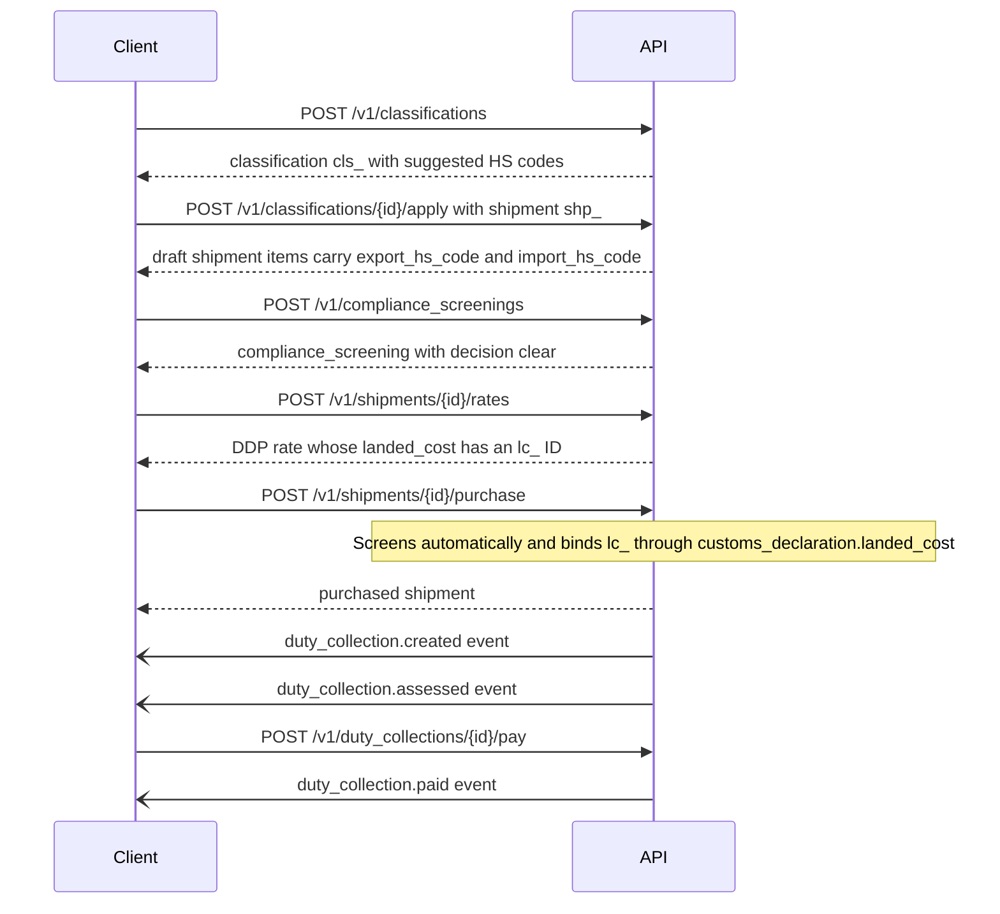
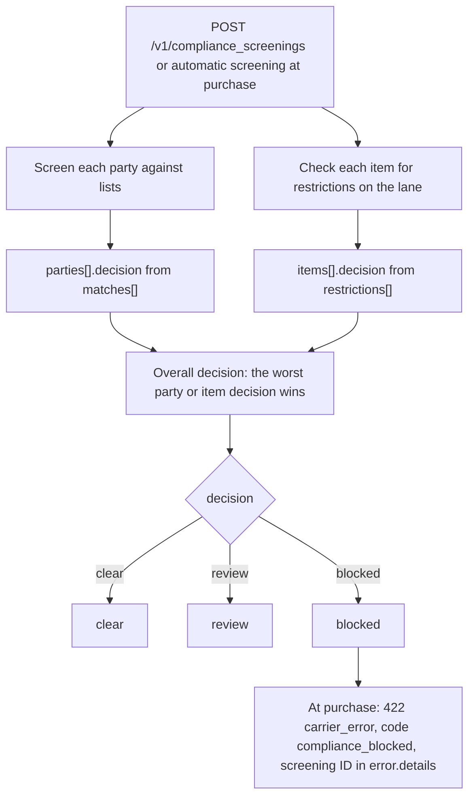
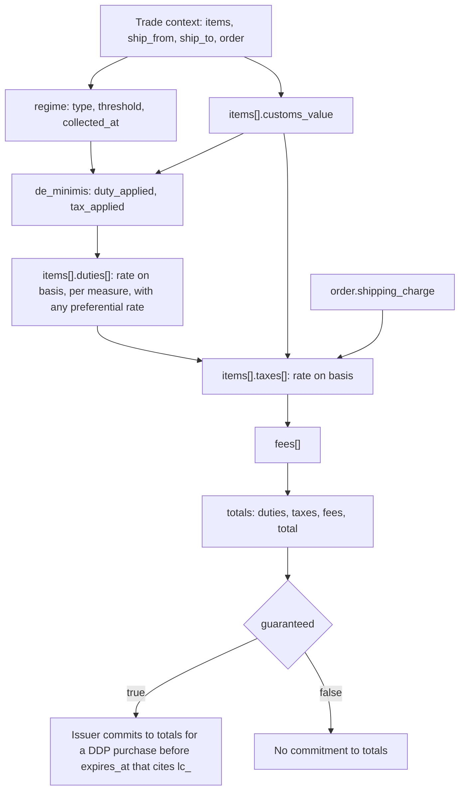
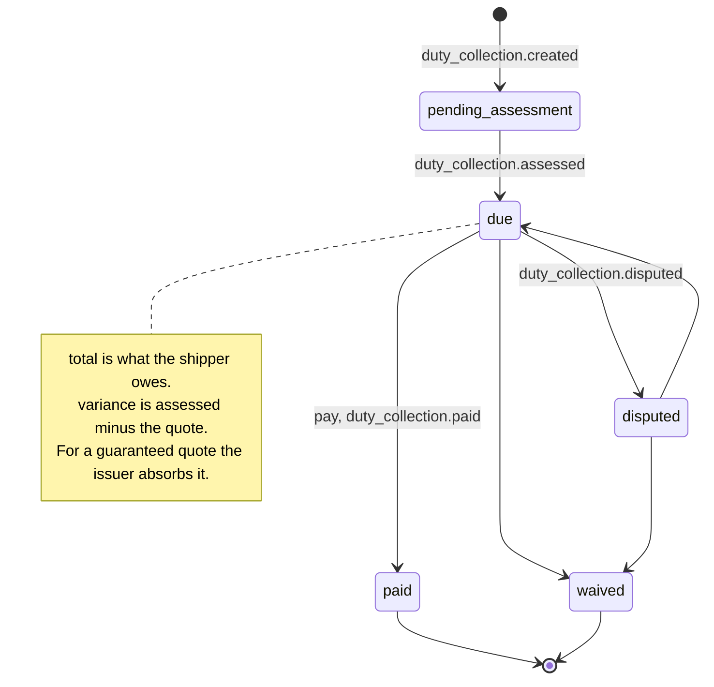

The trade engine answers the questions a customs declaration depends on: *what is this item* (classification), *may it go there* (screening), and *what will it cost to land* (landed cost). Carriers and 3PLs that broker customs implement it. Universal implementers MAY implement it, by proxying a carrier's engine or a specialist provider.

It reuses the core objects, `Item` (chapter 01 §3), `Contact` and `Money`, so its outputs drop straight into a shipment.

**The no-invention rule still applies.** The engine *suggests*. It never writes `export_hs_code` or `import_hs_code` onto a shipment unless the client explicitly applies a result (§2.3).

| Resource | Prefix | Endpoints |
|---|---|---|
| `classification` | `cls_` | `POST /v1/classifications`, `GET /v1/classifications/{id}`, `GET /v1/classifications`, `POST /v1/classifications/{id}/apply`, `POST /v1/classifications/{id}/feedback` |
| `compliance_screening` | `scr_` | `POST /v1/compliance_screenings`, `GET /v1/compliance_screenings/{id}`, `GET /v1/compliance_screenings` |
| `landed_cost` | `lc_` | `POST /v1/landed_costs`, `GET /v1/landed_costs/{id}`, `GET /v1/landed_costs` |
| `tariff` | — | `GET /v1/tariffs/{country}/{hs_code}` |
| `duty_collection` | `dcol_` | `GET /v1/duty_collections`, `GET /v1/duty_collections/{id}`, `POST /v1/duty_collections/{id}/pay`, `POST /v1/duty_collections/export` |

This sequence shows how the trade resources feed a DDP shipment, from item classification to the duty collection after import.



## 1. Common inputs

Trade requests take a **trade context**. It is a subset of a shipment, so a client can send what it already has:

```json
{
  "ship_from": { "address": { "country": "US", "state": "CA", "postal_code": "95014" } },
  "ship_to": { "address": { "country": "GB", "postal_code": "SW1A 2AA" } },
  "items": [ { "...": "Item" } ],
  "order": { "shipping_charge": { "amount": 995, "currency": "usd" }, "insurance_charge": null },
  "customs_declaration": { "incoterm": "DDP", "contents_type": "merchandise" },
  "shipment": null
}
```

Alternatively, pass `shipment: "shp_..."`, and the context is read from it, with items taken from `handling_units[].items[]`.

## 2. Classification

### 2.1 Create

```
POST /v1/classifications
```

```json
{
  "items": [
    { "title": "Cotton t-shirt", "description": "Men's knitted t-shirt, 100% cotton", "category": "apparel", "material": "cotton", "product_url": "https://...", "image_url": "https://...", "origin_country": "PT", "sku": "TS-RED-M" }
  ],
  "export_country": "US",
  "import_countries": ["GB", "DE", "CA"],
  "include_restrictions": true
}
```

### 2.2 The `classification` object

```json
{
  "id": "cls_7Gh1",
  "object": "classification",
  "status": "completed",
  "items": [
    {
      "index": 0,
      "sku": "TS-RED-M",
      "export": { "country": "US", "hs_code": "6109.10.0012", "description": "T-shirts, knitted, of cotton, men's", "confidence": 0.94 },
      "import": [
        { "country": "GB", "hs_code": "6109100010", "description": "...", "confidence": 0.93, "alternatives": [{ "hs_code": "6109100090", "confidence": 0.04 }] },
        { "country": "DE", "hs_code": "6109100010", "confidence": 0.93 },
        { "country": "CA", "hs_code": "6109100011", "confidence": 0.88 }
      ],
      "requires_review": false,
      "rationale": "Knitted outer garment, cotton > 50% by weight, men's.",
      "restrictions": []
    }
  ],
  "messages": [],
  "user_metadata": {}, "carrier_metadata": {}, "system_metadata": {}
}
```

- `status` is `pending`, `completed` or `failed`. Requests with more than 100 items MAY be asynchronous and emit `classification.completed`.
- `confidence` is 0–1. Below the implementer's published threshold, `requires_review` is `true`, and the result MUST NOT be applied automatically by any implementer-side automation.
- `rationale` is human-readable and is never a substitute for the code.

### 2.3 Apply and feedback

```
POST /v1/classifications/{id}/apply      { "shipment": "shp_...", "items": [0, 1], "import_country": "GB" }
POST /v1/classifications/{id}/feedback   { "index": 0, "import": { "country": "GB", "hs_code": "6109100090" }, "reason": "Broker reclassified" }
```

`apply` with `{ "product": "prod_..." }` writes into the product's `hs_codes` instead (chapter 20). With a shipment, `apply` writes `export_hs_code` and `import_hs_code` to the matching items, matched by `sku`, then by `index`, on a `draft` shipment, and records `system_metadata.classification` on each one. `feedback` records corrections that implementers MAY use to improve future suggestions.

## 3. Compliance screening

```
POST /v1/compliance_screenings
```

```json
{
  "parties": [ { "role": "ship_to", "contact": { "...": "Contact" } }, { "role": "importer_of_record", "contact": { } } ],
  "items": [ { "...": "Item" } ],
  "ship_from": { "address": { "country": "US" } },
  "ship_to": { "address": { "country": "AE" } },
  "lists": ["us_ofac_sdn", "us_bis_entity", "eu_consolidated", "uk_hmt", "un_consolidated"]
}
```

```json
{
  "id": "scr_3Kk0",
  "object": "compliance_screening",
  "decision": "review",
  "parties": [
    { "role": "ship_to", "decision": "review", "matches": [ { "list": "us_bis_entity", "name": "…", "score": 0.82, "entry_id": "…", "url": "…" } ] }
  ],
  "items": [
    { "index": 0, "decision": "clear", "restrictions": [] },
    { "index": 1, "decision": "blocked", "restrictions": [ { "country": "AE", "level": "prohibited", "agency": null, "code": "lithium_metal_air", "message": "Lithium metal batteries not accepted on this lane." } ] }
  ],
  "embargo": null,
  "lists_version": "2026-10-05"
}
```

- `decision` is `clear`, `review` or `blocked`. The worst item or party decides the overall result. An item restriction of `prohibited` means `blocked`. `restricted`, `license_required` and `agency_review` mean `review`. A party match at or above the implementer's published threshold means `review`, and an exact match on a sanctions list means `blocked`.
- At purchase, `blocked` fails the purchase, and `review` lets it proceed with a `compliance_review` warning in `messages[]`, unless the account setting `compliance.block_on_review` is `true`.
- `restrictions[].level` is `prohibited`, `restricted` (allowed with conditions), `license_required`, or `agency_review` (FDA, USDA, CITES…). It may carry `license_types[]` and `documents_required[]`.
- When `trade` is implemented, implementers SHOULD screen automatically at purchase and fail with `422 carrier_error` / `compliance_blocked`, giving the screening ID in `error.details`.

This flowchart shows how party and item results combine into one decision, and what a blocked result means at purchase.



## 4. Landed cost

```
POST /v1/landed_costs
```

The body is a trade context (§1) plus optional `service` (a service code, because some fees are carrier-specific) and `currency`.

### The `landed_cost` object

```json
{
  "id": "lc_9Mm2",
  "object": "landed_cost",
  "expires_at": 1791388800,
  "guaranteed": true,
  "currency": "gbp",
  "incoterm": "DDP",
  "regime": { "type": "uk_low_value", "threshold": { "amount": 13500, "currency": "gbp" }, "collected_at": "point_of_sale" },
  "de_minimis": { "duty": { "amount": 13500, "currency": "gbp" }, "tax": null, "duty_applied": false, "tax_applied": false },
  "items": [
    {
      "index": 0,
      "import_hs_code": "6109100010",
      "customs_value": { "amount": 2389, "currency": "gbp" },
      "duties": [ { "kind": "duty", "name": "Third-country duty", "rate": 0.12, "basis": "customs_value", "amount": { "amount": 0, "currency": "gbp" }, "measure": "MFN", "preferential": "eu_origin_tca" } ],
      "taxes": [ { "kind": "tax", "name": "VAT", "rate": 0.20, "basis": "customs_value_plus_duty_plus_shipping", "amount": { "amount": 478, "currency": "gbp" } } ]
    }
  ],
  "fees": [ { "kind": "customs_fee", "name": "Clearance fee", "amount": { "amount": 0, "currency": "gbp" } } ],
  "totals": { "duties": { "amount": 0, "currency": "gbp" }, "taxes": { "amount": 478, "currency": "gbp" }, "fees": { "amount": 0, "currency": "gbp" }, "total": { "amount": 478, "currency": "gbp" } },
  "messages": []
}
```

- `regime.type` is `standard`, `eu_ioss`, `uk_low_value`, `no_voec`, `au_lvg`, `ch_low_value`, `us_section_321`, or `other`. It also says whether tax is collected at checkout or at import.
- `duties[].measure` records the legal basis (`MFN`, `section_301`, `anti_dumping`, `countervailing`, `retaliatory`), and `preferential` records any trade-agreement rate applied.
- **Guarantees.** If `guaranteed` is `true`, the issuer commits to these totals for a DDP shipment purchased before `expires_at` that cites this quote in `customs_declaration.landed_cost: "lc_..."`. Rates reuse the object: `rate.landed_cost` *is* a `landed_cost` (with `id`), so buying a DDP rate binds its quote.

This flowchart shows how the parts of a `landed_cost` build on each other, from customs value to the guaranteed total.



## 5. Tariff lookup

```
GET /v1/tariffs/GB/6109100010?origin_country=PT
```

```json
{ "object": "tariff", "country": "GB", "hs_code": "6109100010", "description": "…", "duty": [ { "measure": "MFN", "rate": 0.12 }, { "measure": "preferential", "rate": 0, "agreement": "uk_eu_tca", "origin_country": "PT" } ], "taxes": [ { "name": "VAT", "rate": 0.20 } ], "restrictions": [], "valid_on": "2026-10-06" }
```

Capability `trade.tariffs`.

## 6. Duty and tax collections

For carriers and 3PLs that pay import duties and taxes on the shipper's behalf under DDP, and then collect them from the shipper.

```json
{
  "id": "dcol_1Pp5",
  "object": "duty_collection",
  "status": "due",
  "shipment": "shp_1Q2w...",
  "landed_cost": "lc_9Mm2",
  "assessed": { "duties": { "amount": 0, "currency": "gbp" }, "taxes": { "amount": 478, "currency": "gbp" }, "fees": { "amount": 0, "currency": "gbp" } },
  "total": { "amount": 478, "currency": "gbp" },
  "variance": { "amount": 0, "currency": "gbp" },
  "assessed_at": 1791500000,
  "due_by": "2026-11-05",
  "entry_number": "GB26XYZ0001234",
  "payment": null
}
```

- `status` is `pending_assessment`, `due`, `paid`, `disputed`, or `waived`.
- `variance` is the assessed total minus the guaranteed quote. For guaranteed quotes the issuer absorbs it, so the shipper's total stays at the quote.
- `POST /v1/duty_collections/{id}/pay` with `{ "payment_method": "..." }` settles a collection, with the payment method's details handled outside this spec. `POST /v1/duty_collections/export` produces a CSV `file`. This is capability `trade.collections`.

This state diagram shows the `duty_collection` statuses and the events that mark each transition. Transitions without a label have no event in §7.



## 7. Events

`classification.completed`, `classification.failed`, `compliance_screening.completed`, `landed_cost.created`, `duty_collection.created`, `duty_collection.assessed`, `duty_collection.paid`, `duty_collection.disputed`.
