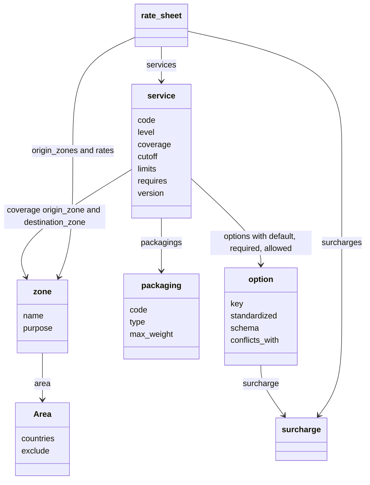
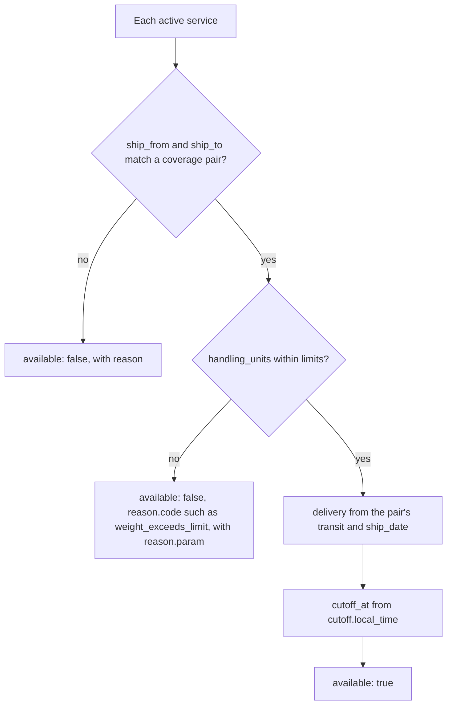
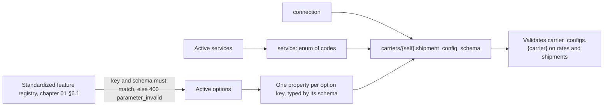
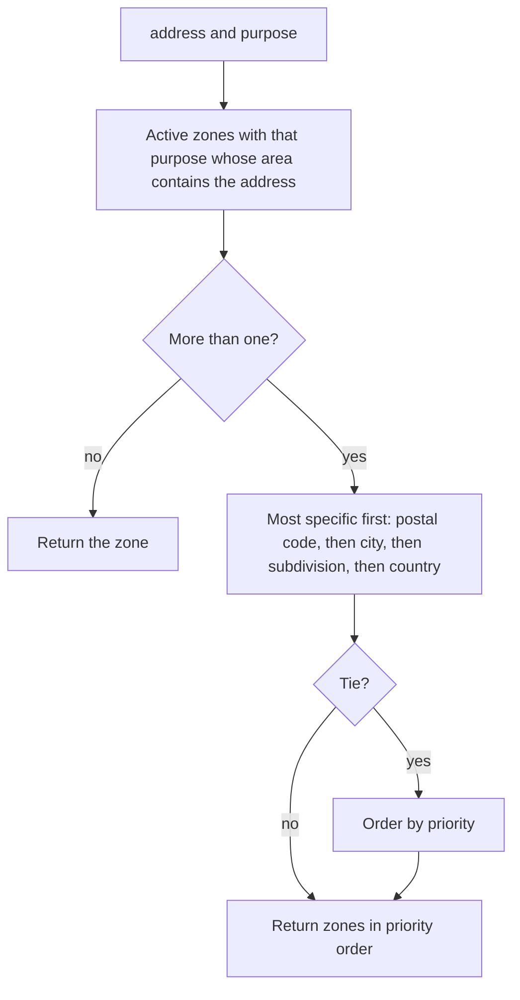
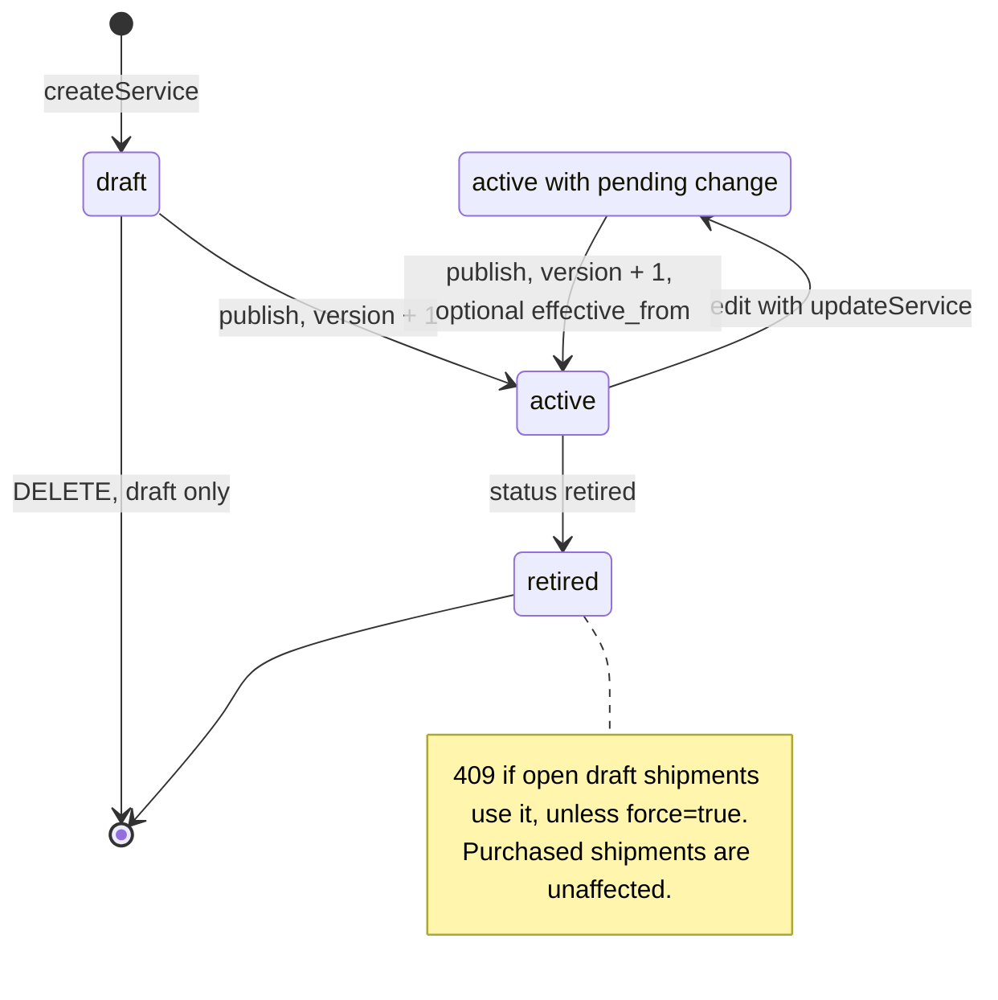

> **API surface.** Authoring the catalog is a **GraphQL Interface** back-office operation. Integrators read it through REST: `GET /v1/carriers/{id}` and `POST /v1/service_availability`.

The catalog is how an implementer that **is** a carrier (Carrier, 3PL or Fleet mode) describes what it sells. In Universal mode the same objects appear read-only inside `GET /v1/carriers/{id}`. One shape serves both cases: a `service` in a Carrier implementer's catalog is byte-for-byte what a Universal implementer shows under `carrier.services[]` after onboarding that carrier.

| Resource | Prefix | Purpose |
|---|---|---|
| `service` | `svc_` | A product: coverage, transit, limits, allowed packagings and options |
| `option` | `opt_` | A value-added service or setting: its schema, constraints and pricing hook |
| `packaging` | `pkg_` | A carrier-supplied or standard package type |
| `zone` | `zone_` | A named `Area` (chapter 01 §14), reused by services, rate sheets and fleet service areas |

Every catalog object has `status`: `draft`, `active`, or `retired`. Only `active` objects are used for rating and purchase. Changes to `active` objects are versioned (§6).

This class diagram shows how the catalog objects reference each other, and where the pricing module (chapter 15) attaches.



## 1. Service

```json
{
  "id": "svc_2Bb4",
  "object": "service",
  "code": "meridian_expedited_dropoff",
  "name": "Meridian Expedited (drop-off)",
  "description": "Cross-border expedited, duties optional, drop-off at partner location.",
  "level": "express",
  "carrier_code": "MERIDIAN-EXPEDITED-DROPOFF",
  "status": "active",
  "domestic": false,
  "international": true,
  "coverage": [
    { "origin_zone": "zone_us_all", "destination_zone": "zone_gb_mainland", "transit": { "min_days": 3, "max_days": 5, "business_days": true } },
    { "origin_zone": "zone_us_all", "destination_zone": "zone_eu_core", "transit": { "min_days": 4, "max_days": 7, "business_days": true } }
  ],
  "cutoff": { "local_time": "15:00", "facility": "fac_lax1" },
  "handover": ["drop_off", "pickup"],
  "limits": {
    "handling_unit_types": ["parcel", "envelope", "tube"],
    "weight": { "min": { "value": 0.01, "unit": "kg" }, "max": { "value": 30, "unit": "kg" } },
    "dimensions": { "max_length": { "value": 120, "unit": "cm" }, "max_length_plus_girth": { "value": 300, "unit": "cm" } },
    "declared_value": { "max": { "amount": 250000, "currency": "usd" } },
    "handling_units_per_shipment": 1
  },
  "dimensional_weight": { "divisor": 5000, "unit": "cm3_per_kg", "applies": "when_greater" },
  "packagings": ["pkg_envelope", "pkg_parcel", "pkg_tube"],
  "options": [
    { "option": "opt_signature", "default": "none", "required": false },
    { "option": "opt_delivery_warranty", "default": false },
    { "option": "opt_duty_tax_mode", "required": true, "allowed": ["guaranteed", "collect_from_consignee"] }
  ],
  "requires": ["ship_to.phone", "handling_units[].items[].import_hs_code"],
  "features": { "tracking": "full", "proof_of_delivery": ["photo"], "returns": true, "dangerous_goods": { "accepted_classes": [] }, "cash_on_delivery": false },
  "label": { "formats": ["pdf", "png", "zpl"], "sizes": ["4x6"], "template": "dtpl_meridian_label_4x6", "spec": "lspec_meridian_v2" },
  "effective_from": "2026-10-01",
  "effective_until": null,
  "version": 3,
  "user_metadata": {}, "carrier_metadata": {}, "system_metadata": {}
}
```

| Field | Notes |
|---|---|
| `code` | Globally unique `{carrier}_{name}`. It is immutable, and it is what `carrier_configs.{carrier}.service` takes. |
| `coverage[]` | Origin and destination zone pairs, each with its transit estimate. A shipment is serviceable if both addresses match a pair. |
| `cutoff` | The latest local handover time for same-day dispatch, optionally per facility |
| `handover` | Array of accepted handover methods: `drop_off`, `pickup` |
| `limits` | Hard constraints, checked before pricing. `handling_unit_types` lists accepted unit types, so a parcel service rejects pallets. Violations return the existing error codes (`weight_exceeds_limit`, `dimensions_exceed_limit`). |
| `dimensional_weight` | `divisor` with its `unit`. `applies` is `always`, `when_greater` (the default), or `never`. |
| `options[]` | References to `option` objects, with per-service `default`, `required`, and `allowed` values |
| `requires` | Field paths that become required at purchase. They surface in `rate.requires` (chapter 02). |
| `label` | Formats and sizes. When the carrier publishes its own label design, `template` and `spec` point to it (chapter 25 §6), and implementers can then generate compliant labels offline. |
| `features.tracking` | `full`, `milestones_only`, `none` |

## 2. Serviceability check

```
POST /v1/service_availability
```

```json
{ "ship_from": { }, "ship_to": { }, "handling_units": [ ], "ship_date": "2026-10-06" }
```

```json
{ "object": "service_availability", "services": [ { "service": "svc_2Bb4", "code": "meridian_expedited_dropoff", "available": true, "delivery": { "days": 4, "date": "2026-10-10" }, "cutoff_at": 1791334800 }, { "service": "svc_9Cc1", "code": "meridian_economy", "available": false, "reason": { "code": "weight_exceeds_limit", "param": "handling_units[0].weight" } } ] }
```

This returns which services can carry the shipment, and when, without pricing it. It is cheaper than rating and useful for checkout eligibility. It is available in every mode. Universal implementers fan it out like rates.

This flowchart shows the checks behind each entry in `services[]`. No pricing step runs.



## 3. Option

```json
{
  "id": "opt_signature",
  "object": "option",
  "key": "signature",
  "standardized": true,
  "carrier_code": "ADULT",
  "name": "Signature on delivery",
  "description": "Recipient must sign. Adult requires ID showing 21+.",
  "schema": { "type": "string", "enum": ["none", "standard", "adult"] },
  "conflicts_with": ["opt_safe_place"],
  "requires": [],
  "surcharge": "sur_signature",
  "status": "active"
}
```

- `key` is the property name in `carrier_configs.{carrier}`. With `standardized: true`, the option *implements* a standardized feature (chapter 01 §6.1). `key` and `schema` MUST match the registry, the implementer rejects mismatches with `400 parameter_invalid`, and `carrier_code` records the carrier's native code, which is what `rate.features` reports. With `standardized: false`, it is a carrier-specific feature. Its key MUST NOT reuse a standardized name.
- `schema` is a JSON Schema fragment for the value.
- `surcharge` links to the pricing module (chapter 15 §3), which is how an option gets its price.
- **Generated config schema.** The implementer generates `carriers/{self}.shipment_config_schema` from its active options: `service` (an enum of active service codes), `connection`, and one property per option, with standardized options carrying `x-standardized: true`. It also lists them in `carriers/{self}.standardized_features`. Nobody maintains the schema by hand, so it cannot drift from the catalog.

This flowchart shows where each part of the generated schema comes from, and what it validates.



## 4. Packaging

```json
{ "id": "pkg_fedex_box_small", "object": "packaging", "code": "fedex_box_small", "name": "FedEx Small Box", "type": "box", "inner_dimensions": { "length": 31.4, "width": 27.6, "height": 3.8, "unit": "cm" }, "outer_dimensions": null, "tare_weight": { "value": 0.1, "unit": "kg" }, "max_weight": { "value": 9, "unit": "kg" }, "flat_rate": false, "status": "active" }
```

`type` is `envelope`, `pak`, `box`, `tube`, `pallet`, or `custom`. The `code` is what `handling_unit.packaging` accepts.

## 5. Zone

```json
{ "id": "zone_gb_mainland", "object": "zone", "name": "GB mainland", "purpose": ["coverage", "pricing"], "priority": 10, "area": { "countries": ["GB"], "exclude": { "postal_codes": ["BT*", "GY*", "JE*", "IM*", "HS*", "ZE*", "KW15-KW17"] } }, "status": "active" }
```

- `purpose` is any of `coverage`, `pricing`, `service_area` (fleet), or `surcharge` (remote areas, for example).
- `matchZone` (GraphQL Interface mutation) with `{ "address": Address, "purpose": "pricing" }` returns the zones that contain the address, in priority order. Rating uses this, and exposing it makes pricing explainable.
- Zones may overlap. Where several match, the most specific wins: postal code beats city beats subdivision beats country. Ties are broken by the explicit `priority` field.

This flowchart shows how `matchZone` (GraphQL Interface mutation) picks between overlapping zones.



## 6. Endpoints and versioning

```
mutation createService                query services        query service
mutation updateService           mutation deleteService   (draft only; otherwise set status: "retired")
mutation publishService   (draft or pending change → active, version + 1)
query serviceVersions
```

The same pattern applies to `/v1/options`, `/v1/packagings` and `/v1/zones`.

- Editing an `active` object creates a **pending change**, which is visible at `GET …/{id}?version=pending`. The change takes effect on `publish`, optionally at a future `effective_from`.
- Rates and shipments record the catalog `version` they were computed against, in `rate.carrier_metadata.catalog_version`, for disputes.
- Retiring a service with open draft shipments returns `409` unless `?force=true`. Purchased shipments are unaffected.
- Events: `service.created`, `service.updated`, `service.published`, `service.retired`, and the same for `option`, `packaging` and `zone`.

This state diagram shows the lifecycle of a catalog object and how edits to an `active` object are versioned.



## 7. Universal mode

In Universal mode, these objects are read-only and nested:

- `GET /v1/carriers/{id}` → `services[]`, `packagings[]`, `options[]` (as `option` objects), and `zones[]` where the carrier publishes them.
- For federated carriers (chapter 09 §6), they are synchronized from the carrier's own catalog endpoints. For carriers integrated through code, they are maintained by the implementer.
- `POST /v1/service_availability` works across every connected carrier.
