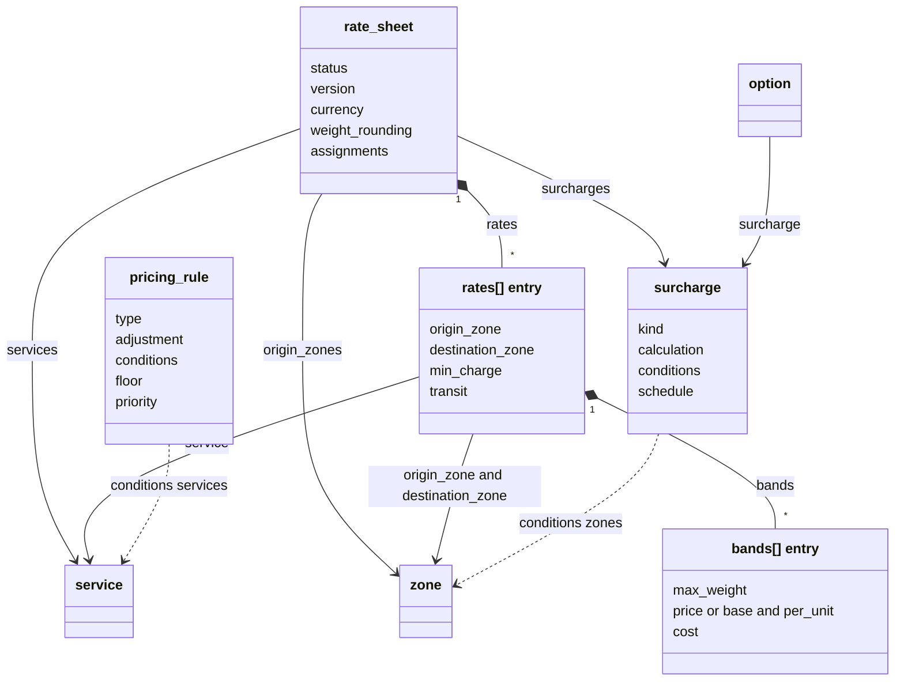
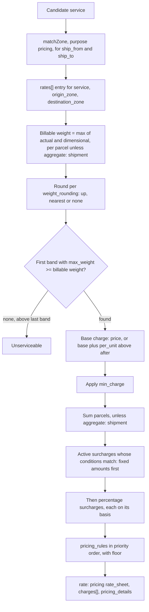
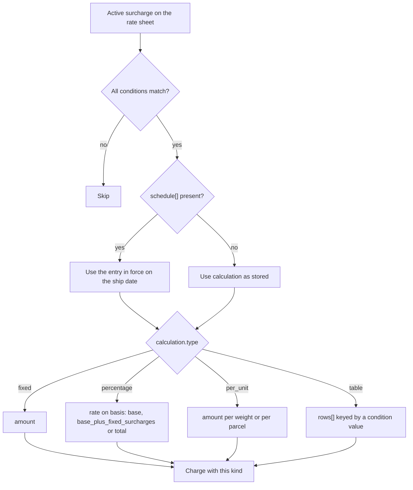
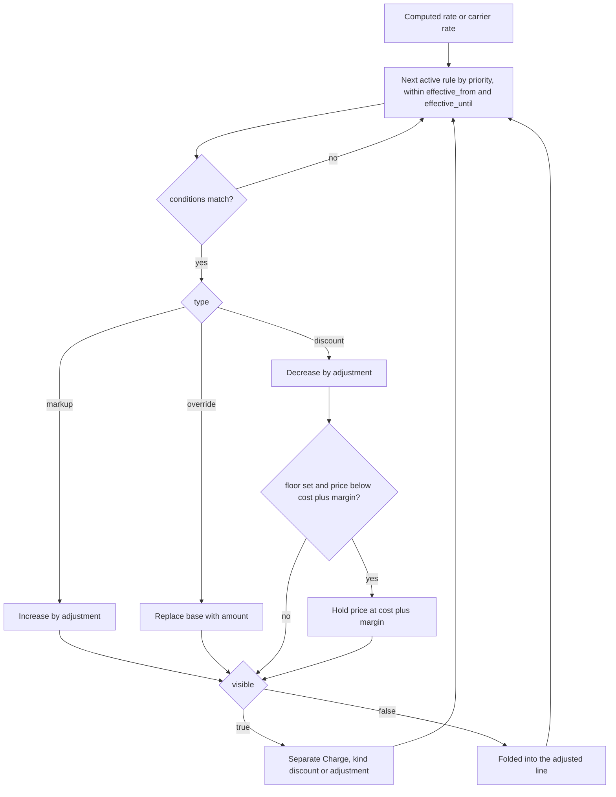
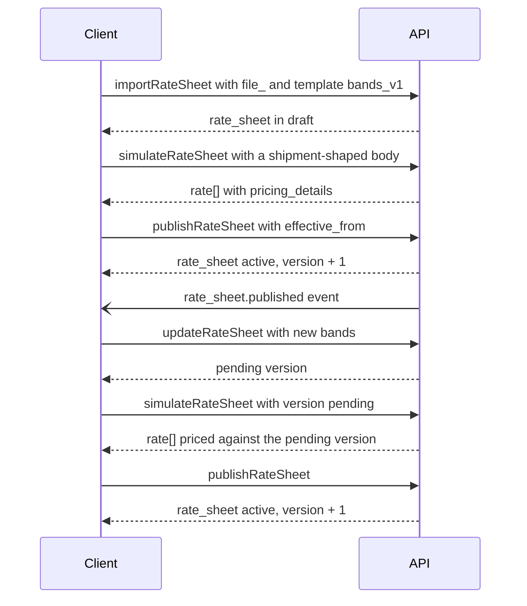

> **API surface.** Rate sheets, surcharges and pricing rules are managed over **GraphQL Interface**. Integrators see their effect on REST rates, through `rate.pricing_details`.

Carriers, 3PLs and fleets price their own networks. Universal implementers price custom or offline carriers, and mark up carrier rates. All of them need the same things: a tariff by service, zone and weight, surcharges, customer-specific deals, and a way to explain any price after the fact.

The structure follows Karrio's rate sheets, which have run in production for custom carriers: shared zones, shared surcharges, and service × zone rates in weight bands with both a sell `rate` and a `cost`.

| Resource | Prefix | Purpose |
|---|---|---|
| `rate_sheet` | `rs_` | A versioned tariff for one or more services |
| `surcharge` | `sur_` | A reusable charge rule: fuel, residential, remote area, option fees, DG, peak |
| `pricing_rule` | `prule_` | A markup, discount or contract override applied on top of a computed or carrier rate |

This class diagram shows how the pricing objects reference the catalog objects from chapter 14.



## 1. Rate sheet

```json
{
  "id": "rs_5Df8",
  "object": "rate_sheet",
  "name": "Meridian Public Tariff 2026-Q4",
  "status": "active",
  "version": 4,
  "currency": "usd",
  "effective_from": "2026-10-01",
  "effective_until": null,
  "services": ["svc_2Bb4", "svc_9Cc1"],
  "origin_zones": ["zone_us_all"],
  "weight_rounding": { "increment": { "value": 0.5, "unit": "kg" }, "mode": "up" },
  "dimensional_weight": null,
  "rates": [
    {
      "service": "svc_2Bb4",
      "origin_zone": "zone_us_all",
      "destination_zone": "zone_gb_mainland",
      "bands": [
        { "max_weight": { "value": 0.5, "unit": "kg" }, "price": { "amount": 1450, "currency": "usd" }, "cost": { "amount": 980, "currency": "usd" } },
        { "max_weight": { "value": 2, "unit": "kg" }, "price": { "amount": 2190, "currency": "usd" }, "cost": { "amount": 1510, "currency": "usd" } },
        { "max_weight": { "value": 30, "unit": "kg" }, "base": { "amount": 2190, "currency": "usd" }, "per_unit": { "amount": 420, "currency": "usd", "per": { "value": 1, "unit": "kg" }, "after": { "value": 2, "unit": "kg" } } }
      ],
      "min_charge": { "amount": 1450, "currency": "usd" },
      "transit": { "min_days": 3, "max_days": 5 }
    }
  ],
  "surcharges": ["sur_fuel", "sur_remote_area", "sur_signature", "sur_dg"],
  "assignments": { "accounts": null, "default": true },
  "user_metadata": {}, "carrier_metadata": {}, "system_metadata": {}
}
```

| Field | Notes |
|---|---|
| `rates[]` | One entry per service, origin zone and destination zone. `origin_zone` may be `null` for a single-origin network. |
| `bands[]` | Ordered by `max_weight`. A band has either a flat `price`, or a `base` plus `per_unit` (with `after` as the threshold the per-unit charge applies above). The billable weight selects the first band whose `max_weight` is greater than or equal to it. Above the last band, the shipment is unserviceable. |
| `cost` | Optional. What the implementer pays (subcontracted legs, or the line-haul allocation). It is never exposed to non-owner accounts. It enables margin reporting and floor rules (§3). |
| `weight_rounding` | Applied to the billable weight before band lookup. `mode` is `up`, `nearest`, or `none`. |
| `aggregate` | `parcel` (the default: each handling unit is priced through steps 2–3 and summed, then surcharges and rules apply to the shipment total) or `shipment` (total billable weight is priced once) |
| `dimensional_weight` | Overrides the service's own setting for this sheet |
| `assignments` | `default: true` makes it the public tariff. `accounts: ["acct_..."]` makes it a customer-specific tariff that takes precedence for those accounts. |

### Calculation (normative)

For each candidate service:

1. Resolve zones with `matchZone` (GraphQL Interface mutation) (purpose `pricing`), for both `ship_from` and `ship_to`.
2. Billable weight = max(actual, dimensional) per parcel, rounded per `weight_rounding`. Multi-parcel shipments are priced per parcel and summed, unless the sheet sets `aggregate: "shipment"`.
3. Find the band, compute the base charge, and apply `min_charge`.
4. Apply every **active** surcharge whose `conditions` match, in order (fixed amounts first, then percentages), using each surcharge's `basis`.
5. Apply `pricing_rule`s (§3), in priority order: the **highest** `priority` first, with ties broken by `created`.
6. Emit a `rate` with `pricing: "rate_sheet"`, the `charges[]` breakdown, and `pricing_details`.

```json
"pricing_details": { "rate_sheet": "rs_5Df8", "version": 4, "origin_zone": "zone_us_all", "destination_zone": "zone_gb_mainland", "billable_weight": { "value": 1.5, "unit": "kg" }, "band_index": 1, "surcharges": ["sur_fuel"], "pricing_rules": ["prule_acme_10off"] }
```

`pricing_details` is part of the `rate` object in every mode where pricing is computed. It makes every price reproducible.

This flowchart shows the normative calculation for one candidate service, and which step fills each part of `pricing_details`.



## 2. Surcharge

```json
{
  "id": "sur_fuel",
  "object": "surcharge",
  "name": "Fuel surcharge",
  "kind": "fuel_surcharge",
  "calculation": { "type": "percentage", "rate": 0.145, "basis": "base" },
  "conditions": {},
  "schedule": [
    { "effective_from": "2026-10-06", "rate": 0.145 },
    { "effective_from": "2026-10-13", "rate": 0.1475 }
  ],
  "status": "active"
}
```

| Field | Notes |
|---|---|
| `kind` | The `Charge.kind` it produces (chapter 01 §8) |
| `calculation.type` | `fixed` (`amount`), `percentage` (`rate` and `basis`: `base`, `base_plus_fixed_surcharges`, or `total`), `per_unit` (`amount` per weight or per parcel), or `table` (`rows[]` keyed by a condition value) |
| `conditions` | All must match: `services[]`, `origin_zones[]`, `destination_zones[]` (remote-area zones, for example), `residential`, `options` (`{ "signature": ["adult"] }`), `dangerous_goods` (classes), `min_weight`, `min_length`, `min_girth`, `dates` (peak periods), `accounts[]` |
| `schedule[]` | Time-indexed values for surcharges that change regularly, such as weekly fuel indexes. The value in force on the **ship date** applies, and it overrides `calculation.rate` or `amount`, which serve as the fallback before the first entry. Publishing a new entry does not require a rate sheet version bump. |

Option prices come from surcharges with `conditions.options`. The `option` object links back to them (chapter 14 §3).

This flowchart shows how one surcharge turns into a charge line, including the `schedule[]` lookup by ship date.



## 3. Pricing rule

Pricing rules adjust a computed rate (in Carrier, 3PL and Fleet modes) or a carrier's rate (in Universal and 3PL modes).

```json
{
  "id": "prule_acme_10off",
  "object": "pricing_rule",
  "name": "ACME contract: 10% off express",
  "type": "discount",
  "adjustment": { "type": "percentage", "rate": 0.10, "basis": "base" },
  "conditions": { "accounts": ["acct_acme"], "levels": ["express"], "carriers": null, "services": null, "connections": null, "destination_zones": null },
  "floor": { "margin": { "type": "percentage", "rate": 0.05 } },
  "priority": 100,
  "visible": false,
  "effective_from": "2026-10-01",
  "effective_until": "2027-09-30",
  "status": "active"
}
```

- `type` is `markup`, `discount`, or `override` (which replaces the base with a fixed `amount`, for contract prices).
- `floor` stops a discount or override from pushing price below `cost` plus a margin. It requires `cost` on the rate sheet, or the carrier cost in Universal mode.
- `visible: false` folds the adjustment into the line it adjusts. `visible: true` emits a separate `Charge` (`kind: "discount"` or `"adjustment"`).
- In Universal mode, markups apply to carrier rates, and the rate's `pricing` becomes `implementer`. The original carrier amount is kept in `system_metadata.carrier_total`, visible to owner accounts only.

This flowchart shows how each pricing rule is applied to a rate, in priority order.



## 4. Endpoints

```
mutation createRateSheet                     query rateSheets       query rateSheet
mutation updateRateSheet                mutation deleteRateSheet   (draft only)
mutation publishRateSheet        → active, version + 1, optional effective_from
query rateSheetVersions
mutation simulateRateSheet       { shipment-shaped body, version?: "pending" } → rate[] with pricing_details
mutation importRateSheet              { file: "file_...", format: "csv" | "xlsx", template: "bands_v1" } → rate_sheet (draft)
query rateSheetExport?format=csv
mutation createSurcharge  ·  query surcharges  ·  GET/POST/mutation deleteSurcharge  ·  mutation scheduleSurcharge
mutation createPricingRule  ·  query pricingRules  ·  GET/POST/mutation deletePricingRule
```

- `simulate` prices a shipment against a draft or pending version without publishing it. This is how tariff changes get tested before they go live.
- The import templates (`bands_v1`, `matrix_v1`) are published with the spec, so carriers can hand the same spreadsheet to every implementer.
- Events: `rate_sheet.published`, `rate_sheet.retired`, `surcharge.updated`, `surcharge.schedule_updated`, `pricing_rule.created`, `pricing_rule.updated`, `pricing_rule.deleted`.

This sequence shows a tariff change tested with `simulate` before it is published.


