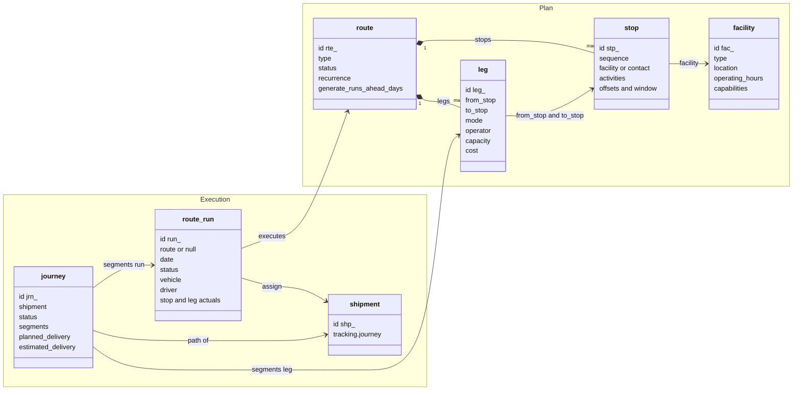
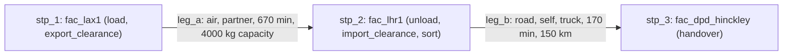
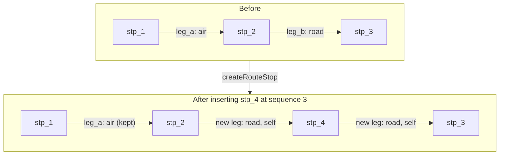
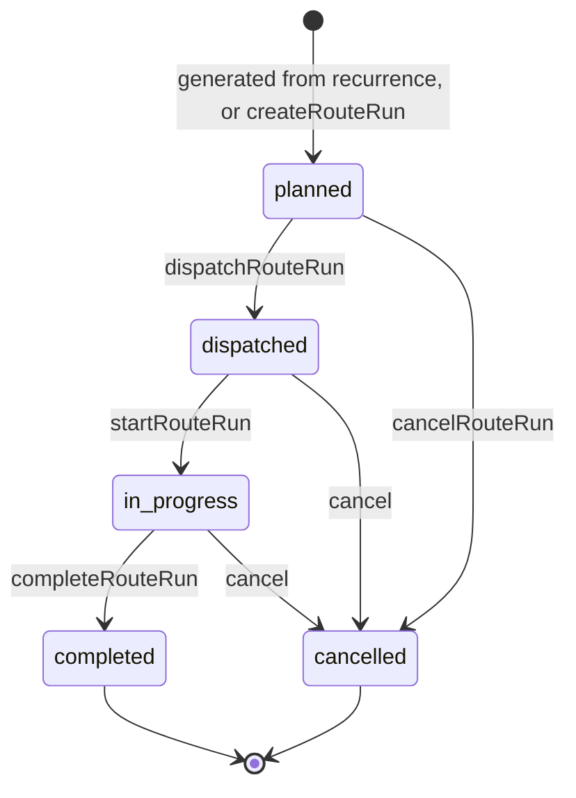
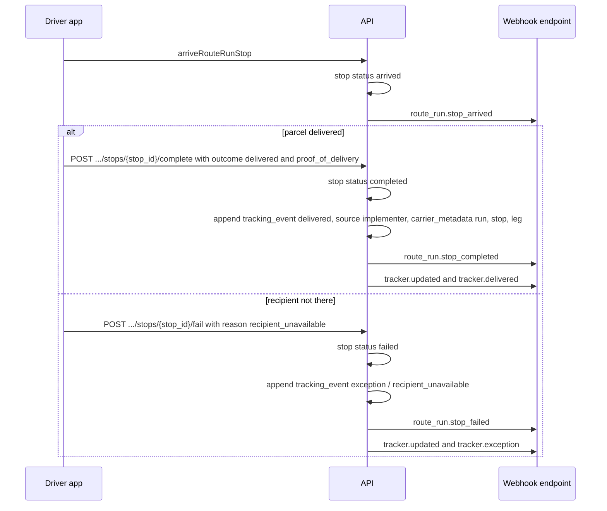
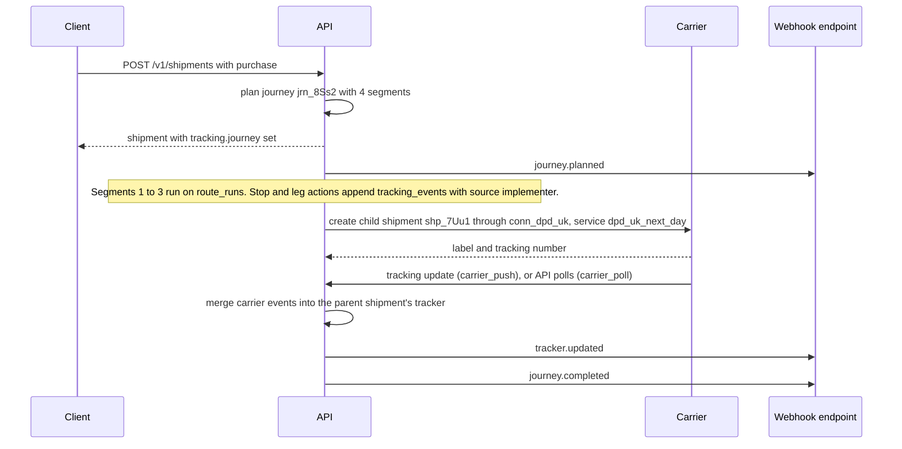

> **API surface.** Facilities, routes, stops, legs and route runs are managed over **GraphQL Interface** (operations consoles and driver apps). Integrators use REST for `POST /v1/journeys/plan` and `GET /v1/shipments/{id}/journey`.

A carrier moves parcels between hubs on scheduled line-haul. A 3PL strings its own trucks together with subcontracted carrier legs. A fleet runs delivery routes through dozens of addresses a day. These are the same structure at different scales: **ordered stops, joined by legs, run on a schedule**. This chapter models all three with one set of objects.

| Resource | Prefix | What it is |
|---|---|---|
| `facility` | `fac_` | A physical place in the network: hub, depot, warehouse, airport, port |
| `route` | `rte_` | A **plan**: ordered stops and the legs between them, optionally recurring |
| `stop` | `stp_` | A place on a route (a facility or an address) and what happens there |
| `leg` | `leg_` | The movement between two consecutive stops: mode, operator, timing, capacity, cost |
| `route_run` | `run_` | An **execution** of a route on a date (or an ad-hoc run), with actuals, assignments and status |
| `journey` | `jrn_` | A shipment's path through the network: the sequence of legs, across runs, from origin to destination |

Plans and executions are separate so that the timetable is edited in one place, and what actually happened is recorded in another. The same split appears elsewhere in the spec: pickup schedules and pickups, rate sheets and rates.

The diagram below shows how the plan objects (left) relate to the execution objects (right).



## 1. Facility

```json
{
  "id": "fac_lax1",
  "object": "facility",
  "name": "LAX Gateway",
  "type": "gateway",
  "status": "active",
  "contact": { "company": "Meridian Express LAX", "phone": "+13105550100", "address": { "line1": "World Way W", "street_number": "6000", "city": "Los Angeles", "state": "CA", "postal_code": "90045", "country": "US" } },
  "location": { "latitude": 33.94, "longitude": -118.40 },
  "timezone": "America/Los_Angeles",
  "operating_hours": { "frequency": "weekly", "days": ["mon", "tue", "wed", "thu", "fri"], "times": ["06:00-22:00"], "timezone": "America/Los_Angeles", "holiday_calendar": "us_federal" },
  "codes": { "iata": "LAX", "unlocode": "USLAX", "carrier": "LAX1" },
  "capabilities": ["sort", "customs_clearance", "export_screening", "dangerous_goods"],
  "service_zones": ["zone_us_west"],
  "user_metadata": {}, "carrier_metadata": {}, "system_metadata": {}
}
```

- `type` is `hub`, `sort_center`, `depot`, `gateway`, `warehouse`, `fulfillment_center`, `cross_dock`, `airport`, `seaport`, `rail_terminal`, `access_point`, `customs_bonded`, or `partner`.
- `operating_hours` is a `Recurrence` (chapter 01 §13). Here, `times` holds `HH:MM-HH:MM` ranges.
- `capabilities` is `sort`, `customs_clearance`, `export_screening`, `dangerous_goods`, `cold_chain`, `returns_processing`, `pickup_point`.
- `functions` declares what the facility is **for**, with a spec per function. A facility may have several functions: a sort hub with a small returns area, or a fulfillment center that also cross-docks.

```json
"functions": {
  "sortation": { "sorter": "cross_belt", "throughput_per_hour": 18000, "handling_unit_types": ["parcel", "envelope"], "max_weight": { "value": 30, "unit": "kg" }, "cutoffs": [ { "wave": "night", "local_time": "22:30" } ], "outbound_sort_points": 240 },
  "storage": { "temperature_classes": ["ambient", "chilled"], "capacity": { "pallet_positions": 4200, "bin_locations": 18000, "volume": { "value": 21000, "unit": "m3" } }, "location_types": ["pallet_rack", "shelving", "cold", "hazmat"], "multi_client": true },
  "fulfillment": { "services": ["pick_pack", "kitting", "gift_wrap", "returns_processing"], "order_cutoff_local_time": "15:00", "same_day": true },
  "cross_dock": { "max_dwell_hours": 24 },
  "returns": { "grading": true, "refurbishment": false },
  "customs": { "bonded": true, "clearance": true, "authorized_economic_operator": true },
  "hazmat": { "classes": ["3", "8", "9"], "segregation_plan": "file_seg_plan" }
}
```

| Function | What it means | Used by |
|---|---|---|
| `sortation` | Receives, sorts and dispatches handling units and consolidations. It holds no inventory. | Route stops with `sort` activity, consolidation (chapter 24) |
| `storage` | Holds inventory in storage locations | Inventory (chapter 29) |
| `fulfillment` | Turns stored inventory into shipments (pick, pack, kit) | Fulfillment orders (chapter 29 §4) |
| `cross_dock` | Transfers goods between inbound and outbound without storage | Injection and ASNs (chapter 18), routes |
| `returns` | Receives, grades and restocks or disposes of returns | Returns (chapter 03 §6), inventory `return` movements |
| `customs` | Bonded storage, examination, clearance | Trade (chapter 13), consolidation customs |
| `hazmat` | Dangerous goods storage and handling | Dangerous goods on items, location restrictions |

`facilities` (GraphQL Interface query) finds candidate facilities. Fulfillment allocation (chapter 29 §4) and journey planning (§4) use `functions` to decide where goods can be stored, sorted or handed over.
- GraphQL: `facilities`, `facility`, `createFacility`, `updateFacility`, `deleteFacility`. Delete is refused while a route references the facility.

## 2. Route

```json
{
  "id": "rte_lax_lhr_daily",
  "object": "route",
  "name": "LAX → LHR daily air",
  "type": "linehaul",
  "status": "active",
  "recurrence": { "frequency": "daily", "days": ["mon", "tue", "wed", "thu", "fri"], "times": ["18:00"], "timezone": "America/Los_Angeles" },
  "generate_runs_ahead_days": 14,
  "stops": [
    { "id": "stp_1", "sequence": 1, "facility": "fac_lax1", "activities": ["load", "export_clearance"], "cutoff_offset": "-02:00", "depart_offset": "+00:00", "service_minutes": 0 },
    { "id": "stp_2", "sequence": 2, "facility": "fac_lhr1", "activities": ["unload", "import_clearance", "sort"], "arrive_offset": "+11:10", "service_minutes": 120 },
    { "id": "stp_3", "sequence": 3, "facility": "fac_dpd_hinckley", "activities": ["handover"], "arrive_offset": "+16:00" }
  ],
  "legs": [
    { "id": "leg_a", "from_stop": "stp_1", "to_stop": "stp_2", "mode": "air", "operator": { "type": "partner", "name": "Partner Airline", "reference": "flight XX123" }, "duration_minutes": 670, "capacity": { "weight": { "value": 4000, "unit": "kg" } }, "cost": { "amount": 380000, "currency": "usd" } },
    { "id": "leg_b", "from_stop": "stp_2", "to_stop": "stp_3", "mode": "road", "operator": { "type": "self" }, "vehicle_type": "truck", "duration_minutes": 170, "distance": { "value": 150, "unit": "km" } }
  ],
  "user_metadata": {}, "carrier_metadata": {}, "system_metadata": {}
}
```

The route above, drawn as a network: facilities are stops, and each edge is a leg with its mode and operator.



| Field | Notes |
|---|---|
| `type` | `linehaul` (facility to facility, carrier and 3PL), `first_mile` (collection from shippers), `last_mile` (delivery to addresses, fleet), `mixed` |
| `recurrence` | When runs happen. `null` means the route is a reusable template whose runs are created by hand or by optimization (chapter 17 §3). |
| `generate_runs_ahead_days` | How far ahead the implementer materializes `route_run`s from the recurrence |
| `stops[].facility` or `stops[].contact` | A stop is either a facility, or an ad-hoc address given as a Contact. Last-mile stops are usually contacts. |
| `stops[].activities` | `load`, `unload`, `pickup`, `delivery`, `handover`, `sort`, `export_clearance`, `import_clearance`, `cross_dock`, `fuel`, `break` |
| `*_offset` | Signed `±HH:MM` relative to the run's start time. `cutoff_offset` is the latest time parcels must reach the stop to make this run. |
| `stops[].window` | For last mile, `{ arrive_after, arrive_before }` in local time. It is the customer's delivery window. |
| `legs[].mode` | `road`, `air`, `sea`, `rail`, `courier`, `bike`, `walk`, `drone` |
| `legs[].air` | For `mode: air`: `{ flight_number, awb_prefix, uld_assignments[] }` (chapter 17 §1.1) |
| `legs[].operator` | `{ type: "self" }`, `{ type: "carrier", connection, service }` (subcontracted to a carrier through the `connections` module, which is the 3PL case), or `{ type: "partner", name, reference }` |
| `legs[].capacity` | `{ weight, volume, handling_units, pallets }`. Assignment past capacity fails with `409 capacity_exceeded`. |
| `legs[].cost` | The cost allocated to the leg. It feeds rate sheet `cost` and margin reporting (chapter 15). |

### Legs are derived, then edited

There is exactly one leg between each pair of consecutive stops. When stops are added, removed or reordered, the implementer recomputes the leg list. A leg whose `from_stop` → `to_stop` pair survives the change keeps its ID and attributes. New pairs get a new leg with defaults (`mode: road`, `operator: self`). Clients edit leg *attributes*, and never create or delete legs directly.

This example inserts a new stop `stp_4` between `stp_2` and `stp_3`. The `stp_1` to `stp_2` pair survives, so `leg_a` keeps its ID and attributes. The `stp_2` to `stp_3` pair no longer exists, so `leg_b` is gone, and the two new pairs get new legs with defaults.



### Endpoints

```
mutation createRoute                                query routes          query route
mutation updateRoute                           mutation deleteRoute       (draft or inactive only)
mutation activateRoute                  mutation deactivateRoute
mutation createRouteStop                     { sequence?, facility | contact, activities, ... }   insert (default: append)
mutation updateRouteStop           update
mutation deleteRouteStop
mutation reorderRouteStop             { "order": ["stp_1", "stp_3", "stp_2"] }
query routeLegs
mutation updateRouteLeg             update mode, operator, vehicle_type, duration, capacity, cost
```

Changes to an `active` route apply to runs generated **after** the change. Existing future runs are regenerated only with `updateRoute` (GraphQL Interface mutation) and `apply_to_existing_runs: true`. Runs already in progress are never modified.

## 3. Route run

```json
{
  "id": "run_20261007_lax_lhr",
  "object": "route_run",
  "route": "rte_lax_lhr_daily",
  "date": "2026-10-07",
  "status": "in_progress",
  "scheduled_start": "2026-10-07T18:00:00-07:00",
  "started_at": 1791421800,
  "completed_at": null,
  "vehicle": null,
  "driver": null,
  "stops": [
    { "id": "stp_1", "facility": "fac_lax1", "status": "departed", "scheduled_arrival": null, "scheduled_departure": "2026-10-07T18:00:00-07:00", "departed_at": 1791421800, "shipments": { "load": ["shp_..."], "unload": [] } },
    { "id": "stp_2", "facility": "fac_lhr1", "status": "pending", "scheduled_arrival": "2026-10-08T13:10:00+01:00", "eta": "2026-10-08T13:25:00+01:00" }
  ],
  "legs": [
    { "id": "leg_a", "status": "in_transit", "departed_at": 1791421800, "arrived_at": null, "delay_minutes": 15, "load": { "weight": { "value": 2810, "unit": "kg" }, "handling_units": 1422 }, "carrier_metadata": { "awb": "125-12345675" } }
  ],
  "shipment_count": 1422,
  "user_metadata": {}, "carrier_metadata": {}, "system_metadata": { "source": "schedule" }
}
```

- `status` is `planned`, `dispatched`, `in_progress`, `completed`, or `cancelled`.
- `stops[].status` is `pending`, `arrived`, `departed`, `completed`, `skipped`, or `failed` (with a `reason` taken from the tracking `status_detail` vocabulary).
- `legs[].status` is `pending`, `in_transit`, `arrived`, or `cancelled`.
- `route` is `null` for ad-hoc runs, which are created directly with their own stops (typical in fleet mode).

The run lifecycle, with the endpoint that causes each transition (see Endpoints below):



### Endpoints

```
mutation createRouteRun                            ad-hoc run, or { route, date } to materialize one now
query routeRuns?route=…&date=…&status=…    query routeRun    mutation updateRouteRun
mutation dispatchRouteRun              { vehicle?, driver? } → dispatched
mutation startRouteRun                 mutation completeRouteRun     mutation cancelRouteRun { reason }
mutation assignRouteRun                { shipments: [...], stop?: "stp_...", activity?: "load" | "delivery" | "pickup" }
mutation unassignRouteRun              { shipments: [...] }
mutation arriveRouteRunStop     { at?, position? }
mutation completeRouteRunStop   { at?, results: [{ shipment, outcome: "delivered" | "picked_up" | "loaded" | "unloaded", proof_of_delivery? }] }
mutation failRouteRunStop       { results: [{ shipment, reason: "recipient_unavailable" | ... }] }
mutation skipRouteRunStop       { reason }
mutation departRouteRunLeg       mutation arriveRouteRunLeg
```

**Run actions write tracking.** Every stop and leg action appends canonical `tracking_event`s to the affected shipments' trackers (chapter 07), with `source: "implementer"` and `carrier_metadata: { run, stop, leg }`. For example, `arrive` at an import facility produces `in_transit` / `arrived_at_destination_country`, `complete` with `delivered` produces `delivered`, and `fail` with `recipient_unavailable` produces `exception` / `recipient_unavailable`. Carrier, 3PL and fleet implementers therefore get tracking from operations without a separate integration, and clients see the same tracker API as in Universal mode.

This sequence shows a driver completing or failing a last-mile stop, and the tracking events and webhooks that follow.



## 4. Journey

A journey is a shipment's path through the network. It is planned at rating or purchase time and updated as runs execute.

```
POST /v1/journeys/plan     { ship_from, ship_to, handling_units, service?, ship_date }  → journey (not persisted)
GET  /v1/shipments/{id}/journey
```

```json
{
  "id": "jrn_8Ss2",
  "object": "journey",
  "shipment": "shp_1Q2w...",
  "status": "on_track",
  "segments": [
    { "sequence": 1, "type": "first_mile", "run": "run_20261007_lax_pu3", "from": "shp:ship_from", "to": "fac_lax1", "planned_departure": "…", "planned_arrival": "…", "actual_departure": "…", "actual_arrival": "…" },
    { "sequence": 2, "type": "middle_mile", "run": "run_20261007_lax_lhr", "leg": "leg_a", "from": "fac_lax1", "to": "fac_lhr1", "planned_arrival": "…" },
    { "sequence": 3, "type": "middle_mile", "run": "run_20261008_lhr_hin", "leg": "leg_b", "from": "fac_lhr1", "to": "fac_dpd_hinckley" },
    { "sequence": 4, "type": "last_mile", "operator": { "type": "carrier", "connection": "conn_dpd_uk", "service": "dpd_uk_next_day" }, "from": "fac_dpd_hinckley", "to": "shp:ship_to", "subcontracted_shipment": "shp_7Uu1" }
  ],
  "planned_delivery": "2026-10-09",
  "estimated_delivery": "2026-10-09"
}
```

- `segments[].type` is `first_mile` (collection to the first network facility), `middle_mile` (facility to facility: line-haul road, air, ocean or rail, including customs gateways), or `last_mile` (final facility to the consignee, or to an access point). A single carrier that covers origin to destination end to end produces one `end_to_end` segment. `linehaul` routes (§2) serve `middle_mile` segments.
- `status` is `planned`, `on_track`, `at_risk` (a predicted miss of a downstream cutoff), `delayed`, `rerouted`, or `completed`.
- **Subcontracted segments** (the 3PL case) create a child shipment through the `connections` module. Its tracker events are merged into the parent shipment's tracker, with `source: "carrier_poll"` or `"carrier_push"`.

This sequence follows the example journey above: three segments on the implementer's own runs, then a last-mile segment subcontracted to a carrier.


- In Carrier and 3PL modes, `rate.delivery` comes from the planned journey's `planned_delivery`, and `shipment.tracking.journey` is set at purchase.
- Rerouting: `replanShipmentJourney` (GraphQL Interface mutation) (`{ reason, avoid: { facilities, runs } }`) produces a new plan, and `journey.rerouted` fires.

## 5. Events

`facility.created`, `facility.updated`, `route.created`, `route.updated`, `route.activated`, `route.deactivated`, `route_run.created`, `route_run.dispatched`, `route_run.started`, `route_run.stop_arrived`, `route_run.stop_completed`, `route_run.stop_failed`, `route_run.completed`, `route_run.cancelled`, `route_run.delayed`, `journey.planned`, `journey.at_risk`, `journey.delayed`, `journey.rerouted`, `journey.completed`.
