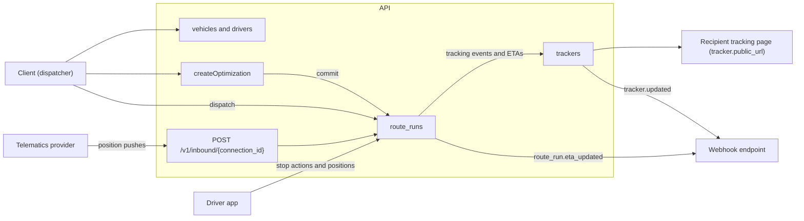
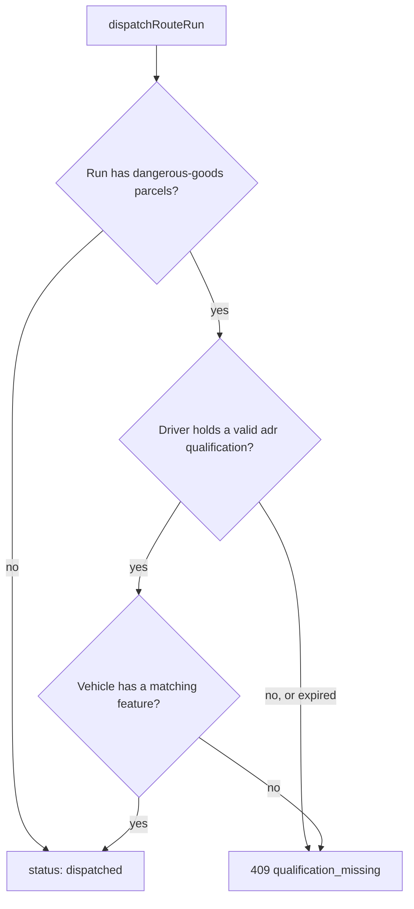
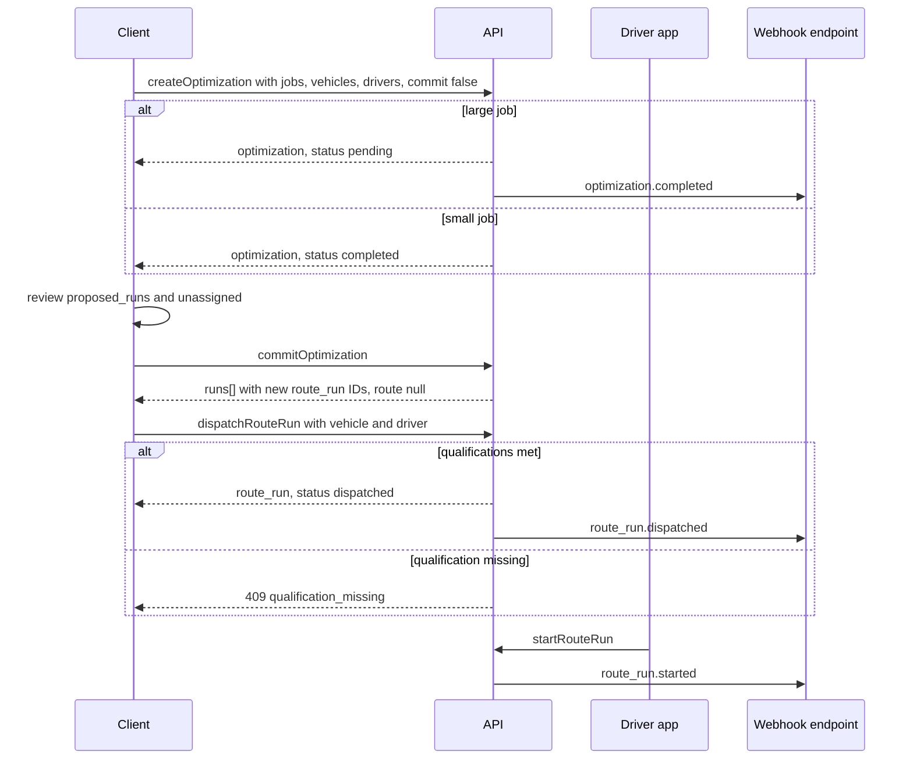
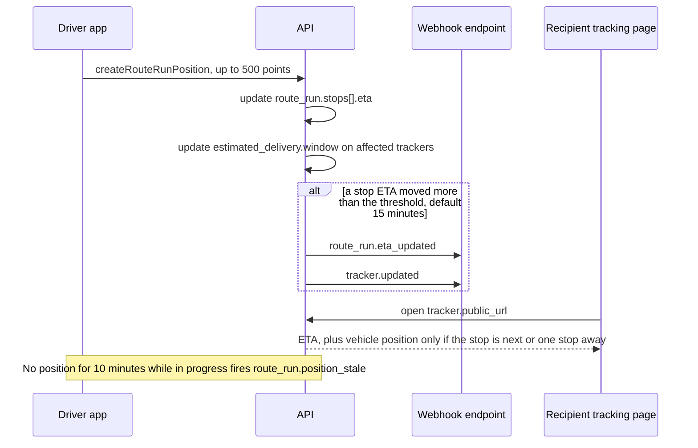

> **API surface.** The fleet module is a **GraphQL Interface** back-office surface. Telematics and driver devices report positions through REST `POST /v1/device_events` (chapter 22).

Fleet mode adds the operational layer for organizations that run their own vehicles. It reuses `route` and `route_run` (chapter 16) for the work, `tracker` (chapter 07) for customer-visible progress, and `zone` (chapter 14) for service areas. It adds only what is specific to running a fleet.

| Resource | Prefix | Purpose |
|---|---|---|
| `vehicle` | `veh_` | A vehicle: type, capacity, features, telematics link |
| `driver` | `drv_` | A driver: contact, qualifications, shifts |
| `optimization` | `optj_` | A routing job that turns a set of jobs into proposed route runs |
| `position` | — | A GPS ping for a run, vehicle or driver |

The diagram below shows where fleet data comes from and where it goes. Dispatchers plan and dispatch runs, drivers and telematics report progress, and recipients and webhook endpoints see the result through trackers.



## 1. Vehicle

```json
{
  "id": "veh_van07",
  "object": "vehicle",
  "name": "Van 07",
  "type": "van",
  "status": "active",
  "registration": { "plate": "LX26 ABC", "country": "GB" },
  "capacity": { "weight": { "value": 1200, "unit": "kg" }, "volume": { "value": 10.5, "unit": "m3" }, "handling_units": 180 },
  "features": ["liftgate", "dangerous_goods_lq", "electric"],
  "home_facility": "fac_lon_depot",
  "range": { "value": 220, "unit": "km" },
  "telematics": { "provider": "samsara", "device_id": "dev_123" },
  "user_metadata": {}, "carrier_metadata": {}, "system_metadata": {}
}
```

- `type` is `car`, `van`, `truck`, `trailer`, `bike`, `cargo_bike`, `scooter`, `walker`, `drone`, `aircraft`, `vessel`, or `rail_car`. `status` is `active`, `maintenance`, or `retired`.
- `class` holds type-specific attributes (§1.1). The rest of the object is the same for every type, so an airline, a drone operator and a van fleet share dispatch, runs, positions and tracking.
- `features` is `refrigerated`, `liftgate`, `dangerous_goods_lq`, `dangerous_goods_full`, `electric`, `secure`, `oversize`.
- GraphQL: `vehicles`, `vehicle`, `createVehicle`, `updateVehicle`, `deleteVehicle`, `vehiclePosition`.

### 1.1 Vehicle classes

| `type` | `class` fields |
|---|---|
| `aircraft` | `registration` (tail number), `icao_type` (e.g. `B77F`), `configuration` (`freighter`, `combi`, `belly`), `uld_positions: [{ position, uld_types: ["AKE", "PMC"] }]`, `max_payload`, `operator_codes: { iata, icao }` |
| `drone` | `uas_registration`, `category` (`open`, `specific`, `certified`), `max_payload`, `range`, `endurance_minutes`, `bvlos_approved`, `operating_area` (a `zone` with purpose `service_area`), `delivery_method` (`land`, `winch`, `parachute`), `docking_station` (a facility) |
| `vessel` | `imo_number`, `mmsi`, `vessel_type` (`container`, `ro_ro`, `feeder`, `barge`), `teu_capacity` |
| `rail_car` | `wagon_number`, `wagon_type`, `train_service` |
| road types | `axles`, `emission_class`, `max_gross_weight` |

Airlines are carriers like any other. An airline implementer, or an airline member of a network (chapter 21), publishes air services in its catalog, models flights as `route`s with `mode: "air"` legs whose recurrence is the timetable, and runs each departure as a `route_run` with its aircraft as the vehicle. Flight specifics go on the leg: `legs[].air = { flight_number, awb_prefix, uld_assignments: [{ uld_id, uld_type, position, handling_units: ["hu_..."] }] }`.

Drone runs are ordinary `last_mile` route runs. Their dispatch checks add the drone's payload, range and `operating_area` (`409 qualification_missing` with `param` naming the failed constraint). Positions arrive from the drone's autopilot as a device (chapter 22).

## 2. Driver

```json
{
  "id": "drv_ama",
  "object": "driver",
  "contact": { "name": "Ama Mensah", "phone": "+447700900456", "email": "ama@fleet.example" },
  "status": "active",
  "home_facility": "fac_lon_depot",
  "qualifications": [ { "type": "license", "class": "B", "expires_on": "2031-05-01" }, { "type": "adr", "expires_on": "2027-03-01" } ],
  "skills": ["age_verification", "white_glove"],
  "shifts": { "frequency": "weekly", "days": ["mon", "tue", "wed", "thu", "fri"], "times": ["07:00-16:00"], "timezone": "Europe/London" },
  "availability_exceptions": [ { "date": "2026-10-20", "available": false, "reason": "leave" } ],
  "app_user": "usr_9Dd",
  "user_metadata": {}, "carrier_metadata": {}, "system_metadata": {}
}
```

- `shifts` is a `Recurrence` (chapter 01 §13).
- Qualifications constrain dispatch. A run with dangerous-goods parcels can only be dispatched to a driver holding a valid `adr` qualification and a vehicle with a matching feature. Otherwise `dispatchRouteRun` (GraphQL Interface mutation) returns `409 qualification_missing`.

The dispatch check for a run that carries dangerous goods:


- The spec never stores driver credentials. `app_user` links to the implementer's own identity system.
- GraphQL: `drivers`, `driver`, `createDriver`, `updateDriver`, `deleteDriver`.

## 3. Optimization (planning runs)

```
mutation createOptimization
```

```json
{
  "date": "2026-10-07",
  "depot": "fac_lon_depot",
  "jobs": { "shipments": ["shp_...", "..."], "pickups": ["pck_..."] },
  "vehicles": ["veh_van07", "veh_van08", "veh_bike02"],
  "drivers": ["drv_ama", "drv_kofi"],
  "service_area": "zone_lon_central",
  "objective": "minimize_duration",
  "constraints": { "respect_time_windows": true, "max_run_duration_minutes": 540, "breaks": [ { "after_minutes": 270, "duration_minutes": 30 } ], "return_to_depot": true },
  "commit": false
}
```

```json
{
  "id": "optj_4Ee6",
  "object": "optimization",
  "status": "completed",
  "proposed_runs": [ { "vehicle": "veh_van07", "driver": "drv_ama", "stops": [ "..." ], "distance": { "value": 84.2, "unit": "km" }, "duration_minutes": 492, "load": { "handling_units": 141 } } ],
  "unassigned": [ { "shipment": "shp_X1", "reason": "time_window_infeasible" } ],
  "summary": { "runs": 3, "distance": { "value": 211.7, "unit": "km" }, "duration_minutes": 1380 },
  "runs": []
}
```

- `objective` is `minimize_duration`, `minimize_distance`, `minimize_vehicles`, or `balance_load`.
- `status` is `pending`, `completed`, or `failed`. Large jobs are asynchronous and emit `optimization.completed`.
- With `commit: true`, or later with `commitOptimization` (GraphQL Interface mutation), the implementer creates `route_run`s (ad-hoc, `route: null`) from `proposed_runs`, and fills `runs[]` with their IDs.
- Re-optimizing an in-progress run, for example after a vehicle breakdown: `optimizeRouteRun` (GraphQL Interface mutation) with `{ "lock_completed_stops": true }`.

This sequence goes from an optimization request to a dispatched, started run.



## 4. Positions and ETAs

```
mutation createRouteRunPosition
```

```json
{ "positions": [ { "at": "2026-10-07T10:42:05+01:00", "latitude": 51.507, "longitude": -0.128, "heading": 270, "speed": { "value": 32, "unit": "km/h" }, "accuracy_m": 8, "source": "driver_app" } ] }
```

- It accepts batches of up to 500 points. `source` is `driver_app`, `telematics`, or `manual`. Telematics providers can push instead through `POST /v1/inbound/{connection_id}` with a telematics connection (chapter 08 §6).
- Positions update `route_run.stops[].eta`, and from that the `estimated_delivery.window` on each affected shipment's tracker. When a stop's ETA moves by more than the implementer's threshold (default 15 minutes), `route_run.eta_updated` and `tracker.updated` fire.
- **Privacy.** Positions are retained for at most 30 days unless the implementer publishes a longer period. Recipient-facing tracking (`tracker.public_url`) MAY show the vehicle's position only while the recipient's stop is next or one stop away, and MUST NOT expose the driver's full route.

This sequence shows how a batch of positions turns into ETA updates for recipients.



```
query routeRunPositions?since=…     query vehiclePosition
```

## 5. Proof of delivery and exceptions

Stop completion carries proof using the existing `ProofOfDelivery` shape (chapter 07 §8): `signed_by`, `signature_file`, `photo_files`, `location`. Failed stops use the tracking `status_detail` reasons (`recipient_unavailable`, `access_restricted`, `refused`, `address_issue`…). The driver app needs no vocabulary beyond what tracking already defines.

## 6. Service areas and pricing

- Service areas are `zone` objects with purpose `service_area`. Rating rejects addresses outside every active service area with `address_unserviceable`.
- Fleet pricing uses rate sheets (chapter 15), typically with distance or zone bands. A `per_unit` band may use `per: { value: 1, unit: "km" }`, priced on the planned route distance from the depot to the stop. This requires capability `pricing.distance`.

## 7. Events

`vehicle.created`, `vehicle.updated`, `driver.created`, `driver.updated`, `optimization.completed`, `optimization.failed`, `route_run.eta_updated`, `route_run.position_stale` (no position received for 10 minutes while the run is in progress).
