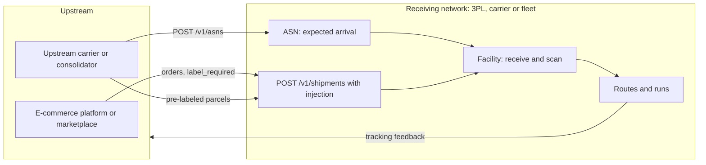
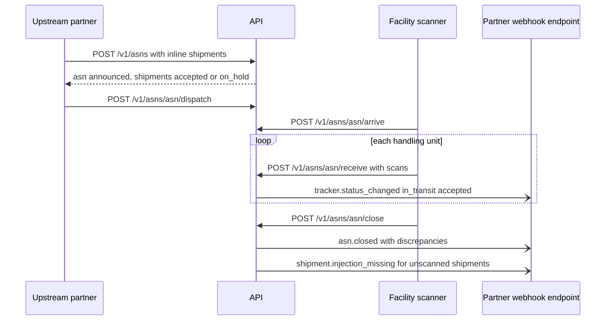
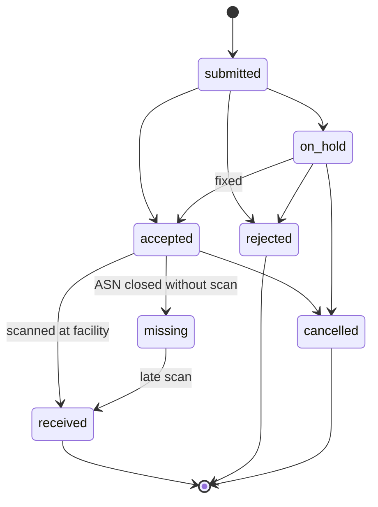
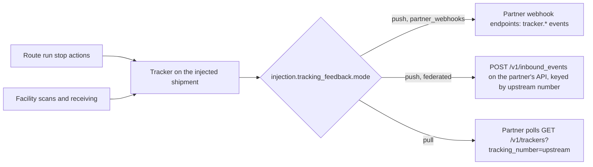

**Injection** is when another party hands you shipments to move. A marketplace pushes orders that a 3PL must label and ship. A cross-border carrier injects pre-labeled parcels into a domestic last-mile partner. A consolidator delivers a trailer of parcels to a postal operator's facility. In every case three things happen:

1. **Data arrives first.** The upstream party creates the shipments in the receiving network, individually or in bulk.
2. **Goods arrive later**, usually together, announced by an **advance shipping notice** (ASN) and checked in at a facility.
3. **Status flows back.** The upstream party needs tracking for the shipments it handed over, usually under its own tracking numbers.

This chapter reuses the `shipment`, `tracker`, `facility` and `account` objects. It adds an `injection` group on the shipment, and one new resource, `asn`. Injection is required in 3PL mode, and optional in Carrier and Fleet modes (chapter 12).



## 1. Who injects, and how they authenticate

An injecting party is an **account** of `type: "partner"` (a carrier or consolidator) or `type: "merchant"` (a shipper or e-commerce platform) in the receiving implementer (chapter 19). Partners authenticate with their own API keys or OAuth client credentials, scoped to `injection:write`. A partner that is itself a spec implementer can be connected through federation (chapter 09 §6) in both directions: it injects into you, and you push tracking back to it.

An e-commerce platform (a Shopify app, a marketplace) usually acts **on behalf of** many merchants. It uses OAuth with `Shipping-Account: acct_...` per merchant (chapter 00 §3.3), so each injected shipment belongs to the right merchant.

## 2. The `injection` group on a shipment

An injected shipment is an ordinary `shipment` with one extra group:

```json
"injection": {
  "partner": "acct_dpd_intl",
  "channel": "carrier",
  "upstream_reference": "DPDINT-778812",
  "upstream_carrier": "dpd_de",
  "upstream_tracking_number": "01234567890123",
  "label_mode": "pre_labeled",
  "injection_point": "fac_lon_hub",
  "expected_at": "2026-10-08T06:00:00+01:00",
  "asn": "asn_3Hh8",
  "status": "accepted",
  "decision": { "reasons": [] },
  "received": null,
  "tracking_feedback": { "mode": "push", "target": "partner_webhooks", "number": "upstream" }
}
```

| Field | Notes |
|---|---|
| `partner` | The injecting account. It is set from the authenticated account and cannot be supplied by the client. |
| `channel` | `carrier`, `marketplace`, `ecommerce_platform`, `merchant` |
| `upstream_reference` | The upstream party's ID for the shipment. Unique per partner, and used for idempotent upserts (§3). |
| `upstream_carrier`, `upstream_tracking_number` | The upstream party's carrier and tracking number, when the parcel already carries their label |
| `label_mode` | `pre_labeled`: the upstream label is used, and `tracking.number` = `upstream_tracking_number`. `relabel`: the receiving network prints its own label on receipt, and keeps the upstream number for cross-reference. `label_required`: no label exists yet (marketplace orders), and the receiving network labels it as a normal purchase. |
| `injection_point` | The `facility` where goods will be handed over. It defaults from the partner's account settings. |
| `expected_at` | Expected physical arrival. It is usually set from the ASN. |
| `asn` | The advance shipping notice this shipment arrives on (§4) |
| `status` | `submitted`, `accepted`, `on_hold`, `rejected`, `received`, `missing`, `cancelled` (§5) |
| `decision.reasons[]` | Why it was held or rejected: `{ code, message, param }`. Codes include `address_unserviceable`, `compliance_blocked`, `dangerous_goods_not_permitted`, `customs_required`, `duplicate_upstream_reference`, `weight_exceeds_limit`. |
| `received` | `{ at, facility, condition: "ok" \| "damaged", measured: { weight, dimensions } }`, filled at receiving. The measured values drive charge adjustments (§6). |
| `tracking_feedback` | How status goes back upstream: `mode` is `push` (webhooks or federated inbound events), `pull` (the partner polls trackers), or `none`. `target` is `partner_webhooks` (the partner account's webhook endpoints) or `federated` (`POST /v1/inbound_events` on the partner's own implementation). `number` is `upstream` or `local`: which tracking number events are keyed by. |

`injection` is `null` for shipments created by the shipper directly.

## 3. Injecting shipments

### 3.1 One at a time

```
POST /v1/shipments
Idempotency-Key: ...
```

```json
{
  "ship_from": { "company": "DPD International", "address": { "line1": "Wailandtstraße", "street_number": "1", "city": "Aschaffenburg", "postal_code": "63741", "country": "DE" } },
  "ship_to": { "name": "Grace H.", "phone": "+447700900111", "address": { "line1": "Downing St", "street_number": "10", "city": "London", "postal_code": "SW1A 2AA", "country": "GB" } },
  "handling_units": [ { "weight": { "value": 1.2, "unit": "kg" }, "dimensions": { "length": 30, "width": 20, "height": 10, "unit": "cm" }, "tracking_number": "01234567890123" } ],
  "carrier_configs": { "acme_3pl": { "service": "acme_3pl_last_mile_next_day" } },
  "injection": {
    "channel": "carrier",
    "upstream_reference": "DPDINT-778812",
    "upstream_carrier": "dpd_de",
    "upstream_tracking_number": "01234567890123",
    "label_mode": "pre_labeled",
    "injection_point": "fac_lon_hub"
  }
}
```

- The presence of `injection` makes the create an injection. The receiving network validates serviceability, the service, the limits, and compliance (when `trade` is implemented). It responds `200` with `injection.status` set to `accepted`, `on_hold` (accepted pending a fix, such as missing customs data), or `rejected`.
- `label_mode: label_required` behaves like a normal create with a purchase. The partner may include a `purchase` instruction, and otherwise the receiving network labels it at receipt.
- **Upsert by upstream reference.** Repeating a create with the same `(partner, upstream_reference)` returns the existing shipment and applies any changed fields while it is still `submitted` or `on_hold`. That makes order-sync loops from e-commerce platforms safe without client-side bookkeeping.

### 3.2 In bulk

```
POST /v1/asns     (with inline shipments, §4)
POST /v1/batches  { "operation": "shipments.create", "items": [ ... ] }   (chapter 10 §7)
```

Most carrier injections arrive as an ASN with its shipments inline. Platform order syncs typically use batches.

### 3.3 Updating and cancelling

- `POST /v1/shipments/{id}` with `injection.expected_at`, contacts or handling units, until the shipment is `received`.
- `POST /v1/shipments/{id}/cancel_injection` with `{ reason }` sets `injection.status: "cancelled"` before receipt. After receipt, the receiving network handles it as a return to the partner (chapter 03 §6).

## 4. Advance shipping notices

An **ASN** announces a physical delivery of injected shipments to a facility: one trailer, one air pallet, one van load.

```json
{
  "id": "asn_3Hh8",
  "purpose": "injection",
  "object": "asn",
  "partner": "acct_dpd_intl",
  "facility": "fac_lon_hub",
  "status": "arrived",
  "expected_at": "2026-10-08T06:00:00+01:00",
  "arrived_at": 1791443100,
  "transport": { "mode": "road", "carrier_name": "DPD Linehaul", "vehicle": "trailer", "registration": "AB12 CDE", "seal_number": "SEAL-889201", "reference": "LH-20261007-44" },
  "shipments": ["shp_...", "..."],
  "expected": { "shipments": 1180, "handling_units": 1204, "weight": { "value": 2410, "unit": "kg" }, "containers": [ { "type": "cage", "count": 24 } ] },
  "received": { "handling_units": 1196, "damaged": 3, "unexpected": 2 },
  "discrepancies": [
    { "type": "missing", "shipment": "shp_9Xx1", "tracking_number": "01234567890999" },
    { "type": "unexpected", "tracking_number": "01234567890777" },
    { "type": "damaged", "shipment": "shp_7Yy2", "note": "crushed corner" },
    { "type": "weight_variance", "shipment": "shp_5Zz3", "declared": { "value": 1.2, "unit": "kg" }, "measured": { "value": 2.9, "unit": "kg" } }
  ],
  "closed_at": null,
  "documents": [],
  "user_metadata": {}, "carrier_metadata": {}, "system_metadata": {}
}
```

(`purpose` is `injection`, for shipments to move onward, or `stock_receipt`, for inventory to store. Stock receipts list `lines: [{ product, quantity, lot?, serials? }]` instead of shipments, and receive scans write `receive` stock movements, chapter 29 §3.)

| `status` | Meaning |
|---|---|
| `announced` | Created. Goods not yet dispatched to the facility. |
| `in_transit` | The partner has dispatched (`POST /v1/asns/{id}/dispatch`) |
| `arrived` | At the facility gate |
| `receiving` | Scans in progress |
| `closed` | Receiving finished. `discrepancies[]` is final, unreceived shipments are `missing`, and events fire. |
| `cancelled` | Withdrawn before arrival |

### Endpoints

```
POST   /v1/asns                         { facility, expected_at, transport, shipments: ["shp_..."] | [ inline injected shipment bodies ] }
GET    /v1/asns  ·  GET /v1/asns/{id}  ·  POST /v1/asns/{id}  (expected_at, transport, add/remove shipments before arrival)
POST   /v1/asns/{id}/dispatch           POST /v1/asns/{id}/arrive        POST /v1/asns/{id}/cancel
POST   /v1/asns/{id}/receive            { scans: [ { tracking_number | sscc, at, condition, measured? } ] }   (repeatable, up to 1000 scans per call)
POST   /v1/asns/{id}/close
```

Filters: `partner`, `facility`, `status`, `expected_at[gte|lte]`.

The receiving flow at the facility:



**Receiving rules.**

- Each scan matches by `tracking_number` (upstream or local) or SSCC. A match sets `injection.status: "received"`, fills `injection.received`, and appends a tracking event (`in_transit` / `accepted`, `source: "implementer"`).
- A scan that matches no shipment on the ASN is recorded as `unexpected`. If it matches a shipment on another open ASN from the same partner, the implementer moves it and records `misrouted_asn`.
- `relabel` shipments get their label at receipt. The new label is appended to `documents[]`, and `tracking.number` changes to the local number, with the upstream number kept in `injection.upstream_tracking_number`.
- On `close`, every shipment not received becomes `missing`, and fires `shipment.injection_missing`. Late scans after close reopen nothing. They are recorded as `unexpected` on a new ASN created automatically.

## 5. Injection status



`injection.status` is a third, independent lifecycle, alongside `status` (commercial) and `tracking.status` (physical). Once received, the shipment follows the normal lifecycle in the receiving network.

## 6. Billing the partner

- The receiving network prices injected shipments from its own rate sheets (chapter 15), with the partner's account-specific `pricing_rule`s and rate sheet assignments.
- Measured weight and dimensions at receipt can re-price a shipment. The difference is recorded as `purchase.charges[]` with `kind: "adjustment"`, and `shipment.charges_adjusted` fires, which matches the carrier reweigh flow in reverse.
- Injection fees (handling, relabelling, customs brokerage) are surcharges with `conditions: { channels: ["carrier"], label_modes: ["relabel"] }`.

## 7. Tracking feedback upstream



- With `number: "upstream"`, events sent upstream carry `upstream_tracking_number`, so the partner's customers keep the tracking number printed on their label.
- Federated feedback uses the partner's own canonical inbound injection endpoint (chapter 08 §7). Two spec implementers chain tracking with no custom integration.

## 8. Events

`asn.created`, `asn.updated`, `asn.dispatched`, `asn.arrived`, `asn.closed`, `asn.cancelled`, `shipment.injection_accepted`, `shipment.injection_on_hold`, `shipment.injection_rejected`, `shipment.injection_received`, `shipment.injection_missing`, `shipment.injection_cancelled`. Events are delivered to the receiving network's own endpoints, and to the partner account's endpoints for its own shipments.
