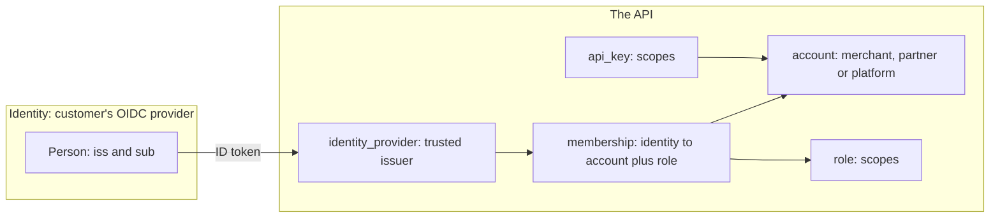
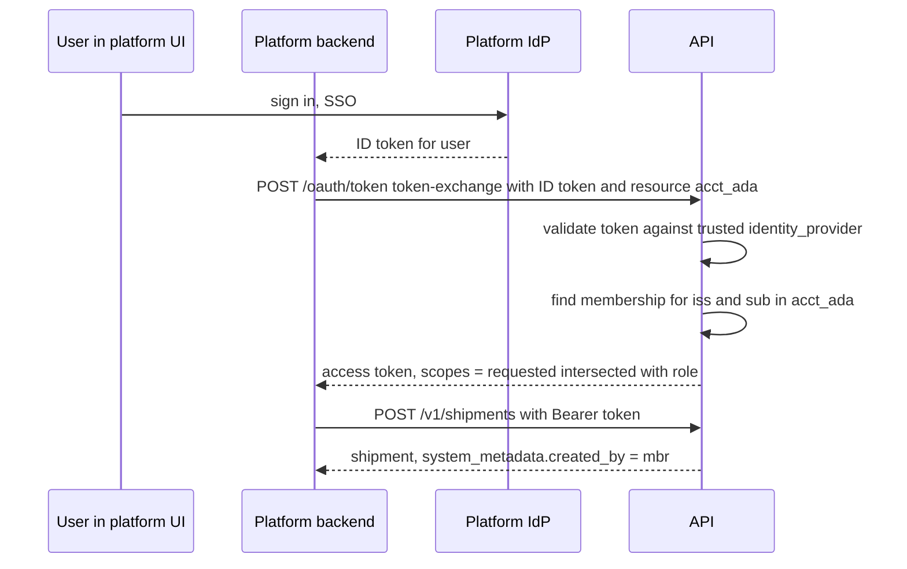

> **API surface.** Platforms create and update merchant accounts over **REST** (`/v1/accounts`, `GET /v1/account`). Identity providers, memberships, invitations, roles, API keys and account suspension are administered over **GraphQL Interface**.

Platforms that run shipping for many businesses need to create those businesses, let their people sign in with the identity provider they already use, and decide what each person may do. The spec keeps three concerns apart, so that any of them can change without touching the others:

| Concern | Lives in | Spec objects |
|---|---|---|
| **Identity**: who a person is | The customer's OpenID Connect provider (Okta, Entra ID, Google, Auth0, Keycloak, or the platform's own IdP) | `identity_provider` (trust configuration only). The API never stores passwords. |
| **Tenancy**: which business data belongs to | The API | `account` |
| **Authorization**: what a person or key may do in an account | The API | `membership`, `role`, `api_key`, OAuth scopes |

An identity can hold memberships in many accounts. An account can trust several identity providers. Swapping a merchant from Google to Okta changes one `identity_provider`, and no membership, role or shipment changes.



## 1. Account

```json
{
  "id": "acct_ada",
  "object": "account",
  "type": "merchant",
  "status": "active",
  "parent": "acct_platform_shopco",
  "profile": {
    "legal_name": "Ada Shop Inc.",
    "display_name": "Ada Shop",
    "contact": { "company": "Ada Shop Inc.", "email": "ops@adashop.example", "phone": "+14085550100", "tax_ids": [{ "type": "ein", "value": "12-3456789" }], "address": { "line1": "Infinite Loop", "street_number": "1", "city": "Cupertino", "state": "CA", "postal_code": "95014", "country": "US" } },
    "website": "https://adashop.example",
    "industry": "apparel"
  },
  "settings": {
    "timezone": "America/Los_Angeles",
    "currency": "usd",
    "units": { "weight": "lb", "dimensions": "in" },
    "label_format": { "format": "zpl", "size": "4x6" },
    "default_ship_from": null,
    "api_version": "2026-10-01"
  },
  "modules": ["core", "webhooks", "pickups", "manifests", "products"],
  "requirements": { "currently_due": [], "pending_verification": [] },
  "user_metadata": {}, "carrier_metadata": {}, "system_metadata": {}
}
```

| Field | Notes |
|---|---|
| `type` | `merchant` (a shipper), `carrier` (an LSP that is a member of a network and owns its catalog, pricing and routes, chapter 21), `partner` (an injecting carrier or consolidator, chapter 18), `platform` (an account that manages other accounts), or `internal` |
| `parent` | The managing platform account. Platforms see and act on their children with `Shipping-Account`. Hierarchies are at most 3 levels deep. |
| `status` | `onboarding`, `active`, `restricted` (`requirements.currently_due` is non-empty), `suspended`, `closed` |
| `settings` | Account-wide defaults, used wherever a request omits the value. `default_ship_from` may be a Contact. |
| `modules` | Which modules this account may use. It is a subset of the implementer's modules (chapter 12), set by the parent platform or the implementer. |
| `requirements` | Information needed before live mode, such as `profile.contact.tax_ids` or `billing.payment_method` |

### Endpoints

```
POST   /v1/accounts                     create a child account (platform accounts only)
GET    /v1/accounts                     list children        GET /v1/accounts/{id}
POST   /v1/accounts/{id}                update profile, settings, modules, user_metadata
mutation suspendAccount        mutation reactivateAccount        mutation closeAccount
GET    /v1/account                      the account the current credentials act for
```

Closing an account revokes its keys and tokens, deletes its connections and webhook endpoints, and keeps shipment records for the retention period (chapter 10 §9).

## 2. Identity providers (SSO)

```json
{
  "id": "idp_okta_ada",
  "object": "identity_provider",
  "account": "acct_ada",
  "type": "oidc",
  "status": "active",
  "issuer": "https://ada.okta.com/oauth2/default",
  "client_id": "0oa1b2c3",
  "client_secret": null,
  "scopes": ["openid", "email", "profile", "groups"],
  "domains": [ { "domain": "adashop.example", "verified": true, "verification": { "type": "dns_txt", "name": "_shipping-verify.adashop.example", "value": "sv=9f1e..." } } ],
  "claims": { "email": "email", "name": "name", "groups": "groups" },
  "role_mapping": [ { "group": "shipping-admins", "role": "admin" }, { "group": "warehouse", "role": "operator" } ],
  "default_role": "viewer",
  "provisioning": { "jit": true, "deprovision_on_missing_group": true, "scim": { "enabled": false, "endpoint": null } },
  "enforce": true
}
```

| Field | Notes |
|---|---|
| `issuer` | The OIDC issuer. Discovery, JWKS and token validation follow OpenID Connect Core and Discovery. Signatures, `iss`, `aud`, `exp` and `nonce` are all checked. |
| `domains[]` | Email domains this provider is authoritative for. They are verified by DNS TXT before `enforce` can be set. A sign-in from `@adashop.example` is routed to this provider. |
| `claims` | Which ID token claims carry email, name and groups |
| `role_mapping` | Group to role. It is re-evaluated at every sign-in, so removing someone from a group in the IdP removes their role on their next sign-in. |
| `provisioning.jit` | Create a membership on first successful sign-in from a verified domain |
| `provisioning.scim` | Optional SCIM 2.0 (RFC 7643, RFC 7644) endpoint for pushing users and groups ahead of sign-in, and deactivating them immediately. This is capability `accounts.scim`. |
| `enforce` | When `true`, members with a verified-domain email can only sign in through this provider |

`type` may also be `saml` where the implementer offers it (capability `accounts.saml`). Everything downstream is the same, because a SAML assertion is mapped to the same identity shape.

GraphQL: `identityProviders`, `identityProvider`, `createIdentityProvider`, `updateIdentityProvider`, `deleteIdentityProvider`, `verifyDomainIdentityProvider` (GraphQL Interface mutation), and `testIdentityProvider` (GraphQL Interface mutation), which returns a sign-in URL for testing the configuration.

## 3. Memberships and roles

```json
{
  "id": "mbr_7Kk2",
  "object": "membership",
  "account": "acct_ada",
  "identity": { "issuer": "https://ada.okta.com/oauth2/default", "subject": "00u1abcd", "email": "ama@adashop.example", "name": "Ama Mensah" },
  "role": "operator",
  "status": "active",
  "source": "idp_group",
  "last_sign_in_at": 1791440000
}
```

- `identity` is the `(issuer, subject)` pair. It is never an email alone, because emails change and get reused. `email` is informational.
- `source` is `invitation`, `jit`, `scim`, `idp_group`, or `api`.
- `status` is `invited`, `active`, `suspended`, or `removed`.

**Roles** bundle the same scopes OAuth uses (chapter 00 §3.2), so a person and an API key are authorized by one vocabulary:

| Role | Scopes |
|---|---|
| `owner` | All, plus account closure, identity providers, and billing |
| `admin` | All except account closure |
| `developer` | `*:read`, `webhooks:write`, `connections:write`, API keys |
| `operator` | `rates:read`, `shipments:write`, `pickups:write`, `manifests:write`, `trackers:write`, `products:write` |
| `viewer` | `*:read` |

Custom roles: `createRole` (GraphQL Interface mutation) with `{ name, scopes[] }`.

Endpoints:

```
query memberships  ·  query membership  ·  mutation updateMembership (role, status)  ·  mutation deleteMembership
mutation createInvitation  { email, role, expires_in }   ·  query invitations  ·  mutation revokeInvitation
mutation createRole  ·  query roles  ·  GET/POST/mutation deleteRole
```

An invitation is accepted by signing in through any provider the account trusts, or the implementer's own sign-in for accounts without SSO. The resulting identity is bound to the membership, and the email only routes the invitation.

## 4. API keys

```json
{ "id": "key_4Ff9", "object": "api_key", "account": "acct_ada", "name": "WMS integration", "mode": "live", "type": "restricted", "scopes": ["shipments:write", "trackers:read"], "prefix": "rk_live_", "last4": "a91f", "secret": null, "created_by": "mbr_7Kk2", "last_used_at": 1791440100, "expires_at": null, "allowed_ips": ["203.0.113.0/24"] }
```

`createApiKey` (GraphQL Interface mutation) returns `secret` once. Other endpoints: `apiKeys` (GraphQL Interface query), `apiKey`, `updateApiKey` (name, scopes, allowed_ips), `rollApiKey` (GraphQL Interface mutation) (`{ expire_previous_in }`), and `deleteApiKey` (GraphQL Interface mutation). `system_metadata.created_by` on every object references the key or membership that created it.

## 5. Seamless platform SSO (token exchange)

A platform whose users are already signed in, through the platform's own IdP, should not make them sign in again to ship. The platform exchanges the user's ID token for a scoped access token to one merchant account, using OAuth 2.0 Token Exchange (RFC 8693):

```http
POST /oauth/token
Content-Type: application/x-www-form-urlencoded

grant_type=urn:ietf:params:oauth:grant-type:token-exchange
&subject_token=eyJhbGciOi...            (the user's ID token from the platform IdP)
&subject_token_type=urn:ietf:params:oauth:token-type:id_token
&resource=acct_ada
&scope=shipments:write trackers:read
&client_id=app_platform&client_assertion=...
```



Rules:

- The platform's IdP must be registered as an `identity_provider` on the platform account. Child accounts inherit trust from their parent unless they configure their own.
- The issued token's scopes are the **intersection** of the requested scopes, the membership's role, and the client app's allowed scopes. It is never wider than any of them.
- Tokens last at most 1 hour and are not refreshable. The platform repeats the exchange.
- Each action is attributed to the person's membership, not to the platform's app. Audit trails name real people.

## 6. Events

`account.created`, `account.updated`, `account.requirements_updated`, `account.suspended`, `account.closed`, `identity_provider.created`, `identity_provider.updated`, `identity_provider.domain_verified`, `membership.created`, `membership.updated`, `membership.removed`, `invitation.accepted`, `api_key.created`, `api_key.rolled`, `api_key.deleted`. Platforms receive their children's account events on their own endpoints.
