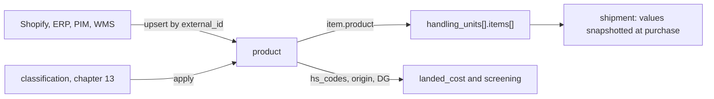
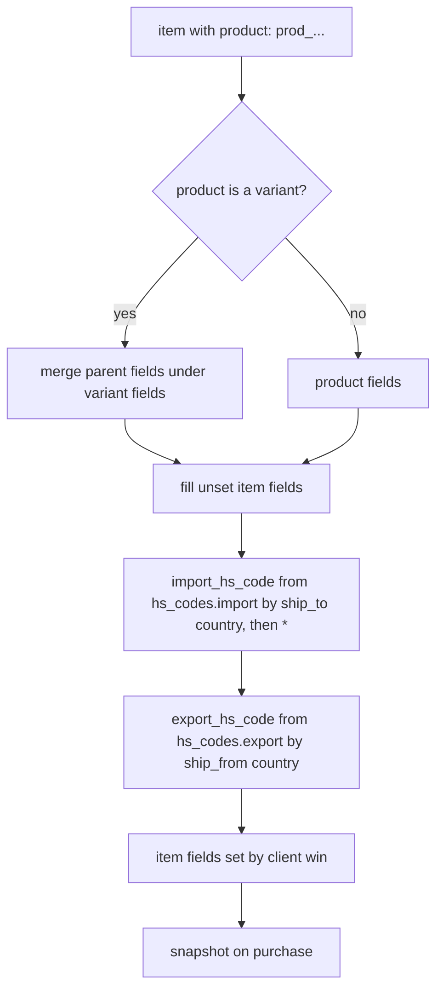

Every customs declaration repeats the same facts about the same goods: description, origin, HS codes, weights, materials, dangerous goods. A **product** stores them once. Items reference it, and shipments inherit from it. Product records are synchronized from where they actually live: an e-commerce platform, an ERP, a PIM, or a 3PL's WMS.

| Resource | Prefix | Purpose |
|---|---|---|
| `product` | `prod_` | A sellable SKU with its trade data. Variants are products with a `variant_of` parent. |

The module is `products`. It is required in 3PL mode and optional elsewhere (chapter 12).



## 1. The `product` object

```json
{
  "id": "prod_ts_red_m",
  "object": "product",
  "status": "active",
  "sku": "TS-RED-M",
  "title": "Cotton t-shirt, red, M",
  "description": "Men's knitted t-shirt, 100% cotton",
  "variant_of": "prod_ts",
  "options": { "color": "red", "size": "M" },
  "category": "apparel",
  "brand": "Ada Basics",
  "material": "100% cotton",
  "origin_country": "PT",
  "manufacturer": { "name": "Fábrica Têxtil Lda", "country": "PT", "mid": "PTFABTEX123BRA" },
  "unit_value": { "amount": 1500, "currency": "usd" },
  "unit_net_weight": { "value": 180, "unit": "g" },
  "unit_gross_weight": { "value": 200, "unit": "g" },
  "unit_dimensions": { "length": 25, "width": 20, "height": 2, "unit": "cm" },
  "hs_codes": {
    "export": { "US": "6109.10.0012" },
    "import": { "GB": "6109100010", "DE": "6109100010", "CA": "6109100011", "*": "610910" }
  },
  "classification": { "source": "cls_7Gh1", "reviewed": true, "reviewed_at": 1791300000 },
  "compliance": null,
  "dangerous_goods": null,
  "restrictions": [],
  "barcodes": [ { "type": "gtin13", "value": "5601234567890" } ],
  "product_url": "https://shop.example.com/p/ts-red",
  "image_url": "https://cdn.example.com/ts-red.jpg",
  "external_ids": [ { "source": "shopify", "id": "gid://shopify/ProductVariant/4455" }, { "source": "netsuite", "id": "ITEM-88" } ],
  "version": 7,
  "user_metadata": {}, "carrier_metadata": {}, "system_metadata": { "source": "api" }
}
```

| Field | Notes |
|---|---|
| `sku` | Unique per account among non-archived products |
| `variant_of`, `options` | A variant inherits every field it leaves `null` from its parent. `options` holds the variant's attributes. |
| Commodity fields | `title`, `description`, `category`, `brand`, `material`, `origin_country`, `manufacturer`, `unit_value`, `unit_net_weight`, `unit_gross_weight`, `compliance` and `dangerous_goods` have exactly the meaning of the same fields on `Item` (chapter 01 §3) |
| `hs_codes.export` | Per **origin** country. Most products ship from one country. |
| `hs_codes.import` | Per **destination** country. `"*"` is a 6-digit fallback used only when no country-specific code exists, and it is reported as `hs_code_derived`. |
| `classification` | Where the codes came from (a `cls_` or `manual`), and whether a person reviewed them |
| `restrictions[]` | Cached screening results per destination (chapter 13 §3), refreshed by the implementer when screening lists change |
| `external_ids[]` | `{ source, id }` pairs, each unique per account. They are the keys for sync (§3). |
| `version` | Incremented on every change. It is used for optimistic concurrency (§2). |

## 2. CRUD

```
POST   /v1/products                     create
GET    /v1/products/{id}                retrieve (also GET /v1/products/sku:{sku} and /v1/products/ext:{source}:{id})
POST   /v1/products/{id}                update (partial)
DELETE /v1/products/{id}                delete if never referenced, otherwise 409 (archive instead)
POST   /v1/products/{id}/archive        POST /v1/products/{id}/unarchive
GET    /v1/products                     list: status, category, origin_country, variant_of, updated[gte], external_ids[source]
GET    /v1/products/search?query=…      e.g. sku~"TS-" AND -hs_codes.import.GB:*
```

- **Optimistic concurrency.** Send `If-Match: 7` (the `version`) on update. A stale version returns `409 state_error` / `version_conflict`, with the current object in `error.details`. This prevents two sync sources from silently overwriting each other.
- `status` is `active`, `archived`, or `draft` (incomplete trade data: allowed in drafts, and rejected at purchase when required).
- The search query `-hs_codes.import.GB:*` finds products missing a UK import code, which is useful before opening a new corridor.

## 3. Sync

```
POST /v1/products/upsert
```

```json
{
  "match": { "external_id": { "source": "shopify", "id": "gid://shopify/ProductVariant/4455" } },
  "product": { "sku": "TS-RED-M", "title": "Cotton t-shirt, red, M", "unit_value": { "amount": 1500, "currency": "usd" } },
  "fields_owned": ["title", "unit_value", "image_url", "product_url", "barcodes"]
}
```

- `match` is `external_id`, `sku`, or `id`. A match updates, and no match creates. The response is the product, with `system_metadata.upsert: "created" | "updated" | "unchanged"`.
- **Field ownership.** `fields_owned` says which fields this source is authoritative for. Fields it does not own are never overwritten by it. That lets an e-commerce platform own titles and prices, while the trade team owns HS codes and origin, with no last-writer-wins damage.
- **Bulk.** `POST /v1/batches` with `operation: "products.upsert"` (up to 1000), or `POST /v1/products/import` with a CSV `file` and a column mapping.
- **Incremental pull.** `GET /v1/products?updated[gte]=…` with cursor pagination, or `product.*` webhooks, keep downstream systems in sync.
- **Export.** `POST /v1/exports` with `resource: "products"` (chapter 10 §8).

## 4. Items that reference products

Any `Item` may set `product`:

```json
{ "product": "prod_ts_red_m", "quantity": 2 }
```

Resolution at create and update time (normative):

1. The product's fields, merged over its parent's (for variants), fill every item field that the item leaves unset.
2. `import_hs_code` is taken from `hs_codes.import[ship_to.address.country]`, then `"*"`. `export_hs_code` is taken from `hs_codes.export[ship_from.address.country]`.
3. Fields set on the item always win. Per-shipment overrides are normal, such as a discounted `unit_value`.
4. The resolved values are written onto the item. **At purchase they are snapshotted**, so later product edits never change a purchased shipment or its customs record.
5. A `draft` or `archived` product used in a purchase returns `400 parameter_invalid` (`product_not_active`).



Trade engine integration: `POST /v1/classifications/{id}/apply` accepts `{ "product": "prod_..." }` as well as a shipment, writing into `hs_codes` and `classification`. Compliance screening caches its item results in `restrictions[]`.

## 5. Events

`product.created`, `product.updated` (with `previous_attributes`), `product.archived`, `product.unarchived`, `product.deleted`, `product.classification_needed` (emitted when a shipment needs a destination code the product lacks).
