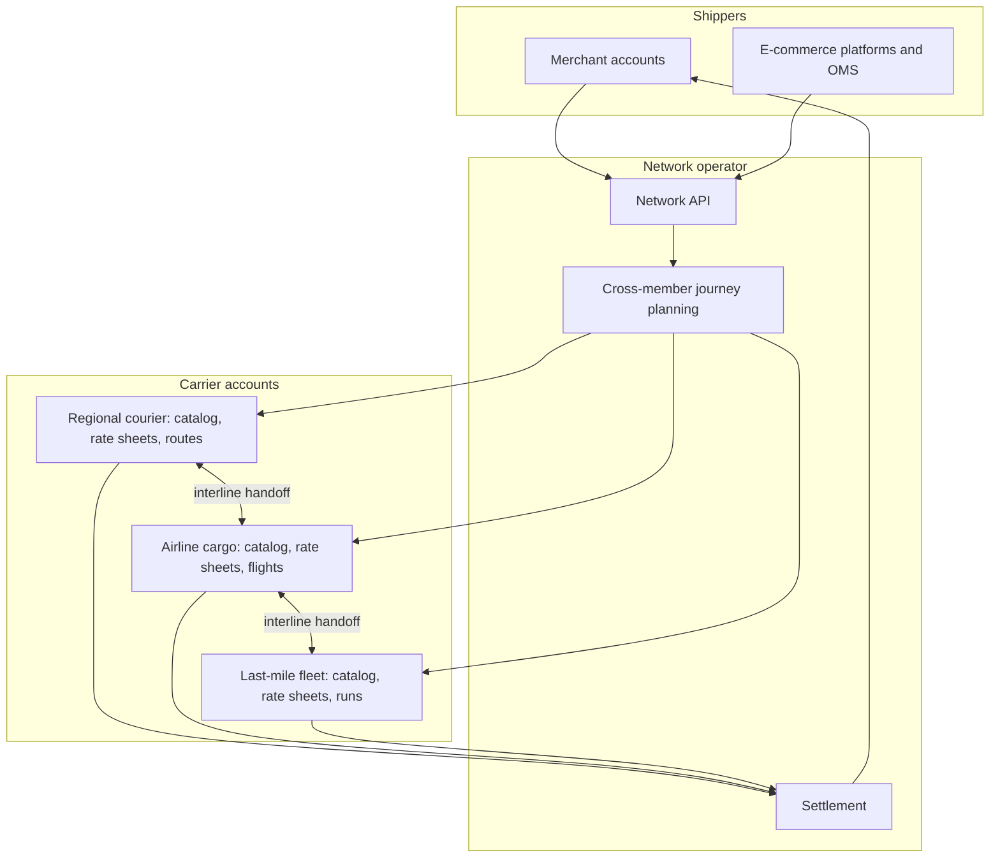
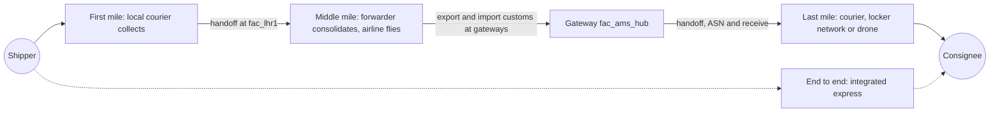
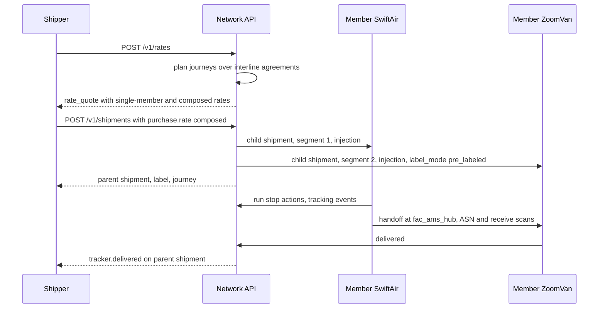

> **API surface.** Shippers book across the network through **REST** rates and shipments. Members and the operator manage member listing, catalogs, interline agreements, ledgers, settlements and service levels over **GraphQL Interface**.

A **network** is a platform where many logistics service providers (LSPs) offer capacity, and many shippers buy it. Each member is an independent business with its own services, tariffs and routes. The network adds what no single member has: reach across members, multi-leg journeys that hand off between them, one API for shippers, and settlement between all parties. Regional courier alliances, postal unions, freight marketplaces, air cargo consortia and last-mile collectives all have this shape.

Network mode reuses almost everything:

| Need | Reused from | What network mode adds |
|---|---|---|
| Member businesses | `account` (chapter 19) | Account `type: "carrier"`, member onboarding and requirements |
| Member services, options, packagings, zones | `catalog` (chapter 14) | Catalog objects are **owned by a member account** |
| Member tariffs | `pricing` (chapter 15) | Rate sheets owned by members, plus network fees as pricing rules |
| Member routes, facilities, runs | `routes` (chapter 16) | Routes owned by members, and shared facilities |
| Shipper-facing rating and labels | `core` (chapters 02, 03) | Rating across members, `network` journeys |
| Handoffs between members | `journey` (chapter 16 §4), `injection` (chapter 18) | `interline_agreement`, and handoffs as injections between members |
| Money between parties | — | `settlement` and `ledger_entry` |



## 1. Carrier accounts

A member is an `account` with `type: "carrier"` (chapter 19 §1). Its people sign in through the member's own identity provider, and its systems use the member's own API keys. Everything a member creates is scoped to its account by the `Shipping-Account` header, or by the token's account.

```json
{
  "id": "acct_swiftair",
  "object": "account",
  "type": "carrier",
  "status": "active",
  "parent": "acct_network",
  "profile": { "legal_name": "SwiftAir Cargo Ltd", "display_name": "SwiftAir", "contact": { "...": "Contact" } },
  "carrier": {
    "id": "net_swiftair",
    "kinds": ["airline"],
    "codes": { "iata": "SW", "icao": "SWF", "scac": null },
    "status": "listed",
    "visibility": "network",
    "service_area": ["zone_eu_core", "zone_gb_mainland"]
  },
  "requirements": { "currently_due": ["documents.insurance_certificate"], "pending_verification": ["documents.air_operator_certificate"] },
  "modules": ["catalog", "pricing", "routes", "fleet", "iot", "injection"]
}
```

| Field | Notes |
|---|---|
| `carrier.id` | The member's carrier ID in the network, namespaced `net_` in the shared registry. This is what `carrier_configs` keys and `GET /v1/carriers` use. |
| `carrier.kinds` | `courier`, `postal`, `freight_forwarder`, `consolidator`, `ltl`, `ftl`, `airline`, `ocean`, `rail`, `last_mile`, `crowdsourced_fleet`, `locker_network`, `drone_operator`, `customs_broker`, `warehouse` (a physical storage or fulfillment provider) |
| `carrier.segments` | Which journey segments the member serves (`first_mile`, `middle_mile`, `last_mile`, `end_to_end`) and where. See "Member roles" below. |
| `carrier.status` | `onboarding`, `listed` (bookable), `paused`, `delisted` |
| `carrier.visibility` | `network` (all shippers), `private` (only shippers on its allow-list), or `interline_only` (only other members can hand off to it, as with wholesale line-haul) |
| `requirements` | What the network needs before listing: certificates, insurance, operating licences, tax IDs. Documents are `file` objects with `purpose: "other"`, reviewed by the network operator. |

Endpoints are those of chapter 19, plus:

```
mutation networkMembers        mutation pauseMember        mutation delistMember
```

### What a member defines

Using its own credentials, a carrier account authors, publishes and versions exactly the same objects a Carrier-mode implementer does, through the GraphQL Interface ([GraphQL Interface](/spec/graphql)):

| Defines | API | Chapter |
|---|---|---|
| Services, options, packagings, zones | GraphQL: `createService`, `createOption`, `createPackaging`, `createZone`, `publishService`… | 14 |
| Tariffs, surcharges, contract rules | GraphQL: `createRateSheet`, `createSurcharge`, `createPricingRule`… | 15 |
| Facilities, routes, schedules, runs | GraphQL: `createFacility`, `createRoute`, `createRouteRun`… | 16 |
| Vehicles, drivers, aircraft, drones | GraphQL: `createVehicle`, `createDriver`… | 17 |
| Devices for scans and telemetry | GraphQL `createDevice`, then REST `POST /v1/device_events` | 22 |

A published catalog becomes the member's entry in the network's `GET /v1/carriers`, with `shipment_config_schema` generated from its options (chapter 14 §3). Shippers see one catalog of all members, and members never write per-network adapters.

### Member roles: first, middle and last mile

Most real journeys are relays. A courier collects in the origin city, a freight forwarder or airline moves the goods between countries, and a local courier or fleet delivers. A network member declares which **segments** it serves, and where:

```json
"carrier": {
  "id": "net_swiftair",
  "kinds": ["airline", "freight_forwarder"],
  "segments": {
    "first_mile": null,
    "middle_mile": { "lanes": [ { "from_zone": "zone_gb_mainland", "to_zone": "zone_eu_core", "modes": ["air"] } ], "handoff_points": ["fac_lhr1", "fac_ams_hub"], "customs": { "export": true, "import": true } },
    "last_mile": null,
    "end_to_end": null
  }
}
```

| Segment | Typical members | What they declare |
|---|---|---|
| `first_mile` | Local couriers, pickup fleets, postal collection, 3PL outbound docks | Collection zones, pickup windows, the facilities they deliver into |
| `middle_mile` | Freight forwarders, airlines, ocean carriers, LTL and FTL operators, consolidators, rail | Lanes (zone pairs), transport modes, handoff points, consolidation types they accept (gaylords, ULDs, containers), and customs capabilities at each end |
| `last_mile` | Couriers, postal operators, parcel lockers, drone operators, crowdsourced fleets | Service areas (zones), delivery services and options, the facilities they accept freight at |
| `end_to_end` | Integrated express carriers | Coverage, as a single member covering every segment |

A `customs_broker` member offers brokerage as a service at a gateway, attached to the middle-mile segment that crosses the border.

The network plans composed journeys by chaining compatible segments: a first-mile member whose delivery facility is a middle-mile member's handoff point, then a middle-mile lane ending at a facility where a last-mile member accepts freight. Interline agreements (§3) make each junction bookable.



A member can serve several segments, so a courier can be first mile in one city and last mile in another. Shippers see one composed rate (§2) whose `composition.segments[]` carry the segment type, and one parent shipment whose journey (chapter 16 §4) lists every segment and member.

## 2. Rating and booking across members

A shipper calls `POST /v1/rates` against the network as usual. The network answers from two kinds of candidates:

1. **Single-member rates.** A member whose coverage spans origin to destination prices the whole shipment from its own rate sheets.
2. **Composed rates.** The network plans multi-member journeys through interline agreements (§3), prices each segment from the responsible member's rate sheet, adds the agreed handoff fees and the network's own pricing rules, and returns one rate.

```json
{
  "id": "rate_net_7Rr2",
  "object": "rate",
  "service": { "carrier": "network", "code": "network_eu_express_composed", "name": "Express via SwiftAir + ZoomVan", "level": "express" },
  "total": { "amount": 3890, "currency": "eur" },
  "charges": [
    { "kind": "base", "name": "Segment 1: SwiftAir air LHR→AMS", "amount": { "amount": 2100, "currency": "eur" } },
    { "kind": "base", "name": "Segment 2: ZoomVan last mile", "amount": { "amount": 990, "currency": "eur" } },
    { "kind": "other", "name": "Interline handoff", "amount": { "amount": 300, "currency": "eur" } },
    { "kind": "other", "name": "Network fee", "amount": { "amount": 500, "currency": "eur" } }
  ],
  "pricing": "rate_sheet",
  "composition": {
    "segments": [
      { "sequence": 1, "segment": "middle_mile", "carrier": "net_swiftair", "service": "net_swiftair_express_air", "from": "shp:ship_from", "to": "fac_ams_hub", "amount": { "amount": 2100, "currency": "eur" } },
      { "sequence": 2, "segment": "last_mile", "carrier": "net_zoomvan", "service": "net_zoomvan_next_day", "from": "fac_ams_hub", "to": "shp:ship_to", "amount": { "amount": 990, "currency": "eur" } }
    ],
    "interline_agreements": ["ila_swift_zoom"]
  },
  "delivery": { "days": 2, "date": "2026-10-09" }
}
```

- `rate.composition` is present only on composed rates. The service `carrier` is `network`, and its `code` is generated per route pattern.
- Single-member rates look exactly like any other carrier's rate, with `service.carrier = "net_…"`.
- Shippers can restrict rating with `carrier_configs` keys as usual, or set `carrier_configs.network.compose: false` to see only single-member rates.

When the shipper buys a composed rate, the network:

1. Creates the shipper's **parent shipment**, with `tracking.journey` holding every segment.
2. Creates one **child shipment per segment** in the responsible member's account, as an injection (chapter 18) with `injection.channel: "carrier"`, `injection.partner` = the previous member (or the network for segment 1), and `label_mode` per the interline agreement.
3. Issues the shipper one label, normally the first member's, or a network label when the agreement says `label: "network"`.



## 3. Interline agreements

An interline agreement lets one member hand shipments to another at agreed points, on agreed terms.

```json
{
  "id": "ila_swift_zoom",
  "object": "interline_agreement",
  "status": "active",
  "from_carrier": "net_swiftair",
  "to_carrier": "net_zoomvan",
  "handoff_points": [ { "facility": "fac_ams_hub", "cutoff_local_time": "05:30", "days": ["mon", "tue", "wed", "thu", "fri", "sat"] } ],
  "services": { "from": ["net_swiftair_express_air"], "to": ["net_zoomvan_next_day"] },
  "label": "first_carrier",
  "tracking_number": "first_carrier",
  "handoff_fee": { "amount": 300, "currency": "eur", "paid_by": "network" },
  "pricing": { "basis": "to_carrier_rate_sheet", "rate_sheet": "rs_zoom_wholesale" },
  "liability": { "transfers_at": "receive_scan", "max_per_kg": { "amount": 2500, "currency": "eur" } },
  "data_sharing": { "policy": "pol_interline_default" },
  "effective_from": "2026-10-01",
  "effective_until": null,
  "signatures": [ { "account": "acct_swiftair", "signed_at": 1791000000 }, { "account": "acct_zoomvan", "signed_at": 1791000500 } ]
}
```

| Field | Notes |
|---|---|
| `status` | `proposed`, `active` (both parties have signed), `suspended`, `terminated` |
| `handoff_points[]` | Facilities and cutoffs where custody changes |
| `label`, `tracking_number` | `first_carrier` (the downstream member uses the upstream label and number, `label_mode: pre_labeled`), `relabel`, or `network` |
| `pricing.basis` | `to_carrier_rate_sheet` (the downstream member's wholesale sheet), `fixed`, or `revenue_share` (`{ share: 0.4 }`) |
| `liability.transfers_at` | `receive_scan` or `handoff_point_arrival`. It determines who owns a loss (§5). |
| `data_sharing.policy` | Which fields each side may see, when the `data_network` module is used (chapter 23 §4) |

Endpoints:

```
mutation createInterlineAgreement           (proposed by either member, or by the network)
query interlineAgreements  ·  query interlineAgreement  ·  mutation updateInterlineAgreement
mutation signInterlineAgreement       mutation suspendInterlineAgreement       mutation terminateInterlineAgreement
```

The handoff itself runs on chapter 18: the upstream member's route run unloads at the handoff facility, an ASN announces the shipments to the downstream member, and its receive scans transfer custody. Each step appends events to the parent shipment's tracker, so the shipper sees one continuous timeline.

## 4. Network operator controls

The operator account (`type: "platform"`) governs the network through objects it already has:

- **Fees:** `pricing_rule`s with `type: "markup"`, scoped by `conditions.carriers` or by composed services.
- **Listing and quality:** member `carrier.status`, plus network-wide `service_level` targets. These are optional objects (`sla_`) with `{ carrier, metric: "on_time_delivery" | "first_attempt_success" | "scan_compliance", target, window_days }`. The operator reads achieved values at `serviceLevel` (GraphQL Interface query), computed from trackers.
- **Shared facilities:** facilities owned by the operator account, usable as handoff points by any member.
- **Disputes:** `disputeSettlement` (GraphQL Interface mutation) (§5).

## 5. Settlement

Every money movement between parties is a ledger entry, and entries roll up into periodic settlements.

```json
{
  "id": "le_5Ss1",
  "object": "ledger_entry",
  "type": "segment_charge",
  "shipment": "shp_child_seg2",
  "parent_shipment": "shp_parent",
  "debit_account": "acct_network",
  "credit_account": "acct_zoomvan",
  "amount": { "amount": 990, "currency": "eur" },
  "basis": { "interline_agreement": "ila_swift_zoom", "rate_sheet": "rs_zoom_wholesale", "version": 3 },
  "status": "posted",
  "created": 1791500000
}
```

- `type` is `shipper_charge` (shipper to network), `segment_charge` (network to member), `handoff_fee`, `network_fee`, `adjustment` (reweighs at receipt, chapter 18 §6), `claim` (loss or damage, charged to the member liable at the time), or `refund`.
- `status` is `pending` (the shipment is not yet delivered, or the period is open), `posted`, or `reversed`.
- Settlements (`stl_`) aggregate entries per account and period: `{ account, period: { from, to }, currency, totals: { debits, credits, net }, status: "open" | "closed" | "invoiced" | "paid" | "disputed", statement: "file_..." }`.

```
query ledgerEntries?account=…&shipment=…&type=…
query settlements  ·  query settlement
mutation closeSettlement          mutation disputeSettlement   { entries: ["le_..."], reason }
```

Closing a settlement issues an `invoice` with `kind: "settlement"` (chapter 28 §1). Members are paid through `payout`s on the network's payments connection (chapter 28 §6), so the settlement records who owes whom and the payments interface moves the money.

## 6. Events

`account.listed`, `account.paused`, `account.delisted`, `interline_agreement.proposed`, `.signed`, `.activated`, `.suspended`, `.terminated`, `ledger_entry.posted`, `settlement.closed`, `settlement.disputed`, `service_level.breached`. Members receive the events for their own child shipments. Shippers receive events for their parent shipments.
