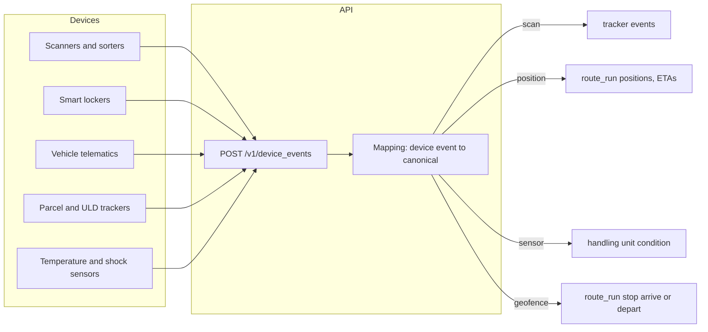

> **API surface.** Devices send events through **REST** (`POST /v1/device_events`). Registering, attaching and credentialing devices is **GraphQL Interface**.

Most tracking events start on a device: a handheld scanner at a depot, a sorter tunnel, a smart locker, a vehicle's telematics unit, a BLE tag in a parcel, or a temperature logger in a ULD. This module gives devices a first-class interface, so their readings arrive as canonical events without a bespoke integration per device vendor.

It is optional in every mode that moves goods: Carrier, Network, 3PL and Fleet.



## 1. Device

```json
{
  "id": "dev_sc_lon_12",
  "object": "device",
  "type": "scanner",
  "status": "active",
  "name": "LON hub dock 3 scanner",
  "manufacturer": "Zebra",
  "model": "MC9300",
  "serial_number": "21345A0042",
  "attached_to": { "facility": "fac_lon_hub", "vehicle": null, "handling_unit": null },
  "capabilities": ["scan", "position"],
  "authentication": { "method": "mtls", "certificate_fingerprint": "SHA256:4f:9a:…", "expires_at": 1822000000 },
  "default_location": { "facility": "fac_lon_hub" },
  "last_seen_at": 1791500100,
  "firmware": "11.2.4",
  "user_metadata": {}, "carrier_metadata": {}, "system_metadata": {}
}
```

| Field | Notes |
|---|---|
| `type` | `scanner`, `sorter`, `locker`, `telematics`, `tracker_tag` (in a parcel or ULD), `sensor`, `gateway` (aggregates other devices), `drone_autopilot`, `driver_app` |
| `attached_to` | Exactly one of `facility`, `vehicle` or `handling_unit` may be set. It supplies default context for its events: a scanner at a facility gives events that facility as their location, and a tag on a handling unit gives events that unit. |
| `capabilities` | `scan`, `position`, `temperature`, `humidity`, `shock`, `tilt`, `light`, `door`, `geofence`, `locker_slot` |
| `authentication.method` | `mtls` (an X.509 client certificate, recommended), `device_token` (a short-lived token issued by `tokenDevice` (GraphQL Interface mutation)), or `gateway` (authenticated through a gateway device). Device secrets are never returned. |

Endpoints:

```
mutation createDevice           query devices (type, status, facility, vehicle)    query device
mutation updateDevice      mutation deleteDevice
mutation certificateDevice      { csr }  → signed certificate, returned once
mutation tokenDevice            → { token, expires_at }   (for device_token)
mutation attachDevice           { facility | vehicle | handling_unit }       mutation detachDevice
mutation deactivateDevice
```

## 2. Ingestion

```
POST /v1/device_events
```

```json
{
  "events": [
    { "id": "d-88213", "device": "dev_sc_lon_12", "type": "scan", "at": "2026-10-08T06:12:44+01:00", "barcode": { "symbology": "code128", "value": "01234567890123" }, "action": "inbound", "location": { "facility": "fac_lon_hub", "zone": "dock-3" } },
    { "id": "d-88214", "device": "dev_tag_uld_77", "type": "sensor", "at": "2026-10-08T06:12:50+01:00", "readings": { "temperature": { "value": 9.1, "unit": "c" }, "shock": { "value": 2.4, "unit": "g" } } },
    { "id": "d-88215", "device": "dev_tm_van07", "type": "position", "at": "2026-10-08T06:13:00+01:00", "latitude": 51.507, "longitude": -0.128, "speed": { "value": 0, "unit": "km/h" } },
    { "id": "d-88216", "device": "dev_tm_van07", "type": "geofence", "at": "2026-10-08T06:20:00+01:00", "geofence": "zone_lon_depot", "transition": "exit" },
    { "id": "d-88217", "device": "dev_locker_42", "type": "locker", "at": "2026-10-08T14:02:00+01:00", "barcode": { "value": "01234567890123" }, "slot": "B12", "action": "deposited", "pin_issued": true }
  ]
}
```

- It accepts up to 1000 events per call. `id` is the device's own event ID, and `(device, id)` deduplicates, so devices can retry blindly.
- The response is `{ accepted, rejected, errors: [{ index, code, message }] }`. Events are processed asynchronously, in `at` order per device.
- Devices that buffer offline send late events with their true `at`. Tracking merges them by `occurred_at` (chapter 07 §7).
- **MQTT binding (optional, capability `iot.mqtt`).** Topic `devices/{device_id}/events`, with the same JSON payload, over TLS with mTLS device certificates. It suits constrained devices that cannot do HTTPS batching.

### Event types and how they map

| `type` | Required fields | Becomes |
|---|---|---|
| `scan` | `barcode`, `action` | A `tracking_event` on the matching handling unit's tracker. `action` maps to status: `inbound` and `sort` give `in_transit`/`arrived_at_facility`, `outbound` gives `in_transit`/`departed_facility`, `load_vehicle` gives `out_for_delivery` when the vehicle's run is last-mile, `delivery` gives `delivered`, and `exception` (with `reason`) gives `exception`. It also completes matching ASN receives (chapter 18) and route-run stop actions. |
| `position` | `latitude`, `longitude` | A position on the device's vehicle's current `route_run` (chapter 17 §4) |
| `geofence` | `geofence` (a zone or facility), `transition` (`enter`, `exit`) | A route-run stop `arrive` (enter) or `depart` (exit) when the geofence is a planned stop |
| `sensor` | `readings` | Condition telemetry on the handling unit (§3) |
| `scan` with `action: aggregate` or `disaggregate` | `barcode` (the child), `parent` (the consolidation barcode) | Adds the child to, or removes it from, a `consolidation` (chapter 24 §3). This is the EPCIS AggregationEvent equivalent. |
| `scan` with `action: putaway`, `pick`, `move` or `count` | `barcode` (the product, lot or handling unit), `location` (the storage location barcode), `quantity` | A `stock_movement` (chapter 29 §3), or an inventory count line |
| `locker` | `barcode`, `action` (`deposited`, `collected`, `expired`), `slot` | `available_for_pickup`/`at_access_point`, or `delivered`/`delivered_to_access_point` |

Barcodes are matched against `handling_units[].tracking_number`, SSCCs, `injection.upstream_tracking_number`, and AWB or ULD identifiers. An unmatched scan is kept as an `unmatched_scan` record (`GET /v1/device_events?status=unmatched`) and retried when a matching shipment appears, which covers data that arrives after the goods.

Every tracking event created from a device has `source: "device"`, and its `carrier_metadata` holds `{ device, device_event_id }`.

## 3. Condition monitoring

Handling units can declare limits:

```json
"handling_units": [ {
  "type": "parcel",
  "conditions": { "temperature": { "min": { "value": 2, "unit": "c" }, "max": { "value": 8, "unit": "c" } }, "shock": { "max": { "value": 5, "unit": "g" } }, "tilt": { "max_degrees": 45 } },
  "...": "HandlingUnit"
} ]
```

- Sensor readings for a unit, from a device attached to it, or to its vehicle or ULD while it is loaded, are checked against its `conditions`.
- An excursion appends a `tracking_event` with `status: "exception"` and `status_detail: "temperature_excursion"`, `"shock_detected"` or `"tilt_detected"`, and fires `handling_unit.condition_breached`.
- `GET /v1/shipments/{id}/conditions?handling_unit=hu_…` returns the reading series and excursions, for cold-chain compliance (GDP, for example) and claims.

## 4. Events

`device.created`, `device.updated`, `device.deactivated`, `device.offline` (no events for longer than the device type's heartbeat), `device_event.unmatched`, `handling_unit.condition_breached`.
