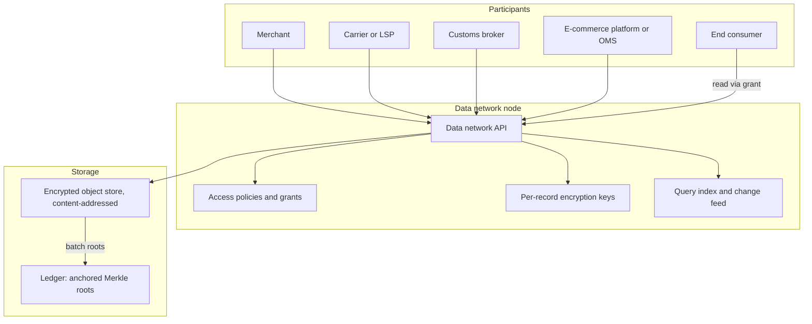
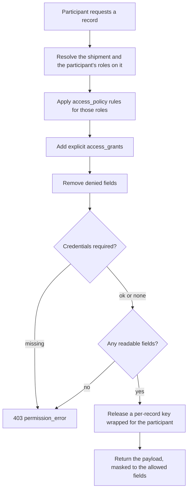
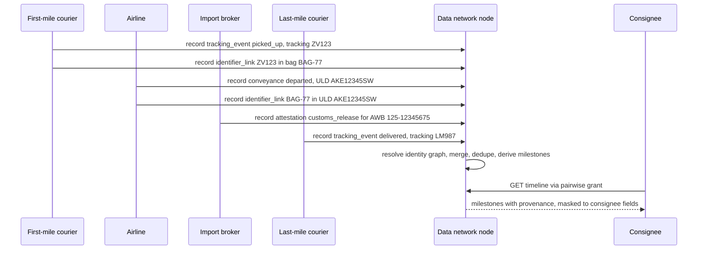

> **API surface.** Participants, records, timelines, grants and attestations are **REST**. Network-wide access policies are **GraphQL Interface**.

Every party to a shipment keeps its own copy of the truth, and nobody can see the whole journey. The merchant has the order, the carrier the scans, the broker the entry, the consumer an email. They reconcile by phone when they disagree. The **Logistics Data Network** is a shared, append-only record of the spec's canonical objects. Every participant can write the facts it is responsible for, read the facts it is entitled to, and prove that neither has been altered.

It is a mode (`data`, chapter 12) run by **nodes**. Every other mode feeds it through federation (chapter 09 §6).

## 1. Design principles

| Principle | Consequence |
|---|---|
| **Canonical objects only** | The data network stores the spec's own objects (shipment snapshots, tracking events, documents, ledger entries, attestations), so it needs no new data model and stays readable by any spec client |
| **Content-addressed** | Every stored version has an ID derived from its bytes (a multihash CID). The same bytes always get the same ID, and changed bytes always get a new one. |
| **Signed by the producer** | Each record is signed by the participant that asserted it. You know *who* said a parcel was delivered, not only *that* it was. |
| **Anchored, not stored, on-chain** | Only Merkle roots of record batches go to a ledger. Payloads stay off-chain, encrypted. The spec is ledger-agnostic: any chain that can timestamp a hash works. |
| **Personal data is erasable** | Payloads are encrypted per record. Deleting the key (crypto-shredding) makes the data unreadable while keeping the proof that it existed. This is how a tamper-evident store is reconciled with GDPR-style erasure. |
| **Need-to-know by default** | Access is derived from a participant's role on each shipment and enforced at field level, not by "share the whole record or nothing" |



## 2. Participants

```json
{
  "id": "ptc_swiftair",
  "object": "participant",
  "did": "did:web:swiftair.example",
  "account": "acct_swiftair",
  "kinds": ["carrier", "airline"],
  "verification_methods": [ { "id": "did:web:swiftair.example#key-1", "type": "JsonWebKey2020", "public_key_jwk": { "kty": "OKP", "crv": "Ed25519", "x": "…" } } ],
  "credentials": [ { "type": "AirOperatorCertificate", "issuer": "did:web:caa.example", "valid_until": "2028-01-01", "vc": "eyJ…" } ],
  "status": "active"
}
```

- A participant is identified by a W3C **DID**. `did:web` is enough for organizations that own a domain. Spec-native implementers can use their API domain.
- `kinds` is `merchant`, `ecommerce_platform`, `marketplace`, `carrier`, `lsp`, `airline`, `three_pl`, `fleet_operator`, `import_broker`, `export_broker`, `ior_eor_provider`, `customs_authority`, `insurer`, `financier`, `consumer`, or `data_node`.
- `credentials` are W3C **Verifiable Credentials** issued by recognized authorities (licences, certifications, broker registrations). Policies can require them, as in "only a licensed customs broker may read declarations".
- Consumers are participants too, usually through a **pairwise DID** created for one shipment, so different shipments cannot be correlated to the same person.
- `account` links the participant to a spec account (chapter 19) where one exists.

Endpoints: `POST /v1/participants` (register a DID, proven by signing a challenge), `GET /v1/participants/{id}`, `GET /v1/participants?kind=…`, `POST /v1/participants/{id}/credentials` (attach a VC), `POST /v1/participants/{id}/rotate_keys`.

## 3. Records

A **record** is one signed, content-addressed version of one canonical object.

```json
{
  "id": "rec_bafyreih3…",
  "object": "record",
  "cid": "bafyreih3kd7…",
  "subject": { "type": "tracking_event", "id": "tev_aa01", "shipment": "shp_1Q2w3E4r5T6y" },
  "previous": "rec_bafyreig9…",
  "producer": "ptc_swiftair",
  "role": "carrier",
  "produced_at": "2026-10-08T07:42:00+01:00",
  "schema": "https://shippinginternals.dev/schemas/0.1/tracking_event.json",
  "payload": { "encryption": "xchacha20poly1305", "key_id": "key_rec_…", "location": "ipfs://bafybeic…", "size": 1842 },
  "public_fields": { "status": "out_for_delivery", "occurred_at": "2026-10-08T07:42:00+01:00" },
  "signature": { "alg": "EdDSA", "kid": "did:web:swiftair.example#key-1", "value": "…" },
  "anchor": { "batch": "anc_7Tt3", "merkle_proof": ["…"], "status": "anchored" }
}
```

| Field | Notes |
|---|---|
| `cid` | A content identifier of the canonical JSON (RFC 8785 JCS) of the object version |
| `subject` | Which canonical object this is a version of, and the shipment it belongs to, for access derivation |
| `previous` | The prior record for the same subject. Records for a subject form a hash chain, so a missing or edited version is detectable. |
| `producer`, `role` | Who asserted it, and in which role on the shipment |
| `payload` | The encrypted object. `location` is any content-addressed store (IPFS, Arweave, S3 with CID keys). |
| `public_fields` | An optional, policy-limited, **non-personal** subset kept in clear text for indexing |
| `signature` | Over the `cid`, by a key in the producer's DID document |
| `anchor` | The batch whose Merkle root carries this record on the ledger |

### Writing

```
POST /v1/records      { subject, object: <canonical JSON>, role }      (signed with the Shipping-Signature-Participant header, or by the node on the participant's behalf with delegated keys)
```

Spec implementers do not write records by hand. With data network replication enabled on an account (`settings.data_network: { node, replicate: ["shipment", "tracking_event", "document", "ledger_entry", "attestation"] }`), every committed object version is replicated as a record automatically, signed by the account's participant keys.

### Anchoring

```json
{ "id": "anc_7Tt3", "object": "anchor", "ledger": { "network": "eip155:8453", "contract": "0x…", "tx": "0x…", "block": 21733120 }, "merkle_root": "0x9f…", "records": 4096, "created": 1791500400, "status": "confirmed" }
```

- Nodes batch records (by time or count), compute a Merkle root, and write it to the ledger. `ledger.network` uses CAIP-2 chain identifiers, so any chain works.
- `status` is `pending`, `submitted`, `confirmed`, or `failed`.
- `POST /v1/records/verify` with `{ "record": "rec_…" }` or `{ "object": <JSON>, "subject": … }` returns `{ valid, cid_matches, signature_valid, producer, anchored_at, ledger_tx }`. Anyone can verify a record they hold, even without access to the node that wrote it.

## 4. Access control

Access is decided per participant, per record, per field. It comes from three sources, checked in order.

### 4.1 Shipment roles (automatic)

Every shipment defines who is involved. Each involvement is a **role**:

| Role | Derived from |
|---|---|
| `shipper` | The account that created the shipment |
| `consignee` | `ship_to` (through a pairwise participant created when a tracking link is issued) |
| `bill_to` | `bill_to` |
| `carrier` | `carrier_configs` key, or each journey segment's carrier, **for its segment only** |
| `injector` | `injection.partner` |
| `importer_of_record`, `exporter_of_record` | `customs_declaration` parties, including IOR/EOR service providers acting for sellers without a local entity |
| `import_broker`, `export_broker` | `customs_declaration.import_broker`, `.export_broker` |
| `platform` | The parent account of the shipper |
| `network_operator` | The network the shipment was booked through |

### 4.2 Access policies (field masks per role)

A policy says what each role may read about each object type:

```json
{
  "id": "pol_default",
  "object": "access_policy",
  "rules": [
    { "role": "consignee", "objects": ["tracking_event"], "fields": ["status", "status_detail", "occurred_at", "location.city", "location.country"] },
    { "role": "consignee", "objects": ["shipment"], "fields": ["tracking", "purchase.delivery"] },
    { "role": "carrier", "objects": ["shipment"], "fields": ["ship_from", "ship_to", "handling_units", "customs_declaration"], "scope": "own_segment" },
    { "role": "carrier", "objects": ["shipment"], "fields": ["purchase.amount"], "deny": true },
    { "role": "import_broker", "objects": ["shipment", "document"], "fields": ["customs_declaration", "handling_units", "order", "ship_to", "ship_from"], "require_credentials": ["CustomsBrokerLicence"] },
    { "role": "export_broker", "objects": ["shipment", "document"], "fields": ["customs_declaration", "handling_units", "order", "ship_from"], "require_credentials": ["ExportFilingAgent"] },
    { "role": "shipper", "objects": ["*"], "fields": ["*"] }
  ]
}
```

- `fields` uses dotted paths, with `*` for everything. `deny` rules win over `allow` rules.
- `scope: "own_segment"` limits a carrier to the segments of the journey it operates, plus the handoff points next to them.
- `require_credentials` checks the participant's verifiable credentials.
- The spec publishes `pol_default` (above, abridged). Accounts and networks can attach their own policies, and an interline agreement's `data_sharing.policy` applies to the carriers on that agreement.

### 4.3 Grants (explicit)

Participants can grant access that the policies do not imply: a merchant sharing a shipment with an insurer for a claim, or a consumer sharing their tracking with a neighbour.

```json
{ "id": "grt_2Uu9", "object": "access_grant", "grantor": "ptc_ada_shop", "grantee": "ptc_insureco", "subjects": { "shipments": ["shp_1Q2w3E4r5T6y"] }, "fields": ["*"], "purpose": "claim", "expires_at": 1794000000, "status": "active" }
```

```
POST /v1/access_grants   ·   GET /v1/access_grants   ·   POST /v1/access_grants/{id}/revoke
```

A grantor can only grant fields it can read itself, so grants never escalate access.

### How a read is decided



Keys are released wrapped to the participant's DID key, so a node serves ciphertext plus a wrapped key, and never needs to send plaintext over federation. Every key release is itself logged as a record (`subject.type: "access_log"`). A participant can see who read its data.

## 5. Query and change feed

```
GET  /v1/records?subject.shipment=shp_…&subject.type=tracking_event
POST /v1/records/query     { "select": ["subject.id", "public_fields.status"], "where": { "subject.type": "tracking_event", "produced_at": { "gte": "2026-10-01" } }, "limit": 500 }
GET  /v1/records/feed?after=rec_…     (also available as webhooks: record.created)
POST /v1/datasets          { "query": { … }, "format": "parquet" | "jsonl", "anonymization": "k_anonymity_5" }   → file
```

- Every result is filtered by the requester's access (§4), and queries never see fields the requester cannot read.
- `datasets` produce aggregated or anonymized extracts for network analytics: lane transit times, carrier on-time performance, emissions per lane. This is capability `data.datasets`.

## 6. Attestations

An attestation is a signed statement by a participant about another record. It covers proof of delivery countersigned by the consignee, customs release by a broker, condition-on-receipt by a downstream carrier, and an insurer accepting a claim.

```json
{ "id": "att_4Vv7", "object": "attestation", "attester": "ptc_consignee_pairwise_91", "about": "rec_bafyreih3…", "statement": "received_in_good_condition", "evidence": ["rec_bafypod…"], "signature": { "…": "…" } }
```

`POST /v1/attestations`, `GET /v1/attestations?about=rec_…`. Attestations are records too. They are anchored and access-controlled in the same way.

## 7. End-to-end timelines

A cross-border parcel is scanned by six to ten organizations: the shipper's 3PL, a first-mile courier, a consolidator, an airline, two customs brokers, a gateway, a last-mile courier and a locker. Each sees its own scans under its own identifier (its tracking number, a bag ID, an AWB, a container number), and nobody sees the whole journey. The data network assembles it. Every party writes its events as records, identifiers are linked as custody changes, and the node consolidates the distributed events into **one timeline per shipment**, with standard milestones and provenance for every entry.



### 7.1 Identity linking

Each party knows the shipment by a different name. **Identifier links** are records that say two identifiers refer to the same goods, or that one contains the other:

```json
{ "object": "identifier_link", "relation": "contains", "parent": { "scheme": "uld", "value": "AKE12345SW" }, "child": { "scheme": "bag", "value": "BAG-77" }, "valid_from": "2026-10-08T05:10:00Z", "valid_to": "2026-10-08T13:40:00Z", "producer": "ptc_swiftair" }
```

- `relation` is `same_as` (two tracking numbers for one parcel, such as an upstream and a relabelled local number) or `contains` (aggregation, with a validity window from load to unload).
- `scheme` is `tracking_number` (with `carrier`), `shipment` (`shp_`), `sscc`, `uld`, `container` (ISO 6346), `awb`, `postal_receptacle`, `bag`, `upstream_reference`.
- Links are written automatically by implementers that replicate: injection writes `same_as` (chapter 18), consolidation add and remove write `contains` (chapter 24), and relabelling writes `same_as`.
- The node maintains an **identity graph** per shipment. An event recorded against any identifier in the graph, during the window that identifier is linked, belongs to the shipment's timeline. This is how one airline scan of a ULD becomes a milestone for 700 parcels from 40 shippers, without the airline knowing any of them.

### 7.2 Milestones

Raw events are many and noisy. **Milestones** are the small, standard set every party and consumer understands. The node derives them from distributed events using a published definition set:

| Milestone | Derived from (any producer) |
|---|---|
| `booked` | `shipment.purchased` record |
| `collected` | First `picked_up`, `accepted` or first-mile receive scan |
| `export_cleared` | Export declaration accepted (ITN or MRN), or an export broker attestation |
| `departed_origin` | First `conveyance.departed` carrying the shipment (through the graph), or `departed_facility` at an origin gateway |
| `arrived_destination` | `conveyance.arrived` at, or `arrived_at_destination_country` in, the destination country |
| `import_cleared` | A `customs_release` attestation, or `customs_cleared` |
| `handed_to_last_mile` | Receive scan by the last-mile member, or an interline handoff |
| `out_for_delivery` | `out_for_delivery` |
| `delivered` | `delivered` with proof of delivery, strengthened by a consignee attestation |
| `exception_*` | `exception` events, keyed by `status_detail` (`exception_customs_hold`, `exception_damaged`…) |
| `returned` | `returned` |

```json
{
  "object": "timeline",
  "shipment": "shp_1Q2w3E4r5T6y",
  "identifiers": [ { "scheme": "tracking_number", "carrier": "net_zoomvan", "value": "ZV123" }, { "scheme": "bag", "value": "BAG-77" }, { "scheme": "uld", "value": "AKE12345SW" }, { "scheme": "awb", "value": "125-12345675" }, { "scheme": "tracking_number", "carrier": "lastmile_co", "value": "LM987" } ],
  "milestones": [
    { "milestone": "collected", "occurred_at": "2026-10-07T16:02:00+01:00", "status": "confirmed", "sources": [ { "record": "rec_bafy…a1", "producer": "ptc_zoomvan", "via": null } ] },
    { "milestone": "departed_origin", "occurred_at": "2026-10-08T09:52:00+01:00", "status": "confirmed", "sources": [ { "record": "rec_bafy…f7", "producer": "ptc_swiftair", "via": { "scheme": "uld", "value": "AKE12345SW" } } ] },
    { "milestone": "import_cleared", "occurred_at": "2026-10-08T14:30:00+02:00", "status": "attested", "sources": [ { "record": "rec_bafy…c2", "producer": "ptc_broker_nl", "via": { "scheme": "awb", "value": "125-12345675" } } ] },
    { "milestone": "delivered", "occurred_at": "2026-10-09T10:58:00+02:00", "status": "disputed", "sources": [ { "record": "rec_bafy…d9", "producer": "ptc_lastmile_co" } ], "conflicts": [ { "record": "rec_bafy…e4", "producer": "ptc_consignee_91", "statement": "not_received" } ] }
  ],
  "events": { "count": 37, "url": "/v1/timelines/shp_1Q2w3E4r5T6y/events" },
  "gaps": [ { "expected": "export_cleared", "after": "collected", "reason": "no_record", "severity": "warning" } ],
  "eta": { "date": "2026-10-09", "source": "journey" },
  "as_of": 1791600000
}
```

| Field | Notes |
|---|---|
| `milestones[].status` | `confirmed` (one producer, authoritative for that milestone), `corroborated` (two or more independent producers agree), `attested` (a signed attestation by the authority or party responsible, such as a broker's customs release or a consignee's receipt), `inferred` (derived only through aggregation, for example from a ULD's departure), or `disputed` (producers conflict) |
| `sources[].via` | The aggregation identifier through which the event reached this shipment. It is the provenance of a fan-out milestone. |
| `conflicts` | Contradicting records. Nothing is overwritten. Both stay visible, and the disagreement itself is information, for claims for example (chapter 26 §5). |
| `gaps` | Expected milestones that are missing or late, given the journey plan and the milestone definition set. They power "where is my order" alerting across organizations. |

**Rules.**

- Events are merged by `occurred_at`, deduplicated across producers (same milestone class, the same identifier through the graph, within the dedupe window), and **never rewritten**. Corrections are new records that supersede old ones by `previous`.
- When producers disagree, precedence is: an attested record over others, then the party responsible for that segment at that time (from the journey and interline custody), then the earliest receipt. The losing records stay in `conflicts`.
- The timeline is filtered through access control (§4) like everything else. A consignee sees milestones with city-level locations. A carrier sees full detail only for its own segments. A shipper sees everything about its shipments.

### 7.3 Endpoints

```
GET  /v1/timelines/{shipment_id}                 the consolidated timeline (requires a role on the shipment, or a grant)
GET  /v1/timelines/{shipment_id}/events          all merged events, with producer and via provenance
POST /v1/timelines/resolve                       { identifier: { scheme, value, carrier? } }  → shipments whose graph contains it
GET  /v1/milestone_definitions                   the published definition set and its version
POST /v1/identifier_links                        write a link record (implementers do this automatically)
```

Events: `timeline.milestone_reached`, `timeline.milestone_disputed`, `timeline.gap_detected`. They are delivered to every participant that has a role on the shipment and a subscription, so the shipper, its platform and the consignee's tracking page all see the same milestone at the same moment, whoever scanned it.

## 8. Erasure

`POST /v1/records/erase` with `{ subject: { shipment } , reason: "data_subject_request" }` destroys the payload keys of every record holding personal data for that shipment. Records, CIDs, signatures and anchors remain, so the history stays verifiable, but the personal fields can no longer be decrypted. `public_fields` never contain personal data, which policy validation enforces at write.

## 9. Events

`participant.registered`, `participant.credential_added`, `record.created`, `timeline.milestone_reached`, `timeline.milestone_disputed`, `timeline.gap_detected`, `anchor.confirmed`, `access_grant.created`, `access_grant.revoked`, `attestation.created`, `records.erased`.
