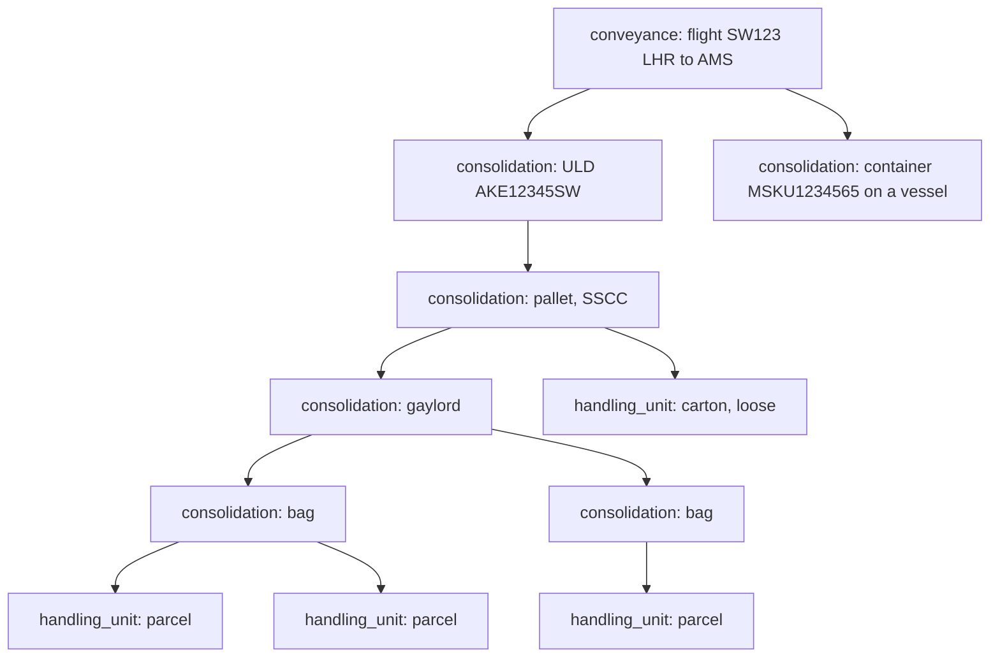
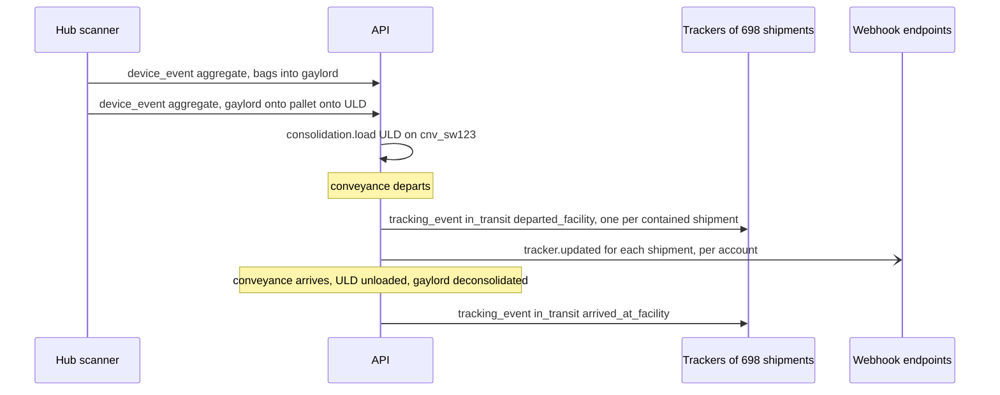

> **API surface.** Consolidations and conveyances are built and operated over **GraphQL Interface**, or by device scans through REST `POST /v1/device_events`. Integrators read the outcome through REST `GET /v1/shipments/{id}/custody` and timelines.

Parcels rarely travel alone. A sort center bags 60 parcels, puts 12 bags into a gaylord, and loads the gaylord onto a pallet. The pallet is built onto an air ULD, and the ULD flies on a scheduled flight. At the other end, everything is broken down in reverse. Each layer has its own identifier, its own scans, and often its own customs and dangerous-goods paperwork. A system of record has to model the layers, or a single scan of a gaylord either means nothing or has to be fanned out by hand into 700 parcel events.

This chapter adds two objects and one rule:

| Object | Prefix | What it is |
|---|---|---|
| `consolidation` | `csl_` | A **transport unit** that contains handling units or other consolidations: a bag, sack, cage, gaylord, pallet, ULD, container, trailer or swap body |
| `conveyance` | `cnv_` | A **movement** of consolidations on one vehicle departure: a flight, a voyage, a truck run, a train. It is the transport-unit view of a `route_run` leg. |

**The aggregation rule.** An event on a consolidation applies to everything inside it, recursively, until the contents are removed. Scanning a gaylord out of a hub moves every parcel in it.

## 1. The hierarchy



Handling units (chapter 01 §2) remain the leaves: the things a shipper labels. Consolidations are created by carriers, 3PLs and networks as goods move, and they can mix shipments from many shippers and many accounts.

## 2. The `consolidation` object

```json
{
  "id": "csl_gay_7781",
  "object": "consolidation",
  "type": "gaylord",
  "status": "closed",
  "owner": "acct_swiftair",
  "identifiers": { "sscc": "376123450000077810", "label": "GAY-LHR-7781", "uld_id": null, "container_number": null, "postal_receptacle": null },
  "parent": "csl_pal_552",
  "contents": { "consolidations": ["csl_bag_1001", "csl_bag_1002"], "handling_units": [] },
  "counts": { "handling_units": 712, "shipments": 698, "consolidations": 12 },
  "weight": { "value": 312.4, "unit": "kg" },
  "dimensions": { "length": 120, "width": 100, "height": 110, "unit": "cm" },
  "origin": "fac_lhr1",
  "destination": "fac_ams_hub",
  "seal": { "number": "SEAL-00918", "type": "bolt", "applied_at": 1791480000, "applied_by": "dev_sc_lhr_04" },
  "dangerous_goods": { "contains": true, "classes": ["9"], "lithium": ["ion_pi967"], "declaration": "doc_dgd_771" },
  "customs": { "status": "not_required", "reference": null },
  "conveyance": "cnv_sw123_20261008",
  "documents": [ { "id": "doc_lbl_7781", "type": "label", "format": "zpl", "url": "https://..." } ],
  "location": { "facility": "fac_lhr1", "at": 1791480100 },
  "user_metadata": {}, "carrier_metadata": {}, "system_metadata": {}
}
```

| Field | Notes |
|---|---|
| `type` | `bag`, `sack` (postal receptacle), `tote`, `cage` (roll cage), `gaylord` (bulk box), `pallet`, `uld`, `container`, `trailer`, `swap_body`, `rail_wagon`, `other` |
| `status` | `open` (accepting contents), `closed` (contents final), `sealed`, `loaded` (on a conveyance), `in_transit`, `arrived`, `deconsolidated` (emptied, terminal) |
| `owner` | The account that built it. Contents may belong to many accounts, and access to them is governed per shipment (chapter 23 §4). |
| `identifiers` | Any of `sscc` (GS1 logistic unit), `uld_id` (IATA, e.g. `AKE12345SW`), `container_number` (ISO 6346, e.g. `MSKU1234565`), `postal_receptacle` (UPU S9 29-character receptacle ID), `label` (free-form). Scans match on any of them. |
| `parent` | The consolidation this one sits in. Nesting depth is at most 6. |
| `contents` | Direct children only. Use `consolidationContents` (GraphQL Interface query) for the full tree. |
| `counts` | Recursive totals, maintained by the implementer |
| `dangerous_goods` | A rollup of contained DG classes, with the declaration document. Required for air ULDs (the NOTOC), and checked against the conveyance's acceptance. |
| `customs` | `{ status: "not_required" \| "pending" \| "cleared" \| "held", reference }` for consolidations cleared as one entry (consolidated clearance, postal receptacles) |
| `ULD` and `container` specifics | `type_code` (IATA ULD type `AKE`/`PMC`…, or ISO 6346 size-type code `45G1`…), `tare_weight`, `max_gross_weight`, `reefer: { set_point, unit }` |

## 3. Building and breaking consolidations

```
mutation createConsolidation                         { type, identifiers, origin, destination, parent? }
query consolidations  ·  query consolidation  ·  query consolidationContents?recursive=true
mutation addConsolidation                { handling_units: [...], consolidations: [...] }  or scans: [{ barcode }]
mutation removeConsolidation             { handling_units: [...], consolidations: [...] }
mutation closeConsolidation              mutation sealConsolidation { number, type }
mutation loadConsolidation               { conveyance, position? }      mutation unloadConsolidation
mutation deconsolidateConsolidation      (empties it one level, the children go to the current location, terminal)
mutation labelConsolidation              { format } → a document carrying the SSCC, ULD tag or receptacle label
```

Rules:

- A handling unit or consolidation is in **at most one** parent at a time. Adding something that is already in another open consolidation moves it, and records a `removed` event on the old parent.
- `add` validates compatibility with the consolidation's `destination` (a unit routed elsewhere is rejected with `409 destination_mismatch`), dangerous-goods segregation, and weight and volume limits (`capacity_exceeded`).
- After `seal`, `add` and `remove` fail with `409 state_error` / `consolidation_sealed` until the seal is broken with `breakSealConsolidation(id, input: { reason })` (GraphQL), which is recorded and notifies the owner.
- Facility scanners do all of this through the IoT interface with `action: "aggregate"` (the scanned children go into the parent being built) and `action: "disaggregate"` (chapter 22 §2). Most consolidations are never touched through the REST endpoints by a person.

## 4. Conveyances: flights, voyages, trucks, trains

A conveyance is one departure of one vehicle carrying consolidations. It is created with, and kept in sync with, a `route_run` leg (chapter 16 §3).

```json
{
  "id": "cnv_sw123_20261008",
  "object": "conveyance",
  "mode": "air",
  "route_run": "run_20261008_lhr_ams",
  "leg": "leg_a",
  "vehicle": "veh_gswfa",
  "operator": "net_swiftair",
  "identifiers": { "flight_number": "SW123", "voyage_number": null, "imo_number": null, "trip_number": null },
  "departure": { "location": "fac_lhr1", "unlocode": "GBLHR", "scheduled": "2026-10-08T09:40:00+01:00", "actual": "2026-10-08T09:52:00+01:00" },
  "arrival": { "location": "fac_ams_hub", "unlocode": "NLAMS", "scheduled": "2026-10-08T12:00:00+02:00", "estimated": "2026-10-08T12:08:00+02:00", "actual": null },
  "status": "departed",
  "load": [ { "consolidation": "csl_uld_ake12345", "position": "11L" }, { "consolidation": "csl_uld_pmc33001", "position": "P2" } ],
  "manifests": [ { "type": "air_cargo_manifest", "document": "doc_ffm_123" }, { "type": "notoc", "document": "doc_notoc_123" } ],
  "capacity": { "weight": { "value": 18000, "unit": "kg" }, "positions": 22 },
  "used": { "weight": { "value": 14210, "unit": "kg" }, "positions": 19 },
  "user_metadata": {}, "carrier_metadata": {}, "system_metadata": {}
}
```

| `mode` | `identifiers` | Typical consolidations | Typical documents |
|---|---|---|---|
| `air` | `flight_number` | `uld`, `pallet` | Air waybills (master and house), cargo manifest, NOTOC (DG notification to captain) |
| `sea` | `voyage_number`, `imo_number` | `container` | Bill of lading, container manifest, VGM (verified gross mass) |
| `road` | `trip_number`, trailer plate | `trailer`, `cage`, `pallet`, `gaylord` | CMR consignment note, trip sheet |
| `rail` | `trip_number`, wagon numbers | `container`, `swap_body`, `rail_wagon` | Rail consignment note (CIM) |

`status` is `planned`, `loading`, `closed` (load finalized), `departed`, `arrived`, `unloaded`, or `cancelled`. Changes write through to the route-run leg, and from there, through the aggregation rule, to every contained shipment's tracker.

```
mutation createConveyance  ·  query conveyances  ·  query conveyance  ·  mutation updateConveyance
mutation closeConveyance  ·  /depart  ·  /arrive  ·  /cancel
query conveyanceManifest?format=json|pdf
```

## 5. Events through the layers



- Fan-out events carry `carrier_metadata: { via: { consolidation, conveyance } }`, so a shipper can see that its parcel moved because its gaylord did.
- Implementers MAY coalesce fan-out webhooks into `tracker.updated` batches per account (capability `tracking.batched_webhooks`). The tracker data is still per shipment.
- `GET /v1/shipments/{id}/custody` returns the shipment's current consolidation chain, from the handling unit up to the conveyance. Support teams answer "where is it really" with one call.

## 6. Gaylords and bulk mail, in detail

Gaylords (bulk boxes on a pallet base, about 1.2 m cubed) and postal sacks carry most cross-border e-commerce volume, and they are where data is most often lost. The spec's requirements for them:

1. Every gaylord and sack has an SSCC or a UPU receptacle ID, with a printed label generated by `labelConsolidation` (GraphQL Interface mutation).
2. Every parcel added is scanned in, because a manual count is not a manifest.
3. `close` freezes the content list, and the content list becomes the consolidation's manifest.
4. Customs pre-arrival data for the contents is sent per parcel, from each shipment's `customs_declaration`, not per gaylord.
5. On receipt, deconsolidation scans reconcile actual against declared contents, using the same discrepancy model as ASNs (chapter 18 §4).

## 7. Events

`consolidation.created`, `consolidation.closed`, `consolidation.sealed`, `consolidation.seal_broken`, `consolidation.loaded`, `consolidation.deconsolidated`, `conveyance.created`, `conveyance.closed`, `conveyance.departed`, `conveyance.arrived`, `conveyance.delayed`, `conveyance.cancelled`.
