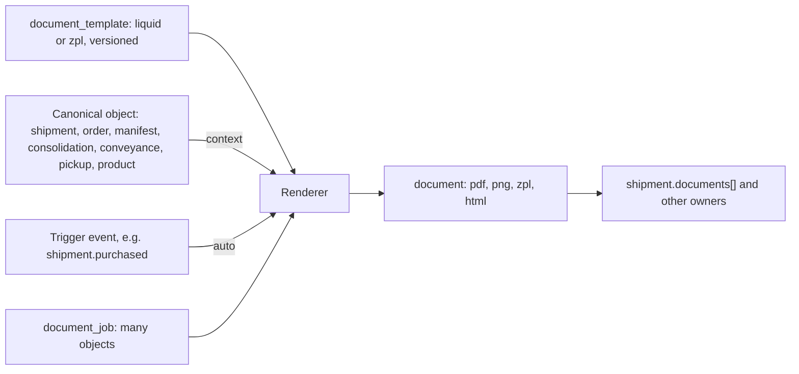
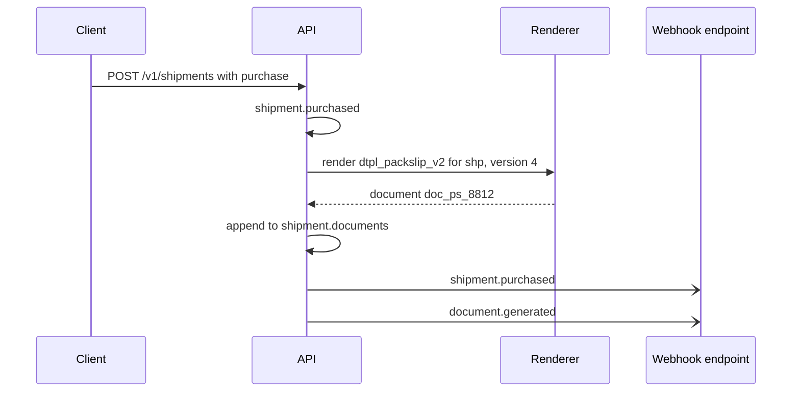

> **API surface.** Generation, ingestion, document reads and document jobs are **REST**. Template and label-spec authoring is **GraphQL Interface**. Shippers read label specs, certify and allocate tracking ranges over REST.

Some carrier labels come from carrier APIs. Everything else is generated by somebody, and often generated by one system and ingested by another: packing slips, commercial invoices, CN23s, pick lists, gaylord and ULD tags, CMR notes, air waybills, delivery receipts. Carrier, Network, 3PL and Fleet implementers also print their **own** shipping labels. This module standardizes how those documents are templated and produced, so a template written against the spec's objects works on any implementer.

It follows Karrio's document templates (a template bound to a related object, rendered on demand) and extends them with versioning, typed contexts, barcode helpers, triggers and batch output.

| Resource | Prefix | Purpose |
|---|---|---|
| `document_template` | `dtpl_` | A versioned template for one document type, bound to one canonical object type |
| `document` | `doc_` | A generated document. It is the same `document` object embedded in shipments and manifests (chapter 01 §10), now also addressable on its own. |
| `document_job` | `djob_` | A batch generation run producing many documents, or one merged file |



## 1. Document template

```json
{
  "id": "dtpl_packslip_v2",
  "object": "document_template",
  "name": "Packing slip, branded",
  "slug": "packing-slip-branded",
  "type": "packing_slip",
  "status": "active",
  "version": 4,
  "related_object": "shipment",
  "engine": "liquid",
  "source": "<html><body><h1>{{ shipment.reference }}</h1><p>{{ item.quantity }} × {{ item.title }}</p>{{ shipment.tracking.number | barcode: 'code128' }}</body></html>",
  "assets": { "logo": "file_logo_ada", "stylesheet": null },
  "page": { "size": "a6", "orientation": "portrait", "margins_mm": 5, "dpi": 300 },
  "formats": ["pdf", "png", "html"],
  "locale": "en-GB",
  "triggers": [ { "event": "shipment.purchased", "conditions": { "returns.is_return": false } } ],
  "attach_to": "related_object",
  "default_for": ["packing_slip"],
  "preview": { "object": "shp_sample_01", "url": "https://..." },
  "user_metadata": {}, "carrier_metadata": {}, "system_metadata": {}
}
```

| Field | Notes |
|---|---|
| `type` | The produced `document.type` (chapter 01 §10): `label`, `return_label`, `packing_slip`, `pick_list`, `commercial_invoice`, `proforma_invoice`, `customs_declaration`, `certificate_of_origin`, `manifest`, `consolidation_label` (gaylord, sack, ULD tag), `bill_of_lading`, `cmr`, `air_waybill`, `delivery_receipt`, `dangerous_goods_declaration`, `custom` |
| `related_object` | The canonical object type the template renders: `shipment`, `order` (a shipment's order), `manifest`, `pickup`, `consolidation`, `conveyance`, `product`, `route_run`, or `none` (data supplied in the request) |
| `engine` | `liquid` (HTML or text output, rendered to PDF or PNG) or `zpl` (thermal labels, ZPL source with Liquid variables). Implementers MAY add engines, but templates using `liquid` and `zpl` are portable. |
| `source` | The template body. The render context is the related object, exactly as `GET` returns it, **with the expansions the template declares** (§2), so a template is written against the spec, not against an implementer. |
| `assets` | `file_` IDs for logos, fonts and stylesheets |
| `page` | Size (`4x6`, `a4`, `a5`, `a6`, `letter`, or `WxH` in inches), orientation, margins and DPI |
| `formats` | The output formats it supports |
| `triggers[]` | Generate automatically when an event fires on the related object and its `conditions` match (§4) |
| `attach_to` | `related_object` (append to its `documents[]`) or `none` (standalone `document`) |
| `default_for` | The document types for which this is the account's default. An account has at most one default per type. |
| `status`, `version` | `draft`, `active`, `retired`. Edits to an active template create a pending version, as in the catalog (chapter 14 §6). |

### Template language (normative for `liquid`)

- Liquid syntax, with the context root named after `related_object` (`shipment`, `manifest`…), plus `account` (profile and settings), `now`, and `locale`.
- **Formatting filters:** `money` (localized minor units: `{{ purchase.amount | money }}`), `weight` and `dimensions` (with an optional unit conversion: `{{ hu.weight | weight: 'lb' }}`), `date` (locale-aware), `address` (multi-line, using the country's postal format).
- **Barcode filters**, which output an inline SVG or image: `barcode: 'code128' | 'gs1_128' | 'ean13' | 'itf14' | 'datamatrix' | 'gs1_datamatrix' | 'qr' | 'pdf417' | 'maxicode'`. `sscc` formats a GS1-128 SSCC with the `(00)` application identifier.
- **Declaring expansions:** `` at the top of the template. Only declared expansions are fetched, so rendering stays bounded and fast.
- **Sandboxed.** No network access, no file access beyond `assets`, and a time and size limit (5 seconds, 10 MB). Templates are data, so implementers MUST render them in isolation.
- Missing fields render as empty, never as an error. `` makes rendering fail with `422 template_data_missing` when the shipment does not carry the data, which suits documents that must be complete, such as customs paperwork.

### ZPL templates

`engine: "zpl"` takes ZPL II source with the same Liquid variables and filters. Barcode filters output native ZPL commands (`^BC`, `^BX`, `^BQ`). Output is ZPL text, or a PNG or PDF rendered from it, at the template's DPI (203 or 300).

## 2. Endpoints for templates

```
mutation createDocumentTemplate                 query documentTemplates (type, related_object, status)
query documentTemplate            mutation updateDocumentTemplate           mutation deleteDocumentTemplate   (draft only)
mutation publishDocumentTemplate    query documentTemplateVersions
mutation previewDocumentTemplate    { object?: "shp_...", data?: {…}, format: "pdf" | "png" | "html", version?: "pending" }  → document (not attached, expires in 1 hour)
mutation validateDocumentTemplate   → { valid, errors: [{ line, message }], unknown_fields: ["shipment.parcels"] }
```

`validate` checks the template's field references against the JSON Schema of `related_object` (from `openapi.yaml`) and flags references to fields that do not exist. Templates written against a previous spec version are caught before they print blanks.

The spec ships a set of **reference templates** (portable Liquid and ZPL) for packing slips, commercial invoices, CN23s, gaylord and ULD tags, and a 4x6 label, which implementers install as defaults with `system_metadata.generated: true`.

## 3. Generating documents

```
POST /v1/documents/generate
```

```json
{ "template": "dtpl_packslip_v2", "object": { "type": "shipment", "id": "shp_1Q2w3E4r5T6y" }, "format": "pdf", "attach": true, "options": { "copies": 1 } }
```

| Param | Notes |
|---|---|
| `template` | A `dtpl_` ID, or `type` alone to use the account's default template for that type |
| `object` | The related object to render. Alternatively, `data` (a JSON object) for `related_object: none` templates, validated against nothing |
| `format` | One of the template's `formats` |
| `attach` | Append the result to the object's `documents[]` (the default follows the template's `attach_to`) |
| `locale` | Overrides the template locale |
| `inline` | Return base64 in `document.data`, as for labels |

The response is a `document`:

```json
{ "id": "doc_ps_8812", "object": "document", "type": "packing_slip", "format": "pdf", "size": "a6", "template": "dtpl_packslip_v2", "template_version": 4, "related": { "type": "shipment", "id": "shp_1Q2w3E4r5T6y" }, "file": "file_ps_8812", "url": "https://...", "url_expires_at": 1791510000, "sha256": "…", "created": 1791506400 }
```

`template_version` and `sha256` make a printed document reproducible and verifiable. With data network replication, the document is also recorded as a signed record (chapter 23 §3).

Other document endpoints: `GET /v1/documents/{id}` (re-signs `url`), `GET /v1/documents?related.id=shp_…&type=…`, `DELETE /v1/documents/{id}` (only standalone documents; attached documents follow their owner's retention).

## 4. Triggers

A template with `triggers[]` renders automatically when a matching event fires:



- Trigger rendering happens before `shipment.purchased` is delivered where possible, so the webhook payload already carries the document. Otherwise `document.generated` follows it.
- A trigger failure never fails the purchase. It emits `document.generation_failed` with the template errors.
- Typical triggers: packing slip on `shipment.purchased`, commercial invoice on `shipment.purchased` when `customs_declaration.paperless_trade` is false, gaylord tag on `consolidation.closed`, delivery receipt on `tracker.delivered`, manifest summary on `manifest.submitted`.

## 5. Batch generation and merged output

```
POST /v1/document_jobs
```

```json
{ "template": "dtpl_packslip_v2", "objects": { "type": "shipment", "ids": ["shp_...", "..."] }, "format": "pdf", "output": "merged", "sort": "handover.close_group" }
```

- `objects` takes `ids` (up to 5000), or `query` (a search query from chapter 10 §3, such as every purchased shipment in close group `dock-a` today).
- `output` is `merged` (one file, in `sort` order, which suits a print run) or `individual` (one document per object, attached if `attach` is true).
- A `document_job` has `status` (`processing`, `completed`, `completed_with_errors`), `counts`, `result_file` (the merged file) and `errors[]`. It emits `document_job.completed`.
- Labels can be merged the same way: `{ "type": "label", "output": "merged" }` merges the carrier labels already on the shipments, without re-rendering them. This is the end-of-day "print all labels" operation.

## 6. Carrier label templates and certification

Many carriers (postal operators, regional parcel networks, and LTL carriers' bills of lading) do not return labels from an API. They publish a **label specification**, and shippers must print compliant labels themselves. Others want every platform to render their label identically. In Carrier and Network modes, the carrier publishes both the template and the machine-checkable rules.

```json
{
  "id": "lspec_zoom_v3",
  "object": "label_spec",
  "owner": "acct_zoomvan",
  "carrier": "net_zoomvan",
  "template": "dtpl_zoom_label_4x6",
  "services": ["net_zoomvan_next_day", "net_zoomvan_same_day"],
  "sizes": ["4x6"],
  "dpi": [203, 300],
  "required_fields": ["ship_to.name", "ship_to.address.postal_code", "tracking.number", "handover.close_group", "purchase.service.code"],
  "barcodes": [
    { "role": "tracking", "symbology": "code128", "payload": "{{ tracking.number }}", "min_module_width_mm": 0.33, "quiet_zone_mm": 6.35 },
    { "role": "routing", "symbology": "gs1_datamatrix", "payload_schema": "https://zoomvan.example/schemas/routing-2d-v3.json", "min_size_mm": 20 }
  ],
  "zones": [ { "name": "routing", "x_mm": 5, "y_mm": 5, "w_mm": 92, "h_mm": 30, "required": true } ],
  "tracking_numbers": { "format": "^ZV[0-9]{12}$", "allocation": "range", "check_digit": "mod10" },
  "certification": { "required": true, "samples": 5 },
  "version": 3,
  "status": "active"
}
```

- `template` is a normal `document_template` (`type: "label"`) owned by the carrier. Its services reference it in the catalog: `service.label.template` (chapter 14 §1).
- `tracking_numbers` declares how shipper-side generation gets tracking numbers. `range` means ranges allocated through `POST /v1/label_specs/{id}/tracking_ranges` with `{ count }`. `api` means numbers are fetched per shipment.
- **Offline label generation.** When a shipment's service has a label spec, a universal implementer renders the label from the carrier's template, using a number from the allocated range. No carrier call is made at purchase. Shipment data reaches the carrier later, through the manifest (chapter 05), which is how most postal and regional networks work.
- **Certification.** `POST /v1/label_specs/{id}/certify` with `{ "samples": ["doc_…"] }` (rendered labels, or photos of printed ones) checks required fields, barcode decodability and payload schema, zone placement and quiet zones. It returns `{ result: "pass" | "fail", findings: [...] }`. A carrier with `certification.required: true` rejects live shipments from accounts that have not passed (`422 carrier_error` / `label_not_certified`).
- Carriers author specs over GraphQL (`createLabelSpec`, `updateLabelSpec`, `publishLabelSpec`). Shippers use REST: `GET /v1/label_specs`, `GET /v1/label_specs/{id}`, `POST /v1/label_specs/{id}/certify` and `POST /v1/label_specs/{id}/tracking_ranges`.

The same pattern covers every regulated or carrier-defined document: a carrier's **bill of lading** (VICS BOL for LTL), **CMR**, **air waybill** (IATA layout), **CN22/CN23** (UPU layout), and **commercial invoice**. Each is a template plus, where a counterparty must accept it, a spec that can be certified.

## 7. Document ingestion

Systems also receive documents they did not create: a supplier's commercial invoice PDF, a forwarder's bill of lading, a carrier invoice, a scanned proof of delivery, a customs release notice, a certificate of origin. Ingestion turns them into structured data on the right objects.

```
POST /v1/documents/ingest
```

```json
{ "file": "file_bol_scan_771", "type": "bill_of_lading", "attach_to": { "type": "shipment", "id": "shp_1Q2w3E4r5T6y" }, "apply": "review" }
```

```json
{
  "id": "ding_2Rr5",
  "object": "document_ingestion",
  "status": "needs_review",
  "type": "bill_of_lading",
  "detected_type": "bill_of_lading",
  "format": "pdf_scanned",
  "file": "file_bol_scan_771",
  "extraction": {
    "fields": {
      "bol_number": { "value": "MAEU123456789", "confidence": 0.99 },
      "shipper.company": { "value": "Fábrica Têxtil Lda", "confidence": 0.97 },
      "consignee.company": { "value": "Ada Shop Inc.", "confidence": 0.96 },
      "port_of_loading": { "value": "PTLIS", "confidence": 0.93 },
      "containers[0].container_number": { "value": "MSKU1234565", "confidence": 0.98, "check_digit_valid": true },
      "containers[0].seal_number": { "value": "SEAL-00918", "confidence": 0.81 }
    },
    "mapped": [ { "target": "consolidation.identifiers.container_number", "value": "MSKU1234565" }, { "target": "consolidation.seal.number", "value": "SEAL-00918" } ]
  },
  "attach_to": { "type": "shipment", "id": "shp_1Q2w3E4r5T6y" },
  "document": "doc_bol_771",
  "job": "job_ding_41"
}
```

| Field | Notes |
|---|---|
| `type` | A hint, or `auto`. Detected from content otherwise. All document types in chapter 01 §10 are supported, plus `customs_release` and `delivery_note`. |
| `format` | `pdf_text`, `pdf_scanned`, `image`, `edi_x12`, `edifact`, `ubl`, `xml`, `json` |
| `status` | `processing`, `needs_review` (low-confidence fields, or `apply: "review"`), `applied`, `rejected`, `failed` |
| `extraction.fields` | Every extracted field with its `confidence`, plus validations where a standard defines them (ISO 6346 check digits, IATA AWB check digit, GS1 check digits, HS code validity) |
| `extraction.mapped` | The changes that applying would make to spec objects |
| `apply` | `auto` (apply mapped fields whose confidence is above the implementer's threshold), `review` (wait for `POST /v1/document_ingestions/{id}/apply` with optional corrections), or `none` (extract only) |

- Structured formats (EDI, UBL, XML, JSON) are parsed deterministically and never need review. Carrier invoices in those formats go straight to invoice import (chapter 28 §1).
- The original file is always kept as a `document` attached to the target object, so the extraction can be audited against its source. With data network replication, it is also recorded as a signed record.
- **Never auto-apply to legal records.** Fields of a customs declaration on a purchased shipment are never changed by ingestion. Mismatches are reported in `messages[]` as `document_mismatch`, for a person to resolve.

Endpoints: `POST /v1/documents/ingest`, `GET /v1/document_ingestions`, `GET /v1/document_ingestions/{id}`, `POST /v1/document_ingestions/{id}/apply` with `{ corrections?: { field: value } }`, `POST /v1/document_ingestions/{id}/reject`. Batch ingestion runs as a job (chapter 27, `type: "documents.ingest"`).

## 8. Events

`document_template.created`, `document_template.published`, `document_template.retired`, `document.generated`, `document.generation_failed`, `document_job.completed`, `label_spec.published`, `label_spec.certification_passed`, `label_spec.certification_failed`, `document_ingestion.needs_review`, `document_ingestion.applied`, `document_ingestion.failed`.
