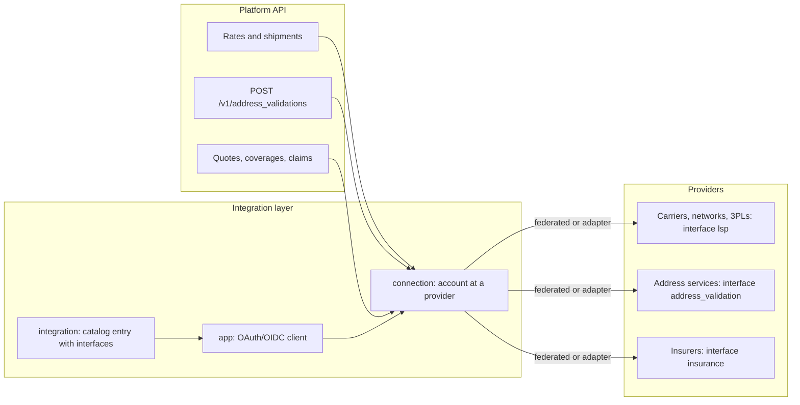
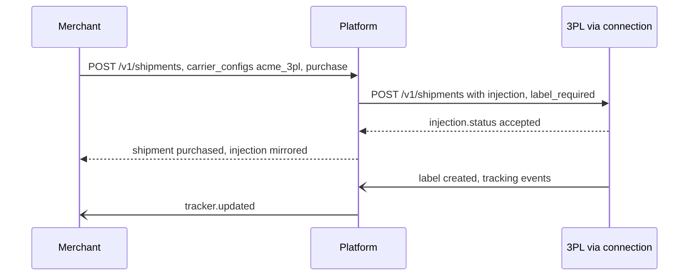

A platform integrates many kinds of providers, not only carriers. It may use an address validation service, a parcel insurer, or a 3PL it sends orders to. Before this chapter, the spec handled only carriers generically (chapter 09). This chapter lifts that machinery into a reusable layer: **every provider is an integration, connected through the same app and connection objects, and spoken to through a typed interface.**

| Interface | Provider examples | Platform API that uses it | Provider contract |
|---|---|---|---|
| `lsp` | Carriers, networks, fleets, 3PLs | Rates, shipments, tracking, pickups, manifests (chapters 02–07), and injection into 3PLs (chapter 18) | This spec's own `core` endpoints, plus `injection` for 3PLs |
| `address_validation` | Postal address databases, geocoders, carrier address APIs | `POST /v1/address_validations`, and `validate_addresses: true` everywhere | `POST /v1/address_validations` |
| `insurance` | Parcel insurers, insurtechs, carrier declared-value programs | Quotes, coverages and claims (§5) |
| `payments` | Stripe, Adyen, PayPal, acquirers for card networks, bank rails (ACH, SEPA) | Payment methods, payments, refunds, payouts (chapter 28 §6) | Hosted setup, charge, refund and payout operations, plus webhooks into the connection's inbound receiver | `POST /v1/insurance_quotes`, `POST /v1/coverages`, `POST /v1/claims` |

The interfaces are open-ended. `trade` (classification and landed cost providers, chapter 13) and `notifications` (recipient messaging) follow the same pattern, and future interfaces register in the same catalog.

**Every interface is a subset of this spec.** A provider that implements an interface's endpoints, and publishes `/.well-known/shipping-configuration` listing it in `interfaces`, can be connected **federated**: no adapter code, the same discovery, OAuth and dynamic registration as federated carriers (chapter 09 §6). Providers with proprietary APIs are reached through implementer-maintained adapters behind the same objects.



## 1. Integration catalog

The `integration` object generalizes the `carrier` object (chapter 09 §1). Carriers are integrations whose `interfaces` include `lsp`, and `GET /v1/carriers` remains as the filtered view `GET /v1/integrations?interface=lsp`.

```json
{
  "id": "addrcheck",
  "object": "integration",
  "name": "AddrCheck",
  "kind": "address_validation",
  "interfaces": {
    "address_validation": { "countries": ["US", "CA", "GB", "DE", "FR"], "features": ["deliverability", "residential", "geocode", "components", "suggestions"], "batch": true }
  },
  "connection_methods": [ { "type": "oauth", "issuer": "https://auth.addrcheck.example", "openid": true, "app": { "required": true, "dynamic_registration": true } }, { "type": "credentials", "credentials_schema": { "...": "JSON Schema" } } ],
  "config_schema": { "...": "JSON Schema" },
  "federated": { "configuration": "https://api.addrcheck.example/.well-known/shipping-configuration" },
  "pricing": { "model": "per_request", "documentation": "https://addrcheck.example/pricing" },
  "status": "available"
}
```

| Field | Notes |
|---|---|
| `kind` | The primary category: `carrier`, `network`, `3pl`, `fleet`, `address_validation`, `insurance`, `trade`, `notifications` |
| `interfaces` | A map from interface name to that interface's capability descriptor. An integration may implement several. A carrier, for example, may offer `lsp` and `address_validation`. |
| `connection_methods` | As for carriers: `oauth` (through an `app`) or `credentials`, with schemas for dynamic forms |
| `federated` | Present when the provider implements the spec. The implementer synchronizes the descriptor from the provider's configuration document. |

Endpoints: `GET /v1/integrations?interface=…&kind=…&country=…`, `GET /v1/integrations/{id}`, and `createIntegration` (GraphQL Interface mutation) with `{ "federated": { "configuration": "https://…" } }` to onboard a federated provider of any interface.

## 2. Apps and connections, generalized

- **`app`** (chapter 09 §4) is the generic OAuth 2.1 + OIDC **client wrapper** for any integration. `app.carrier` becomes `app.integration`, and `app.interfaces` lists the interfaces it may be used for. Dynamic client registration, secret rotation, platform visibility and the connect-session flow are unchanged.
- **`connection`** (chapter 09 §3) gains `integration` and `interfaces`. For carriers, `carrier` remains as an alias of `integration`. A connection with several interfaces (a carrier that also validates addresses) is one account at one provider, not two connections.
- **Defaults per interface.** `account.settings.default_connections` is `{ "address_validation": "conn_addr1", "insurance": "conn_ins1" }`. Any API that needs an interface and is not given a connection uses the default.
- **Connect sessions** work for any integration: `POST /v1/connect_sessions` with `{ "integration": "addrcheck" }`.

```json
{ "id": "conn_addr1", "object": "connection", "integration": "addrcheck", "interfaces": ["address_validation"], "method": "oauth", "status": "active", "config": { "default_country": "US" }, "...": "Connection" }
```

## 3. Interface `lsp`: carriers and 3PLs

The `lsp` interface is the core of this spec. Connections to carriers, networks and fleets behave as described in chapters 02–07 and 09.

**3PL connections.** A connection whose integration has `kind: "3pl"`, and whose `interfaces.lsp` descriptor has `injection: true`, makes the platform an **injecting party** to that 3PL (chapter 18):

- Purchasing a shipment with `carrier_configs: { "acme_3pl": { "service": "acme_3pl_ground" } }` sends it to the 3PL as an injected shipment, with `label_mode: "label_required"` or `"pre_labeled"` per the connection config. The platform's shipment mirrors the 3PL's `injection.status` and tracking.
- `POST /v1/asns` through the connection (`Shipping-Connection: conn_3pl` header) announces inbound freight to the 3PL's facility.
- The 3PL's receiving outcomes, discrepancies and tracking return through webhooks or federated inbound events.



## 4. Interface `address_validation`

### Platform API

```
POST /v1/address_validations
```

```json
{ "address": { "line1": "1 Infinite Lp", "city": "Cupertino", "state": "CA", "postal_code": "95014", "country": "US" }, "contact": null, "connection": null, "features": ["deliverability", "residential", "geocode"] }
```

```json
{
  "id": "av_3Ww8",
  "object": "address_validation",
  "status": "corrected",
  "deliverability": "deliverable",
  "input": { "...": "Address" },
  "suggested": { "line1": "Infinite Loop", "street_number": "1", "city": "Cupertino", "state": "CA", "postal_code": "95014-2083", "country": "US", "residential": false },
  "alternatives": [],
  "components": { "street_number": "1", "street_name": "Infinite", "street_type": "Loop", "unit": null, "postal_code": "95014", "postal_code_suffix": "2083", "delivery_point": "01" },
  "residential": false,
  "geocode": { "latitude": 37.3318, "longitude": -122.0312, "accuracy": "rooftop" },
  "changes": ["line1", "postal_code"],
  "connection": "conn_addr1",
  "messages": [],
  "carrier_metadata": { "dpv_match_code": "Y" }
}
```

| Field | Notes |
|---|---|
| `status` | `verified` (unchanged and confirmed), `corrected` (`suggested` differs from the input), `ambiguous` (several `alternatives`), `unverified` (no data for this address or country), `invalid` |
| `deliverability` | `deliverable`, `deliverable_missing_unit`, `undeliverable`, `unknown` |
| `components` | The parsed parts. `street_number` feeds `Address.street_number` (chapter 01 §1). |
| `geocode.accuracy` | `rooftop`, `parcel`, `interpolated`, `postal_code`, `city` |

- `validate_addresses: true` on rates, shipments and pickups calls this interface through the default connection, and stores the result in `address.validation` (chapter 01 §1).
- Batches go through a job: `POST /v1/jobs` with `type: "address_validation.batch"` (chapter 27).
- **Privacy.** Validation requests send only the address, plus contact data when a feature needs it. Results are retained for 30 days unless they are attached to a shipment.

## 5. Interface `insurance`

Parcel coverage from third-party insurers, alongside the carrier's own declared value (the standardized `insurance` feature, chapter 01 §6.1). A shipment uses one or the other: buying a coverage removes a carrier `insurance` option from the purchase, with a warning in `messages[]`.

### Quotes

```
POST /v1/insurance_quotes
```

```json
{ "shipment": "shp_1Q2w3E4r5T6y", "insured_value": { "amount": 25000, "currency": "usd" }, "coverage_types": ["loss", "damage"], "connections": null }
```

```json
{
  "object": "list",
  "data": [
    { "id": "iq_6Xx1", "object": "insurance_quote", "connection": "conn_ins1", "provider": "parcelguard", "premium": { "amount": 225, "currency": "usd" }, "insured_value": { "amount": 25000, "currency": "usd" }, "deductible": { "amount": 0, "currency": "usd" }, "coverage_types": ["loss", "damage"], "exclusions": ["perishables", "cash"], "terms_url": "https://...", "expires_at": 1791510000 }
  ],
  "errors": []
}
```

Quotes fan out across insurance connections, with partial failures in `errors[]`, the same model as rates.

### Coverages

```
POST /v1/coverages                { quote: "iq_6Xx1" }  or  { shipment, connection, insured_value }   (Idempotency-Key required, spends money)
GET  /v1/coverages  ·  GET /v1/coverages/{id}
POST /v1/coverages/{id}/cancel    (before first carrier scan, refund per provider terms)
```

```json
{ "id": "cov_2Yy4", "object": "coverage", "status": "active", "shipment": "shp_1Q2w3E4r5T6y", "connection": "conn_ins1", "policy_number": "PG-2026-00918", "insured_value": { "amount": 25000, "currency": "usd" }, "premium": { "amount": 225, "currency": "usd" }, "coverage_types": ["loss", "damage"], "period": { "starts": "first_scan", "ends": "delivered_plus_days", "days": 7 }, "certificate": "doc_cert_771", "claims": [] }
```

- `status` is `pending`, `active`, `expired`, `cancelled`, or `claimed`.
- The shipment records it in `purchase.coverage`, and the certificate is appended to `shipment.documents[]` with `type: "insurance_certificate"`.
- Coverage can be bought in the same call as the label: `purchase: { rate, coverage: { quote: "iq_…" } }`.

### Claims

```
POST /v1/claims       { coverage, type: "loss" | "damage" | "delay" | "shortage", amount, description, evidence: ["file_…", "rec_…"] }
GET  /v1/claims  ·  GET /v1/claims/{id}  ·  POST /v1/claims/{id}  (add evidence)  ·  POST /v1/claims/{id}/withdraw
```

- `status` is `submitted`, `under_review`, `information_requested`, `approved`, `denied`, `paid`, or `withdrawn`. `resolution` holds `{ amount, paid_at, reason }`.
- Evidence can cite data network records and attestations (chapter 23): signed scans, condition excursions, the consignee's damage attestation. Insurers verify custody without asking anyone for screenshots.

## 6. Building a provider

To offer an interface to every implementer of the spec, a provider:

1. Implements that interface's endpoints exactly as specified (the OpenAPI operations tagged with the interface).
2. Publishes `/.well-known/shipping-configuration` with `"interfaces": { "<name>": <descriptor> }`.
3. Runs OAuth 2.1 + OIDC with dynamic client registration (chapter 00 §3.2).
4. Passes the interface's conformance suite (chapter 11 §4).

## 7. Events

`integration.created`, `integration.updated`, `address_validation.completed`, `insurance_quote.created`, `coverage.created`, `coverage.activated`, `coverage.cancelled`, `coverage.expired`, `claim.submitted`, `claim.updated`, `claim.approved`, `claim.denied`, `claim.paid`.
