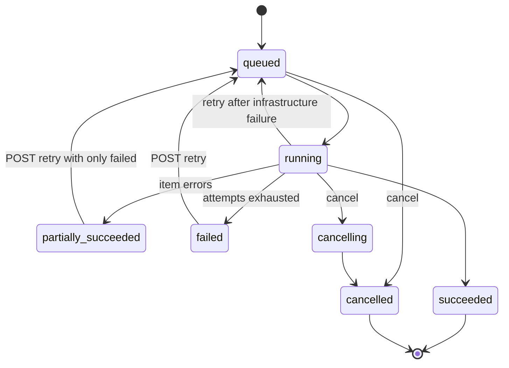

> **API surface.** Jobs are **REST** (integrators monitor and retry their own work). Job schedules are **GraphQL Interface**.

Logistics runs on background work: nightly product syncs, end-of-day closes, 5,000-label print runs, route optimizations, tracking refreshes, dataset exports. Before this chapter, each of those had its own async object with its own status vocabulary. This interface gives them **one envelope**: every asynchronous operation is a `job`. Clients, dashboards and agents monitor, cancel and retry all of them the same way, and recurring work is declared once as a `job_schedule`.

Existing async objects keep their shape and gain a `job` field linking to their envelope:

| Async operation | Domain object | `job.type` |
|---|---|---|
| Bulk create, void, cancel, upsert | `batch` (chapter 10 §7) | `batch.shipments.create`, `batch.products.upsert`… |
| Document print runs | `document_job` (chapter 25 §5) | `documents.generate` |
| Route optimization | `optimization` (chapter 17 §3) | `fleet.optimize` |
| Large classifications | `classification` (chapter 13 §2) | `trade.classify` |
| Exports, datasets | `file` (chapter 10 §8, chapter 23 §5) | `export`, `data.dataset` |
| Imports | `rate_sheet`, `product` imports | `pricing.import`, `products.import` |
| Address batch validation | `address_validation`s (chapter 26 §4) | `address_validation.batch` |
| End-of-day close | `manifest` (chapter 05 §7) | `manifests.end_of_day` |
| Pickup schedule booking | `pickup` (chapter 04 §7) | `pickups.schedule_occurrence` |
| Route run generation | `route_run` (chapter 16 §2) | `routes.generate_runs` |
| Tracker refresh sweep | `tracker` (chapter 07) | `tracking.refresh` |
| Data network anchoring | `anchor` (chapter 23 §3) | `data.anchor` |

## 1. The `job` object

```json
{
  "id": "job_8Zz3",
  "object": "job",
  "type": "documents.generate",
  "status": "running",
  "source": "api",
  "schedule": null,
  "subject": { "type": "document_job", "id": "djob_44" },
  "parameters": { "template": "dtpl_packslip_v2", "objects": { "type": "shipment", "query": "handover.close_group:\"dock-a\" AND status:\"purchased\"" } },
  "progress": { "total": 4210, "completed": 2930, "failed": 3, "percent": 69.6, "eta_seconds": 41, "stage": "rendering" },
  "attempt": 1,
  "max_attempts": 3,
  "priority": "normal",
  "queued_at": 1791520000,
  "started_at": 1791520004,
  "finished_at": null,
  "result": null,
  "errors": [ { "item": "shp_9Aa1", "code": "template_data_missing", "message": "shipment.customs_declaration is required" } ],
  "created_by": { "type": "membership", "id": "mbr_7Kk2" },
  "user_metadata": {}, "carrier_metadata": {}, "system_metadata": { "source": "api", "request_id": "req_J0b1" }
}
```

| Field | Notes |
|---|---|
| `type` | A dotted name from the registry above. It is open, and implementers may add `x_`-prefixed types. |
| `status` | `queued`, `running`, `succeeded`, `partially_succeeded` (finished with item-level `errors[]`), `failed`, `cancelling`, `cancelled` |
| `source` | `api` (a client started it), `schedule` (a `job_schedule` started it), or `system` (the implementer's own automation, such as end-of-day or tracker sweeps). System jobs are visible, so operators can see why something happened at 17:30. |
| `subject` | The domain object the job produces or operates on |
| `progress` | Monotonic counts. `stage` is a free-form phase label. `eta_seconds` is best-effort. |
| `attempt`, `max_attempts` | Whole-job retries after infrastructure failures. Item-level failures do not retry the job. |
| `priority` | `low`, `normal`, `high`. Implementers MAY schedule by priority within an account's concurrency limits. |
| `result` | On completion: `{ file?, objects?: { type, ids[] }, summary? }` |
| `errors[]` | Item-level errors, capped at 1000. The full list is in `result.error_file` (JSONL) when larger. |



## 2. Endpoints

```
POST   /v1/jobs                         { type, parameters, priority?, idempotency via Idempotency-Key }
GET    /v1/jobs                         filters: type (prefix match, e.g. documents.*), status, source, schedule, subject.type, created[gte]
GET    /v1/jobs/{id}
POST   /v1/jobs/{id}/cancel             cooperative: items already processed stay processed
POST   /v1/jobs/{id}/retry              { only_failed?: true }  → a new attempt of the same job
GET    /v1/jobs/{id}/logs?after=…       structured log lines: { at, level, message, item? }
GET    /v1/jobs/{id}/stream             Server-Sent Events: progress and log lines until the job finishes
```

- `POST /v1/jobs` is the generic way to start any registered job type. The domain-specific endpoints (`POST /v1/batches`, `POST /v1/document_jobs`, `createOptimization` (GraphQL Interface mutation)) remain, and return their domain object with `job` set.
- **Concurrency.** Each account has published concurrency limits per job type. Excess jobs stay `queued`, and `GET /v1/jobs?status=queued` shows the position in `progress.stage`.
- **Idempotency.** `Idempotency-Key` on `POST /v1/jobs` follows chapter 00 §8. Items inside a job derive their own keys (`{job_id}:{index}`), so a retried job never duplicates side effects such as labels.

## 3. Job schedules

Recurring work is declared once:

```json
{
  "id": "jsch_nightly_sync",
  "object": "job_schedule",
  "status": "active",
  "type": "products.import",
  "parameters": { "connection": "conn_shopify", "mode": "incremental" },
  "recurrence": { "frequency": "daily", "times": ["02:00"], "timezone": "Europe/London" },
  "overlap": "skip",
  "next_run_at": 1791600000,
  "last_job": "job_7Aa2",
  "last_status": "succeeded",
  "user_metadata": {}, "carrier_metadata": {}, "system_metadata": {}
}
```

- `recurrence` is the shared `Recurrence` (chapter 01 §13).
- `overlap` is `skip` (do not start while the previous run is still running), `queue`, or `cancel_previous`.
- **System schedules are visible.** The implementer's own recurring work for the account (connection `end_of_day` closes, pickup schedule bookings, route run generation, tracker sweeps) appears as read-only `job_schedule`s with `system_metadata.source: "system"`. A support team can read one list to answer "what runs automatically on this account?".

```
mutation createJobSchedule  ·  query jobSchedules  ·  query jobSchedule  ·  mutation updateJobSchedule
mutation pauseJobSchedule  ·  /resume  ·  /run_now  ·  mutation deleteJobSchedule
```

## 4. Events

`job.queued`, `job.started`, `job.progressed` (at most every 10 seconds, opt-in by subscribing explicitly), `job.succeeded`, `job.partially_succeeded`, `job.failed`, `job.cancelled`, `job_schedule.created`, `job_schedule.paused`, `job_schedule.resumed`, `job_schedule.run_skipped`.

Domain events still fire as before (`batch.completed`, `document_job.completed`, `optimization.completed`). `job.*` events are the generic layer for dashboards and agents that watch everything.
