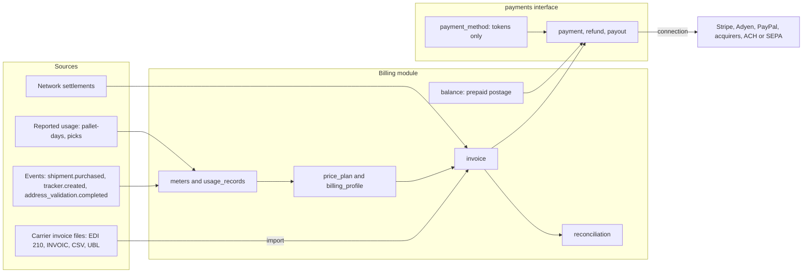
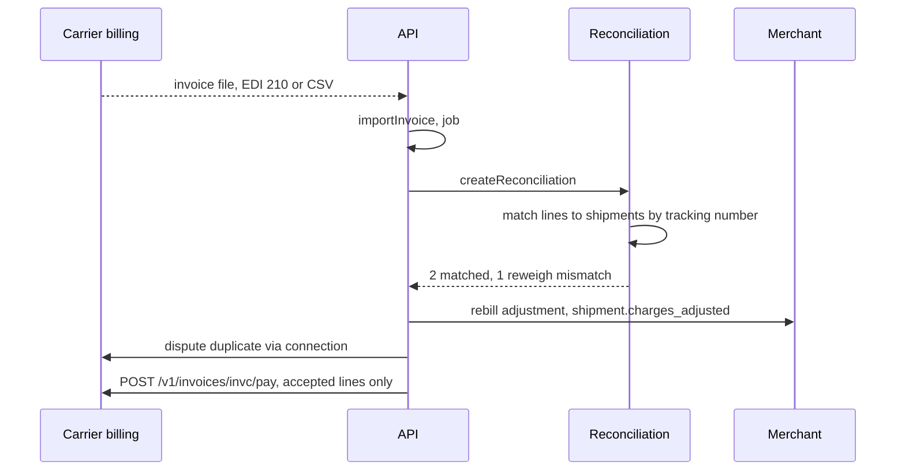
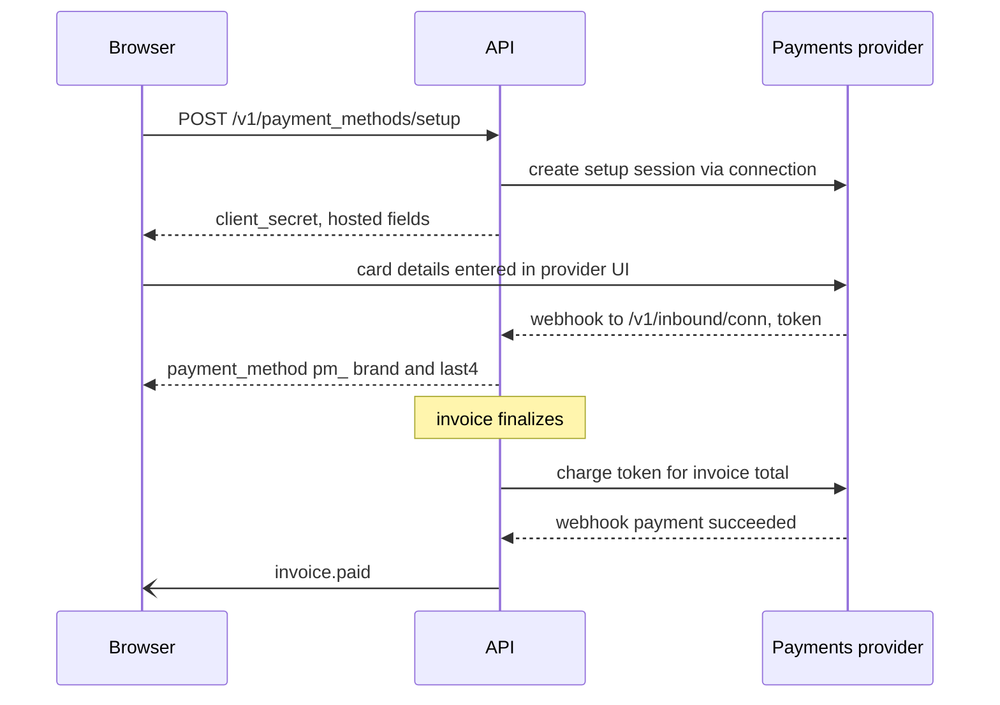

> **API surface.** Invoices (read, pay, dispute, export), payment methods, payments, balances and usage reporting are **REST**. Invoice authoring and import, reconciliation, meters, price plans, billing profiles, refunds and payouts are **GraphQL Interface**.

Money moves in three directions in logistics, and most systems tangle them together:

| Flow | From → to | Example | Spec objects |
|---|---|---|---|
| **Transport billing** | Carrier or LSP → its customer | UPS bills a merchant weekly for labels, reweighs and surcharges. A network bills a 3PL that injected parcels. | `invoice` (`kind: transport`), import, export, `reconciliation` |
| **Usage billing** | Platform → its accounts | A multi-carrier platform charges per label, per tracker and per address validation. A 3PL charges pallet-days and pick fees. | `meter`, `usage_record`, `price_plan`, `billing_profile`, `invoice` (`kind: usage`) |
| **Settlement** | Network → members, members → network | Composed journeys split revenue between members (chapter 21 §5) | `ledger_entry`, `settlement` → `invoice` |

All three end in the same place: an **invoice** that is paid through a **payment provider**. The spec defines invoices, usage and reconciliation as its own objects, and reaches Stripe, Adyen, PayPal, card networks (through acquirers) and bank rails (ACH, SEPA, Faster Payments) through a `payments` **interface** (chapter 26). Swapping providers changes a connection, not a data model.



## 1. Invoice

One object for every invoice, whichever direction it flows.

```json
{
  "id": "invc_7Ff2",
  "object": "invoice",
  "kind": "transport",
  "direction": "payable",
  "status": "open",
  "issuer": { "account": null, "integration": "ups", "connection": "conn_ups01", "name": "UPS", "tax_ids": [{ "type": "ein", "value": "58-2480149" }] },
  "recipient": { "account": "acct_ada", "name": "Ada Shop Inc." },
  "number": "000000A1B2C3416",
  "issued_on": "2026-10-11",
  "due_on": "2026-10-25",
  "period": { "from": "2026-10-04", "to": "2026-10-10" },
  "currency": "usd",
  "lines": [
    { "id": "il_1", "kind": "transport", "shipment": "shp_1Q2w3E4r5T6y", "tracking_number": "1Z999AA10123456784", "service": "ups_ground", "description": "Ground, zone 5", "billed_weight": { "value": 3, "unit": "lb" }, "zone": "5", "amount": { "amount": 1145, "currency": "usd" }, "external_ref": "L0001" },
    { "id": "il_2", "kind": "surcharge", "shipment": "shp_1Q2w3E4r5T6y", "charge_kind": "fuel_surcharge", "amount": { "amount": 172, "currency": "usd" } },
    { "id": "il_3", "kind": "adjustment", "shipment": "shp_9Ij8", "tracking_number": "1Z999AA10123456791", "reason": "dimensional_reweigh", "declared": { "weight": { "value": 2, "unit": "lb" } }, "audited": { "weight": { "value": 6, "unit": "lb" }, "dimensions": { "length": 16, "width": 12, "height": 10, "unit": "in" } }, "amount": { "amount": 486, "currency": "usd" } },
    { "id": "il_4", "kind": "fee", "description": "Address correction", "shipment": "shp_5Zz3", "amount": { "amount": 2300, "currency": "usd" } }
  ],
  "totals": { "subtotal": { "amount": 4103, "currency": "usd" }, "tax": { "amount": 0, "currency": "usd" }, "total": { "amount": 4103, "currency": "usd" }, "paid": { "amount": 0, "currency": "usd" }, "due": { "amount": 4103, "currency": "usd" } },
  "reconciliation": { "id": "rcn_4Gg1", "status": "completed", "matched": 2, "mismatched": 1, "unknown": 0, "disputed_amount": { "amount": 486, "currency": "usd" } },
  "source": { "type": "import", "format": "carrier_csv", "file": "file_inv_ups_1011", "job": "job_imp_88" },
  "documents": [ { "id": "doc_inv_pdf", "type": "invoice", "format": "pdf", "url": "https://..." } ],
  "payments": [],
  "external_ids": [ { "source": "ups_billing_center", "id": "000000A1B2C3416" } ],
  "user_metadata": {}, "carrier_metadata": {}, "system_metadata": {}
}
```

| Field | Notes |
|---|---|
| `kind` | `transport` (carrier or LSP charges for moving goods), `usage` (platform fees from meters, §4), `settlement` (from a network settlement, chapter 21 §5), `duties` (from duty collections, chapter 13 §6), `subscription`, `credit_note` |
| `direction` | Relative to the account viewing it: `payable` (it owes) or `receivable` (it is owed). The same invoice is `receivable` for its issuer and `payable` for its recipient. |
| `status` | `draft`, `open`, `partially_paid`, `paid`, `overdue`, `disputed`, `void`, `uncollectible` |
| `issuer`, `recipient` | An account in this implementer, or an external integration or connection (a carrier that bills outside the platform) |
| `lines[].kind` | `transport`, `surcharge`, `adjustment` (with `reason`: `dimensional_reweigh`, `weight_correction`, `address_correction`, `residential_reclassification`, `service_change`, `undeliverable_return`), `fee`, `duty`, `tax`, `usage`, `subscription`, `credit` |
| `lines[].shipment` | The resolved shipment. Unresolved lines keep `tracking_number` and `external_ref` until reconciliation matches them. |
| `source` | `issued` (created here), `import` (with format and file), `settlement`, or `usage_cycle` |

Endpoints:

```
mutation createInvoice                         create a draft (receivable): kind, recipient, lines
GET    /v1/invoices  ·  GET /v1/invoices/{id}  ·  mutation updateInvoice   (draft lines, due_on, user_metadata)
mutation finalizeInvoice            draft → open, number assigned, document rendered (chapter 25)
mutation sendInvoice                deliver to the recipient (email, webhook, federated inbox)
mutation voidInvoice                mutation markUncollectibleInvoice
POST   /v1/invoices/{id}/pay                 { payment_method?, amount? }   → payment (§6), Idempotency-Key required
POST   /v1/invoices/{id}/dispute             { lines: ["il_3"], reason, evidence: ["rec_…", "file_…"] }
mutation importInvoice                   { file, format, connection? }   → job (chapter 27) → invoice(s)
GET    /v1/invoices/{id}/export?format=…
```

### Import and export formats

| `format` | Standard | Typical use |
|---|---|---|
| `edi_210` | ANSI X12 210, Motor Carrier Freight Details and Invoice | US LTL and parcel carrier invoices |
| `edifact_invoic` | UN/EDIFACT INVOIC | European carriers and forwarders |
| `ubl` | OASIS UBL 2.1, Peppol BIS Billing 3.0, EN 16931 | E-invoicing mandates (EU, Australia, Singapore) and 3PL and network invoices |
| `carrier_csv` | The carrier's published invoice CSV, mapped by the integration's `invoice_mapping` | UPS, FedEx, DHL billing-center downloads |
| `json` | This spec's `invoice` object | Federated implementers (lossless) |
| `csv` | Spec CSV template (`invoice_lines_v1`) | Spreadsheet round-trips |

**Injection billing.** A receiving network (3PL, carrier, network) bills each injecting partner (chapter 18 §6) with a `transport` invoice whose lines reference the injected shipments by `injection.upstream_reference`. It exports in `ubl` or `json`. The partner imports it, and lines are matched to its own shipments by upstream reference, so both sides reconcile the same identifiers.

## 2. Reconciliation

Carrier invoices rarely match what was quoted. Reconciliation matches every line against the platform's own records and classifies the differences.

```
mutation createReconciliation        { invoice, rules?: "rset_default" }   → reconciliation (async, job-backed)
query reconciliation   (lines are included, filter client-side by result)
mutation resolveReconciliation   { action: "accept" | "dispute" | "rebill" | "write_off", note? }
```

```json
{
  "id": "rcn_4Gg1",
  "object": "reconciliation",
  "type": "invoice_vs_shipments",
  "invoice": "invc_7Ff2",
  "status": "completed",
  "summary": { "lines": 4, "matched": 2, "amount_mismatch": 1, "unknown_shipment": 0, "voided_but_billed": 0, "duplicate": 0, "not_billed": 1, "variance": { "amount": 486, "currency": "usd" } },
  "lines": [
    { "invoice_line": "il_3", "shipment": "shp_9Ij8", "result": "amount_mismatch", "expected": { "amount": 0, "currency": "usd" }, "billed": { "amount": 486, "currency": "usd" }, "cause": "dimensional_reweigh", "evidence": ["rec_bafy…dims"], "suggested_action": "rebill", "resolution": null }
  ]
}
```

| `result` | Meaning | Default action |
|---|---|---|
| `matched` | Equal to `purchase.amount` (plus accepted adjustments), within tolerance | `accept` |
| `amount_mismatch` | Differs. `cause` is inferred from the line and the shipment: reweigh, surcharge not quoted, service change, address correction | By rule: `rebill` within policy, otherwise `dispute` |
| `unknown_shipment` | The tracking number is not found | `dispute` |
| `voided_but_billed` | The shipment's `purchase.void.status` is `succeeded` | `dispute`, with the void record as evidence |
| `duplicate` | Same tracking number and charge billed twice | `dispute` |
| `not_billed` | Purchased in the period but absent from the invoice. It is informational, because it may appear on a later invoice. | none |

- **Rules** (`reconciliation_rule_set`, `rset_`) set tolerances (`{ absolute: 50, percent: 0.02 }`), per-cause actions, and rebill policy (`rebill_to: "merchant"`, with `markup` or `at_cost`).
- `rebill` appends a `Charge` with `kind: "adjustment"` to the shipment's `purchase.charges` (`shipment.charges_adjusted` fires), and adds a usage or adjustment line to the merchant's next invoice. This is how platforms pass carrier reweighs through without spreadsheets.
- `dispute` files the dispute through the carrier connection when the integration supports `lsp.billing_disputes`, and otherwise records it for manual filing. Evidence can cite data network records: dimension scans from devices, the void confirmation, delivery attestations.
- `type: "usage_vs_invoice"` reconciles a **platform's usage** (§4) against an LSP's invoice. Labels the platform purchased for an account are matched against what the carrier billed that account, so both sides agree on volume.



## 3. Billing profiles

```json
{
  "object": "billing_profile",
  "account": "acct_ada",
  "currency": "usd",
  "cycle": { "interval": "month", "anchor_day": 1 },
  "plans": ["plan_growth"],
  "payment_methods": { "default": "pm_card_4242", "fallback": "pm_ach_001" },
  "collection": "charge_automatically",
  "balance": { "enabled": true, "auto_top_up": { "below": { "amount": 5000, "currency": "usd" }, "amount": { "amount": 25000, "currency": "usd" } } },
  "invoice_delivery": { "email": "ap@adashop.example", "formats": ["pdf", "ubl"] },
  "tax": { "ids": [{ "type": "ein", "value": "12-3456789" }], "exempt": false },
  "payments_connection": "conn_stripe_platform"
}
```

`billingProfile` (GraphQL Interface query) and `updateBillingProfile` (GraphQL Interface mutation) act on the current account. Platforms manage children's profiles with `Shipping-Account`.

- `collection` is `charge_automatically` (charge the default payment method when the invoice finalizes) or `send_invoice` (the account pays by `due_on`).
- `payments_connection` chooses which payments provider collects for this account (§6).

## 4. Usage metering and price plans

### Meters

```json
{ "id": "mtr_labels", "object": "meter", "key": "labels.purchased", "name": "Labels purchased", "source": { "event": "shipment.purchased" }, "aggregation": "count", "value_path": null, "filters": { "purchase.service.carrier": { "not_in": ["network"] } }, "unit": "label", "status": "active" }
```

- `source` is `{ event }` (an event type, chapter 08 §2) or `{ reported: true }` (usage reported through the API).
- `aggregation` is `count`, `sum` (of `value_path`, e.g. `purchase.amount.amount` for value-based fees, or `quantity`), `max` (peak storage), or `unique` (distinct `value_path` values, such as active trackers).
- **Built-in meters:** `storage.pallet_days`, `fulfillment.picks` and the other inventory meters (chapter 29 §7), `labels.purchased`, `labels.voided`, `rates.requested`, `trackers.active`, `address_validations.completed`, `documents.generated`, `device_events.ingested`, `records.stored`, `coverages.premium`. Platforms add their own.

### Usage records

```json
{ "id": "ur_9Hh3", "object": "usage_record", "meter": "mtr_pallet_days", "account": "acct_ada", "quantity": 14, "occurred_at": "2026-10-06T23:59:00Z", "subject": { "type": "facility", "id": "fac_lon_hub" }, "properties": { "sku": "TS-RED-M" }, "source": "reported" }
```

```
POST /v1/usage_records                  { meter, account?, quantity, occurred_at, subject?, properties? }   (Idempotency-Key required)
POST /v1/usage_records/import           { file, format: "csv" | "jsonl" }   → job
GET  /v1/usage_records?meter=…&account=…&occurred_at[gte]=…
GET  /v1/usage_summaries?account=…&period=2026-10   → per-meter totals, priced amounts, plan allowances used
GET  /v1/usage_summaries/export?format=csv|jsonl
```

Event-sourced records are created automatically, and they carry the event's ID, so voids and refunds net out correctly (`labels.voided` can be a negative-priced meter).

### Price plans

```json
{
  "id": "plan_growth",
  "object": "price_plan",
  "name": "Growth",
  "currency": "usd",
  "base_fee": { "amount": 4900, "currency": "usd", "interval": "month" },
  "prices": [
    { "meter": "mtr_labels", "model": "graduated", "tiers": [ { "up_to": 500, "unit_amount": 0 }, { "up_to": 5000, "unit_amount": 5 }, { "up_to": null, "unit_amount": 3 } ] },
    { "meter": "mtr_trackers", "model": "per_unit", "unit_amount": 1, "included": 1000 },
    { "meter": "mtr_pallet_days", "model": "per_unit", "unit_amount": 45 },
    { "meter": "mtr_coverage_premium", "model": "percentage", "rate": 0.1 }
  ],
  "minimum": { "amount": 9900, "currency": "usd", "interval": "month" },
  "status": "active"
}
```

`model` is `per_unit`, `graduated` (each tier priced separately), `volume` (the reached tier prices every unit), `package` (`{ size, amount }`), or `percentage` (of a summed money meter). Unit amounts are in the currency's minor units and may be fractional (`0.5` cents per tracker) for high-volume meters, rounded at invoice time.

At the end of each `billing_profile.cycle`, the implementer runs a `billing.cycle` job (chapter 27) that aggregates usage, applies plans, and finalizes a `usage` invoice per account. Platforms preview the upcoming invoice with `GET /v1/invoices/upcoming`.

## 5. Prepaid balances

Many carriers and platforms run on prepaid postage: labels are debited from a balance that is topped up by card or bank transfer.

```json
{ "object": "balance", "account": "acct_ada", "available": { "amount": 18420, "currency": "usd" }, "pending": { "amount": 2100, "currency": "usd" }, "low_balance_threshold": { "amount": 5000, "currency": "usd" } }
```

```
GET  /v1/balance                    GET /v1/balance_transactions?type=…
POST /v1/balance/top_up             { amount, payment_method? }   → payment (Idempotency-Key required)
```

`balance_transaction` (`btx_`) types are `top_up`, `label_charge`, `label_refund` (on a successful void), `adjustment` (rebilled reweighs), `coverage_premium`, `fee`, and `payout`. A purchase that would take the available balance below zero fails with `402 billing_error` / `insufficient_balance`, unless `auto_top_up` succeeds first.

## 6. Payments interface

`payments` is an integration interface (chapter 26). Providers include Stripe, Adyen, PayPal, Checkout.com, and bank rails. Card networks such as Visa and Mastercard are reached through an acquirer or processor, never directly.

| Object | Prefix | Holds |
|---|---|---|
| `payment_method` | `pm_` | A **provider token** plus display data (`brand`, `last4`, `exp_month`, `exp_year`, `bank_name`, `type`: `card`, `us_bank_account`, `sepa_debit`, `wallet`, `invoice_terms`). Never a card number. |
| `payment` | `pay_` | An attempt to collect an amount for an invoice or a top-up: `status` is `requires_action`, `processing`, `succeeded`, `failed`, `refunded`, or `partially_refunded` |
| `refund` | `rf_` | A full or partial reversal of a payment |
| `payout` | `po_` | Money sent to an account (network members receiving settlement, chapter 21 §5), through the provider's connected-account or bank-transfer rails |

```
POST /v1/payment_methods/setup        { connection? }  → { client_secret, provider, hosted_url }   (collect details in the provider's own UI)
GET  /v1/payment_methods  ·  GET /v1/payment_methods/{id}  ·  DELETE /v1/payment_methods/{id}
GET  /v1/payments  ·  GET /v1/payments/{id}  ·  mutation refundPayment { amount? }
query payouts  ·  query payout
```

**Decoupling rules (normative):**

1. Card and bank details are collected only in the provider's own hosted fields or pages (Stripe Elements, Adyen Drop-in, and similar), using the `setup` response. Spec implementers MUST NOT receive, store or transmit primary account numbers. This keeps implementers outside PCI DSS cardholder-data scope.
2. Domain objects (`invoice`, `usage_record`, `balance`, `settlement`) never reference provider objects directly. Only `payment`, `payment_method`, `refund` and `payout` carry provider references, in `carrier_metadata` (the namespace for any external provider's data).
3. Provider webhooks enter through the inbound receiver of the payments connection (`POST /v1/inbound/{connection_id}`, chapter 08 §6), and update `payment` status. Domain events (`invoice.paid`) follow from that.
4. Bank statement reconciliation accepts ISO 20022 `camt.053` statements (`POST /v1/payments/reconcile_statement { file }`), matching remittances to invoices for `send_invoice` collection.
5. Switching provider means adding a connection and re-collecting payment methods through the new provider's setup. Invoices, usage, balances and history are unchanged.



## 7. Events

`invoice.created`, `invoice.finalized`, `invoice.sent`, `invoice.paid`, `invoice.partially_paid`, `invoice.overdue`, `invoice.disputed`, `invoice.voided`, `invoice.imported`, `reconciliation.completed`, `reconciliation.line_resolved`, `usage_record.created`, `billing.cycle_completed`, `balance.low`, `balance.topped_up`, `payment_method.attached`, `payment.succeeded`, `payment.failed`, `payment.requires_action`, `refund.created`, `payout.paid`, `payout.failed`.
