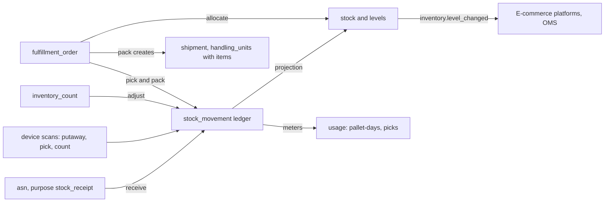
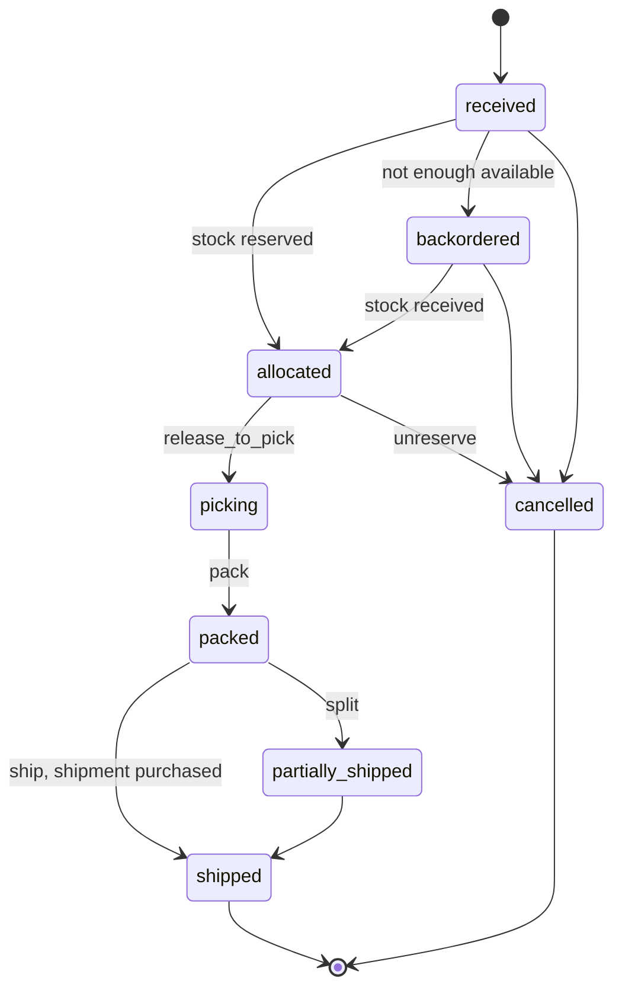

> **API surface.** Stock levels and fulfillment orders (create, read, update, cancel) are **REST**, for OMSs and platforms. Warehouse execution (allocation, picking, packing, shipping, waves, counts, storage locations and manual movements) is **GraphQL Interface**.

A 3PL, a merchant's own warehouse or a carrier's fulfillment arm all answer the same questions: *what do we hold, where, in what condition, for whom*, and *how does an order become a shipment*. This module answers them with the same discipline as tracking (chapter 07): an **append-only ledger of movements** is the truth, and **stock levels are a projection** over it.

It reuses `product` (chapter 20) for what is stored, `facility` (chapter 16 §1) for where, `asn` (chapter 18 §4) for inbound receipts, `device_event` (chapter 22) for scans, `shipment` (chapter 03) for what leaves, and `meter` (chapter 28 §4) for storage and handling fees.

| Resource | Prefix | Purpose |
|---|---|---|
| `storage_location` | `loc_` | A place inside a facility that holds stock: zone, aisle, rack, shelf, bin |
| `stock` | `stk_` | A quantity of one product, at one location, in one lot and status, for one owner |
| `stock_movement` | `mov_` | One append-only change to stock: receive, put away, move, pick, adjust, ship, return |
| `fulfillment_order` | `fo_` | A request to ship stock to a customer, from allocation through pick and pack to shipment |
| `inventory_count` | `cnt_` | A cycle count or full count, reconciling counted against expected |

The module is `inventory`. It is required in 3PL mode, and optional in Universal (a merchant's own warehouses), Carrier and Network (warehousing services) modes.



## 1. Storage locations

```json
{
  "id": "loc_lon_a12_03_b",
  "object": "storage_location",
  "facility": "fac_lon_fc1",
  "code": "A12-03-B",
  "path": { "zone": "A", "aisle": "12", "rack": "03", "shelf": "B", "bin": null },
  "type": "pick_face",
  "temperature_class": "ambient",
  "capacity": { "volume": { "value": 0.48, "unit": "m3" }, "weight": { "value": 150, "unit": "kg" }, "units": null, "pallets": null },
  "restrictions": { "hazmat_classes": [], "owners": null, "max_sku_count": 1 },
  "status": "active",
  "barcode": "LOC-A12-03-B",
  "pick_sequence": 1203
}
```

| Field | Notes |
|---|---|
| `type` | `pick_face`, `reserve`, `bulk`, `pallet_rack`, `shelving`, `cold`, `frozen`, `hazmat`, `bonded`, `quarantine`, `returns`, `staging`, `dock` |
| `temperature_class` | `ambient`, `chilled` (2–8 °C), `frozen`, `controlled_room_temperature` |
| `restrictions.owners` | Limits the location to certain owner accounts. This supports dedicated space in a multi-client 3PL. |
| `pick_sequence` | The order pickers walk locations in, used to sequence pick lists |

GraphQL: `storageLocations`, `storageLocation`, `createStorageLocation`, `updateStorageLocation`, `deleteStorageLocation`, `importStorageLocation` (CSV of a facility layout, run as a job). Delete is refused while stock is present.

## 2. Stock

```json
{
  "id": "stk_88a1",
  "object": "stock",
  "owner": "acct_ada",
  "product": "prod_ts_red_m",
  "facility": "fac_lon_fc1",
  "location": "loc_lon_a12_03_b",
  "status": "available",
  "quantity": 142,
  "lot": { "number": "L2026-09-14", "manufactured_on": "2026-09-14", "expires_on": null },
  "serials": null,
  "handling_unit": null,
  "updated": 1791520000
}
```

| Field | Notes |
|---|---|
| `owner` | The account that owns the goods. A 3PL holds stock for many owners, and every query is scoped by it. |
| `status` | `available`, `reserved` (allocated to a fulfillment order, not yet picked), `picked`, `damaged`, `quarantine` (quality hold, recall, customs bond), `expired`, `in_transit` (between facilities) |
| `lot` | For lot-tracked products: batch number, manufacture and expiry dates. Allocation can follow FEFO (first expiry, first out). |
| `serials` | For serial-tracked products, the list of serial numbers. `quantity` then equals the list length. |
| `handling_unit` | When stock sits as a whole pallet or case with its own SSCC, the link to it |

`stock` rows are **read-only projections**. They change only through movements (§3).

### Stock levels

```
GET /v1/inventory/levels?product=prod_ts_red_m&facility=fac_lon_fc1
```

```json
{ "object": "inventory_level", "owner": "acct_ada", "product": "prod_ts_red_m", "facility": "fac_lon_fc1", "on_hand": 160, "available": 142, "reserved": 12, "picked": 2, "damaged": 3, "quarantine": 1, "inbound": 240, "in_transit_out": 0, "as_of": 1791520000 }
```

`available` is what can be promised. `inbound` counts open stock-receipt ASNs. Omit `facility` to aggregate across the network, or `group_by=facility` for one row per facility. Low-stock thresholds per product and facility (`thresholdsInventory` (GraphQL Interface mutation)) emit `inventory.level_low`.

## 3. Stock movements (the ledger)

```json
{
  "id": "mov_5Kk8",
  "object": "stock_movement",
  "type": "pick",
  "owner": "acct_ada",
  "product": "prod_ts_red_m",
  "quantity": 2,
  "from": { "location": "loc_lon_a12_03_b", "status": "reserved" },
  "to": { "location": "loc_lon_pack_01", "status": "picked" },
  "lot": "L2026-09-14",
  "serials": null,
  "reason": null,
  "reference": { "fulfillment_order": "fo_1Mm4", "asn": null, "count": null },
  "source": "device",
  "device_event": "d-90812",
  "performed_by": { "type": "membership", "id": "mbr_picker_17" },
  "occurred_at": "2026-10-07T09:14:02+01:00"
}
```

| `type` | From → to | Created by |
|---|---|---|
| `receive` | (outside) → `dock`/`staging`, `available` or `quarantine` | ASN receive scans (chapter 18 §4) with `purpose: stock_receipt` |
| `putaway` | staging → storage location | Device scan `action: putaway`, or `createStockMovement` (GraphQL Interface mutation) |
| `move` | location → location (replenishment, consolidation) | Device scan or API |
| `reserve`, `unreserve` | `available` ↔ `reserved` | Fulfillment-order allocation (§4) |
| `pick` | location (`reserved`) → pack station (`picked`) | Device scan `action: pick` |
| `ship` | pack station → (outside) | Shipment purchase from a fulfillment order |
| `adjust` | ± quantity, with a `reason` (`count_variance`, `damaged`, `lost`, `found`, `expired`, `quality_hold`) | Counts (§5) or API |
| `status_change` | e.g. `available` → `damaged`, or `quarantine` → `available` | API, quality release, customs release |
| `return` | (outside) → `returns` location | Return shipment receipt (chapter 03 §6) |
| `transfer_out`, `transfer_in` | Facility to facility, with `in_transit` between | Transfer orders, implemented as a fulfillment order to another facility |

Rules:

- Movements are **append-only**. A mistake is corrected by a compensating movement, never by editing or deleting.
- Every movement is idempotent on `(source, device_event)` or on `Idempotency-Key`, so retried scans never double-count.
- `createStockMovement` (GraphQL Interface mutation) records manual movements (`putaway`, `move`, `adjust`, `status_change`). It returns `409 insufficient_stock` when the `from` side lacks quantity.
- `stockMovements` (GraphQL Interface query) is the audit trail. With data network replication, movements become signed records (chapter 23).

## 4. Fulfillment orders

```json
{
  "id": "fo_1Mm4",
  "object": "fulfillment_order",
  "owner": "acct_ada",
  "status": "picking",
  "channel": { "source": "shopify", "order_id": "1001", "upstream_reference": "gid://shopify/Order/5512" },
  "order": { "id": "1001", "shipping_charge": { "amount": 995, "currency": "usd" }, "...": "Order" },
  "ship_to": { "...": "Contact" },
  "lines": [ { "product": "prod_ts_red_m", "quantity": 2, "allocated": 2, "picked": 2, "packed": 0, "lot_policy": "fefo" } ],
  "facility": "fac_lon_fc1",
  "allocation": { "strategy": "single_facility_nearest", "split_allowed": false, "decided_at": 1791519000 },
  "shipping": { "carrier_configs": { "royal_mail": { "service": "royal_mail_tracked_48" } }, "rate_shop": { "levels": ["standard"], "pick": "cheapest" }, "promise": { "deliver_by": "2026-10-10" } },
  "packing": { "packaging": "auto", "inserts": ["dtpl_packslip_v2"], "gift_message": null },
  "tasks": [ { "type": "pick", "location": "loc_lon_a12_03_b", "product": "prod_ts_red_m", "quantity": 2, "status": "done", "wave": "wave_0907_a" } ],
  "shipments": [],
  "documents": [],
  "user_metadata": {}, "carrier_metadata": {}, "system_metadata": {}
}
```

| `status` | Meaning |
|---|---|
| `received` | Accepted, not yet allocated |
| `allocated` | Stock reserved at one or more facilities. `reserve` movements were written. |
| `backordered` | Not enough available stock. It allocates automatically when stock arrives, unless `cancel_unfulfillable` is set. |
| `picking` | Pick tasks issued, usually grouped into waves |
| `packed` | Handling units built with their items, ready for labeling |
| `shipped` | Shipment(s) purchased and handed over. `ship` movements were written. |
| `partially_shipped` | Split across shipments or facilities, with some remaining |
| `cancelled` | Cancelled before shipping. Reservations are released with `unreserve` movements. |

```
POST /v1/fulfillment_orders                    create (Idempotency-Key required); upsert by channel.upstream_reference
GET  /v1/fulfillment_orders  ·  GET /v1/fulfillment_orders/{id}  ·  POST /v1/fulfillment_orders/{id}   (ship_to, shipping, until picking)
mutation allocateFulfillmentOrder      mutation releaseToPickFulfillmentOrder
mutation packFulfillmentOrder          { handling_units: [{ packaging, weight, dimensions, items: [{ product, quantity, lot?, serials? }] }] }
mutation shipFulfillmentOrder          { purchase: { rate? , label_format } }  → shipment(s), Idempotency-Key required
POST /v1/fulfillment_orders/{id}/cancel        { reason }
mutation createWave                                 { facility, fulfillment_orders | query, strategy: "zone" | "batch" | "single_order" }  → wave with pick tasks and pick list document
```

- **Allocation strategies:** `single_facility_nearest`, `single_facility_cheapest` (rates each candidate facility), `split_minimize_shipments`, and `fixed` (a named facility). Lots follow `lot_policy`: `fefo`, `fifo`, or `specific`.
- **Packing to shipping:** `pack` writes the handling units. `ship` creates the shipment with those handling units, whose items reference the products, rates or uses `shipping.carrier_configs`, and buys it. The label, the packing slip (from `packing.inserts`) and the invoice land in `documents[]`. This one path connects inventory to every carrier in the spec.
- **Pick lists** are documents rendered from a template (`type: "pick_list"`, chapter 25), sorted by `pick_sequence`.



## 5. Counts

```
mutation createInventoryCount           { facility, scope: { locations? | products? | zone? }, type: "cycle" | "full" | "spot", blind: true }
mutation linesInventoryCount    { counts: [{ location, product, lot?, counted }] }   (repeatable; device scans with action "count" also add lines)
mutation completeInventoryCount → variances; with approve: true, writes adjust movements (reason count_variance)
query inventoryCounts  ·  query inventoryCount
```

With `blind: true`, counters do not see expected quantities. `complete` returns per-line `expected`, `counted`, `variance` and `value_variance` (variance × `product.unit_value`). Implementers MAY require approval above a variance threshold.

## 6. Sync with sales channels

- `inventory.level_changed` fires when `available` changes for a product and facility, coalesced to at most once per minute per product.
- `GET /v1/inventory/levels?updated[gte]=…` supports incremental pulls for platforms that poll.
- A connection to a sales channel (an integration with `kind: "ecommerce_platform"`, chapter 26) with `sync: { inventory: "push" }` pushes `available` (minus an optional safety buffer) to the channel. A job schedule (chapter 27) runs a full reconciliation nightly.

## 7. Billing hooks

The inventory module feeds built-in meters (chapter 28 §4): `storage.pallet_days`, `storage.cubic_meter_days`, `storage.bin_days` (computed daily from stock by location type), `fulfillment.orders`, `fulfillment.picks`, `fulfillment.units_packed`, `receiving.units`, and `returns.processed`. 3PLs price them in a `price_plan` per owner account.

## 8. Events

`storage_location.created`, `stock_movement.created`, `inventory.level_changed`, `inventory.level_low`, `fulfillment_order.created`, `.allocated`, `.backordered`, `.picking`, `.packed`, `.shipped`, `.cancelled`, `wave.released`, `inventory_count.completed`.
