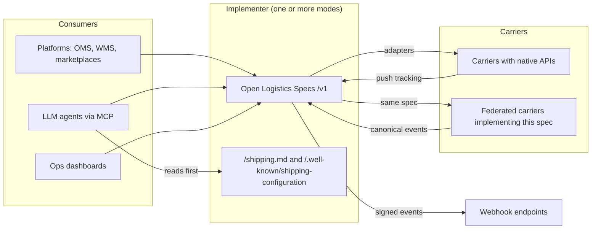
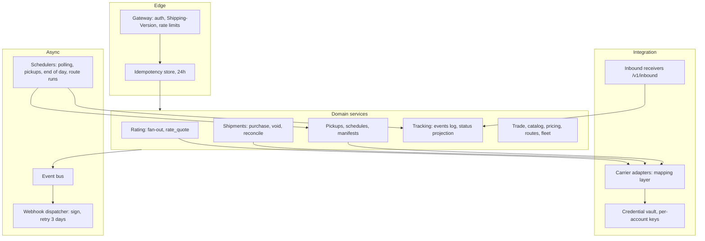
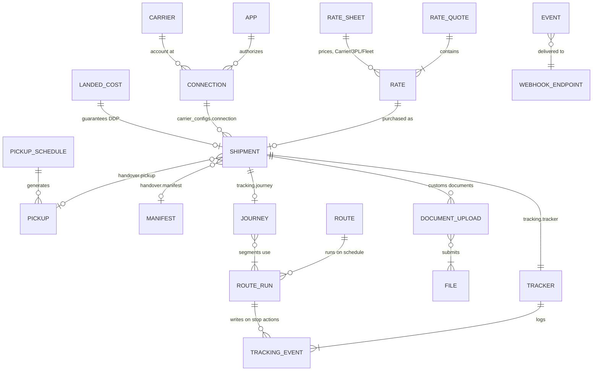
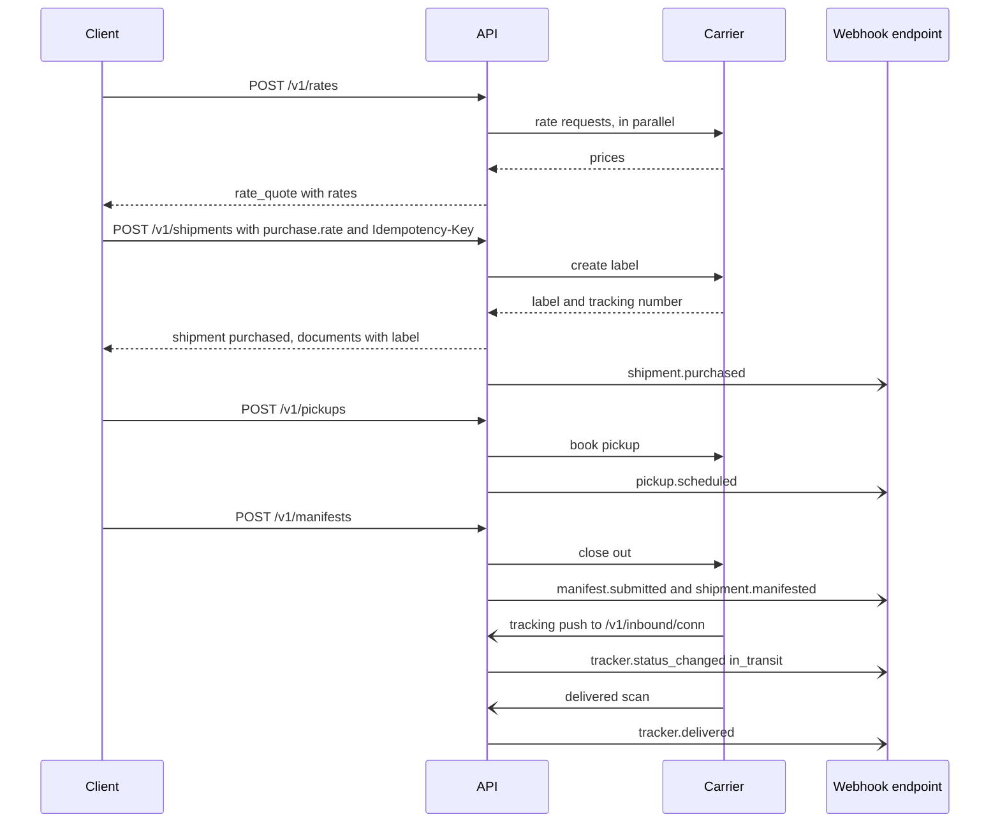
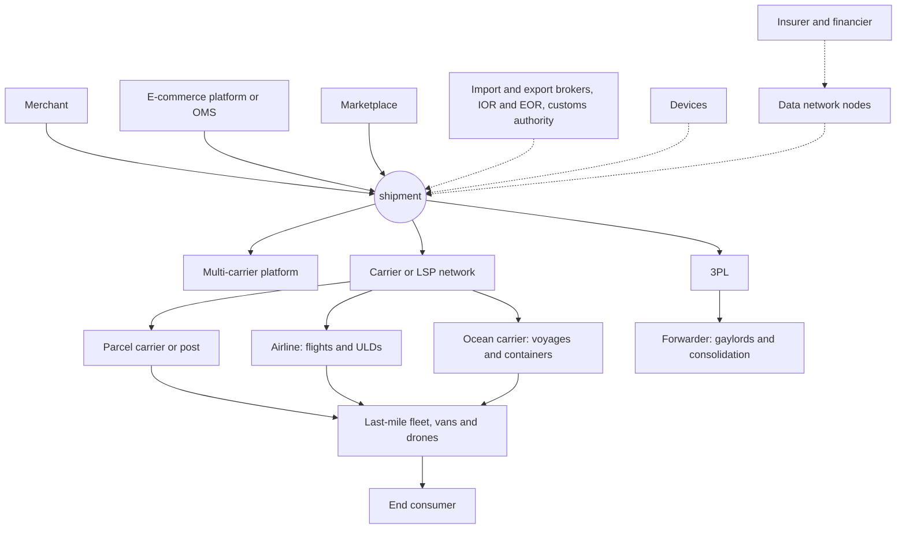

This page is the map. Each chapter covers one module in depth. This page shows how they fit together.

## 1. System context

Who talks to whom. Platforms and agents speak one API. Implementers speak to carriers in whatever form those carriers require: native APIs, push webhooks, or this same spec when the carrier is federated.

## 2. Reference architecture of an implementer

The spec does not mandate internals. This is the shape that keeps the guarantees cheap to provide: idempotency, partial rating failure, purchase reconciliation, lossless tracking, and signed at-least-once events.

What each boundary protects:

| Boundary | Guarantee it makes cheap |
|---|---|
| Idempotency store in front of domain services | A retried purchase returns the first response instead of buying a second label (chapter 00 §8) |
| Carrier adapters as the only mapping layer | Carrier disagreement is quarantined in one place. Domain services see canonical objects only (chapters 01 §6, 07). |
| Credential vault outside the domain | Secrets stay write-only and encrypted per account (chapter 00 §15) |
| Event bus between domain and dispatcher | Writes never wait on webhook receivers, and delivery is retried independently (chapter 08 §4) |
| Schedulers as first-class components | Pickup schedules, end-of-day close, tracker polling and route-run generation behave identically whether a human or a clock triggers them |

## 3. Object model

The resources and how they reference each other. Value objects (Contact, HandlingUnit, Item, Order, CustomsDeclaration) are embedded, and are covered in chapter 01.

Plans and executions are separate objects throughout (rationale D25):

| Plan | Execution |
|---|---|
| `pickup_schedule` | `pickup` |
| `route` | `route_run` |
| `rate_sheet` | `rate` |
| catalog `service` | `rate.service`, `shipment.purchase.service` |

## 4. A shipment's life, end to end

Rate, buy, hand over, close the day, move, deliver, with every webhook along the way.

## 5. Industry map

The spec models the logistics industry as **parties** that **own objects** and **perform operations** on them through **modes**. This table is the index. Every row is a party a shipment can involve.

| Party | Role in a shipment | Mode it implements, or interfaces it uses | Objects it writes | Key operations | What the standard gives it |
|---|---|---|---|---|---|
| Merchant / shipper | Sells goods, creates shipments | Client of any mode | `shipment`, `order`, `product`, `pickup_schedule` | Rate, buy, void, pick up, close day | One integration for every carrier, network and 3PL |
| E-commerce platform / OMS | Acts for many merchants | Client with `platform` (token exchange, `Shipping-Account`) | `shipment` (injection), `product` (sync) | Upsert products, inject orders, embed rating | Ship for every merchant without per-carrier code |
| Marketplace | Sells for many sellers, often controls fulfilment | Client, or Network operator | `shipment`, `injection`, `pricing_rule` | Inject orders, set delivery promises | Promise dates computed from real journeys |
| Multi-carrier platform | Brokers access to carriers | **Universal** | `connection`, `app`, `rate_quote` | Fan out, normalize, federate | Federated carriers with no adapter code |
| Parcel carrier | Moves parcels on its network | **Carrier** | `service`, `rate_sheet`, `route`, `tracking_event` | Publish catalog, price, scan, deliver | Distribution through every platform at once |
| Postal operator | Universal service, international mail | **Carrier** (+ UPU mapping) | `consolidation` (sacks), `conveyance` | Receptacles, dispatches, customs pre-advice | UPU EDI and the e-commerce API as one model |
| Airline cargo | Line-haul by air | **Carrier** + **Fleet** | `conveyance` (flights), `consolidation` (ULDs), `air_waybill` documents | Book capacity, build ULDs, fly | ONE Record alignment, interline in networks |
| Ocean carrier | Line-haul by sea | **Carrier** + **Fleet** | `conveyance` (voyages), `consolidation` (containers) | Book, load, sail, discharge | DCSA alignment, door-to-door visibility |
| Freight forwarder / consolidator | Buys line-haul, consolidates | **3PL** + **Network member** | `consolidation`, `injection`, `customs_declaration` | Consolidate, inject, broker | Own the journey across modes and partners |
| 3PL / fulfilment | Stores, picks, ships for merchants | **3PL** | `asn`, `injection`, `product`, `document` | Receive, label, ship, subcontract | Inbound from any platform, outbound to any carrier |
| Carrier / LSP network | Market for many carriers | **Network** | `interline_agreement`, `ledger_entry`, `settlement` | Compose journeys, hand off, settle | Reach beyond any single member |
| Last-mile fleet | Final delivery | **Fleet** | `route_run`, `vehicle`, `driver`, POD | Optimize, dispatch, deliver | Tracking from operations, no extra integration |
| Drone operator | Autonomous delivery | **Fleet** | `vehicle` (drone), `route_run` | Dispatch within an operating area | Same API as vans |
| Import customs broker | Files the import entry and pays duties for the importer | Participant with `trade`, `customs_declaration.import_broker` | `classification`, `landed_cost`, `duty_collection`, release attestations | Classify, screen, file entry, clear | Complete, structured data before arrival |
| Export broker / filing agent | Files export declarations (AES/EEI, EU export system) | `customs_declaration.export_broker` | `export_declaration` (ITN, MRN), attestations | Screen, file, obtain ITN or MRN before loading | Export filing from the same item data as the import |
| IOR / EOR service provider | Acts as importer or exporter of record for sellers with no local entity | `customs_declaration.importer_of_record` / `exporter_of_record` | Contacts with tax IDs, `landed_cost` guarantees | Take legal responsibility, remit duties and VAT | Cross-border selling without a foreign entity |
| Customs authority | Regulates the border | Data network participant (read) | Attestations (release, hold) | Receive pre-arrival data, release | Verifiable, tamper-evident filings |
| Insurer / financier | Covers loss, finances goods | Data network participant via grants | Attestations (claims) | Verify custody and condition | Claims settled on signed evidence |
| IoT and device vendor | Captures physical events | `iot` devices | `device_event` | Scan, sense, locate | One ingestion interface for every customer |
| End consumer | Receives goods | Pairwise participant, tracking page | Attestations (receipt) | Track, collect, confirm, return | Privacy by default, one timeline |
| Data node | Keeps the shared record | **Data Network** | `record`, `anchor` | Store, anchor, release keys | Neutral infrastructure for the whole network |

## 6. Where to read next

| If you are | Read |
|---|---|
| Building a client or an agent | [shipping.md](/shipping), then [Conventions](/spec/00-conventions), [Rates](/spec/02-rates), [Shipments](/spec/03-shipments), [Tracking](/spec/07-tracking), [Webhooks](/spec/08-webhooks) |
| Implementing a universal API | The above, then [Connections](/spec/09-connections) and [Conformance](/spec/11-conformance) |
| A carrier, 3PL or fleet | [Modes](/spec/12-modes), then [Catalog](/spec/14-catalog), [Pricing](/spec/15-pricing), [Routes](/spec/16-routes), and [Trade](/spec/13-trade) or [Fleet](/spec/17-fleet) |
| A network operator | [Networks](/spec/21-network), [Injection](/spec/18-injection), [Merchants & Identity](/spec/19-accounts) |
| Moving consolidated freight (air, ocean, postal) | [Consolidation](/spec/24-consolidation), [IoT](/spec/22-iot), [Standards mapping](/spec/B-standards) |
| Building shared data infrastructure | [Data Network](/spec/23-data-network) |
